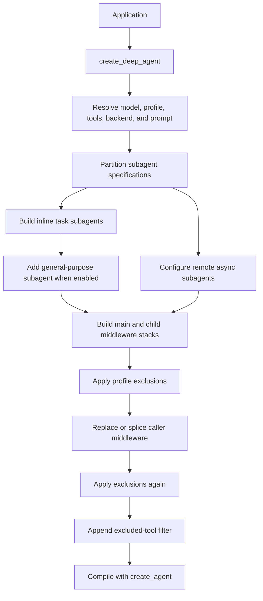
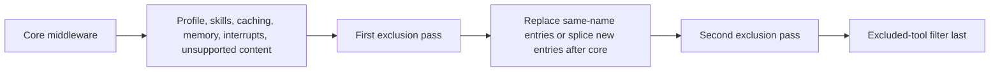
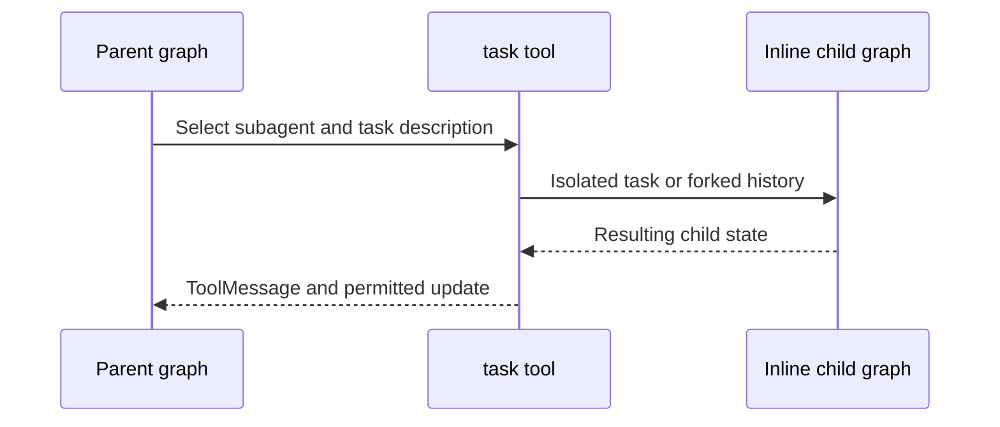
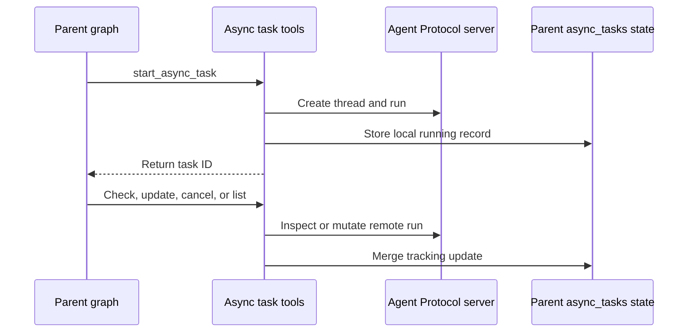
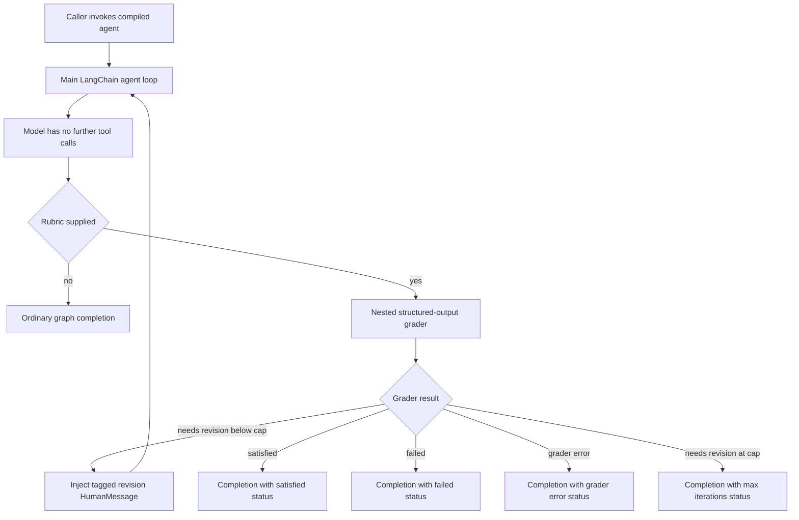

# SDK Construction and Execution

`create_deep_agent()` is the SDK assembly boundary. It resolves the model and its harness profile, chooses a filesystem backend, partitions synchronous and remote subagent specifications, builds middleware, and delegates graph compilation to LangChain `create_agent()`. The result is a compiled LangGraph; it is not a separate Deep Agents execution loop.

The ordinary graph finishes when LangChain reaches its normal terminal path after the model stops requesting tools. `RubricMiddleware` is an **opt-in caller middleware**—not part of the SDK's default stack and not a replacement for construction—that can intercept that natural completion. When invocation state supplies `rubric`, it grades the completed transcript with a separate nested agent and can jump back to the main model with revision feedback. Its status, iteration budget, run identity, frozen criteria, and evaluation history are private graph bookkeeping rather than public agent I/O.

## Construction flow



Caption: construction partitions inline and Agent Protocol delegation before applying the two exclusion passes and caller middleware transformation.

### Inputs resolved by the entry point

The public entry point accepts a model, tools, prompt, middleware, subagent specifications, skills and memory sources, permissions, backend, interrupt policy, schemas, and LangGraph execution options. If no backend is passed, it creates `StateBackend()`. `BackendProtocol` supplies the common file-operation boundary; shell execution is a separate `SandboxBackendProtocol` capability, so filesystem support does not imply that `execute` can run shell commands.

A string model is resolved before profile lookup; a supplied `BaseChatModel` is retained. `model=None` remains a deprecated compatibility path and constructs `ChatAnthropic(model_name="claude-sonnet-4-6")`. The selected harness profile may rewrite supplied tool descriptions and contributes its prompt material. Profile text is appended to a string prompt, while a supplied `SystemMessage` retains its existing content blocks and receives profile text as an additional block.

A specification with `graph_id` is remote (`AsyncSubAgent`); declarative `SubAgent` specifications and mappings with `runnable` (`CompiledSubAgent`) are inline. Unless the profile disables it or an inline spec already uses the name `general-purpose`, construction prepends the default general-purpose inline agent. Remote specs alone do not create the synchronous `task` tool; conversely, remote async task tools remain available even when all inline agents are disabled.

## Middleware assembly and transformation

The main stack begins in this order:

1. `FilesystemMiddleware`;
2. `SubAgentMiddleware`, only when inline subagents exist;
3. `_ParentNotifierMiddleware`;
4. summarization middleware;
5. `PatchToolCallsMiddleware`;
6. `AsyncSubAgentMiddleware`, only when remote subagent specifications exist.

The tail contains profile middleware, optional `SkillsMiddleware`, provider prompt-caching middleware, optional `MemoryMiddleware`, generated `HumanInTheLoopMiddleware`, and `UnsupportedContentMiddleware`. Exclusions are applied once to that assembled stack, then caller middleware is transformed into it, then exclusions are applied again. A caller middleware with the name of a surviving entry replaces that entry in place; a new name is spliced after the surviving core and before the tail. If the profile excludes tools, `_ToolExclusionMiddleware` is appended last, preventing later stack composition from restoring an excluded model-visible tool.



Caption: caller middleware is merged between two profile-exclusion passes; tool exclusion is deliberately the final transformation.

### Exclusion and replacement invariants

`FilesystemMiddleware` and `SubAgentMiddleware` are protected scaffolding. A profile cannot exclude either by class or name: construction raises rather than leaving broken filesystem or task behavior. Class-form exclusions match the exact exclusion type; strings match `AgentMiddleware.name`. Every exclusion must match an assembled main or general-purpose stack, and an exclusion name that matches multiple distinct middleware classes is rejected. `_ParentNotifierMiddleware` is not protected and can be removed with a class-form exclusion.

Replacing a `FilesystemMiddleware` has an additional safety check: when the original carries agent permissions, a replacement inherits them if unconfigured; a different nonempty replacement policy is a conflict and raises `ValueError`.

The automatic general-purpose child is intentionally not a copy of the main stack. Its base is filesystem, summarization, and patching, followed by profile middleware, optional skills, and prompt caching. Caller middleware reaches that child only when it replaces an original general-purpose stack slot, limiting inheritance of main-agent-only behavior.

## State and compilation boundary

Absent a supplied schema, the main graph uses `DeepAgentState`. Its `messages` channel is a `DeltaChannel` with snapshot frequency 50 and the message-delta reducer. The reducer normalizes raw message inputs, treats absent replay state as empty, replaces or removes messages by ID, and honors the remove-all sentinel. This preserves message update semantics while avoiding repeated full-history checkpoint growth.

A supplied `state_schema` is the base main schema and is forwarded when declarative inline agents are compiled. A precompiled runnable owns its own schema. After the final main stack is assembled, private fields from the main schema and installed middleware schemas are assigned to every installed `SubAgentMiddleware`; these keys are not sent across the task boundary or returned as child state updates.

The outer `create_agent()` call receives the resolved model and prompt, rewritten caller tools, final middleware, response format, context schema, checkpointer, store, debug flag, name, cache, and either the supplied schema or `DeepAgentState`. The returned graph is configured with recursion limit `9999` and metadata identifying the Deep Agents integration, its installed version, and the supplied agent name. Checkpointer and store are forwarded at this outer compilation boundary, not separately injected into child compilation.

## Inline `task` delegation

Declarative inline agents resolve their own model and profile and receive a child stack. They inherit parent permissions and `interrupt_on` only when the spec does not provide its own values; caller tools are inherited only when `tools` is omitted. A fork also mirrors parent prompt-producing middleware so it can reconstruct the inherited prompt. Child invocation runs with ambient LangGraph configuration, so callbacks, tags, configurable values, and metadata propagate, while configuration bound by the child wins collisions.



Caption: inline delegation is a blocking child-graph invocation rather than a remote background run.

An isolated task receives permitted state and a fresh task `HumanMessage`. A fork receives effective post-summarization parent history plus the task, and a private marker makes recursive task delegation fail. The bridge requires child `messages`, discards those messages from state updates, filters private or excluded keys and unchanged values, then returns one `ToolMessage`: JSON-serialized structured output when present, otherwise the last nonempty AI text. Shared custom fields that parallel task calls can modify need reducers, or the parent step can fail with `InvalidUpdateError`.

## Remote asynchronous subagents

`AsyncSubAgentMiddleware` is independent of `SubAgentMiddleware`. It validates unique names, `isolated` or experimental `fork` mode, and `interrupt` or `enqueue` update strategy. It contributes reducer-merged `async_tasks` parent state and exposes `start_async_task`, `check_async_task`, `update_async_task`, `cancel_async_task`, and `list_async_tasks`.



Caption: remote threads and runs are owned by the Agent Protocol server, while the parent persists only its task-tracking projection.

Launching creates a remote thread and run, then immediately writes a parent-local record keyed by the thread ID while the parent continues. An SDK launch failure returns a tool error and records no task. The record tracks the newest run, status, timestamps, and—in enqueue mode—superseded run IDs. `interrupt` is the default update strategy. `enqueue` records the follow-up as `pending`, prevents an earlier completion from becoming the latest result, and rejects more than one queued follow-up for the same task in one model turn. Cancellation attempts to stop the tracked newest and earlier active or pending runs; cancelling a `waiting` task changes only local tracking because it has no active run.

Isolated launch sends only the task. Fork mode serializes a launch-time snapshot of effective parent history plus a preamble and task after removing parent-local artifacts and eviction markers and hydrating portable media. It shares conversation content once, not the parent's model, prompt, tools, filesystem, or state. A same-deployment launch may forward JSON-compatible run context after removing the parent reference; URL-targeted launches do not forward it. Local ASGI transport without `url` requires an asynchronous entry point such as `ainvoke`; synchronous invocation requires a reachable URL.

A successfully completed run whose thread is paused is represented as `waiting`. Checks can discover a newer run begun elsewhere, and list refreshes nonterminal cached records while preserving cached state on retrieval failure. A configured webhook is attached to starts and follow-up runs. Permissions, human approval, authorization, and persistence for remote work belong to the remote graph and Agent Protocol deployment; the parent's local filesystem permissions and interrupt configuration do not transfer.

### Polling and parent notification

Remote polling runs only through asynchronous hooks. `abefore_agent` records launch notification and pulls updates, `abefore_model` pulls before a model call, and `aafter_model` pulls after a final answer and returns to the model only for a new notification. Newly observed terminal or waiting outcomes are reported once; failed or timed-out observations are deferred to a later pull. Synchronous invocation still exposes the async tools but does not poll.

The normal SDK-built stack adds `_ParentNotifierMiddleware`. For a top-level asynchronous task run that carries parent linkage, it reports success or model failure once. It wakes an idle or errored parent only when parent thread and assistant identifiers are available; a paused task is not woken this way, and a busy parent learns through polling. URL-targeted launches and `notify_parent=False` omit the assistant reference. A remote task waiting for input or approval must be resumed on its own thread.

## Rubric-driven completion review

`RubricMiddleware` is publicly exported from `deepagents`, but it is installed only when an application includes it in `middleware=`. This makes it appropriate for workflows that need an explicit definition of completion, rather than for routine construction or every agent turn:

```python
from deepagents import RubricMiddleware, create_deep_agent

agent = create_deep_agent(
    model=main_model,
    middleware=[RubricMiddleware(model=grader_model, max_iterations=3)],
)
result = agent.invoke({
    "messages": [{"role": "user", "content": "Implement the change."}],
    "rubric": "Tests pass and the requested behavior is documented.",
})
```

The middleware is a no-op when `rubric` is absent. When it is present, `before_agent` starts a grading run for a changed rubric or after a previous terminal result; it resets that run's iteration count and mints a run ID. A rubric that remains active between invocations keeps its budget and bookkeeping. This is deliberately different from ordinary model/tool execution: the grader is invoked only at the main graph's natural `after_agent` completion point, not after each tool call.



Caption: the extension begins only after the ordinary agent would stop; only a `needs_revision` verdict below the configured cap returns control to the main model.

### Grader boundary and verdict contract

The grader is lazy: on its first use the middleware resolves its configured model and creates a distinct LangChain `create_agent()` graph named `rubric_grader`, with `GraderResponse` structured output. It can receive a custom grading prompt, verification tools, middleware, runtime context schema, and state schema. Static runtime context is forwarded to the nested call. `prepare_messages_for_grader` can transform the transcript before payload construction; `build_grader_state` can add custom nested-agent fields, but cannot replace the middleware-owned `messages` payload and requires `grader_state_schema`.

The structured result has `satisfied`, `needs_revision`, or `failed`, an explanation, and per-criterion pass/fail entries. A failed criterion requires an actionable `gap`; validation rejects a result that calls itself satisfied while containing failures, or requests revision while all nonempty criteria pass. `failed` means the rubric is malformed, contradictory, or not evaluable—not that the grader infrastructure failed. An exception, absent or malformed structured response, or provider problem instead records `grader_error`; `GraphBubbleUp` is re-raised so a grader interrupt remains control flow, while cancellation and `KeyboardInterrupt` are not swallowed.

The grader sees a bounded role-labelled transcript: at most the newest 30 messages, while retaining the original non-synthetic user message if it fell outside that window, and at most 4,000 characters per message. Rubric, transcript, and any frozen criteria are put in fresh nonce-suffixed delimiter blocks; literal closing tags are neutralized. The default grader prompt treats transcript content as untrusted observation, which prevents tool output or conversation text from redefining what the rubric requires.

### Iteration, persistence, and observation

On the first usable non-`failed` result, the middleware freezes the grader's criterion names. Later grader requests replay that list and request the same count, preventing the criterion set from shrinking during one grading run. An empty first response, or later under-coverage, triggers one corrective retry. If an under-covered result still claims `satisfied`, the middleware downgrades it to `needs_revision` and marks the evaluation `unverified`; it remains bounded by `max_iterations`. The first decomposition is not independently parsed or proven complete, so the freeze protects consistency across later iterations rather than guaranteeing complete initial coverage.

For `needs_revision` below the cap, the middleware appends a synthetic `HumanMessage` tagged with `name="rubric_grader"` and `additional_kwargs["lc_source"]="rubric_grader"`, records the evaluation, and returns `jump_to="model"`. The feedback identifies failed criteria and gaps, and asks the main agent not to regress confirmed passes. At the cap, the final record is rewritten to `max_iterations_reached` and no jump occurs. `satisfied`, `failed`, `grader_error`, and the capped status also end grading without changing the main agent's final response. Consumers that need to branch on a non-satisfied ending must examine bookkeeping rather than infer success from the final AI message.

`RubricState` exposes only the caller's `rubric` as public middleware I/O. `_rubric_status`, `_rubric_iterations`, `_rubric_evaluations`, `_current_grading_run_id`, `_active_rubric`, and `_rubric_criteria` are `PrivateStateAttr` fields. They therefore stay out of input/output schemas, but participate in graph state: with a checkpointer they can be inspected through `agent.get_state(config).values`. Each evaluation carries the run ID, zero-based iteration, result, explanation, criteria, and `unverified` flag. The middleware also emits `rubric_evaluation_start` and `rubric_evaluation_end` stream events and invokes `on_evaluation`; callback exceptions are logged and suppressed, so callbacks are observational rather than enforcement hooks.

### Operational guidance and focused tests

Choose a positive integer `max_iterations` (default `3`) and a dedicated, capable grader model. Give the grader only the verification tools and custom state it needs; it is a separate agent, not an implicit copy of the main Deep Agents harness. A grader call adds latency and model cost at each natural completion, and a failed or capped review intentionally preserves the last main-agent response. Instrument status or stream events if acceptance must gate a downstream action.

Focused unit tests cover constructor validation, reset behavior across new and terminal rubrics, private status updates, revision jumps, cap handling, exception propagation, structured-output plumbing, bounded transcript construction, delimiter sanitization, criterion coverage retries, extension callbacks, context forwarding, and stream events. End-to-end fake-model tests wire `RubricMiddleware` through `create_deep_agent()` to cover the satisfied path, iteration loop, cap, no-rubric no-op, and interruption behavior.

## Permissions, skills, and artifact paths

Filesystem enforcement and human approval are separate. `FilesystemMiddleware` independently enforces deny rules. Construction translates interrupt-mode filesystem permissions into path-sensitive `HumanInTheLoopMiddleware.interrupt_on` predicates and merges caller entries over generated entries for the same tool. The predicates distinguish exact-path from bulk operations, conservatively gate pathless or current-directory bulk calls, account for glob patterns that redirect outside the named path, and use resolved symlink targets when the backend supports resolution. Declarative inline agents inherit these controls unless overridden; remote agents do not. Resuming an interrupt requires a checkpointer.

Skills metadata is loaded from backend sources and cached per thread. Later sources override earlier entries with the same name; setting `skills_metadata` to `None` reloads it, and source failures are recorded as warnings. Skill-tool disclosure follows its associated read result without splitting a tool-result batch or moving ahead of queued user content, and uses the model selected after fallback.

`CompositeBackend.artifacts_root` defaults to `/`. Filesystem large-result offload and summarization-history offload normalize a trailing slash and derive their paths from that root.

## Verification focus

The graph tests exercise profile selection, stack order and conditional installation, caller replacement and exclusion failures, schema/private-state wiring, metadata, and general-purpose composition. Permission tests exercise generated approval predicates and deny enforcement, including conservative recursive-delete handling. The async middleware tests cover remote transport, fork snapshots, status tracking, polling, notification, webhooks, update strategies, and cancellation; subagent tests cover isolation, fork behavior, state filtering, and configuration propagation.

## Related pages

- [Middleware stack](middleware-stack.md) — hook responsibilities and ordering.
- [Runtime behavior](runtime-behavior.md) — runtime execution and operations.
- [Middleware catalog](../concepts/middleware-catalog.md) — middleware capabilities, including completion-review extension points.
- [State and persistence](../concepts/state-persistence.md) — checkpointed state and private bookkeeping.
- [Testing guide](../testing/testing-guide.md) — test selection and execution.
- [Subagents and skills](../concepts/subagents-skills.md) — delegation configuration.
- [Build a Deep Agent](../workflows/build-a-deep-agent.md) — SDK usage workflow.
