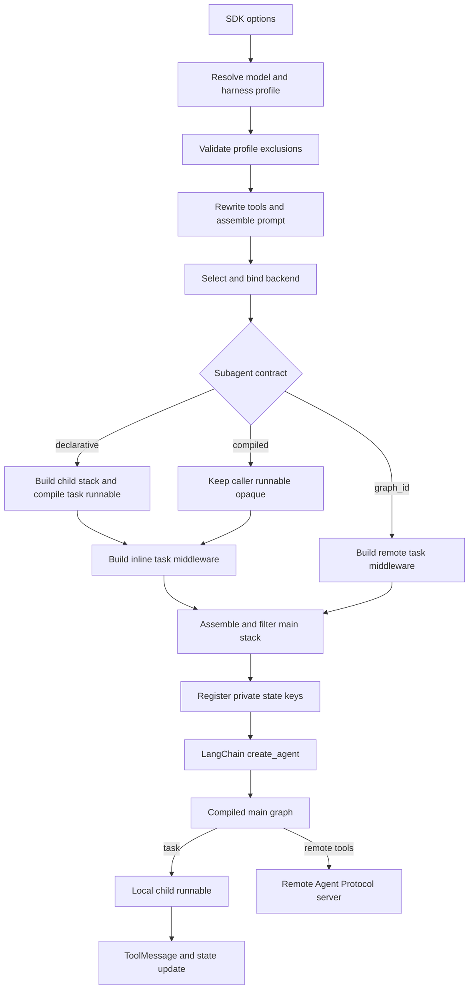

# SDK Construction and Execution

`create_deep_agent()` is the SDK assembly boundary. It does not implement a separate agent loop: it resolves a model, applies the selected harness profile, builds Deep Agents middleware and any declarative child graphs, and delegates compilation to LangChain `create_agent()`. The returned compiled graph is configured with a high recursion limit and Deep Agents tracing metadata; invocation, checkpointing, streaming, and resume behavior are LangGraph concerns at that graph boundary.

## Construction and invocation boundaries

Caption: construction compiles declarative local children and the main graph, but accepts compiled children as supplied. At execution, `task` converts a local child result into a parent update; `graph_id` specifications use remote background-task tools instead.

## Inputs resolved before compilation

A model string is resolved through LangChain model initialization and provider-profile initialization behavior; a prebuilt `BaseChatModel` is used as supplied. `model=None` still constructs `claude-sonnet-4-6`, but is deprecated and scheduled for removal. The resulting model and, for a string, its original spec select the harness profile. Profile lookup matters because it supplies prompt material, tool-description overrides, extra middleware, exclusions, and the general-purpose-subagent policy.

The main authored system prompt is assembled as caller text, profile base prompt, then profile suffix. With a caller `SystemMessage`, its content blocks are retained and profile text is appended as a new text block, preserving caller cache-control markers. Tool-description overrides copy and rewrite supported supplied tools before they are passed to the main graph and to declarative children. Tool *exclusion* is deliberately later: the final exclusion middleware filters the model-visible tool list after other middleware has had an opportunity to inject tools.

If no `backend` is supplied, the SDK creates `StateBackend()`. Before stack construction, it calls `bind_backend(backend)` on caller middleware that implements `BackendConsumer`; declarative subagent middleware receives the same treatment. This makes extension middleware use the same backend as the SDK filesystem tools rather than independently selecting storage or execution.

## Profile validation and middleware order

Profile exclusions are validated before assembly and applied twice: once to the built-in/profile stack, then again after caller middleware is merged. This prevents a caller from restoring profile-excluded middleware. Required scaffolding cannot be excluded: `FilesystemMiddleware` supports built-in file tools and permission enforcement, and `SubAgentMiddleware` supports synchronous `task` delegation. Exact class exclusions and exact middleware-name exclusions are supported. Construction fails for protected exclusions, unmatched exclusions across the relevant main/general-purpose stacks, and a name exclusion that matches different middleware classes in one stack.

The main stack begins with these core entries:

1. `FilesystemMiddleware`;
2. `SubAgentMiddleware` when an inline child exists;
3. `_ParentNotifierMiddleware`;
4. summarization middleware;
5. `PatchToolCallsMiddleware`;
6. `AsyncSubAgentMiddleware` when remote async specifications exist.

The tail then consists of materialized profile middleware, optional `SkillsMiddleware`, provider prompt-caching middleware, optional `MemoryMiddleware`, optional `HumanInTheLoopMiddleware`, `UnsupportedContentMiddleware`, and `ModelRefusalMiddleware`. `_ToolExclusionMiddleware`, when configured by the profile, is appended after final filtering and is therefore last.

Caller middleware is neither blindly appended nor always placed at the start. A caller entry whose `.name` matches an extant entry replaces that entry in place; a novel entry is inserted immediately after the core section and before the profile/caching/memory tail. Thus, a caller `ModelFallbackMiddleware` wraps and can catch the default tail `ModelRefusalMiddleware`. Replacing `FilesystemMiddleware` inherits the top-level permission rules when it has none; providing different nonempty rules is a construction error.

## Built children and subagent boundaries

The SDK separates `subagents=` into three execution contracts:

- **Declarative `SubAgent`** — the SDK resolves its model and profile, builds its child stack, and `SubAgentMiddleware` compiles it through `create_sub_agent()` as the local runnable behind the synchronous `task` tool.
- **`CompiledSubAgent`** — an already-built runnable used by `task`. The SDK does not alter its internal stack, state schema, or checkpoint policy; it must return state containing `messages`.
- **`AsyncSubAgent`** — recognized by `graph_id`; it is passed to `AsyncSubAgentMiddleware`, which exposes background-task tools for an Agent Protocol server rather than the synchronous `task` tool.

Unless disabled by the active main profile or overridden with a same-named inline spec, the SDK prepends a `general-purpose` declarative subagent. If that default is disabled and no other inline child is supplied, `SubAgentMiddleware` and the `task` tool are absent; remote async tools are independent. The default child is intentionally not a mirror of the main stack: only caller middleware matching an existing general-purpose slot may replace that slot, so arbitrary main-agent middleware does not leak into it.

For every declarative child, the SDK builds filesystem, summarization, and patch middleware, then child-profile middleware, optional skills, provider caching, and refusal middleware. The child gets its own profile based on its resolved model. `create_sub_agent()` adds child `HumanInTheLoopMiddleware` for its effective `interrupt_on`, adds `UnsupportedContentMiddleware` if missing, and calls LangChain `create_agent()`.

Provider caching is appended to each SDK-built stack. The Anthropic entry is a lazy stand-in: it imports and constructs the real middleware only for an Anthropic request and otherwise passes the request through. Bedrock and Fireworks entries are appended only when their optional integrations are importable; their class lookup is cached but each stack receives a fresh middleware instance. Those entries use their real middleware names, so normal replacement and profile exclusion still work.

A fork is special: it uses the parent's assembled system prompt byte-for-byte and carries its own instructions in the delegated task message. The inherited effective history and the task-tool ordering are likewise arranged to preserve the cacheable request prefix. A fork inherits parent skills and cannot set different skills. It also merges inherited parent caller middleware with its own middleware by name before the child tail, so it can rebuild dynamic prompt-producing state such as memory. Changing that inherited system prompt or tool definitions is an intentional cache-reuse tradeoff.

### Synchronous task execution

`SubAgentMiddleware` validates nonempty, unique child names and accepts only `isolated` or beta `fork` mode. An isolated child receives a fresh human message containing the delegated description. A fork receives the parent's effective conversation after the current summarization event is applied, plus a task preamble and description. Forked declarative children receive compatible parent state and a guarded mirrored `task` tool; recursive delegation returns a refusal. Forked compiled children are opaque, so private and special keys are withheld.

Before an inline child is invoked, an isolated task transfer removes special message handling, todos, structured output, skill bookkeeping, caller rubric, and registered private keys, then supplies only the delegated description as a fresh human message. A declarative fork instead carries compatible parent state, including private channels needed by its mirrored stack, drops fork-specific bookkeeping, and folds any summarization event into the effective history. A compiled fork remains opaque and receives only non-private transferable state. In both cases, the spawning task-call AI message is removed before fork history is built.

On return, only changed non-excluded state values are merged back with one `ToolMessage`: serialized structured output when present, a refusal notice where applicable, or the last nonempty AI text. This avoids replaying inherited values through reducers. Concurrent children writing the same custom state key need a reducer; otherwise LangGraph can raise `InvalidUpdateError`.

The task boundary turns `ModelRefusalError`, and a structured-output validation failure that contains a refusal, into a retry-warning result for the parent in both synchronous and asynchronous child invocation. Other structured-output failures propagate. This handling covers declarative and compiled children without pretending that the SDK installed refusal middleware in a compiled runnable. Child invocations inherit ambient LangGraph configuration and add subagent tracing metadata plus the parent task call ID.

For a compiled LangGraph child, the task runner streams final values and checkpoint events so the result `ToolMessage` artifact can expose the namespace that actually saved the child history. No checkpoint event yields no artifact. A non-graph runnable instead reports the parent task namespace as a fallback. This is observability metadata, not model-visible content. A known limitation is a child wrapped with `.with_retry()`: it must be invoked rather than streamed, so its artifact can name the first task namespace even when the successful retry saved under that namespace with `|1`; retrying the `task` call itself records the finishing run's namespace.

### Remote asynchronous execution

`AsyncSubAgentMiddleware` validates a nonempty unique set, `isolated` or beta `fork` mode, and `interrupt` or `enqueue` update strategy. It stores task records under `async_tasks`, so task IDs remain available after conversation compaction. Its launch tools return promptly with an ID while a remote Agent Protocol server runs the task; they also support monitoring, updating, cancellation, and listing.

Remote status polling is intentionally asynchronous. Synchronous hooks are pass-through, whereas `abefore_agent`, `abefore_model`, and `aafter_model` poll unfinished tasks. New outcomes become parent-visible messages; after a final answer an outcome can jump back to the model for another turn. A failed remote status check is logged and skipped until a later poll. Consequently, `invoke` can expose the remote tools but does not perform the automatic polling behavior provided through `ainvoke` and Agent Server execution.

## State, backend, and approval invariants

Without `state_schema=`, the main graph uses `DeepAgentState`. Its `messages` channel is a `DeltaChannel` with a local reducer that coerces raw message-like input, treats absent replay state as empty, replaces or tombstones messages by ID, and honors the remove-all sentinel. A supplied state schema is the main base schema and is passed only to declarative child compilation. Compiled and remote graphs retain their independently configured schemas.

After the final main stack is known, the SDK collects private fields from the base schema and installed middleware schemas and registers them with every installed `SubAgentMiddleware`. This closes the delegation boundary even if caller middleware replaces the task middleware. Custom state is therefore a supported declarative parent-child extension point, but it must have reducers wherever parallel task calls can write it.

Filesystem permissions are tool-layer policy, not backend-layer policy. `FilesystemMiddleware` evaluates `FilesystemPermission` rules in declaration order; the first matching rule determines allow, deny, or interrupt, and no match permits the call. Declarative children inherit parent permissions only when they provide none; their own list replaces the parent list. Compiled and remote children must enforce their own policy. Interrupt rules are converted into scoped `HumanInTheLoopMiddleware` predicates during construction, and explicit user `interrupt_on` settings override generated settings by tool name.

`FilesystemBackend` adds a separate path-containment choice. With default `virtual_mode=True`, it anchors virtual paths under `root_dir`, rejects traversal and verifies resolved containment, while avoiding real-root disclosure in displayed paths. With `virtual_mode=False`, absolute paths and relative traversal can access outside the root. Virtual mode is a path guardrail, not process isolation; direct host filesystem access is unsuitable for untrusted web-serving workloads without stronger isolation.

## Configuration and regression checks

Operationally, provide an explicit model, select a backend appropriate to the trust boundary, and use a checkpointer/store at the outer graph boundary when state persistence is required. A backend only provides the file-operation contract; shell `execute` is available only when it also implements `SandboxBackendProtocol`. Direct backend calls do not inherit filesystem-tool permissions.

Focused graph tests cover profile lookup and prompt assembly, default general-purpose child insertion or suppression, tool override/exclusion wiring, private-schema registration, middleware replacement and ordering, child stack isolation, skills placement, backend binding, and optional provider caching on main and child stacks. Subagent tests cover mode and unique-name validation, default `task` registration, dynamic response formats for declarative children, compiled-child schema rejection, state transfer, fork history, prompt and tool-prefix preservation, recursion refusal, result selection, refusal conversion, and checkpoint-namespace artifacts for synchronous and asynchronous task execution. These tests are the appropriate guardrails for changes to construction order, cache-sensitive fork behavior, or delegation boundaries.

## Related pages

- [Middleware stack](middleware-stack.md) — middleware hooks and execution ordering.
- [Architecture overview](overview.md) — broader component boundaries.
- [Backends](../concepts/backends.md) — storage and execution backend choices.
- [Profiles and models](../concepts/profiles-models.md) — model/profile selection.
- [State and persistence](../concepts/state-persistence.md) — checkpointing and state ownership.
- [Subagents and skills](../concepts/subagents-skills.md) — user-facing delegation configuration.
