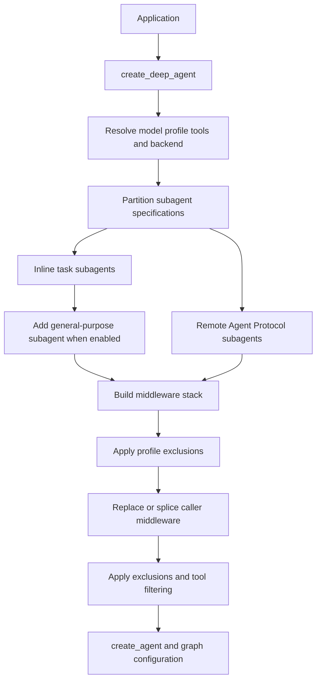
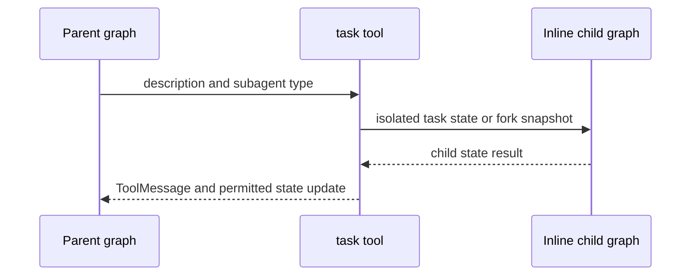
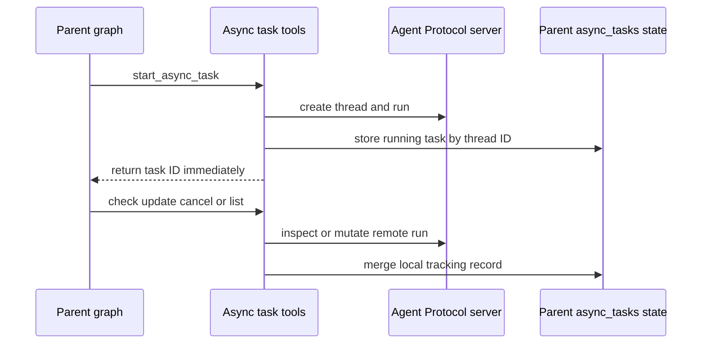

# SDK Construction and Execution

`create_deep_agent()` is an assembly boundary, not a separate agent loop. It resolves a model and harness profile, chooses a backend, builds a LangChain middleware stack, and returns the LangGraph compiled by `create_agent()`. That compiled graph owns normal state, checkpoints, tools, and interrupts. By contrast, a remote asynchronous subagent runs on an Agent Protocol server; the parent graph retains only a durable tracking projection.

## Assembly flow and delegation boundary

Caption: `create_deep_agent()` classifies a spec with `graph_id` as remote; only inline specifications contribute the synchronous `task` tool.

A declarative `SubAgent`, a mapping containing `runnable` (`CompiledSubAgent`), and a mapping containing `graph_id` (`AsyncSubAgent`) have different execution contracts. Unless the profile disables it or the caller supplies an inline subagent named `general-purpose`, the builder prepends that default inline subagent. Therefore remote specifications do not themselves create `task`, while disabling every inline/default subagent still leaves async task tools available when remote specifications exist.

The default backend is `StateBackend()`. A supplied backend implements `BackendProtocol`, the common filesystem-oriented contract used by middleware; its core operations are synchronous and generally have `asyncio.to_thread` async wrappers. Shell execution is deliberately an additional `SandboxBackendProtocol` capability, so an agent on an ordinary backend can still expose file tools but `execute` cannot run a shell command.

`model=None` remains a deprecated compatibility path that creates the default Anthropic model. Otherwise model strings are resolved through LangChain initialization and provider-profile behavior, while prebuilt `BaseChatModel` instances are retained. The selected harness profile can rewrite supplied tool descriptions and contributes profile prompt material: it is appended to a string system prompt, or appended as a new text block without discarding a caller `SystemMessage`'s existing content blocks.

The outer `create_agent()` call receives the final model, prompt, caller tools, middleware, response format, context schema, checkpointer, store, debug flag, name, cache, and either the supplied state schema or `DeepAgentState`. The returned graph is configured with recursion limit `9999` and metadata for the Deep Agents integration, installed version, and agent name. Checkpointer and store cross this outer compilation boundary; child compilation does not receive separate injected copies.

## Middleware composition and policy invariants

The main core is assembled in this order:

1. `FilesystemMiddleware`;
2. `SubAgentMiddleware`, only if an inline pool exists;
3. `_ParentNotifierMiddleware`;
4. summarization middleware;
5. `PatchToolCallsMiddleware`;
6. `AsyncSubAgentMiddleware`, only if remote specifications exist.

The tail is profile middleware, optional `SkillsMiddleware`, provider prompt-caching middleware, optional `MemoryMiddleware`, generated `HumanInTheLoopMiddleware`, and `UnsupportedContentMiddleware`. Exclusions are applied before and after caller middleware. A caller middleware instance whose name matches a surviving slot replaces it in place. A new name is inserted after the surviving core and before the tail. If a harness excludes tools, `_ToolExclusionMiddleware` is appended last, so a custom middleware cannot restore a model-visible excluded tool.

`FilesystemMiddleware` and `SubAgentMiddleware` are protected scaffolding: excluding either by class or name fails rather than producing a broken filesystem or `task` surface. A profile exclusion must match somewhere across the main and general-purpose stacks; unmatched entries and ambiguous string-name collisions also fail construction. `_ParentNotifierMiddleware`, unlike those required components, can be excluded by its class.

The automatically created general-purpose child intentionally is not a wholesale copy of the main stack. It has filesystem, summarization, and patch middleware, then profile middleware, optional skills, and prompt caching. Caller middleware reaches it only when its name replaces an original general-purpose slot. This limits accidental inheritance of main-agent-only behavior.

## State, persistence, and synchronous tasks

`DeepAgentState.messages` uses a `DeltaChannel` with a snapshot frequency of 50 and the message-delta reducer. The reducer converts raw message-like values, treats missing replay state as an empty list, replaces or removes messages by ID, and honors remove-all writes. This bounds checkpoint growth while retaining standard message update behavior.

A caller `state_schema` is the base schema for the main graph and is forwarded when declarative children are compiled. A precompiled child owns its schema. Once the final main stack is known, private fields declared by the main schema or installed middleware schemas are assigned to every installed `SubAgentMiddleware` boundary; those fields are excluded from child inputs and returned updates.

A declarative child resolves its own model/profile and receives a child middleware stack. It inherits parent permissions and `interrupt_on` only when it does not supply its own value, and inherits caller tools only when `tools` is omitted. A fork also mirrors prompt-producing parent middleware to reconstruct the inherited prompt. Synchronous child invocation uses ambient LangGraph configuration: callbacks, tags, configurable values, and metadata propagate, while bound child configuration wins collisions.

Caption: Inline delegation blocks until the child returns; it is a graph invocation inside the parent execution rather than a remote run.

The `task` tool gives an isolated child permitted state plus a fresh task `HumanMessage`. A fork receives effective post-summarization parent history and the task, with a private marker that rejects recursive `task` delegation. A child must return `messages`; the bridge discards messages, private/excluded keys, and unchanged values from state updates, then returns one `ToolMessage` containing JSON-serialized structured output or the final nonempty AI text. Parallel child calls therefore need reducers for any shared custom field they can both modify.

## Remote asynchronous tasks

`AsyncSubAgentMiddleware` is independent of synchronous `SubAgentMiddleware`. It validates unique names, `mode` (`isolated` or experimental `fork`), and `update_strategy` (`interrupt` or `enqueue`); it adds reducer-merged `async_tasks` state and exposes `start_async_task`, `check_async_task`, `update_async_task`, `cancel_async_task`, and `list_async_tasks`.

Caption: threads and runs belong to the Agent Protocol server; `async_tasks` is the parent-local state projection.

A successful start creates a remote thread with subagent and parent linkage metadata, starts a run, and immediately records a running `AsyncTask` keyed by that thread ID. A launch SDK failure returns a tool error and writes no record. The record tracks newest run ID, status, timestamps, and, for queued follow-ups, superseded run IDs. The default update strategy is `interrupt`. `enqueue` records the new run as `pending` and retains earlier run IDs so an earlier completion cannot be read as the latest result; only one queued follow-up per task is accepted in one model turn. Cancellation stops the newest and tracked earlier active or pending runs, but cancelling a `waiting` task changes only local tracking because no run is active.

An isolated remote launch sends only the task. A fork takes a launch-time snapshot of effective parent history, adds a background-task preamble and task, removes parent-local artifacts and eviction markers, hydrates portable media, and serializes the result. Forking shares conversation content once, not the parent model, prompt, tools, filesystem, or state. Same-deployment launches can forward JSON-compatible context after removing the Deep Agents parent reference. URL-targeted launches do not forward that context; they retain only the parent thread reference and omit the parent assistant ID, so they cannot wake the parent across deployments. Local ASGI transport without `url` requires `ainvoke` or another async entrypoint; synchronous invocation requires a reachable URL.

A tracked run that succeeds while its thread is paused is reported as `waiting`, including pending interrupts. Checks and lists can follow a newer run started elsewhere; listing filters the cached projection before refreshing nonterminal records and retains cached status if retrieval fails. Remote permissions, approval behavior, authorization, and persistence belong to the remote graph and deployment, not the local parent configuration. A `webhook` configured on the specification is attached to starts and follow-up runs.

### Polling and parent notification

Polling is async-only. `abefore_agent` records a notification that initiated a run and pulls task updates, `abefore_model` pulls before the model call, and `aafter_model` pulls after a final answer and jumps back to the model only for a new notification. It emits each newly observed terminal or waiting outcome once; failed or timed-out observations are skipped until the next pull. Synchronous `invoke` still provides the five tools but never polls.

The default SDK stack includes `_ParentNotifierMiddleware`. For a top-level asynchronous Deep Agent task launched by a parent, it reports a completion or model failure once. It wakes an idle or errored parent only when linkage has both parent thread and assistant identifiers; a busy parent learns through polling and a paused parent is not disturbed. URL-targeted and `notify_parent=False` launches omit that assistant reference. A remote task paused for input or approval must be answered on its own thread.

## Permissions, skills, and artifact paths

Filesystem enforcement and human review are distinct. `FilesystemMiddleware` independently enforces deny rules. The builder converts interrupt-mode filesystem permissions to path-sensitive `HumanInTheLoopMiddleware.interrupt_on` predicates and merges them with caller configuration, where a caller entry for the same tool wins. The generated predicates distinguish exact-path and bulk calls, conservatively gate pathless/current-directory bulk calls, account for a `glob` that escapes its nominal path, and use symlink-resolved targets when the backend supports resolution. These controls apply to the main graph and constructed declarative children, not to remote async graphs. Resuming a human interrupt requires a checkpointer.

Skills are loaded from backend sources and metadata is cached per thread. Later sources override earlier same-name skills; resetting `skills_metadata` to `None` reloads, and load failures become warnings. Skill-tool disclosure is inserted after the associated read result without splitting a tool-result batch or moving before queued user content, and it uses the model actually selected after fallback.

`CompositeBackend.artifacts_root` defaults to `/`. Filesystem large-result offload and summarization-history offload derive paths from that root after normalizing its trailing slash.

## Verification focus

`test_graph.py` covers stack order, conditional installation, exclusions, state schemas, metadata, and general-purpose composition. `test_subagents.py` covers isolation, forks, returned state, private fields, and ambient configuration propagation. `test_async_subagents.py` exercises local and remote transport, context and parent linkage, fork snapshots, pauses, notifier/polling behavior, webhooks, update strategies, and cancellation. Permission tests cover generated path predicates; artifacts-root tests cover normalized offload paths.

## Related pages

- [Middleware stack](middleware-stack.md) — hook responsibilities and ordering.
- [Runtime behavior](runtime-behavior.md) — runtime execution and operations.
- [Backends](../concepts/backends.md) — backend implementations and file operations.
- [State persistence](../concepts/state-persistence.md) — checkpoints and resume semantics.
- [Subagents and skills](../concepts/subagents-skills.md) — delegation configuration.
- [Build a Deep Agent](../workflows/build-a-deep-agent.md) — SDK usage workflow.
