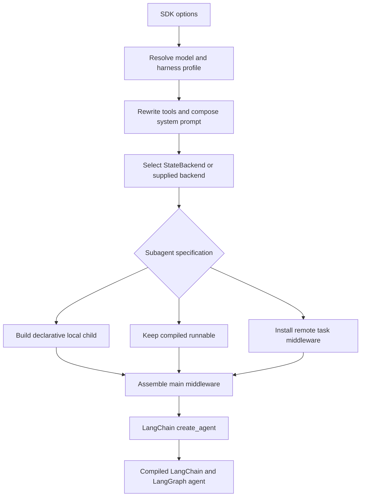
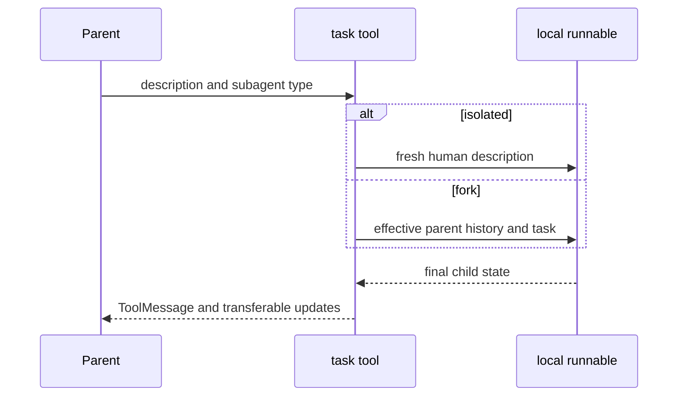
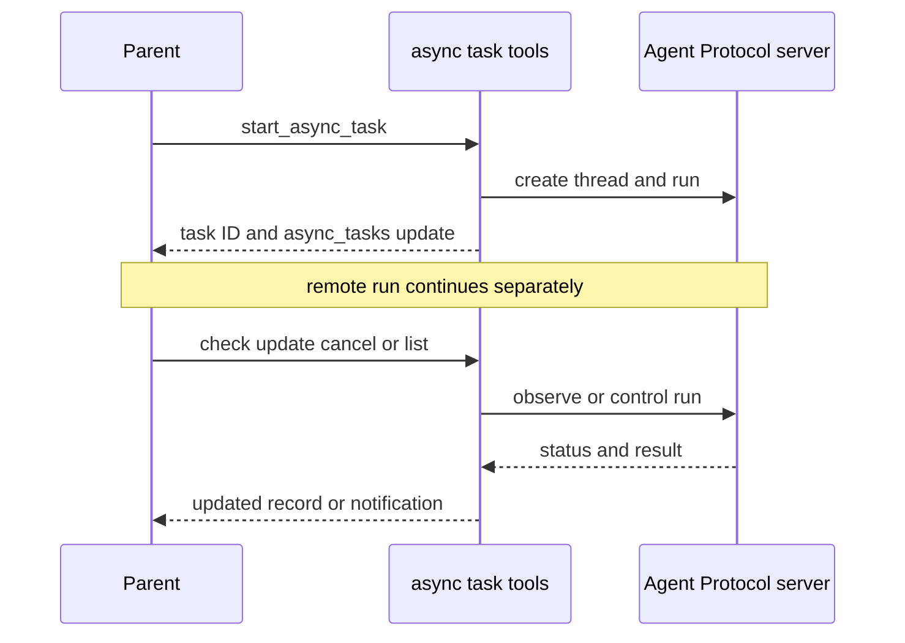

# SDK Construction and Execution

`create_deep_agent()` is an **assembly boundary**, not an independent execution engine. Deep Agents resolves configuration and profiles, selects a backend, constructs middleware and declarative children, and calls LangChain `create_agent()`. The compiled LangChain/LangGraph agent owns model/tool-loop execution, graph invocation, streaming, checkpoint persistence, and resume. Deep Agents supplies the assembled inputs and adds `recursion_limit: 9999` plus Deep Agents tracing metadata.

## Assembly and ownership

Caption: Deep Agents owns SDK assembly; LangChain and LangGraph own the compiled agent's execution lifecycle.

A string model is resolved and a supplied `BaseChatModel` is used as supplied. `model=None` still creates `claude-sonnet-4-6`, but that fallback is deprecated. The resolved model and original string specification select the harness profile, which provides prompt material, tool-description overrides, extra and excluded middleware/tools, and the general-purpose-subagent policy.

The SDK rewrites tool descriptions before graph assembly. It places caller system instructions before profile base/suffix material; for a caller `SystemMessage`, original content blocks are preserved and profile text is appended as a new text block. Tool exclusion is deliberately last, so it also filters tools injected by middleware.

If no backend is passed, the SDK uses `StateBackend`. It calls `bind_backend()` for caller middleware implementing `BackendConsumer`, and does likewise for declarative child middleware before compiling the child. This is the supported construction-time integration point for middleware that needs the same backend as its agent.

### What the public entrypoint returns

The package exports `create_deep_agent` and `DeepAgentState`, but it does not wrap the returned graph in a separate runtime. The final `create_agent()` call receives the model, final prompt, rewritten tools, assembled middleware, response/context schemas, checkpointer, store, debug/name/cache options, and the base state schema. Consequently, configure invocation and persistence through LangChain/LangGraph-compatible graph APIs and configuration; use Deep Agents options to control what is assembled.

## Middleware stack and extension boundaries

The protected main scaffolding begins with `FilesystemMiddleware`; it adds `SubAgentMiddleware` only when inline children exist, followed by `_ParentNotifierMiddleware`, summarization, and `PatchToolCallsMiddleware`. `AsyncSubAgentMiddleware` is added only for remote `graph_id` specifications. The tail consists of profile middleware, optional skills, provider caching, optional memory and human approval, `UnsupportedContentMiddleware`, and `ModelRefusalMiddleware`.

Caller middleware with an existing `.name` replaces that stack entry in place. New caller middleware is inserted after the core entries and before the profile/cache/memory tail, allowing, for example, a caller `ModelFallbackMiddleware` to observe a refusal before the default refusal middleware. Profile exclusions run both before and after this merge: callers cannot restore excluded entries. Required filesystem and synchronous-task scaffolding cannot be excluded; protected, ambiguous, unmatched, or invalid exclusions fail construction. A replacement filesystem middleware inherits top-level permission rules if it has none, while conflicting rules fail construction.

Provider prompt caching is appended to SDK-built main and declarative-child stacks. Anthropic support defers importing its caching middleware until an Anthropic request. Bedrock and Fireworks providers are optional: class lookup is cached, but every stack receives a fresh middleware instance.

The SDK automatically adds `general-purpose` unless the active profile disables it or an inline child already uses that name. If no inline child exists, it installs no `SubAgentMiddleware`, so there is no synchronous `task` tool. Remote async tools remain independent. General-purpose children inherit only caller middleware that replaces an existing general-purpose slot, not arbitrary main-only middleware.

A declarative child gets its own resolved model/profile and a child stack including filesystem, summarization, patching, profile middleware, optional skills/cache middleware, and refusal handling. `create_sub_agent()` adds child approval middleware when configured, ensures `UnsupportedContentMiddleware`, and delegates compilation to LangChain `create_agent()`. A `CompiledSubAgent`, by contrast, stays caller-owned and opaque to SDK stack construction; it must return state with `messages`.

## State schema and persistence boundary

`DeepAgentState` is declared in `deepagents/graph.py`. Its required `messages` field uses a LangGraph `DeltaChannel` with LangGraph's imported `_messages_delta_reducer` and `snapshot_frequency=50`; Deep Agents does not define or own a local message-reducer module. The channel choice is Deep Agents' default schema decision, while delta reduction and checkpoint/channel semantics are LangGraph responsibilities.

When no `state_schema` is supplied, `create_deep_agent()` passes `DeepAgentState` to LangChain `create_agent()`. A custom schema replaces that base schema and must preserve the inherited messages channel. The SDK forwards a custom base schema to declarative child compilation and to `SubAgentMiddleware`; it does not retrofit already compiled runnables or remote graphs. After the main stack is final, private fields contributed by the base schema and installed middleware are registered with each installed `SubAgentMiddleware`, keeping them out of delegation transfer.

Custom fields returned by concurrent local children need reducers if they can be written in the same graph step. Without an appropriate reducer, LangGraph may raise `InvalidUpdateError`. Checkpointing itself is not implemented by Deep Agents: `checkpointer` is passed to the LangChain graph and checkpoint namespace handling is observed only where task delegation needs to report it.

## Local synchronous delegation

Caption: a local `task` call blocks on its runnable; fork mode changes the child input and transfer rules, not execution ownership.

`SubAgentMiddleware` rejects duplicate names and accepts `isolated` or beta `fork` modes. An isolated child receives only a new human message containing the delegated description. A fork derives history from the parent's effective summarized conversation, removes the spawning AI task-call message, and appends a task message with a preamble, optional fork-specific instructions, and the description. The preamble records that delegation has already occurred and recursive delegation is refused.

A declarative fork is rebuilt as a local graph that mirrors compatible parent middleware and inherits state needed for that graph, including private channels. Its `_deepagents_forked_context` guard prevents its mirrored `task` tool from recursively delegating. The SDK preserves the parent's final system prompt unchanged and sends fork-specific instructions with the task message; it also positions the mirrored task tool after filesystem tools. These constraints preserve the inherited request prefix and tool order for provider prompt-cache reuse. A compiled fork is opaque and receives only transferable, non-private state.

For isolated children and compiled forks, task transfer excludes special channels and registered private keys. Returned updates likewise omit special/private fields and values unchanged from the input; the parent receives a `ToolMessage` containing structured output, a refusal warning, or the last nonempty AI text. Refusal errors and structured-output validation failures carrying a refusal become retry-warning task results; other validation failures propagate.

For a compiled LangGraph child, the task runner streams values and checkpoint events and puts the actual saved checkpoint namespace in the result `ToolMessage` artifact. No saved checkpoint produces no artifact. A non-graph runnable falls back to the parent task namespace. This reporting does not make the child checkpoint state parent-owned.

## Remote Agent Protocol delegation

Caption: remote work is a separate Agent Protocol thread and run, not a local `task` runnable.

`AsyncSubAgentMiddleware` is independent of synchronous `SubAgentMiddleware`. It validates unique names, `isolated`/beta `fork` mode, and `interrupt`/`enqueue` update strategy, then provides `start_async_task`, `check_async_task`, `update_async_task`, `cancel_async_task`, and `list_async_tasks`. Launch creates an Agent Protocol thread and run, records a task keyed by the thread ID under reducer-backed `async_tasks`, and returns immediately; it does not execute a local synchronous child. Task IDs remain available across conversation compaction.

The remote launch input contains **only** `messages`; arbitrary parent keys, files, and private state are not transferred. An isolated task sends one user description. A remote fork snapshots the effective conversation after summarization, removes the launching tool-call message, and appends the delegated task. The snapshot is serialized for transport, strips artifacts, and is not shared live state. The remote graph owns its own schema, middleware, permissions, backend, execution, and completion behavior.

Automatic polling is asynchronous only. `abefore_agent` records launch notifications and polls unfinished tasks; `abefore_model` polls again. After a final answer, `aafter_model` polls and jumps back to the model only if there is a new notification. The synchronous hooks pass through: `invoke` exposes the tools but has no automatic polling, whereas `ainvoke` and Agent Server execution do. Observation failures are logged and retried later. Notifications cover successful results, errors, timeouts, cancellation, and remote user/approval waits; the parent cannot answer an interrupt owned by the remote agent.

## Permissions and operational limits

Filesystem permissions are ordered first-match policy for filesystem read/write tools. `FilesystemMiddleware` enforces deny rules. Interrupt rules generate scoped `HumanInTheLoopMiddleware` predicates, and an explicit user `interrupt_on` setting wins for the same tool. Declarative children inherit top-level permissions unless they specify their own; compiled and remote children must enforce their own policy.

`FilesystemBackend` virtual mode anchors paths under `root_dir` and rejects traversal and resolved escapes. Non-virtual mode permits absolute paths and traversal outside that root. Virtual mode is a path guardrail rather than process isolation, and permissions apply at filesystem-tool level rather than to arbitrary direct backend calls.

## Change-focused tests

Construction tests cover default/custom state-schema wiring, private-key registration, profile prompt construction, backend binding, default-child insertion, middleware replacement/order, child isolation, caching, and refusal behavior. State-schema tests explicitly treat custom-field round-trip execution as LangChain `create_agent` behavior and verify only Deep Agents wiring.

Subagent tests cover mode validation, fork prompt placement, inherited memory, recursion protection, tool-order parity, state-transfer filtering, and checkpoint namespace artifacts. Async tests cover validation, five-tool registration, launch records, remote-only message payloads, fork snapshots, status transitions, notifications, and async-only polling. Treat these as separate change gates: local forks inherit selected parent state into a local graph, while remote forks export a one-time messages snapshot to a graph with independent ownership.

## Related pages

- [Middleware stack](middleware-stack.md) — middleware hooks and ordering.
- [Runtime behavior](runtime-behavior.md) — graph invocation and runtime effects.
- [State persistence](../concepts/state-persistence.md) — checkpoint and state concepts.
- [Subagents and skills](../concepts/subagents-skills.md) — delegation configuration.
- [Testing guide](../testing/testing-guide.md) — repository test conventions.
