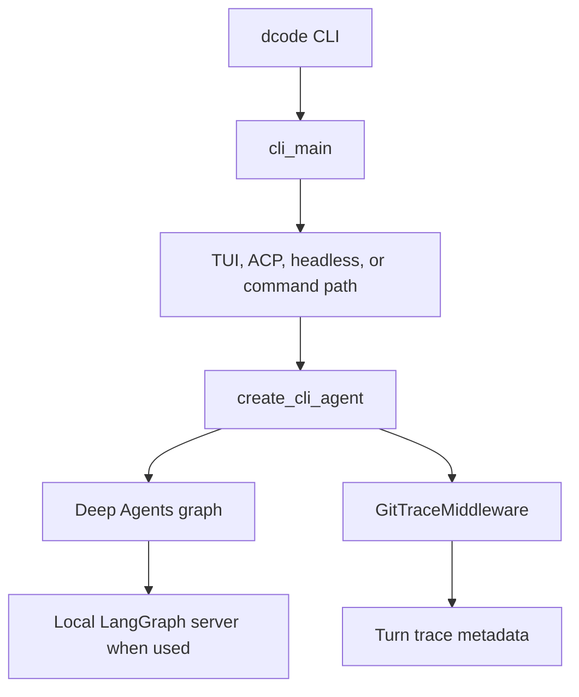
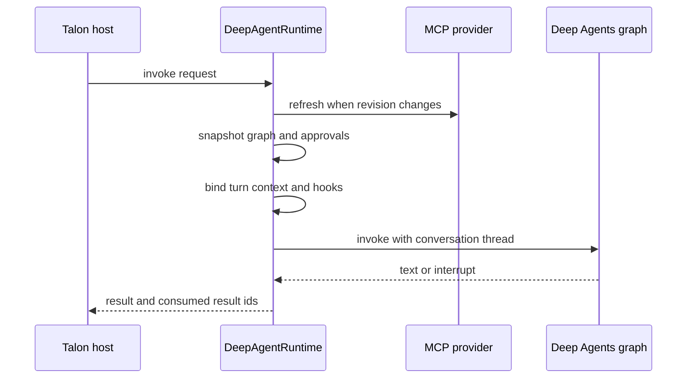
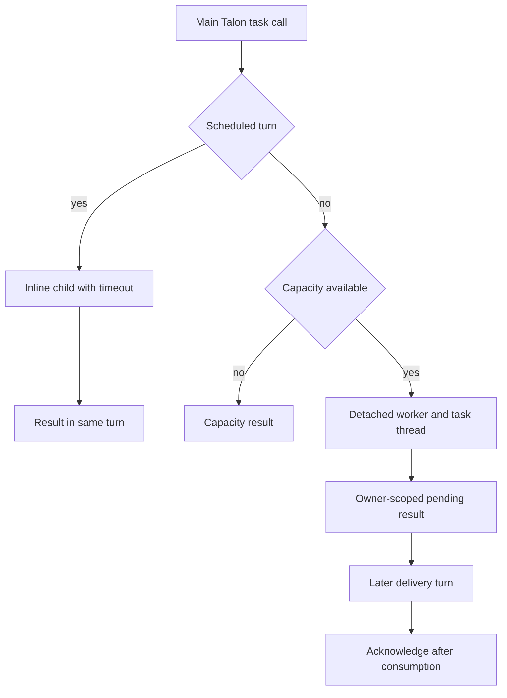

# Repository Source Map

Route a change to the component that owns its state and lifetime—not merely the API that exposes it. This map follows public dcode and SDK construction surfaces into dcode's graph server and trace attribution, then Talon's long-lived runtime, delegation, and host. See [Architecture Overview](./overview.md), [runtime behavior](./runtime-behavior.md), [trace attribution](../concepts/trace-attribution.md), [Talon integration](../integrations/talon.md), [quickstart](../quickstart.md), and the [testing guide](../testing/testing-guide.md).

## Change routing

| Change affects… | Start at | Owner and boundary | Focused tests |
| --- | --- | --- | --- |
| SDK tools, profiles, middleware order, state schema, or injected persistence | `libs/deepagents/deepagents/graph.py` — `create_deep_agent` | The compiled graph; callers retain checkpointer, store, and cache ownership | `libs/deepagents/tests/unit_tests/test_graph.py`, `test_end_to_end.py`, `test_subagent_refusal.py` |
| dcode CLI launch, command dispatch, or managed-policy admission | `libs/code/deepagents_code/main.py` — `cli_main` | CLI owns process-level bootstrap and selects TUI, ACP, non-interactive, or command paths | `libs/code/tests/unit_tests/test_main.py`, `test_main_args.py`, `test_main_acp_mode.py` |
| dcode graph assembly, shell/approval policy, skills, or model selection | `libs/code/deepagents_code/agent.py` — `create_cli_agent` | dcode's configured graph and composite backend | `libs/code/tests/unit_tests/test_agent.py`, `test_end_to_end.py` |
| dcode checkout attribution or trace metadata | `libs/code/deepagents_code/git_trace.py` — `GitTraceMiddleware` | Per-thread, per-turn trace reconciliation; never a tool-result dependency | `libs/code/tests/unit_tests/test_git_trace.py`, `test_git_trace_integration.py` |
| dcode graph serving, offload operations, server startup, or reaping | `libs/code/deepagents_code/client/launch/server.py`; `offload_api.py` | Generated `langgraph.json` and the private Starlette boundary; `ServerProcess` owns its subprocess | dcode server-launch and offload API tests |
| Talon graph wiring, turn snapshots, approvals, MCP/subagent reload, or shutdown | `libs/talon/deepagents_talon/runtime.py` — `DeepAgentRuntime` | Runtime graph snapshot and invocation context variables | `libs/talon/tests/test_runtime.py`, `test_subagent_reload.py`, `test_mcp_config.py` |
| MCP loading/configuration/reload | `libs/talon/deepagents_talon/mcp.py`, `mcp_config.py` | Provider revisions and locked, redacted configuration | `test_mcp_config.py`, `test_mcp_enabled.py`, `test_mcp_adapter.py` |
| Fresh local subagents, task attachments, approvals, or follow-ups | `libs/talon/deepagents_talon/subagents.py`, `subagent_control.py` | Isolated child graph plus in-memory worker control | `test_research_subagents.py`, `test_subagent_control.py` |
| Detached task capacity, delivery, cancellation, or scheduled delegation | `libs/talon/deepagents_talon/background.py` | Process-memory job table keyed by owner conversation | `test_background.py`, `test_background_runtime.py` |
| Conversation persistence, hook transcripts, voice, or host lifecycle | `archive_saver.py`, `hooks.py`, `speech.py`, then `host.py` | Respectively caller-owned stores, trusted hook snapshot, inbound preparation, and host lifecycle | `test_archive_saver.py`, `test_hooks.py`, `test_speech.py`, `test_host.py` |

## Public surfaces, graph construction, and dcode execution

`cli_main()` is the dcode process entrypoint. It keeps `--version` and lightweight diagnostic/help paths ahead of expensive bootstrap, installs terminating-signal handling before launch, dispatches self-contained commands separately, and refuses policy-dependent commands when managed configuration is unhealthy. The TUI entrypoint prespawns the local graph server so server startup overlaps UI import.

`create_cli_agent()` is dcode's construction seam. It turns CLI/server snapshots into a Deep Agents graph and composite backend: it establishes ordered skill sources, validates allowed model strings before executable construction, resolves local subagents, derives approval policy, and composes feature middleware. Treat its main and subagent stacks as coupled: policy or telemetry middleware that applies only to one path can make delegated execution behave differently from its parent.

When Git attribution is enabled, `create_cli_agent()` puts `GitTraceMiddleware` in both main and declarative-subagent stacks. The middleware ignores known read-only operations, snapshots relevant checkouts around potentially modifying calls, and updates only the initiating turn's trace with changed repository/branch metadata. Probe failures never fail a tool: they back off and ultimately disable attribution for the session.

*The CLI selects a public mode; graph construction owns execution middleware, while optional attribution only enriches tracing.*

`create_deep_agent` is the SDK construction seam: it accepts caller-provided backend, middleware, subagents, checkpointer and store dependencies, composes its protected core and tail middleware stack around them, and `DeepAgentState` uses a `DeltaChannel` reducer for messages to limit checkpoint growth.

The main graph starts with filesystem tools and optional SDK `SubAgentMiddleware`, then parent notification, summarization, patched tool calls, and optional remote async delegation. The captured core precedes profile middleware, skills, prompt caching, optional memory, approval interrupts, unsupported-content handling, and refusal handling. Caller middleware replaces matching named slots or is inserted relative to the core; exclusions are applied after assembly and excluded tool names are stripped last. Middleware name and order are therefore behavioral contracts.

`ModelRefusalMiddleware` is tail middleware after unsupported-content handling, so a caller fallback sees a refusal first. By default a top-level refusal raises; excluding it leaves the refusal message observable. Delegated SDK children instead project structured response JSON, then a refusal notice, then final non-empty AI text into the parent `ToolMessage`; refusal-specific validation errors are converted while unrelated validation failures propagate. Remote async SDK tasks are separate from Talon's workers: `AsyncSubAgentMiddleware` persists `async_tasks`, supplies lifecycle tools, and polls unfinished remote tasks on later async invocations. `RubricMiddleware` is inactive without a rubric; otherwise its private state drives post-agent grading and revision without replacing the final visible response on grading failure.

## dcode local server boundary

dcode's generated LangGraph configuration always registers the agent graph, but only its built-in graph adds the authenticated offload Starlette application. The private thread-scoped API covers model metadata, workspace binding, offload/handoff, cancellation, and extensions. Its lifespan wakes queued runs, prebuilds a default runtime while health is polled, cancels that prebuild before extension shutdown, and performs bounded best-effort trace flushing.

`ServerProcess` owns the `langgraph dev` subprocess, not the Textual app. It serializes startup, waits for health, and cleans up incomplete startup including cancellation. On POSIX it creates a separate process session and uses an owner-death pipe, preventing a healthy server from outliving its manager.

## Talon runtime: compile first, swap after success

`DeepAgentRuntime.start()` resolves subagents and approvals before constructing the initial graph. `_create_graph()` builds the current tool catalog, resolves local tool names, filters skill-only MCP tools from the main catalog, prepares subagents, then supplies Talon middleware and dependencies to `create_deep_agent`. The important order is filesystem replacement, selected-model summarization, model selection, progress, approval, hooks, `TaskTools`, background dispatch, optional summarization tool, skills, and caller middleware. Since `after_model` runs in reverse order, hooks are appended after approval so hook resolution happens first.

Each invocation refreshes tools before acquiring the tool lock, reconstructs for an approval change under that lock, and snapshots the graph plus approval state into context variables. It then binds authorization, pending background results, cron origin, breakout handler, and a per-turn hook snapshot. An in-flight turn therefore keeps its graph even if reload succeeds later. `_replace_runtime_tools()` compiles first and assigns `tools` and `_graph` only afterward; both automatic and explicit reload paths preserve the old graph on failure.

*Reload occurs before the stable per-turn snapshot; a turn and its detached children do not observe a mid-turn graph replacement.*

## Talon MCP, persistence, and hooks

`MCPToolProvider` uses refresh revisions to defer loading until a later turn or forced reload. `MCPConfigStore` serves redacted, revisioned configuration and atomically replaces one validated server under a sidecar lock; automatic approval cannot preserve a redacted secret while changing a field that could redirect it. Saved edits are not active until graph replacement succeeds.

`ConversationSaver` bridges caller-owned checkpoint and archive stores. It checkpoints before appending changed top-level scoped messages, leaves archive failure retryable because the stores have no transaction, waits for both writes on cancellation, and refuses deletion of an active session.

Talon hook transcripts use a hashed owner directory and reject symlink and revocation-marker races. `TalonHooks` loads a trusted turn snapshot, gives children distinct identities, and validates interrupt ownership before caching hook responses.

## Talon delegation: fresh children and detached workers

Local Talon subagents come from `AGENTS.md` frontmatter. Their `mode` must be `fresh`; tool names must be unique exact names and are resolved against the parent graph's current catalog. `TaskTools` intentionally uses the SDK `SubAgentMiddleware` name, replacing its parent `task` tool rather than creating two. It permits a named local child to add only advertised, unique task tools and compiles that child in isolation with only approvals applicable to its attached tools. Fresh children do not inherit parent history or skills, and precompiled children are refused when Talon approval policy is present because Talon cannot enforce that policy inside them.

`BackgroundSubagents` intercepts ordinary main-agent `task` and `start_async_task` calls, creates an owner-scoped in-memory job with a separate thread ID, and immediately returns a task ID. Capacity and ownership are enforced at the job table. A worker retains scoped history/cron context but clears authorization and approval-operator context; approval interruption, timeout, and other failure become safe result text. Results are injected into a later owner turn, acknowledged only after its model completes, and may be requeued when the host discards the reply.

A scheduled (cron) turn deliberately takes the opposite path: delegation runs inline under its own semaphore and timeout, produces a result in the same turn, and creates no job. Nested delegation is refused in either mode.

*Chat delegation crosses a detached worker boundary, whereas scheduled delegation waits for its child.*

`SubagentControl` is deliberately outside model-controlled graph state. It retains bounded metadata and message receipts, not tool arguments, outputs, or reasoning. Only Talon-built local workers accept a bounded follow-up; it is injected at the next model boundary, never interrupts a current model/tool call, and does not loosen scope or approvals.

## Host and speech lifecycle

`TalonHost` starts the runtime before channels and scheduler, reverses partially started components when startup fails, and during shutdown cancels host work before channels, scheduler, and runtime while isolating stop failures. Runtime shutdown cancels background workers before closing the checkpointer; it leaves resources open if workers cannot be stopped rather than allowing active writers to use closed persistence.

Inbound voice transcription is best effort and precedes media staging. Disabled, missing, failed, or empty transcription preserves the original message; successful text is appended with `voice_transcribed`. The local Parakeet path converts audio to temporary mono 16 kHz WAV, restricts downloaded artifacts, caches the pipeline, and removes the temporary file.

## Focused test plan

- For SDK stack order, refusal, remote task projection, or rubric behavior, start with the narrow middleware tests and add an end-to-end graph test if compilation crosses the boundary.
- For dcode construction and observability, pair `test_agent.py` wiring coverage with `test_git_trace.py`: read-only bypass, turn isolation, nested checkout discovery, cancellation/failure behavior, and backoff are distinct guarantees.
- For runtime or MCP edits, cover both unsuccessful replacement and subsequent-turn activation in `libs/talon/tests/test_runtime.py`, then configuration redaction/CAS/secret-redirection in `test_mcp_config.py`.
- For fresh children, use `test_research_subagents.py` for frontmatter/catalog/approval behavior and `test_subagent_control.py` for ownership, metadata-only inspection, follow-up timing, and bounded retention.
- For detached work, use `test_background.py` for owner isolation, capacity, authorization stripping, acknowledgement/requeue, delivery failure limits, and scheduled inline semantics.
- For host, archive, hooks, and speech, test lifecycle order and partial-start rollback separately from persistence, transcript ownership, and best-effort media failure behavior.
