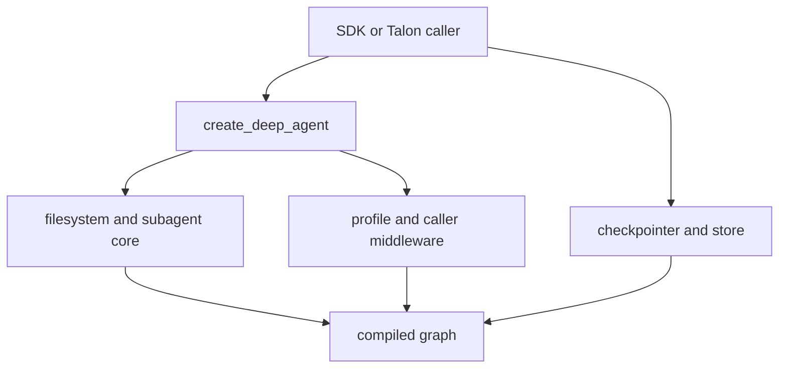
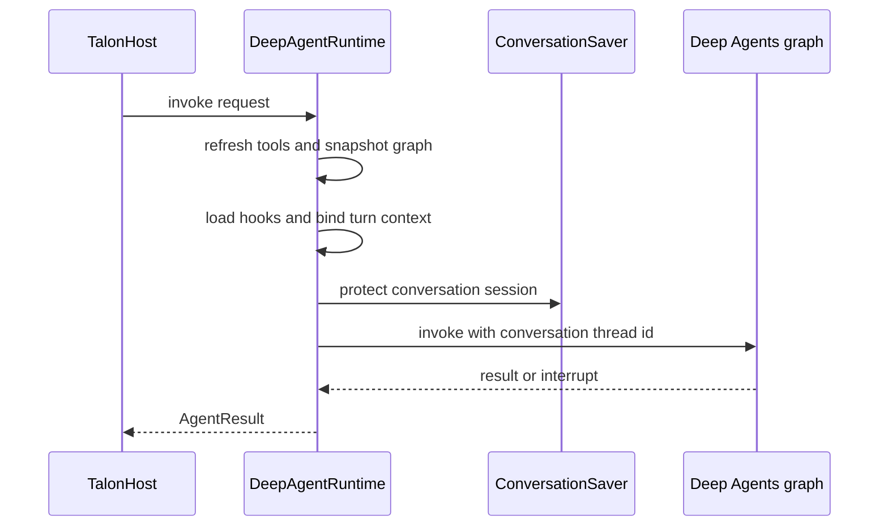

# System Source Map

Route a change to the component that owns the state and lifetime, rather than the caller which happens to expose it. This map concentrates on the SDK graph seam and Talon’s long-running host adaptations. For broader orientation, see [Architecture Overview](./overview.md), [Runtime behavior](./runtime-behavior.md), [Middleware catalog](../concepts/middleware-catalog.md), [Talon](../integrations/talon.md), and the [testing guide](../testing/testing-guide.md).

## Change routing

| If the change affects… | Start at | State or lifecycle owner | Focused tests |
| --- | --- | --- | --- |
| SDK default tools, profile resolution, middleware ordering, or persistence injection | `libs/deepagents/deepagents/graph.py` — `create_deep_agent` | The compiled SDK graph; the caller owns a supplied checkpointer and store | `libs/deepagents/tests/unit_tests/test_graph.py` |
| Remote Agent Protocol task launch, status, update, cancellation, or parent notification | `libs/deepagents/deepagents/middleware/async_subagents.py` — `AsyncSubAgentMiddleware` | `async_tasks` in parent graph state | `libs/deepagents/tests/unit_tests/test_async_subagents.py` |
| Iterative rubric evaluation and grader feedback | `libs/deepagents/deepagents/middleware/rubric.py` — `RubricMiddleware` | Private rubric bookkeeping on the graph thread | `libs/deepagents/tests/unit_tests/middleware/test_rubric_middleware.py` and `test_end_to_end.py` |
| Talon graph wiring, a turn’s context, MCP replacement, approvals, or shutdown | `libs/talon/deepagents_talon/runtime.py` — `DeepAgentRuntime` | Runtime graph snapshot and per-invocation context variables | `libs/talon/tests/test_runtime.py` |
| Checkpoint-to-history projection, history reset, or per-conversation deletion | `libs/talon/deepagents_talon/archive_saver.py` — `ConversationSaver` | Underlying checkpointer plus independent `StoreConversationArchive` | `libs/talon/tests/unit_tests/test_archive_saver.py` |
| Hook transcript storage, deletion, hook snapshots, or hook-interrupt resume | `libs/talon/deepagents_talon/hook_transcripts.py` and `hooks.py` | A `TalonHooks` instance per turn and a transcript owner directory per durable conversation | `libs/talon/tests/unit_tests/test_hook_transcripts.py` and `test_hooks.py` |
| Local agent definitions, task-specific tool selection, fresh child graphs, or child approvals | `libs/talon/deepagents_talon/subagents.py` plus runtime local-definition loading | `TaskTools` and the fresh child graph; parent hooks create isolated child identities | `libs/talon/tests/test_runtime.py` and `libs/talon/tests/unit_tests/test_hooks.py` |

## SDK graph construction

`create_deep_agent` is the reusable construction boundary. It accepts caller-provided tools, backend, middleware, subagents, state/context schemas, checkpointer, store, cache, and response format; built-in filesystem, shell, and `task` capabilities remain additive unless the caller deliberately replaces the relevant middleware. `DeepAgentState.messages` uses `DeltaChannel` so message checkpoint growth is linear rather than repeatedly storing complete history.

The function assembles a protected core stack—filesystem, inline subagents when present, parent notification, summarization, tool-call patching, and async subagents when configured—then inserts profile/user middleware and tail concerns such as skills, caching, memory, approval interrupts, and unsupported-content handling. Profiles can exclude matching middleware, but protected core scaffolding cannot be removed. Consequently, changing middleware names or order is a graph-contract change: check profile exclusion and replacement tests as well as the feature test.

*The SDK compiles the graph; persistence objects are injected by, and remain owned by, the caller.*

## SDK middleware state owners

### Async Agent Protocol subagents

`AsyncSubAgentMiddleware` provides five task tools: start, check, update, cancel, and list. Starting returns immediately; task records persist in `AsyncSubAgentState.async_tasks`, so tracking survives compaction and is available on later turns. A task represents a remote thread and its newest run; queued updates retain superseded run IDs so stale completion notifications do not complete the current task.

In the asynchronous path, the middleware polls only unfinished tasks before the agent and before model calls, converts meaningful status changes into labeled messages, and grants one additional model pass after a final answer only when a new update arrived. A failed status fetch is logged and deferred to a later poll rather than failing the parent turn. The synchronous path leaves polling inactive; local ASGI transport likewise requires an async parent entrypoint. Validate unique names and `interrupt` versus `enqueue` update strategy at construction; fork mode shares a launch-time conversation snapshot but does not synchronize configuration.

### Rubric iteration

`RubricMiddleware` is opt-in per invocation: without a `rubric` state value it is a no-op. With one, it records a private run ID, iteration count, status, frozen criterion names, and accumulated evaluations. It invokes a lazily built nested grader after the main agent reaches a natural stop. A revision verdict injects feedback and jumps back to the model, while satisfied, failed, grader-error, and iteration-limit outcomes end the loop.

A criterion response is validated as a discriminated pass/fail shape; a failing criterion must include an actionable gap. The middleware freezes the first nonempty criterion list to prevent later evaluations from silently shrinking coverage, and downgrades an incompletely supported `satisfied` verdict rather than accepting it. Non-satisfied termination does **not** overwrite the agent’s last response; consumers must inspect private state, the callback, or rubric stream events. Use the unit suite for bookkeeping, validation, coverage, and error paths; use the end-to-end tests for a real graph loop.

## Talon runtime: composition and a turn

`DeepAgentRuntime.start()` resolves subagents, takes the approval-policy snapshot, and compiles the graph. Its graph factory is Talon’s policy composition seam: it assembles runtime tools, approval-management tools, filesystem behavior, selected-model summarization, model selection, progress, approval interrupts, server hooks, Talon task tools, background tasks, skills, and supplied middleware before calling `create_deep_agent`. It also builds a credential-free attachment inventory after the actual tool node is available.

Each `invoke()` refreshes runtime tools before taking the graph snapshot. Under the tool lock it rebuilds for changed approvals, then binds the selected graph, authorization handler, approval state, pending background results, cron origin, breakout handler, and hooks through context variables. The turn loads its hook snapshot in a worker thread, supplies host history scope, protects an archived session from deletion, and invokes using the conversation ID as the thread identity. A successful tool reload is transactional: the replacement graph is compiled before `tools` and `_graph` are assigned, so an invalid replacement leaves the old graph active. Reloaded tools and subagents affect later turns; already-running work retains its snapshot.

*One invocation uses a stable graph and context snapshot; dynamic configuration is applied between turns.*

## Archive persistence and transcript erasure

`ConversationSaver` wraps—not replaces—the asynchronous LangGraph checkpointer and a separate conversation archive; it deliberately does not take either resource’s lifetime. It forwards checkpoint configuration, versioning, listing, delta reconstruction, and pending writes to the backing saver. For top-level checkpoints carrying trusted Talon channel/chat metadata, it persists the checkpoint first, then appends changed message revisions to the archive and acknowledges the checkpoint. Nested namespaces and unscoped runs do not enter history.

There is intentionally no cross-store transaction. A checkpoint failure creates no archive entry; an archive failure propagates after checkpoint persistence and can be repaired by retrying the same checkpoint without duplicate archived revisions. Cancellation is delayed until both writes complete, preventing reset from racing an unfinished projection. Deletion proceeds in retryable order: revoke and erase hook transcripts, delete the backend thread, then remove the archive session. `protect_session()` prevents a conversation tool from deleting a running session; batch deletion also rejects the current session and can be partially complete after failure.

Hook transcripts are an additional projection inside the same conversation erasure boundary. `ConversationTranscripts` uses a hash-derived owner directory under `transcripts/conversations`, rejects symlinked paths, and guards writes/materialization with a process-wide lock. Erasure leaves a changing `.deleted` marker: stale parent or child adapters detect it and cannot write after deletion, while a deliberately reopened fresh turn can proceed after a reset rollback. `DeepAgentRuntime` connects this cleanup to `ConversationSaver` even when hooks are currently absent.

## Hooks and local subagents

`TalonHooks.load()` loads trusted assistant-home hooks once per turn and explicitly disables workspace hooks. It owns a hook runtime, one immutable hook snapshot ID, transcript store, prompt identity, and memoized responses. A child receives a fresh thread/prompt identity and agent identity while retaining the parent snapshot; this keeps concurrently delegated child transcripts and hook invocations isolated. When resuming interrupts, `TalonHooks` fulfills only recognized hook payloads, requires unique interrupt IDs, verifies snapshot/thread/prompt ownership, and caches each invocation response. Normal tool approval is still required unless hook policy already denied the call.

Local Talon definitions are read from `agents/*/AGENTS.md` (with the legacy sibling directory fallback). YAML frontmatter supplies name, description, optional model, exact tool names, and optional web access; malformed definitions are skipped where parsing is recoverable, while duplicate definitions or invalid options fail resolution. Tools are resolved from the graph’s actual catalog before compilation. Talon only supports fresh-context local subagents: fork mode is rejected.

`TaskTools` replaces the SDK’s `SubAgentMiddleware` by name so the parent has exactly one `task` tool. For a named local subagent, `task(tools=[...])` permits only unique names from the exposed attachment catalog and compiles a fresh child with the configured tools plus selected additions. The child does not inherit parent history or skills. Its approval map is limited to tools it actually has, and it receives Talon’s MCP middleware and—when hooks are active—an isolated hook adapter with an in-memory child checkpointer. Nested delegation is refused, and a child approval interrupt reports that no protected action ran.

## Test selection

Start with the narrow test named in the routing table. Add a graph-level test when a change alters stack replacement, state schema, graph rebuild, or a call boundary between these owners. In particular:

- Archive changes should cover failure ordering, retry/idempotency, cancellation, scope exclusion, and deletion protection in `test_archive_saver.py`.
- Transcript/hook changes should cover deletion across restart, stale writer rejection, child isolation, snapshot validation, and concurrent children in `test_hook_transcripts.py` and `test_hooks.py`.
- Local-subagent changes should exercise both runtime assembly and hook-backed child execution; do not validate only frontmatter parsing.
- Async-subagent changes should cover persisted task status and notification behavior on the asynchronous path, not just tool schemas.
- Rubric changes require both middleware bookkeeping tests and end-to-end loop coverage, because status is private state while model revision is graph control flow.
