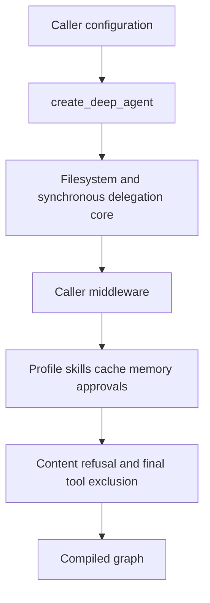
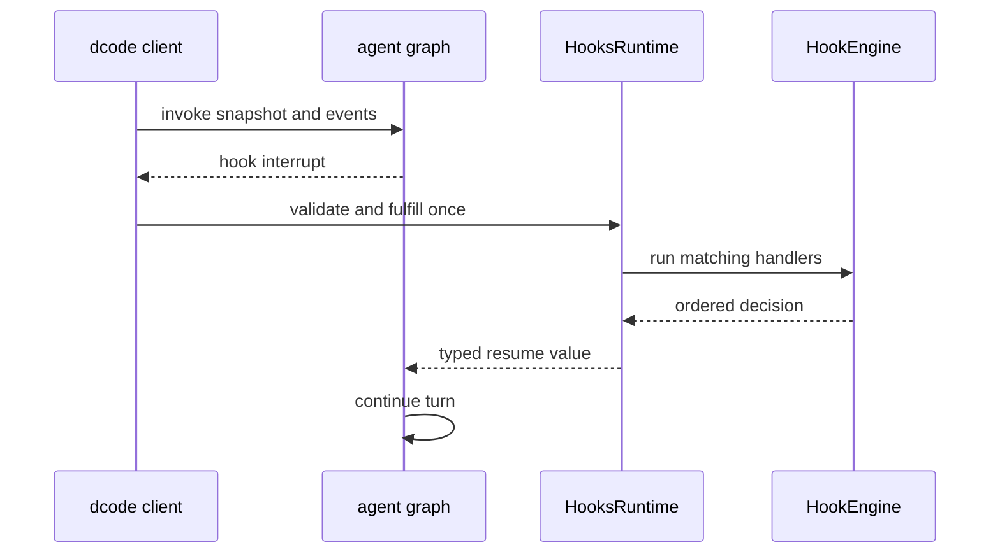
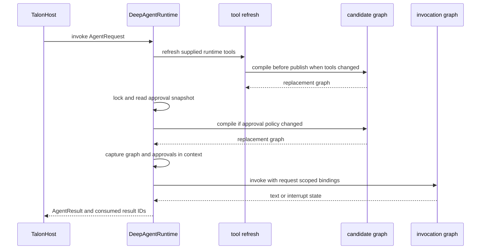

# Source Map

Use this page to find the state owner and enforcement boundary before changing a public surface. It routes by behavior rather than cataloguing files. For wider context see [Architecture Overview](./overview.md), [Profiles and Models](../concepts/profiles-models.md), [Subagents and Skills](../concepts/subagents-skills.md), [Talon Runtime Integration](../integrations/talon.md), and the [Testing Guide](../testing/testing-guide.md).

## Change routing

| Change affects… | Start here | Owner and safe-change boundary | Focused coverage |
| --- | --- | --- | --- |
| Agent construction, message state, built-in visibility, caller middleware, profiles, or persistence dependencies | `libs/deepagents/deepagents/graph.py` — `create_deep_agent` | The compiled SDK graph; callers own checkpointer, Store, cache, and custom middleware | `libs/deepagents/tests/unit_tests/test_graph.py`, subagent tests |
| Persistent filesystem data across threads | `libs/deepagents/deepagents/backends/store.py` — `StoreBackend` | Caller-supplied or execution-context `BaseStore`; the namespace factory is the tenant boundary | `libs/deepagents/tests/unit_tests/backends/test_store_backend.py` |
| dcode model admission, credentials, provider setup, or managed policy | `libs/code/deepagents_code/model_config.py` — `ModelConfig` | Merged default configuration and `models.allowed`; an explicit configuration path intentionally bypasses managed policy | `libs/code/tests/unit_tests/test_model_config.py` |
| dcode CLI stack, hooks, headless stream/resume behavior, or status output | `libs/code/deepagents_code/agent.py`, then `hooks/` and `client/non_interactive.py` | Paired main/subagent middleware stacks and one client-owned headless session | `test_agent.py`, `hooks/test_server_lifecycle.py`, `test_non_interactive.py` |
| JavaScript subagent cost attribution or QuickJS capabilities | `libs/code/deepagents_code/_js_cost.py`, then `libs/partners/quickjs/langchain_quickjs/middleware.py` | Receipt checkpoints and private per-thread interpreter state; direct bridge/PTC paths are capability boundaries | `test_js_cost_tracking.py`, QuickJS persistence/PTC tests |
| Talon initial graph, tool catalog, approval snapshot, reload, or per-turn context | `libs/talon/deepagents_talon/runtime.py` — `DeepAgentRuntime` | Candidate graph construction and atomic publication under `_tools_lock`; an invocation uses its captured graph/policy context | `libs/talon/tests/test_runtime.py`, `unit_tests/test_tool_approval_runtime.py` |
| Talon local task attachments or fresh child graph policy | `libs/talon/deepagents_talon/subagents.py` — `TaskTools`, `prepare_subagents` | Exact names from the parent catalog; fresh roles are Talon-compiled while compiled/remote roles are opaque | `unit_tests/test_research_subagents.py`, `test_subagent_reload.py` |
| Talon `/context-doctor`, `/model`, `/mcp-reload`, channel delivery, or host lifecycle | `libs/talon/deepagents_talon/host.py`, then `context_doctor.py` or `model_selection.py` | `TalonHost` owns commands, channel delivery, and persisted selection; optional runtime protocols prevent host coupling | `unit_tests/test_context_doctor.py`, `test_model_selection.py`, `test_host.py` |
| Talon durable history and semantic search | `libs/talon/deepagents_talon/store_archive.py` | Caller-owned metadata Store plus an optional separate vector Store | `unit_tests/test_store_archive.py`, `store_archive_contract.py` |
| Release-PR dependency validation or release scope | `.github/workflows/check_dep_freshness.yml`, `.github/scripts/release/check_wheel_dep_freshness.py`, then the scope workflow/script | Workflow owns merge-facing decisions; scripts compute target, metadata, or fan-out facts | Release-script tests and workflow validation |
| Unified benchmark dispatch, model pool sizing, Harbor leaves, shards, or artifacts | `.github/workflows/unified_evals.yml`, then `.github/workflows/_harbor_run.yml` | Unified preparation owns the expected matrix; Harbor owns validated leaves and aggregation | `.github/scripts/tests/evals/test_unified_workflow.py`, shard/workflow contracts |

## Graph construction: the SDK seam

`create_deep_agent()` is the SDK construction seam. `DeepAgentState.messages` uses a `DeltaChannel`, avoiding quadratic checkpoint growth. The function resolves a model/profile, binds the selected backend to backend-consuming middleware, and passes caller persistence dependencies to the compiled LangGraph graph. It is therefore the right place to change graph-wide defaults, not a post-compilation patch point.

*SDK construction protects the core capability boundary, then applies caller and profile customization before the final tool filter.*

Caller middleware with a matching name replaces the default in place; a new name is inserted after the core stack and before the profile/prompt/memory tail. A profile cannot exclude `FilesystemMiddleware` or `SubAgentMiddleware`: removal fails rather than silently removing filesystem enforcement or the synchronous `task` handler. Profile tool exclusion is deliberately final, so a caller middleware cannot restore a profile-excluded tool.

`subagents=` has three paths. Declarative and precompiled specs use the synchronous `task` path; an `AsyncSubAgent` becomes remote task lifecycle tools. Declarative children are assembled with their own profile and inherited-or-overridden permissions; compiled and remote graphs remain their provider's responsibility. When changing state, retain the child boundary's private-field filtering and final exclusion behavior.

`StoreBackend` is the durable cross-thread filesystem adapter. It resolves a caller namespace against an explicit or runtime `BaseStore`, rejects namespace components that could widen Store searches, and preserves text and base64 binary content. Its backend tests are the boundary for pagination, encoding, and literal recursive deletion.

## dcode: policy, hooks, and execution

`ModelConfig.load()` is dcode's model-configuration boundary. Default loading merges managed policy; explicit-path loading does not. A present `DEEPAGENTS_CODE_` variable wins over the canonical counterpart even when empty. `models.allowed` distinguishes unrestricted (`None`), deny-all (empty), and exact or `provider:*` admission; malformed declared policy fails closed. Use the model-policy gate rather than interpreting provider strings separately.

`HooksRuntime` freezes a client-owned workspace snapshot and exposes its ID, transcript projection, and configured server events to the graph. Project-hook execution requires resolved workspace trust. `HookEngine` runs matching handlers concurrently with individual limits but reduces in configuration order. The server middleware is the graph-side bridge: it checkpoints the hook context, only emits configured lifecycle events, resolves pre-tool decisions before normal approval routing, and prevents its private bookkeeping from entering public graph I/O or subagent result merges.

*The graph decides where an interrupt belongs; the trusted client snapshot determines whether and how matching handlers run.*

`create_cli_agent()` installs server hook middleware on both main and subagent stacks. The main stack places it after HITL, ensuring a pre-tool decision resolves before approval routing; subagents keep tool hooks but do not emit `Stop`. The fulfillment client rejects a request from another snapshot and de-duplicates repeated `(snapshot_id, invocation_id)` execution.

`run_non_interactive()` owns one headless streaming session. It gates shell execution using the resolved allow-list and explicit project-hook trust, resumes responses in a bounded turn loop, writes agent response text to stdout in quiet mode, and returns 124 after its turn budget. `cli_main()` adds best-effort OSC status publication, which never changes the process exit code. `ProgramStatusReporter` owns validated, bounded, sanitized OSC output while `AgentStatusTracker` owns TUI status precedence and cleanup.

`CostAwareCodeInterpreterMiddleware` only changes asynchronous JavaScript-dispatched subagent accounting. It isolates child checkpoint namespaces, collects idempotent durable receipts once work settles, and returns a parent session-cost transfer; synchronous execution stays on the ordinary middleware path. In the base QuickJS middleware, thread state is private and can be restored only from a bounded optional-HMAC snapshot; invalid snapshots are cleared. `fs=True` and programmatic tool calling bypass normal Deep Agents filesystem permission or per-tool HITL paths, so treat them as explicit capability decisions.

## Talon: graph catalogue, replacement, and per-turn context

`DeepAgentRuntime.start()` resolves subagents, obtains an approval snapshot, and compiles the initial graph. `_create_graph()` constructs its runtime tool list, separates skill-only MCP tools, adds approval-management tools, resolves each local subagent's named attachments against a catalog that includes filesystem tools, prepares child definitions, then calls `create_deep_agent()`.

The Talon middleware list is intentional. It replaces SDK filesystem and summarization slots, installs model selection, progress, approval and server-hook middleware, replaces the SDK synchronous-subagent slot with `TaskTools`, adds background delegation, then conditionally adds context-size tooling, memory, skill handling, caller middleware, MCP filtering, and prompt caching. `get_agent_tools` distinguishes a role's configured attachment inventory from tools selectable for a one-off local `task`; precompiled and remote definitions remain opaque.

*Replacement construction finishes before publication; the active turn resolves graph calls through its captured context rather than a later reload.*

Before each invocation, `invoke()` runs the optional refresh callback. Refresh/reload and approval-change paths hold `_tools_lock`; `_replace_runtime_tools()` and subagent reload compile first, then assign tools/definitions and `_graph`. A failed automatic refresh marks saved MCP changes inactive and retains the current graph; an explicit MCP reload reports failure without publishing a partial replacement. Once the invocation stores graph and approval snapshot context variables, later changes cannot alter that running turn.

Request scope is also the authority boundary. The runtime binds the selected model/effort, operator approval eligibility, authorization and breakout handlers, hook session, cron origin, pending background results, progress/question/history context, and checkpointer session protection for the invocation, then resets them in `finally`. A model selected by the host is validated/build-cached before use; `ModelSelectionMiddleware` swaps it into main-agent calls and selected-model summarization uses its own thresholds, without recompiling the graph. If a saved selected model can no longer be built, the turn falls back to the default.

### Local roles and diagnostics

`TaskTools` deliberately uses the SDK `SubAgentMiddleware` name, replacing rather than duplicating the SDK `task` tool. An optional `tools` argument is accepted only for a named local role; names must be unique and in the non-delegation parent catalog, and augment configured tools for that task. `prepare_subagents()` rejects fork mode. It freshly compiles local roles with explicit tools, applicable approval rules, MCP/control middleware, and a fresh context; under active approval policy it refuses opaque precompiled runnables because Talon cannot enforce policy inside them.

`ContextDoctor` is paired with a successfully compiled graph and is read-only. It reads a named checkpoint, reloads configured memory and skills for estimation, derives initial tool schemas while accounting for deferred and skill-only MCP tools, and estimates conversation tokens after a summarization event. The report exposes counts rather than source contents or paths, bounds row detail, and deliberately excludes middleware additions and provider overhead. `DeepAgentRuntime.context_doctor()` refuses to run before startup.

`TalonHost` owns command routing and channel-safe presentation. `/context-doctor` calls the optional diagnostics protocol with a ten-second limit, follows the current reset thread and selected model, does not interrupt active work, and returns a generic failure instead of backend details. `/mcp-reload` similarly invokes the optional reload protocol and exposes only a success/unavailable/generic-failure response. `/model` lists discovered models to callers, but only an operator can validate, persist, and switch the global selection; the persisted selection affects later turns.

`StoreConversationArchive` is separate from graph checkpointing. It persists scoped, idempotent transcript records in a caller-owned metadata Store, uses a separate vector Store only when indexing is enabled, indexes user text and host-confirmed replies, bounds retrieval scans, and journals vector-first deletion so recovery can continue after interruption.

## CI and evaluation ownership

The release dependency-freshness workflow is an artifact gate for release-please PRs: it resolves a release target, reports dependency-minimum freshness, builds one wheel, validates metadata against PyPI and sibling source constraints, and installs that wheel with dependencies resolved only from PyPI. The separate release-scope path reads trusted base-revision configuration, identifies potential multi-component bump fan-out, and lets the workflow make the merge-facing decision, with `ci:allow-lockfile-release` as an explicit acknowledgement.

`unified_evals.yml` owns manual cross-model dispatch. It validates and constructs an expected per-model flat matrix, derives the outer concurrency limit, and invokes the reusable Harbor workflow. LangSmith usage collection is best-effort and isolated from the repository-writing publisher. `_harbor_run.yml` either expands a single dataset or accepts the pre-expanded matrix, caps its runner pool from that matrix, validates credentials and untrusted inputs, partitions matching shard selections, and writes empty-shard markers so aggregation distinguishes intentional no-op work from missing results.

## Focused test plan

- **SDK and Store:** begin with `libs/deepagents/tests/unit_tests/test_graph.py`; pair Store changes with `unit_tests/backends/test_store_backend.py` and its async counterpart.
- **dcode:** use `libs/code/tests/unit_tests/test_model_config.py`, `hooks/test_engine.py`, and `hooks/test_server_lifecycle.py`; pair headless or status changes with `test_non_interactive.py` and `test_program_status.py`.
- **QuickJS:** use `libs/code/tests/unit_tests/test_js_cost_tracking.py` for durable transfer accounting and `test_js_cost_sync.py` for the unchanged synchronous path. Pair interpreter lifecycle, persistence, or tool exposure changes with the QuickJS middleware, snapshot, and PTC suites.
- **Talon construction/replacement:** `libs/talon/tests/test_runtime.py` verifies tool refresh and transactional MCP replacement. Pair policy snapshots with `unit_tests/test_tool_approval_runtime.py` and local-role or reload work with `test_research_subagents.py` and `test_subagent_reload.py`.
- **Talon diagnostics/models:** `libs/talon/tests/unit_tests/test_context_doctor.py` covers content-free, non-mutating estimates, deferred MCP accounting, reload visibility, and safe host command behavior. `test_model_selection.py` covers operator gating, persistence, catalog admission, selected-model use, unavailable fallback, and gateway validation.
- **Talon host/history:** use `test_host.py` for lifecycle, command routing, delivery, and callback ownership; retain archive contract coverage for persistent history.
- **Evaluations and release:** use `.github/scripts/tests/evals/test_unified_workflow.py` for dispatcher wiring/matrix validation, pair shard changes with shard/workflow contracts, and retain release-script/workflow tests for target resolution, one-wheel validation, PyPI-only install, and scope fan-out.
