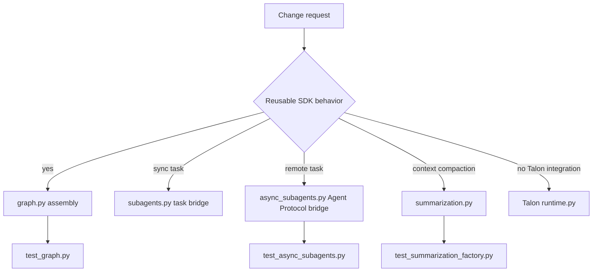
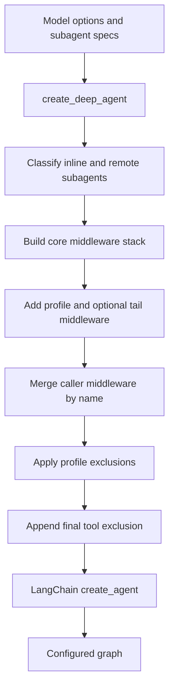
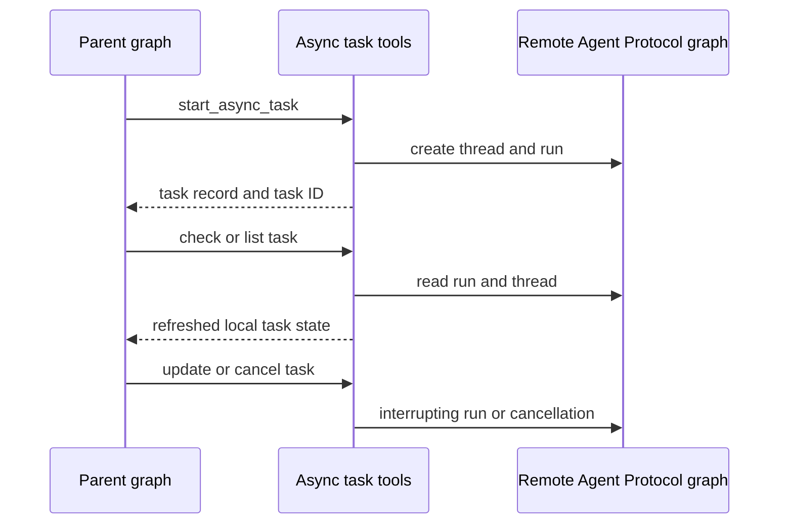

# Source Map and Ownership Boundaries

Use this page to route a behavioral change to the component that owns it, then run the smallest focused SDK test. The key boundary is intentional: Deep Agents owns reusable graph construction and middleware behavior; Talon owns its product runtime composition and invokes those SDK seams rather than redefining them. See the [architecture overview](./overview.md), [SDK construction and execution](./sdk-construction-execution.md), [middleware catalog](../concepts/middleware-catalog.md), [quickstart](../quickstart.md), and [testing guide](../testing/testing-guide.md) for broader guidance.

## Route a change

| Change intent | Owner and primary seam | Focused test starting point |
| --- | --- | --- |
| Change graph state, model/profile resolution, backend defaults, middleware ordering, generated general-purpose subagent, permissions-to-approval wiring, or final graph compilation | Deep Agents: `libs/deepagents/deepagents/graph.py` — `create_deep_agent` | `libs/deepagents/tests/unit_tests/test_graph.py` |
| Change blocking `task` validation, child compilation, child input/output state boundary, fork behavior, or returned result selection | Deep Agents: `libs/deepagents/deepagents/middleware/subagents.py` — `SubAgentMiddleware` and `_build_task_tool` | SDK subagent tests under `libs/deepagents/tests/unit_tests/middleware/` plus graph coverage when assembly changes |
| Change Agent Protocol client use, remote task launch/check/update/cancel/list semantics, async task state, tracing headers, or remote fork payloads | Deep Agents: `libs/deepagents/deepagents/middleware/async_subagents.py` — `AsyncSubAgentMiddleware` | `libs/deepagents/tests/unit_tests/test_async_subagents.py` |
| Change compaction thresholds, summary generation, history/media offload, overflow recovery, or the factory's defaults and knobs | Deep Agents: `libs/deepagents/deepagents/middleware/summarization.py` — `create_summarization_middleware` and `SummarizationMiddleware` | `libs/deepagents/tests/unit_tests/middleware/test_summarization_factory.py`; add behavior-specific summarization tests for lifecycle changes |
| Change Talon-only tools, approval store integration, model selection, progress delivery, Talon backend choice, or its middleware replacements | Talon: `libs/talon/deepagents_talon/runtime.py` — `DeepAgentRuntime._create_graph` | Talon runtime tests; do not move product policy into the SDK middleware above |



This map routes by the behavior being changed, not by the product that happens to call it.

## Graph assembly: the SDK composition seam

`create_deep_agent` is the public construction boundary. It resolves a model and harness profile, supplies `StateBackend()` when the caller omits a backend, classifies supplied subagent specifications, builds the final middleware stack, and delegates compilation to LangChain `create_agent`. It passes through the supplied prompt, tools, response format, context schema, checkpointer, store, debug, name, and cache. The result is configured with Deep Agents metadata and a recursion limit.

`DeepAgentState.messages` uses a `DeltaChannel` and the SDK reducer rather than repeatedly checkpointing the complete message list. The reducer handles replay without a seeded messages value, replaces or removes messages by ID, and supports the all-messages reset sentinel. A custom state schema must retain the `DeepAgentState` message-channel contract.

The assembly order is a compatibility boundary. Its core is filesystem middleware, synchronous subagent middleware when inline workers exist, summarization, patched tool calls, and asynchronous-subagent middleware when remote workers exist. Profile layers, optional skills and memory, caching, optional human review, unsupported-content handling, and final tool exclusion form the tail. A same-named caller middleware replaces the existing slot; a new one is placed after the core and before the tail. Middleware filtering runs again after that merge, while tool exclusion is appended last.

`FilesystemMiddleware` and `SubAgentMiddleware` are protected scaffolding: filesystem middleware supplies built-in file behavior and permissions, while synchronous subagent middleware supplies `task`. A harness profile that attempts to exclude either fails at construction rather than producing an agent without a core capability. This does not make every subagent mandatory: when no inline worker exists because the general-purpose worker is disabled and no synchronous spec is supplied, `task` is absent; remote async tools remain independently available.



This flow shows where ordering changes belong and why a caller middleware cannot restore a profile-excluded tool.

## Synchronous delegation: `subagents.py`

`SubAgentMiddleware` owns the blocking `task` tool. Its input pool consists of declarative `SubAgent` specifications and caller-owned `CompiledSubAgent` runnables. The middleware rejects duplicate names and unsupported modes before building the tool. A declarative child is compiled with its resolved model, tools, middleware, and optional response format; a compiled child is not reconstructed or given a new schema by the SDK.

An isolated task receives permitted parent state plus one human message containing the delegated description. A fork instead receives the parent’s effective conversation—applying the current summarization event—followed by the task. Declarative forks retain the state needed to rebuild the parent’s prompt but receive a private marker that refuses recursive `task` calls. Compiled forks get a narrower state because the SDK cannot assume their graph schema. These are state-ownership rules, not merely prompt conventions.

When a child finishes, the bridge requires a `messages` result. It removes messages, defined excluded keys, middleware-private fields, and unchanged inherited values from the parent update; then it returns exactly one tool message to the parent. That message contains a serialized structured response when one exists, otherwise the last non-empty AI message. Changes to what crosses this boundary belong here and should consider parallel task calls and custom state reducers.

## Remote delegation: `async_subagents.py`

`AsyncSubAgentMiddleware` is a separate, non-blocking delegation path for Agent Protocol servers. Each spec identifies a remote graph by `graph_id` and may provide a URL and headers. Construction requires at least one uniquely named spec and accepts only `isolated` or experimental `fork` modes. The middleware publishes five tools: `start_async_task`, `check_async_task`, `update_async_task`, `cancel_async_task`, and `list_async_tasks`.

Launch creates a remote thread and run, then writes a local `async_tasks` record keyed by that thread ID with the agent name, current run ID, status, and timestamps. Thus parent graph state owns tracking, while the remote server owns execution, its thread, tools, policy, and approval interactions. A check reads the remote run and, after success, its thread: an interrupted thread is represented locally as `waiting`; successful output is the remote thread’s final message. Lists filter local cached records before refreshing nonterminal records, and retain cached status when a refresh fails.

Updates create a new run on the same remote thread with an interrupting multitask strategy and replace only the tracked run ID. Cancellation calls the server except for a `waiting` task, where no active run exists and the local record is simply marked cancelled. An isolated launch sends only the description. A fork snapshots effective compacted parent history, strips artifacts, rehydrates offloaded tool content, and serializes that snapshot plus the new task. Omitting `url` uses local ASGI transport and therefore requires an async parent invocation; synchronous launch needs a reachable URL.



This sequence separates durable parent tracking from remote execution ownership.

## Summarization: compact requests while retaining a recoverable history

`SummarizationMiddleware` is the SDK layer for automatic compaction and backend-backed recovery. It keeps raw message state and records a private summarization event that reconstructs the effective model request as the summary plus the retained tail. Its per-invocation session ID is persisted so later turns append evicted history to the same backend history file; separate invocations, including subagents, receive different IDs.

Before compaction, the middleware can truncate older large tool-call arguments. It summarizes when its configured thresholds are reached and also retries through compaction after a recognized context-overflow error. Evicted history is offloaded while the summary is generated; an offload failure does not prevent summarization, but leaves no recoverable history path and emits a warning. Inline media is offloaded to references before history persistence; media that cannot be preserved becomes an explicit placeholder rather than silently disappearing.

`create_summarization_middleware` is the default construction seam used by graph assembly. It requires a resolved `BaseChatModel`, computes fraction-based trigger and retention defaults when the model exposes `max_input_tokens`, and otherwise uses conservative fixed token and message defaults. Its optional summary prompt, trim budget, token counter, and replacement summarizer are keyword-only and pass through to the middleware. Use this factory for default-policy changes; use the middleware implementation for compaction lifecycle and storage semantics.

## Talon is a caller, not an SDK ownership shortcut

`DeepAgentRuntime._create_graph` is the Talon integration seam. It prepares Talon runtime tools, approvals, model selection, progress middleware, a checkpointer, and its backend, then calls `create_deep_agent`. It deliberately replaces the default filesystem and summarization slots for Talon-specific behavior and conditionally adds its own summarization-tool middleware. Change that composition in `runtime.py` only when the behavior is Talon-specific. Change the reusable `task`, remote task, default summarization, or graph-assembly contract in the corresponding Deep Agents owner first.

## Focused verification

From `libs/deepagents`, the package test target accepts a focused file through `TEST_FILE`:

```bash
make test TEST_FILE=tests/unit_tests/test_graph.py
make test TEST_FILE=tests/unit_tests/test_async_subagents.py
make test TEST_FILE=tests/unit_tests/middleware/test_summarization_factory.py
```

For a graph edit, prove assembly order, protected/excluded middleware, subagent classification, and resulting compilation inputs. For an async task edit, test both synchronous and asynchronous tool implementations with a mocked SDK transport, persisted task updates, status transitions, remote failures, and fork serialization as applicable. For a factory edit, cover both model-profile branches, prompt formatting, pass-through knobs, model validation, and custom summarizer behavior. A behavior change below the summarization factory also needs a lifecycle-level test near the implementation; the factory test alone intentionally covers construction policy.
