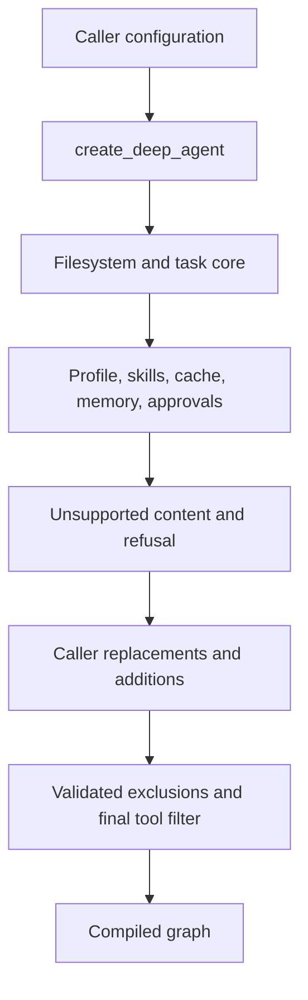
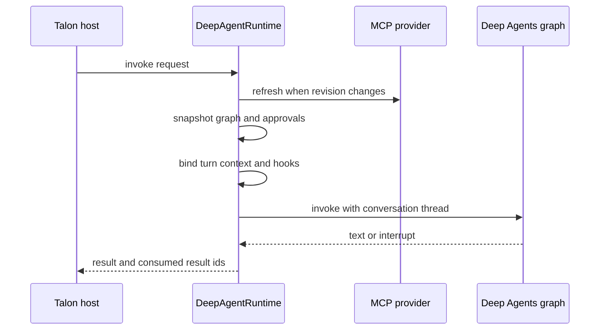

# Repository Source Map

Route a change to the component that owns its state and lifetime—not merely the API that exposes it. This map follows public dcode and SDK construction surfaces into graph construction, Talon's long-lived runtime and delegation, and release dependency maintenance. See [Architecture Overview](./overview.md), [Middleware Stack](./middleware-stack.md), [development](../operations/development.md), [quickstart](../quickstart.md), and the [testing guide](../testing/testing-guide.md).

## Change routing

| Change affects… | Start at | Owner and boundary | Focused tests |
| --- | --- | --- | --- |
| SDK tools, profiles, middleware order, state schema, or injected persistence | `libs/deepagents/deepagents/graph.py` — `create_deep_agent` | The compiled graph; callers retain checkpointer, store, and cache ownership | `libs/deepagents/tests/unit_tests/test_graph.py` |
| Synchronous or forked SDK subagent input, private-state filtering, result projection, or refusal handling | `libs/deepagents/deepagents/middleware/subagents.py` — `SubAgentMiddleware` and its `task` tool | The task boundary translates the child result into parent state | `libs/deepagents/tests/unit_tests/test_subagents.py`, `test_subagent_refusal.py` |
| Remote async SDK subagent lifecycle or notifications | `middleware/async_subagents.py` | Persisted `async_tasks` state and Agent Protocol lifecycle tools | `test_async_subagents.py` |
| dcode CLI launch, command dispatch, or managed-policy admission | `libs/code/deepagents_code/main.py` — `cli_main` | CLI owns process-level bootstrap and selects TUI, ACP, non-interactive, or command paths | `libs/code/tests/unit_tests/test_main.py`, `test_main_args.py`, `test_main_acp_mode.py` |
| dcode graph assembly, shell/approval policy, skills, model selection, or checkout attribution | `agent.py` and `git_trace.py` | dcode's configured graph and per-turn trace reconciliation | `test_agent.py`, `test_git_trace.py`, `test_git_trace_integration.py` |
| dcode graph serving, offload operations, or local server lifecycle | `client/launch/server.py`; `offload_api.py` | Generated `langgraph.json`, private Starlette boundary, and `ServerProcess` | dcode server-launch and offload API tests |
| Talon graph wiring, tool replacement, approvals, MCP reload, or shutdown | `libs/talon/deepagents_talon/runtime.py` — `DeepAgentRuntime` | Runtime graph snapshot and invocation context variables | `libs/talon/tests/test_runtime.py`, `test_subagent_reload.py`, `test_mcp_config.py` |
| MCP configuration or loading | `mcp_config.py`, then `mcp.py` | Redacted revisioned configuration and provider refresh revisions | `test_mcp_config.py`, `test_mcp_enabled.py`, `test_mcp_adapter.py` |
| Fresh local children, task attachments, approvals, or follow-ups | `subagents.py`, `subagent_control.py` | Isolated child graph plus in-memory worker control | `test_research_subagents.py`, `test_subagent_control.py` |
| Detached task capacity, delivery, cancellation, or scheduled delegation | `background.py` | Process-memory job table keyed by owner conversation | `test_background.py`, `test_background_runtime.py` |
| Conversation persistence, hook transcripts, voice, or host lifecycle | `archive_saver.py`, `hooks.py`, `speech.py`, then `host.py` | Caller-owned stores, trusted hook snapshot, inbound preparation, and host lifecycle | `test_archive_saver.py`, `test_hooks.py`, `test_speech.py`, `test_host.py` |
| LangChain-ecosystem lower-bound bumps and locks | `.github/scripts/checks/raise_langchain_minimums.py`, then package `pyproject.toml` | The release manifest owns its declared compatibility floor; the workflow owns resolution filtering and lock regeneration | `.github/scripts/tests/checks/test_raise_langchain_minimums.py` |

## SDK graph and subagent boundary

`create_deep_agent` is the SDK construction seam: it accepts caller-provided backend, middleware, subagents, checkpointer, store, and cache dependencies, then passes persistence and state schema to the compiled graph. Its default `DeepAgentState.messages` uses `DeltaChannel` to avoid quadratic checkpoint growth. Treat middleware order and middleware names as behavioral API: the main stack begins with filesystem and optional synchronous subagent middleware, then parent notification, summarization, patched tool calls, and optional remote async delegation; profile extras, skills, prompt caching, optional memory, approval interrupts, unsupported-content handling, and refusal handling form the tail. A profile exclusion is validated against the assembled main and general-purpose stacks, and tool exclusion runs last so custom middleware cannot restore an excluded tool.

Caller middleware with a matching name replaces that stack slot; a novel name is appended. Private fields declared by any participating state schema are added to `SubAgentMiddleware`'s exclusion set only after caller replacements, so custom task middleware must preserve the private-state contract.

*The graph assembly path makes ordering, replacement, and final filtering explicit.*

`SubAgentMiddleware` owns synchronous child execution. It validates names and modes, builds the `task` tool, compiles declarative specifications, and creates a child input. Ordinary children receive a single `HumanMessage` containing the task; forked children inherit eligible parent state and a reconstructed message history, but cannot delegate recursively. On completion the middleware applies non-private, changed child state and projects a single parent `ToolMessage`: structured response JSON takes priority, followed by a terminal refusal notice, then the last non-empty AI text. Missing `messages` from a compiled child is an error. The sync and async task paths both convert model-refusal errors and refusal-bearing structured-output validation errors, but re-raise other validation failures.

Use `test_graph.py` for assembly invariants—custom state schema propagation, private keys, required/excluded middleware, replacement position, and skills/cache order. Use `test_subagents.py` for actual parent/child state behavior: sync versus remote tool routing, result projection, parallel calls, fork behavior, and private-state non-propagation. Keep `test_subagent_refusal.py` when changing the refusal projection contract.

`ModelRefusalMiddleware` is tail middleware after unsupported-content handling, so a caller fallback sees a refusal first. By default a top-level refusal raises; excluding it leaves the refusal message observable. Remote async SDK tasks are separate from Talon's workers: `AsyncSubAgentMiddleware` persists `async_tasks`, exposes lifecycle tools, and polls unfinished tasks on later async invocations. `RubricMiddleware` is inactive without a rubric; otherwise private state drives post-agent grading and revision without replacing the final visible response on grading failure.

## dcode execution boundary

`cli_main()` is the dcode process entrypoint. It keeps `--version` and lightweight diagnostic/help paths ahead of expensive bootstrap, installs terminating-signal handling before launch, dispatches self-contained commands separately, and refuses policy-dependent commands when managed configuration is unhealthy.

`create_cli_agent()` is dcode's construction seam. It turns CLI/server snapshots into a Deep Agents graph and composite backend, resolves local subagents and approval policy, and composes feature middleware. Treat its main and declarative-subagent stacks as coupled: policy or telemetry middleware installed only on one path can make child behavior diverge. When enabled, `GitTraceMiddleware` is installed in both stacks; it ignores known read-only operations and enriches only the initiating turn's trace, never tool results.

`ServerProcess` owns the `langgraph dev` subprocess. Generated LangGraph configuration always registers the agent graph, while only dcode's built-in graph adds the authenticated, thread-scoped offload Starlette application. The lifespan wakes queued runs, prebuilds a default runtime during health polling, cancels that work before extension shutdown, and makes a bounded best-effort trace flush.

## Talon runtime: compile first, swap after success

`DeepAgentRuntime.start()` resolves subagents and approvals before building the initial graph. `_create_graph()` builds the current tool catalog, resolves local names, prepares subagents, then provides Talon middleware and dependencies to `create_deep_agent`. Invocation refreshes tools before the tool lock, reconstructs for an approval change under that lock, and snapshots graph and approvals into context variables before binding authorization, background results, cron origin, breakout handling, and hook snapshot. An in-flight turn consequently keeps its graph if a later reload succeeds.

*Reload precedes the stable per-turn snapshot, so a turn cannot observe a mid-turn replacement.*

`_replace_runtime_tools()` compiles replacement tools before assigning `tools` and `_graph`; failed explicit or automatic reloads therefore retain the old graph. `MCPToolProvider` uses refresh revisions to defer loading until a later turn or forced reload. `MCPConfigStore` serves redacted, revisioned configuration and atomically replaces a validated server under a sidecar lock; automatic approval cannot reuse a redacted secret while changing a field that could redirect it.

`ConversationSaver` bridges caller-owned checkpoint and archive stores. It checkpoints before appending changed top-level scoped messages, leaves archive failure retryable because no cross-store transaction exists, waits for both writes on cancellation, and refuses active-session deletion. Hook transcripts reside in a hashed owner directory guarded against symlink and revocation-marker races; `TalonHooks` snapshots trust per turn, assigns child identities, and validates interrupt ownership before caching responses.

## Talon delegation and host lifecycle

Local Talon subagents come from `AGENTS.md` frontmatter, resolve exact tools from the current catalog, and run fresh rather than forked. `TaskTools` is the only parent task tool: it validates per-task tool attachments and compiles an isolated child graph with only applicable approvals.

`BackgroundSubagents` detaches ordinary main-agent task calls into owner-scoped in-memory workers with capacity and ownership controls. It runs scheduled-turn delegation inline under a timeout so the same unattended turn receives the result; nested delegation is refused. Detached workers use a distinct task thread, clear authorization and approval-operator state, convert interruption, timeout, or failure into safe results, and acknowledge delivery only after parent consumption. `SubagentControl` keeps bounded metadata and coordinator receipts outside graph state; only Talon-built workers accept queued follow-ups at a later model boundary.

`TalonHost` starts runtime before channels and scheduler, reverses partial startup on failure, and during shutdown cancels host work before stopping channels, scheduler, and runtime while isolating stop failures. Voice transcription is best effort before media staging: it preserves the original message on disabled, failed, or empty transcription and appends successful text with `voice_transcribed`.

## Package compatibility and release touchpoints

The dcode and Talon manifests are not merely install metadata: they define the published compatibility envelope and the workspace edge between packages. dcode pins `deepagents` exactly while setting bounded LangChain/LangGraph family ranges; Talon consumes `deepagents` and `deepagents-code`, maps both to editable sibling sources for local development, and defines mutually exclusive `media` and `media-cpu` extras. Change a package API with the corresponding consumer floor, pin, extras, and lockfile in view.

The `raise_langchain_minimums.py` maintenance script is the change owner for range-floor automation. It considers `langchain`, `langgraph`, `langsmith`, and `deepagents` prefixed requirements in project, optional, and dependency-group tables; preserves upper bounds, extras, markers, and exact pins; and caps a locally sourced sibling requirement at the local declared version. It plans every manifest before writing, fails closed on malformed inputs, unavailable metadata, and unresolved baselines, and can retain only individually compatible bumps after resolution checks. The workflow invokes it with `--check-resolution`, then regenerates affected and reverse-dependent locks using the interpreter selected by the lockfile checker.

## Focused test plan

- For graph construction, begin with `libs/deepagents/tests/unit_tests/test_graph.py`; select the schema/private-state or middleware ordering/replacement cases rather than relying on broad end-to-end coverage.
- For child semantics, begin with `libs/deepagents/tests/unit_tests/test_subagents.py`; cover child input mode, state filtering, projection priority, and concurrent calls. Add `test_subagent_refusal.py` for refusal conversion.
- For dcode construction and observability, pair `test_agent.py` wiring coverage with `test_git_trace.py` for read-only bypass, turn isolation, failure, and backoff.
- For runtime or MCP edits, cover unsuccessful replacement and subsequent-turn activation in `libs/talon/tests/test_runtime.py`, then configuration redaction/CAS/secret-redirection in `test_mcp_config.py`.
- For detached work, use `test_background.py` for owner isolation, capacity, authorization stripping, acknowledgement/requeue, delivery failure limits, and scheduled inline semantics.
- For dependency automation, use `.github/scripts/tests/checks/test_raise_langchain_minimums.py`; retain tests for narrowing, exact/unraiseable floors, resolution filtering, and workflow-to-lockfile handoff when changing the script or workflow.
