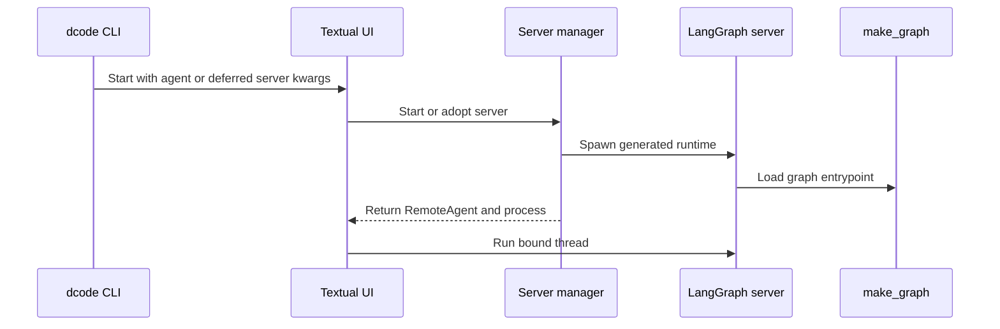
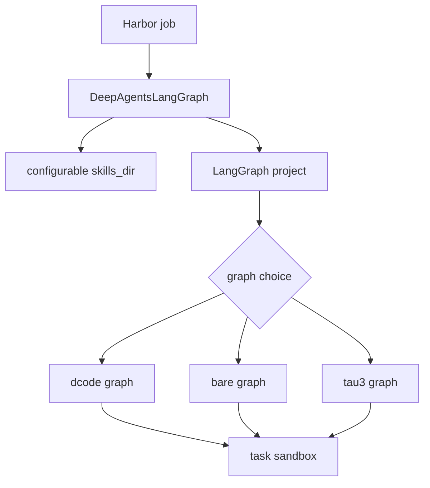

# System Source Map

Route a change to the component that owns its contract and lifetime, not merely to the process where a symptom appears. The reusable `deepagents` package owns graph composition; dcode owns interactive client/server orchestration, workspace policy, local persistence, plugins, and MCP sessions; `deepagents_acp` owns ACP projection; Talon owns a long-running multi-channel host. See [Deep Agents Code Architecture](./code-agent.md), [Architecture Overview](./overview.md), [Plugins](../concepts/plugins.md), [Run evaluations](../workflows/run-evals.md), and the [quickstart](../quickstart.md).

## Change routing

| Change affects… | Contract owner and starting point | Important boundary |
| --- | --- | --- |
| Reusable model/profile resolution, middleware order, tools, subagents, permissions, state, or caller persistence | `libs/deepagents/deepagents/graph.py` — `create_deep_agent` | The SDK constructs a graph; callers own supplied checkpointer and store lifetimes. |
| dcode CLI dispatch, startup mode, Textual UI, resume, approvals, or background server start | `libs/code/deepagents_code/main.py`; `app.py` — `DeepAgentsApp`, `run_textual_app` | The UI can paint before its deferred server is ready; it owns cleanup after it adopts the process. |
| Local LangGraph process configuration, readiness, handoff, or abandoned startup cleanup | `libs/code/deepagents_code/client/launch/server_manager.py` | Bootstrap owns the process until handoff; the returned client/session owns it afterward. |
| Serving graph workspace binding, policy drift, runtime cache, sandbox, or tracing | `libs/code/deepagents_code/server_graph.py` — `make_graph` | Thread-to-workspace binding is durable; a workspace runtime is a disposable cached resource. |
| Local threads, checkpoints, ownership, or deletion | `sessions.py` and `thread_ownership.py` | `sessions.db` is durable shared state; fencing prevents a stale server from writing it. |
| MCP transport validation, tool loading, authorization, or shutdown | `mcp_tools.py` — `MCPSessionManager` | One manager owns router clients and backend connection stacks through cleanup. |
| Plugin marketplaces, manifests, installs, updates, enablement, or plugin state | `plugins/discovery.py`, `manifest.py`, `marketplace.py`, and `store.py` | Mutations are serialized across dcode processes; local source directories are not managed caches. |
| ACP protocol replay or dcode ACP lifecycle | `libs/acp/deepagents_acp/server.py`; dcode `main.py` | Generic ACP owns protocol state; dcode supplies model/MCP resources and per-thread leases. |
| Talon setup, channels, agent runtime, approvals, or scheduler | `libs/talon/deepagents_talon/__main__.py`, `config.py`, and `host.py` | The host owns process-local conversation state; configured stores own durable records. |
| Harbor graph choices, benchmark credentials, staged dependencies, or sandbox environment | `libs/evals/deepagents_harbor/` and `libs/evals/Makefile` | Harbor calls a LangGraph project through `DeepAgentsLangGraph`; each task receives its isolated sandbox context. |
| A provider-backed sandbox adapter | `libs/partners/{daytona,modal,runloop,vercel}/` | A partner package owns its own packaging, lockfile, tests, release wiring, and provider API semantics. |
| Unit-test matrix or package release behavior | `.github/workflows/_test.yml` and `release-please.yml` | CI owns platform branching; release detection and publishing dispatch are separate operations. |

## Core graph and dcode execution path

`create_deep_agent` is the SDK assembly seam. It resolves model/profile configuration and backend capabilities, installs the Deep Agents middleware stack and subagents, then delegates execution to LangChain/LangGraph. `DeepAgentState.messages` uses `DeltaChannel` to avoid checkpoint growth from repeatedly copying full history. Profiles may tailor the visible tool surface, but cannot exclude filesystem or subagent middleware; filesystem permission rules are enforced by that middleware rather than by direct backend calls. The top-level `deepagents` package is the consumer import surface for graph construction, state, core middleware/subagent types, and profile registration.

Dcode deliberately keeps `cli_main` lazy. `main.py` does lightweight argument paths before managed-policy gating, then selects ACP, non-interactive, or Textual operation. In the interactive path, `run_textual_cli_async` resolves a displayable model identity cheaply, can defer startup while credentials are absent, and gives the Textual app the kwargs required to start a local LangGraph server in the background. `DeepAgentsApp` represents connection readiness or failure with messages, allows a prespawned process to be adopted, and `run_textual_app` returns the final thread ID even when it reports a crash snapshot.

*The interactive path paints the UI before deferred startup completes, then transfers server-process ownership to the app/client side.*

The local server manager validates explicit MCP configuration before spawning, serializes `ServerConfig` as `DEEPAGENTS_CODE_SERVER_*` variables, creates a temporary LangGraph project pointing to `server_graph:make_graph`, waits for readiness, and binds the resulting `RemoteAgent` to a required workspace. Startup failure before handoff must reap the child; `server_session` is the convenience context manager that also cleans MCP state and reports preserved logs.

`make_graph` is the served-graph seam. Execution-runtime requests must provide a thread ID and workspace context. It resolves the thread’s persisted workspace binding, rejects policy drift, and finds or creates a runtime keyed by workspace identity plus runtime fingerprint. The binding survives runtime-only changes, while the cache is not persistence and must dispose resources correctly. The process-wide server also carries narrow compatibility patches: the checkpointer adapter enables DeltaChannel history forwarding only for the expected upstream shape, and the in-memory run-queue patch wakes waiting consumers while preserving upstream queue claiming and polling fallback. The dcode lint target AST-checks process-CWD reads because a multi-workspace server’s process directory is not request workspace context.

## Durable threads and ACP

Dcode keeps the shared local database behind session and ownership APIs. The session layer hardens the `sessions.db` location and its SQLite saver, lists threads by checkpoint metadata with exact `cwd` filtering, and opportunistically builds an index so listing need not scan state blobs. Thread ownership combines operating-system locks, an owner token, a writer gate, and fencing checks for checkpoint writes and deletion. A lease release or token rotation therefore fences a still-running stale writer.

`AgentServerACP` adapts either a compiled graph or a session-context factory to the ACP protocol. When loading is enabled, it stores ACP session metadata in the checkpoint thread, validates session/directory identity when restoring, and emits persisted messages and tool calls back to the client. Dcode’s ACP launcher resolves model and MCP resources, initializes the ownership-aware checkpointer, creates a per-session graph factory, and releases both leases and MCP resources on shutdown.

## MCP and plugins: extension lifetimes

MCP configuration is a transport and lifecycle boundary, not merely a tool list. dcode validates stdio versus remote configuration and rejects ambiguous or unsafe combinations such as OAuth on stdio or an OAuth server with an `Authorization` header. `MCPSessionManager` mounts configured backends behind one router/client but retains every adopted load until cleanup, so tools from an earlier load remain usable. Cleanup closes client and backend stacks with bounded teardown, logs ordinary failures, and preserves cancellation semantics.

Plugins are a separately persisted extension system. Discovery coordinates manifests, marketplace materialization, inventory, install/update state, and enablement; marketplace sources can be local directories, files, GitHub/Git, or URLs. Mutations take a cross-process file lock. Managed clones and caches can be removed, whereas a local marketplace directory is never deleted. Plugin state lives under the configured cache/state roots; plugin IDs become bounded hash-suffixed filesystem keys, and remote cache keys are opaque to avoid exposing credentials.

## Talon and sandbox integration

Talon’s CLI builds configured channel adapters and, when a model is configured, opens checkpoint/history infrastructure before constructing `DeepAgentRuntime` with MCP tools, middleware, optional sandbox backend, and scheduler integration. `TalonConfig` namespaces each assistant’s state and applies private directory modes. `TalonHost` owns in-memory locks, task/generation tracking, approvals, and authorization state; startup begins the agent before channels and scheduler, and failure unwinds components that already started.

Dcode’s sandbox registry merges built-in providers, package entry points, and user configuration. Configuration overrides entry points, which override built-ins for construction; metadata can supply working directory, install hints, and capability flags. The partner packages provide concrete Deep Agents sandbox adapters: `langchain_daytona` exposes `DaytonaSandbox`, `langchain_modal` exposes `ModalSandbox`, `langchain_runloop` exposes both provider and sandbox types, and `langchain_vercel_sandbox` exposes `VercelSandbox`. Keep provider-specific timeouts, cleanup, and filesystem error translation in those packages rather than pushing them into generic graph assembly. `langchain-quickjs` is the companion interpreter middleware package, exposing `CodeInterpreterMiddleware` and its streamed subagent events.

## Harbor evaluation graphs and workflows

The Harbor LangGraph project is intentionally separate from the interactive dcode process. Its `langgraph.json` exposes `dcode`, `bare`, and `tau3` graph factories. `DeepAgentsLangGraph` passes Harbor’s task `skills_dir` through `configurable`, the channel available to the graph factory. The graph validates configurable model and skills inputs, uses a sandbox-local working directory, and scrubs provider and tracing secrets from shell execution. The eval Makefile stages checked-out Deep Agents, dcode, ACP, and QuickJS sources into the project before launching Harbor jobs across Docker, Modal, Daytona, Runloop, or LangSmith environments.

*Harbor supplies task context through the adapter and invokes one of three graph factories inside the selected sandbox environment.*

## Focused verification and delivery automation

Prefer the narrowest invariant-owning test: graph and middleware tests for SDK assembly; `test_server_manager.py` for handoff; `test_server_graph.py` and workspace/tracing tests for bindings; session and thread-ownership tests for fencing; ACP tests for protocol replay; Talon main/config/host tests for host lifetime; and plugin, MCP, or sandbox-package tests for their respective boundaries.

The reusable unit workflow validates its caller-supplied JSON matrix, uses frozen `uv` resolution and test dependencies, runs POSIX tests through `make test` with sandbox tests, runs Windows tests directly without the POSIX sandbox, and checks that tests leave the working tree clean. Harbor workflows select dataset, a single model, sandbox environment, graph implementation, task count, rollouts, and concurrency; required secrets vary by selected model and sandbox.

On pushes to `main`, release-please rejects empty commits because path-scoped release inference cannot safely classify them. It identifies a package release from both the package changelog path and release subject, dispatches each recognized package to `release.yml`, waits out pending publication before recomputing release state, and serializes the release-please maintenance job. A new partner or independently released package must be wired into labels, CI, release configuration and manifest, release detection/dispatch, and—when sandbox-backed—Harbor and integration-test credential paths.
