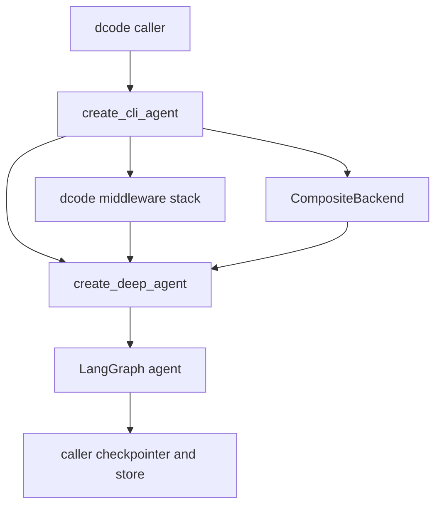
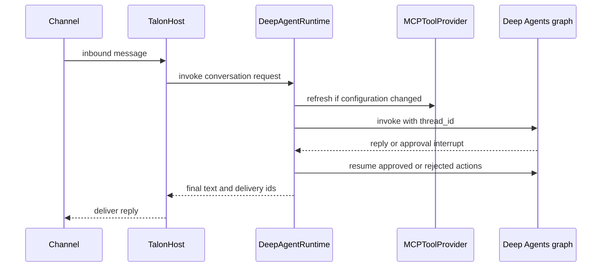

# System Source Map

Route a change to the component that owns its contract and lifetime, not merely to the process where a symptom appears. The reusable `deepagents` package owns graph composition; dcode owns interactive client/server orchestration, workspace policy, persistence, plugins, and MCP sessions; `deepagents_acp` owns ACP projection; Talon owns a long-running multi-channel host. See [Deep Agents Code Architecture](./code-agent.md), [Architecture Overview](./overview.md), [Profiles and models](../concepts/profiles-models.md), [MCP](../integrations/mcp.md), [Talon](../integrations/talon.md), [CI and labeling](../operations/ci-labeling.md), the [quickstart](../quickstart.md), and the [testing guide](../testing/testing-guide.md).

## Change routing

| Change affects… | Lifecycle owner and starting point | Nearest behavioral tests |
| --- | --- | --- |
| Reusable model/profile resolution, middleware order, tools, subagents, permissions, state, or persistence injection | `libs/deepagents/deepagents/graph.py` — `create_deep_agent` | SDK graph and middleware tests; preserve caller ownership of supplied checkpointer/store. |
| dcode graph construction, local backend/artifact routes, prompt/memory/skills, approvals, interpreter, or subagent restrictions | `libs/code/deepagents_code/agent.py` — `create_cli_agent` | `libs/code/tests/unit_tests/test_agent.py`; focused truncation and native-search tests below. |
| Empty or partial provider output | `libs/code/deepagents_code/output_truncation.py` | `libs/code/tests/unit_tests/test_output_truncation.py`. |
| Deferred native MCP-tool discovery | `libs/code/deepagents_code/provider_tool_search.py` | `libs/code/tests/unit_tests/test_provider_tool_search.py`. |
| Local LangGraph process configuration, readiness, handoff, or failed-start cleanup | `libs/code/deepagents_code/client/launch/server_manager.py` | `test_server_manager.py`; bootstrap owns the child until handoff. |
| Serving graph workspace binding, policy drift, runtime cache, sandbox, or tracing | `libs/code/deepagents_code/server_graph.py` — `make_graph` | `test_server_graph.py` and workspace/tracing tests. |
| Local threads, checkpoints, ownership, or deletion | `sessions.py` and `thread_ownership.py` | Session and ownership/fencing tests. |
| dcode MCP transport validation, tool loading, authorization, or shutdown | `mcp_tools.py` — `MCPSessionManager` | MCP tests; one manager owns adopted connections through cleanup. |
| Talon MCP configuration, OAuth, status, reload, or tool naming | `libs/talon/deepagents_talon/mcp.py` — `MCPToolProvider` | `libs/talon/tests/test_mcp.py` and OAuth/config tests. |
| Talon graph construction, turn execution, approvals, tool refresh, recovery, or shutdown | `libs/talon/deepagents_talon/runtime.py` — `DeepAgentRuntime` | `libs/talon/tests/test_runtime.py`, approval, background, and host tests. |
| JavaScript REPL state, PTC bridge, snapshots, or interpreter security | `libs/partners/quickjs/langchain_quickjs/middleware.py` — `CodeInterpreterMiddleware` | `test_repl_middleware.py`, `test_snapshot_persistence.py`, `test_ptc.py`, and `test_subagent_events.py`. |
| Unit-test matrix, changed-package selection, or SDK-to-QuickJS prompt compatibility | `.github/workflows/_test.yml`, `.github/workflows/ci.yml` | Workflow assertions and `test_system_prompt.py` smoke coverage. |
| Curated release-note parsing, draft/apply state, or release-PR gate | `.github/scripts/release/release-notes.js` | `.github/scripts/tests/release/release-notes.test.js` and `test_release_notes.py`. |

## Graph assembly: SDK contract and dcode specialization

`create_deep_agent` is the SDK construction seam: it defaults to `StateBackend`, resolves model/profile configuration, installs the Deep Agents middleware stack, and accepts caller-owned checkpointer and store dependencies. `DeepAgentState.messages` uses a `DeltaChannel` reducer to avoid repeatedly checkpointing complete history. Profiles can alter the visible tool surface, but cannot exclude filesystem or subagent middleware; filesystem permission rules are ordered and translated into human-in-the-loop handling only by middleware, not by direct backend use. The top-level `deepagents` package is the consumer import surface for graph construction, state, core middleware/subagent types, and profile registration.

`create_cli_agent` is dcode’s composition boundary. It resolves a local shell/filesystem or supplied sandbox backend, builds a `CompositeBackend` with persistent conversation-history and large-result routing, and then passes dcode middleware, tool lists, subagents, checkpointer, and store to the SDK. It owns the interaction-specific ordering: runtime model selection, truncation guard, resume/cost/goal state, optional memory and skills, approval behavior, hooks, compaction/retry, and rubric grading. An explicit filesystem-tool allowlist replaces the main filesystem middleware **and is injected into synchronous subagents**; compiled subagents are rejected because their opaque middleware would bypass that restriction. `test_agent.py` is the first place to change when modifying this construction contract.

The interpreter is deliberately a local-only dcode feature: `enable_interpreter=True` with a remote sandbox fails. Its programmatic tool-call bridge does not traverse normal `interrupt_on`/HITL routing, so `InterpreterConfig.ptc` is the effective host-tool boundary; do not treat approval of `js_eval` as approval of every bridged tool. The interpreter middleware is loaded lazily to preserve inexpensive CLI paths.

*Dcode owns its policy-rich assembly inputs; the SDK compiles the resulting graph and callers retain persistence lifetimes.*

### Output and provider-tool-search seams

`output_truncation` normalizes known OpenAI, Anthropic, Google, and Bedrock stop metadata into output-limit, content-filter, or context-window reasons. `EmptyTruncatedReplyMiddleware` raises a serializable `ValueError` subtype rather than checkpointing a silent empty truncated response; it does not retry this failure. For delegated `task` calls, the same error becomes an error `ToolMessage`; partial subagent output instead remains usable and receives a warning. Keep the guard outside retry/recovery middleware as assembled in `create_cli_agent`. `test_output_truncation.py` covers provider mapping, blank versus visible replies, server serialization, retry ordering, and parent/subagent behavior.

`MCPProviderToolSearchMiddleware` is a request-time optimization only for MCP tools that remain exposed on that request. It enables LangChain’s provider-native deferred search only for recognized OpenAI Responses or Anthropic native-format direct/LangSmith-gateway routes (or an explicit profile capability); unsupported models and endpoints retain eager tools and log once. Before forwarding history it strips incompatible native-search blocks, preventing a model/provider switch from replaying foreign wire-format content. `test_provider_tool_search.py` exercises serialized deferred tools, approval/resume, runtime model changes, endpoint rejection, and the dcode default/opt-out switch.

## dcode server, durable threads, ACP, and extensions

Dcode keeps `cli_main` lazy so import does not load startup machinery; it has a version fast path, skips Textual dependency checks for ACP, and dispatches diagnostics before managed configuration. The interactive path can paint the Textual UI before deferred server startup finishes; once it adopts a prespawned server, the app/client side owns its cleanup.

The local server manager validates explicit MCP configuration before spawning, passes `ServerConfig` through `DEEPAGENTS_CODE_SERVER_*`, scaffolds a temporary LangGraph project targeting `server_graph:make_graph`, waits for readiness, and binds the resulting `RemoteAgent` to a required workspace. It reaps a child that fails before handoff. `server_session` additionally cleans its MCP session manager, process, and preserved-log notices.

`make_graph` requires thread ID and workspace context for execution-runtime requests. It resolves the durable thread workspace, caches disposable workspace runtimes by workspace identity plus runtime fingerprint, and refuses policy drift. Its narrow compatibility patches preserve upstream behavior: the checkpointer adapter only forwards DeltaChannel history for its expected upstream shape, and the run-queue patch wakes waiting consumers while retaining stock claim/order/lock behavior and polling fallback. The dcode lint target AST-checks process-CWD reads because process CWD cannot stand in for request workspace context.

Dcode’s session layer owns hardened shared `sessions.db` placement and its ownership-enforcing SQLite saver. Listing uses exact `cwd` metadata filtering and an opportunistic covering index instead of state-blob scans. Thread ownership combines OS locks, writer gating, and fencing tokens, rejecting stale writes and deletion while another client owns the thread. `AgentServerACP` projects a compiled graph or session factory into ACP, persists/validates session working-directory metadata when loading, and replays stored messages and calls. Dcode’s ACP launcher supplies models/MCP, per-session graph factories, checkpointer leases, and shutdown cleanup.

MCP and plugins are independent extension lifetimes. `MCPSessionManager` owns its router client and adopted backend stacks; bounded cleanup logs ordinary failures while preserving cancellation. Plugin marketplace/install mutation is serialized cross-process; configurable roots use hash-suffixed safe IDs and opaque remote cache keys. Sandbox construction resolves configured providers before entry points before built-ins; provider metadata describes working-directory and capabilities. Each partner package owns its environment, packaging, tests, and release wiring.

## Talon: MCP capability lifecycle and runtime turns

Talon’s CLI builds configured channel adapters and, with a model, opens checkpoint/history infrastructure before creating `DeepAgentRuntime` with MCP tools, middleware, optional sandbox, and scheduler integration. `TalonConfig` namespaces assistant state, creates private directories, initializes approvals, and defaults to local `checkpoints.sqlite` unless configured otherwise. `TalonHost` owns in-process conversation locks, tasks, generations, approvals, and authorization tracking; it starts the agent before channels/scheduler and unwinds started components on failure.

`MCPToolProvider` reads the configured file (or `DEEPAGENTS_TALON_MCP_CONFIG`), loads every valid server with a 30-second tool-list timeout, namespaces loaded tool names with the server name, and returns server status alongside tools. Failed servers remain represented as `unauthenticated` or `error` rather than aborting every other server. It adds status, reload, and configuration-management tools, adding OAuth authentication only for servers actually configured for OAuth. Refresh is revision-based and lock-serialized: an edit schedules one reload before a future turn, while active turns retain their original graph/tool capability set. `test_mcp.py` covers status invariants, transport/config resolution, OAuth event routing, filtering, and reload behavior.

`DeepAgentRuntime.start()` resolves subagents and approval policy before compiling a graph. For each graph it separates skill-only MCP tools into skill middleware, supplies built-in time/breakout plus optional history/cron/help/runtime tools, creates the approval map, and composes filesystem, selected-model summarization, model selection, progress, task/background, skills, and supplied middleware around `create_deep_agent`. A turn refreshes tools before taking its graph snapshot; approval-policy changes rebuild the graph under the tool lock. It binds model, approval, authorization, breakout, cron, history, and pending-background-result context for the invocation, then invokes with the conversation as `thread_id`. Empty final text triggers bounded continuation nudges and then a forced summary. Interrupted recovery repairs dangling tool calls and appends a system interruption message to the latest checkpoint.

*The runtime snapshots the graph for a turn; tool and subagent reloads affect subsequent turns, not work already running.*

`DeepAgentRuntime.stop()` first cancels background work. If workers outlive the cancellation wait it leaves graph/checkpointer resources open and raises rather than close under active writers. `test_runtime.py` is the routing test for graph wiring, refresh transactionality, retry/config limits, approval resumption, interruption recovery, and lifecycle failure semantics.

## QuickJS interpreter middleware

`CodeInterpreterMiddleware` exposes a JavaScript `eval` tool with no filesystem, network, or real-clock access. A private slot per LangGraph thread prevents live globals from crossing conversations. In default `thread` mode, `after_agent` snapshots a used REPL into DeltaChannel state and evicts the in-process slot; the next turn restores it lazily. `turn` retains state only within a turn, and `call` resets after each evaluation. Oversize, failed, or invalid signed snapshots are cleared rather than executed. Configure `snapshot_signing_key` whenever checkpoint storage is not fully trusted: missing or mismatched HMAC snapshots are rejected, and all processes sharing a thread need the same key.

PTC selectively exposes current tools as `tools.*` to JavaScript, caches bindings by slot/tool identity, and caps bridge calls by default. Both PTC and JavaScript `task(...)` dispatch occur inside an approved `eval` invocation and bypass per-call parent HITL; gate `eval`, constrain the PTC allowlist, add subagent-local approvals, or disable subagents when per-dispatch approval is required. The VM execution timeout does not bound wall-clock time spent awaiting a host tool. Use the snapshot persistence test for mode/restore/signature changes and PTC/subagent tests for tool-bridge or approval changes.

## CI and release-note operations

The reusable `_test.yml` validates JSON matrix inputs, uses frozen `uv` resolution and the test dependency group, and runs POSIX tests through `make test` with sandbox tests enabled. Windows invokes pytest directly because the local shell backend requires POSIX `sh`; it intentionally omits sandbox tests. It also checks the working tree is clean. Release-sensitive Deep Agents Linux legs install ripgrep strictly unless a live-label, release-PR-only bypass applies; non-release PR installation may time out but records a short-lived artifact. Warning bypasses likewise read current PR labels and fail closed if that lookup fails.

`ci.yml` routes PR work through path filters, while pushes run package jobs unconditionally. SDK edits fan out to dependents that editable-install it. QuickJS gets normal lint/test coverage when it or CI changes; on SDK-only PRs a separate smoke job verifies the prompt snapshot path and runs `tests/unit_tests/smoke_tests/test_system_prompt.py`, closing SDK-to-QuickJS prompt drift without duplicating the full suite. Helper-script changes are covered by `check-release-options`, which installs Node and runs `.github/scripts/tests`.

`release-notes.js` is the curated-note trust boundary. It derives components, release branches, and changelog paths from `release-please-config.json`, validates component/path shapes, and accepts a release PR only when the trusted same-repository branch and matching `release(component): version` title agree. Its parser is intentionally fail-closed for bot-authored draft/applied metadata and bounded, sanitized maintainer commands. The gate compares fingerprints, headings, changelog and PR-body sections, ancestry, and then re-reads PR/comments as a TOCTOU check; stale or edited state blocks merge with draft/apply remediation. Change it with its Node and Python release-note tests, not only the workflow that calls it.

On `main` pushes, release-please blocks empty commits, identifies releases from changelog paths and release subjects, dispatches recognized publishing to `release.yml`, and serializes release-please maintenance after its pending-publish guard clears. Adding an independently released partner requires labels, CI path filters, package/release configuration, detection/dispatch, and relevant integration or Harbor credential paths.

## Evaluation routing

Harbor runs the evaluation LangGraph project through `DeepAgentsLangGraph`, forwards task `skills_dir` using `configurable`, exposes `dcode`, `bare`, and `tau3` graph factories, and validates an absolute, non-traversing skills directory. The eval Makefile provides socket-restricted unit tests, model-required/repeated evaluation commands, and Harbor staging for local Deep Agents, dcode, ACP, and QuickJS dependencies. Keep benchmark graph changes separate from interactive dcode process behavior.
