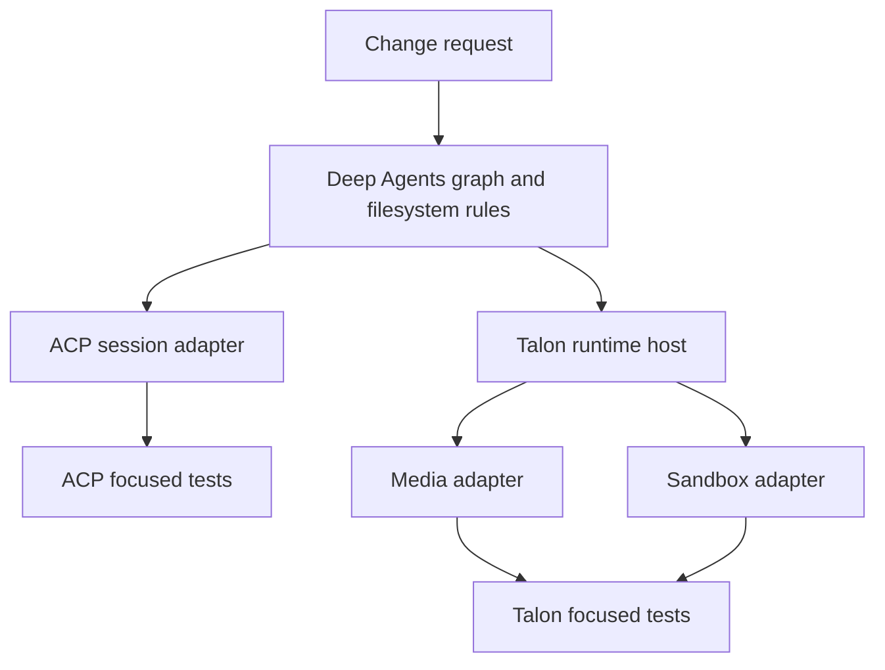
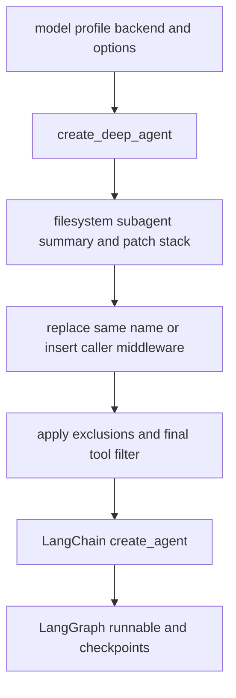
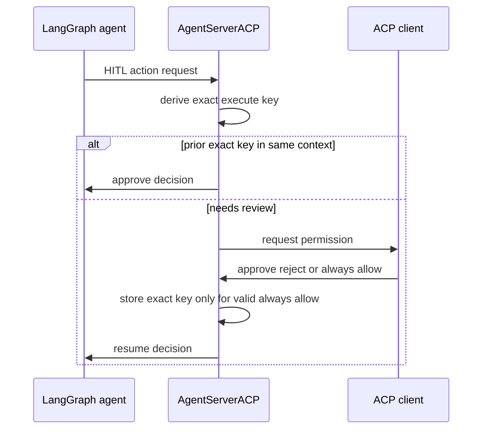
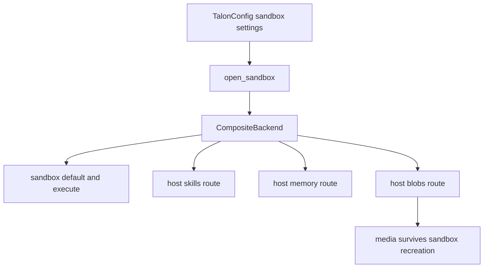

# Source Map and Ownership Boundaries

Use this map to start a change at the component that owns its behavior and its focused regression suite. It covers the boundaries that are easiest to accidentally change through an integration: SDK graph assembly and filesystem approval predicates, ACP's protocol-specific session behavior, and Talon's channel-media and sandbox adaptation. For the full stack see [architecture overview](./overview.md), [middleware stack](./middleware-stack.md), [ACP integration](../integrations/acp.md), [Talon integration](../integrations/talon.md), and the [testing guide](../testing/testing-guide.md).

## Route a change

| Change intent | Owner and primary seam | Focused tests |
| --- | --- | --- |
| Change the Deep Agents middleware stack, default backend, profile exclusions, subagent wiring, or graph state | `libs/deepagents/deepagents/graph.py` — `create_deep_agent` | `libs/deepagents/tests/unit_tests/test_graph.py` |
| Change how filesystem `interrupt` permissions decide whether a tool call needs review | `libs/deepagents/deepagents/middleware/_fs_interrupt.py` | `libs/deepagents/tests/unit_tests/test_permissions.py` |
| Change ACP session construction, replay, stream projection, or permission prompts | `libs/acp/deepagents_acp/server.py` — `AgentServerACP` | `libs/acp/tests/test_agent.py` and `libs/acp/tests/unit_tests/test_execute_permissions.py` |
| Change the ACP local-context example or its compaction behavior | `libs/acp/examples/local_context.py` — `LocalContextMiddleware` | `libs/acp/tests/unit_tests/test_local_context.py` |
| Change channel attachment normalization, model image content, Markdown media output, or outbound path validation | `libs/talon/deepagents_talon/media.py` | `libs/talon/tests/test_media.py` and `libs/talon/tests/unit_tests/test_media_blobs.py` |
| Change sandbox startup, cleanup, host-versus-sandbox routing, or sandbox configuration | `libs/talon/deepagents_talon/sandbox.py`, with configuration in `config.py` | `libs/talon/tests/unit_tests/test_sandbox.py` |

This routing diagram distinguishes reusable SDK policy from the ACP and Talon adapters that project it into separate runtimes.

## SDK: graph construction and filesystem approval are separate owners

`create_deep_agent` is the SDK construction seam. It resolves an explicit model or the deprecated default, chooses the harness profile, applies profile tool-description overrides, defaults the backend to `StateBackend`, constructs subagent specifications, and passes the completed middleware list to LangChain `create_agent`. The returned runnable is configured for Deep Agents metadata and uses `DeepAgentState` by default; its `messages` channel uses `DeltaChannel` with periodic snapshots to avoid quadratic checkpoint growth.

Middleware order is intentionally not a frontend concern. A caller middleware with the same `.name` replaces the existing entry in place. A novel entry is inserted after the captured core stack and before profile, skills, prompt-cache, and memory tail behavior. Profile middleware exclusion is applied before and after caller merging; excluded tools are filtered last, so a caller middleware cannot put a profile-excluded tool back into the usable set. `FilesystemMiddleware` and `SubAgentMiddleware` are required scaffolding: profile exclusion rejects their removal rather than assembling a partially working agent.

This construction flow shows the ordering at which custom middleware and profile policy take effect.

Filesystem permissions have two layers. `FilesystemMiddleware` enforces allow and deny access during tool execution. Graph assembly separately turns `interrupt` permission rules into `HumanInTheLoopMiddleware` configurations. User-supplied `interrupt_on` takes precedence for a tool name. This separation is important: an approval predicate does not replace the filesystem middleware's post-edit/pre-execution permission enforcement.

`_fs_interrupt.py` owns the conservative predicate geometry. Exact-path tools (`read_file`, `write_file`, and `edit_file`) interrupt only when their normalized path matches an interrupt rule and is not denied. Bulk tools (`ls`, `glob`, `grep`, and recursive `delete`) interrupt when their search scope could overlap an interrupt rule. A pathless bulk call, current-directory aliases, absolute `glob` patterns, and relative patterns containing `..` are handled conservatively so they cannot bypass review; when a backend can resolve paths, the predicate also considers a symlink-resolved target. The generated review configuration allows approve, edit, reject, and respond; edited calls still enter the filesystem permission check.

**Change safely:** change stack placement or profile behavior with `test_graph.py`; change path normalization, exact/bulk coverage, or permission bypass protections with `test_permissions.py`. Do not move the approval logic into ACP or Talon: both consume the graph's interrupts.

## ACP: session-scoped protocol projection

`AgentServerACP` is an ACP bridge around either a compiled graph or a factory taking `AgentSessionContext(cwd, mode, model)`. It owns ACP-only session maps: cwd and MCP servers, selected mode and model, cancellation and plan state, reusable approvals, and the currently built graph. Mode or model changes reset a factory-produced graph for that session. `new_session` records cwd and initializes options; the LangGraph config uses the ACP session ID as `thread_id` and persists ACP metadata including cwd, mode, and model.

Durable `session/load` is optional. If enabled, it requires a graph with a checkpointer, confirms the checkpoint identifies an ACP session and was created for the requested cwd, restores selectable options, and replays accumulated messages and tool calls before responding. This makes the server—not the ACP client—the owner of the mapping between ACP session semantics and checkpoint metadata.

During `prompt`, the bridge converts ACP text, image, audio, and resource blocks to LangChain content and streams the graph in `messages` and `updates` modes. It forwards assistant text/reasoning only from the top-level graph namespace, while tool calls are tracked for ACP updates. Cancellation returns `stop_reason="cancelled"`. A non-HITL, free-form LangGraph interrupt is rejected: ACP's permission UI can express fixed approval decisions, not an arbitrary interrupt payload.

### Exact command approvals

The reusable `approve_always` decision is deliberately narrower for `execute` than for other tools. ACP creates a key from the complete JSON-serializable execute argument object (canonicalized with sorted keys) and an `AgentSessionContext` containing cwd, mode, and model. It then allows only that exact key in that session. A changed command string, added or changed execute argument, changed cwd/mode/model, a different session ID, invalid/non-serializable arguments, cancellation, or a permission-request error cannot inherit or grant reusable command approval. Invalid execute requests do not even expose the always-allow option. Non-`execute` tools retain a tool-name-level always-allow set.

This sequence shows why command reuse must remain scoped to both complete arguments and current session context.

### Local context is an example middleware, not server state

`libs/acp/examples/local_context.py` supplies `LocalContextMiddleware` as an example of custom graph middleware. It runs its detection script through the selected backend, stores the initial snapshot in private per-thread state, and adds that baseline to the model system prompt. On a new summarization cutoff it runs again. If the content changed, it adds one escaped, tagged internal `HumanMessage` that supersedes earlier local facts; it records the cutoff even on a failed or empty refresh so the same event does not cause a retry loop. Fingerprints prevent duplicate snapshots. The script therefore works against a local shell or a remote sandbox without ACP server changes.

Messages tagged with `additional_kwargs["lc_source"] == "local_context"` stay internal to ACP presentation: `AgentServerACP` suppresses them from both live assistant content updates and session replay. Preserve that tag if changing the example; changing only the example test without the server projection test could leak environment-derived context to a protocol client.

**Change safely:** run `test_execute_permissions.py` for approval-key changes and `test_local_context.py` for refresh/compaction behavior. Use `test_agent.py` for end-to-end ACP stream, replay, and interrupt projection behavior.

## Talon: media adaptation and sandbox lifecycle

Talon is an experimental runtime. The model-backed CLI path opens a configured sandbox for the host lifetime, opens checkpoint/history resources, and gives `DeepAgentRuntime` the sandbox composite backend and its working directory. Without a configured model it uses the echo runtime instead. The Talon runtime invokes the SDK graph; media conversion and sandbox routing are Talon-specific preparation around that graph.

### Media: bounded input and safe outbound references

`media.py` normalizes channel metadata into text and optional model content. Readable, supported document attachments are inlined only up to `MAX_TEXT_DOCUMENT_BYTES`; oversized, unreadable, or unsupported attachments become bounded fallback text. Video and unknown binary media are represented as fallback text, and voice/audio is left to the transcription path rather than inlined here.

Only inbound images produce multimodal model content. An image must have an accepted reported/guessed/sniffed image MIME type, be readable, and be at most `MAX_INBOUND_IMAGE_BYTES`; accepted data becomes a standard base64 image block after a text block. `DeepAgentRuntime` forwards the request's validated `model_content` to the graph. Filesystem middleware can offload that image data to blobs, so the stored checkpoint does not retain the base64 payload while the model request still receives the image.

For outbound delivery, `extract_markdown_media` removes Markdown image references but masks fenced and inline code first, preventing code examples from becoming attachments. `outbound_channel_media` only emits image or video payloads. When the caller supplies an outbound root, references must be local relative paths: URL schemes, home expansion, absolute paths, Windows drive paths, `..`, missing files, non-regular files, and symlink escapes are rejected after canonical resolution.

### Sandbox: fail closed and keep a minimal host route set

`TalonConfig.sandbox` reads `DEEPAGENTS_TALON_SANDBOX` plus optional ID, snapshot, and setup script. `open_sandbox` yields `None` when sandboxing is absent; otherwise it starts the provider in a worker thread and raises `SandboxStartupError` on failure rather than falling back to host execution. A Talon-created sandbox is closed on exit; an attached sandbox ID is not deleted. The handoff object closes a sandbox that completes startup after its awaiting coroutine has been cancelled, avoiding a cancellation leak.

The resulting `CompositeBackend` sends ordinary filesystem and every `execute` call to the sandbox. It routes only the assistant-local `skills/`, `memory/`, and `/blobs/` namespaces to virtual host-backed filesystems. In particular, `tools.json` is not a host route, while blobs remain on the host under `artifacts/blobs` so offloaded media survives sandbox recreation. Sandbox mode also filters Talon memory candidates to the routed assistant `memory/` directory and tells the agent which sandbox working directory to use.

This routing diagram captures the intentional exception set: persistent assistant content and blobs stay host-backed, while general tool access remains sandboxed.

**Change safely:** use `test_media.py` for input/output parsing and containment, `test_media_blobs.py` for graph-to-blob persistence, and `test_sandbox.py` for provider settings, routing, startup cleanup, cancellation, and fail-closed behavior.

## Focused change checklist

- **Graph assembly or profile exclusions:** edit `graph.py`; cover ordering, required scaffolding, and final tool exclusion in `test_graph.py`.
- **Filesystem interrupt matching:** edit `_fs_interrupt.py`; add exact, bulk, pathless, pattern, and symlink cases to `test_permissions.py` as applicable.
- **ACP approval reuse:** edit `server.py` and prove changed command text, arguments, session context, and session ID cannot reuse approval in `test_execute_permissions.py`.
- **ACP context refresh:** edit the example and preserve its internal message tag; run `test_local_context.py` and the relevant ACP server projection coverage.
- **Talon media:** edit `media.py`; test payload limits, MIME handling, code masking, root containment, and symlink behavior.
- **Talon sandbox:** edit `sandbox.py` (and `config.py` or runtime wiring when needed); test failure and cancellation cleanup as well as route ownership.
