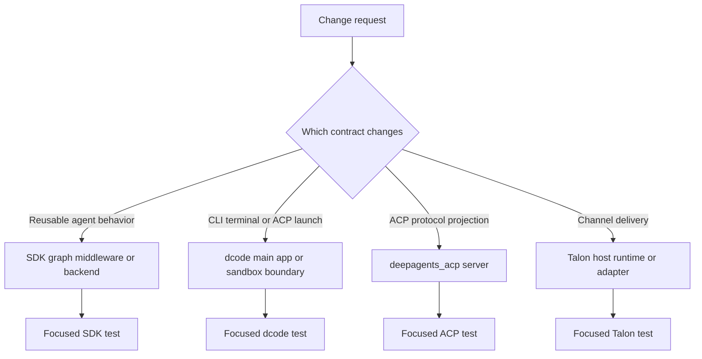
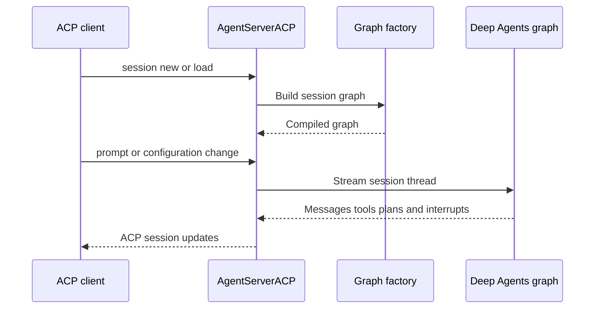
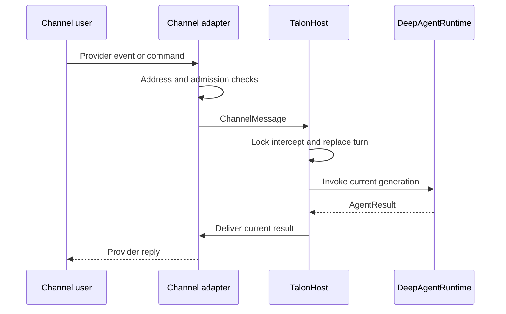

# System Source Map

Route a change to the component that owns its contract, rather than the product where it was first observed. The reusable `deepagents` SDK owns graph assembly, middleware, and backends; dcode owns launch, terminal sessions, sandbox policy, and its ACP launch integration; `deepagents_acp` owns the generic Agent Client Protocol bridge; Talon owns the long-running channel host and provider adapters. See the [architecture overview](./overview.md), [middleware stack](./middleware-stack.md), [quickstart](../quickstart.md), and [testing guide](../testing/testing-guide.md).

## Change routing

| Change intent | Owner and entry point | Focused verification |
| --- | --- | --- |
| SDK graph inputs, profiles, middleware order, tool policy, or checkpoint state | `libs/deepagents/deepagents/graph.py` — `create_deep_agent` | `libs/deepagents/tests/unit_tests/test_graph.py` |
| Blocking delegation or compiled-subagent state transfer | `middleware/subagents.py` — `SubAgentMiddleware` | `libs/deepagents/tests/unit_tests/test_subagents.py` |
| Remote, non-blocking subagent launch, status, update, or cancellation | `middleware/async_subagents.py` — `AsyncSubAgentMiddleware` | `libs/deepagents/tests/unit_tests/test_async_subagents.py` |
| Context compaction, history offload, or overflow recovery | `middleware/summarization.py` | `tests/unit_tests/middleware/test_summarization_factory.py` and summarization lifecycle coverage |
| Prefix-routed files, root listings, cross-route search, globs, or command execution | `backends/composite.py` — `CompositeBackend` | `tests/unit_tests/backends/test_composite_backend.py` and async companion coverage |
| Ephemeral files checkpointed with a conversation thread | `backends/state.py` — `StateBackend` | `tests/unit_tests/backends/test_state_backend.py` |
| Persistent cross-thread files and namespace isolation | `backends/store.py` — `StoreBackend` | `tests/unit_tests/backends/test_store_backend.py` |
| Shared file migration, bytes, read-window, literal grep, or glob semantics | `backends/utils.py` | State and Store backend suites |
| Hub-backed persistent files and conflict handling | `backends/context_hub.py` — `ContextHubBackend` | unit suite plus `tests/integration_tests/test_context_hub_backend.py` |
| dcode command dispatch, managed-policy gates, sandbox selection, or ACP launch | `libs/code/deepagents_code/main.py` — `cli_main` and `_run_acp_cli_async` | `libs/code/tests/unit_tests/test_main.py`, `test_main_acp_mode.py`, and `test_acp.py` |
| dcode terminal interaction, server handoff, rendering, or approval UI | `libs/code/deepagents_code/app.py` — `DeepAgentsApp` | `libs/code/tests/unit_tests/test_app.py` |
| dcode sandbox discovery or precedence | `integrations/sandbox_registry.py` — `SandboxRegistry` | `test_sandbox_registry.py` |
| dcode sandbox acquisition, setup, and cleanup | `integrations/sandbox_factory.py` — `create_sandbox` | `test_sandbox_factory.py` |
| Generic ACP session protocol, stream projection, replay, or client permission bridge | `libs/acp/deepagents_acp/server.py` — `AgentServerACP` | `libs/acp/tests/` |
| Talon CLI boot, channels, persisted checkpoint/archive, or MCP runtime construction | `libs/talon/deepagents_talon/__main__.py` — `main` and `_agent_runtime` | `libs/talon/tests/test_main.py` |
| Talon lifecycle, turns, approvals, cancellation, scheduling, and delivery | `libs/talon/deepagents_talon/host.py` — `TalonHost` | `libs/talon/tests/test_host.py` |
| Talon graph composition, policy snapshots, approval interrupts, and recovery | `libs/talon/deepagents_talon/runtime.py` — `DeepAgentRuntime` | `libs/talon/tests/test_runtime.py` and `unit_tests/test_tool_approval_runtime.py` |
| Provider admission and reply behavior | `libs/talon/deepagents_talon/channels/` | provider-specific channel suite; Discord cross-boundary coverage in `tests/integration_tests/test_discord_host.py` |
| Interim narration and explicit `send_message` | `libs/talon/deepagents_talon/messaging.py` | `unit_tests/test_messaging.py` and `test_verbosity.py` |
| Talon OAuth storage, discovery, and transport safety | `libs/talon/deepagents_talon/mcp_auth.py` | `libs/talon/tests/test_mcp_auth.py` |

*Ownership routing: choose the contract owner first, then verify at the narrowest observable boundary.*

## SDK assembly, delegation, and storage

`create_deep_agent` resolves the model profile and backend, assembles subagent and middleware behavior, delegates the result to LangChain `create_agent`, and uses a DeltaChannel-backed messages state to keep checkpoint growth linear. Custom state schemas should extend `DeepAgentState` to retain that reducer; shared fields updated concurrently need their own reducer.

FilesystemMiddleware and SubAgentMiddleware are protected Deep Agents scaffolding because they respectively enforce built-in filesystem permissions and implement the task tool; excluding either through a harness profile raises instead of producing a degraded graph. Deep Agents inserts novel caller middleware after its core stack and before the tail, replaces same-named stack entries in place, and applies profile tool exclusion last so custom middleware cannot restore an excluded tool.

The top-level `deepagents` package is the curated consumer import surface for graph construction/state, filesystem and subagent types, selected middleware, profiles, and profile registration, while `deepagents.middleware` exposes the middleware-facing feature types.

`SubAgentMiddleware` is the blocking `task` bridge. Declarative and compiled children receive either just the delegated description or, for a fork, effective summarized parent history. A completed child yields one `ToolMessage`; private, excluded, and unchanged inherited state is withheld from the parent update. Route a change to the transfer/filtering rules here, not into an individual subagent implementation.

`AsyncSubAgentMiddleware` instead owns the remote Agent Protocol boundary. It persists a local `async_tasks` record at launch and offers start, check, update, cancel, and list tools, while the remote graph owns its execution and thread. Updating interrupts the current remote run on that thread and records the replacement run ID. A completed-but-interrupted thread is reported as waiting; cancelling that waiting task is local because it has no active remote run to cancel.

Summarization preserves the raw message log. It records a private event that reconstructs the compacted request, gives history offload an append-only session ID, and still uses the summary after offload failure with a warning. The factory derives fraction-based thresholds from `max_input_tokens` when available, falls back to fixed defaults, and requires a resolved `BaseChatModel`.

### File backends

`CompositeBackend` is the virtual filesystem router. It selects the longest matching prefix, exposes route roots in a root listing, remaps routed results, and searches or globs across routes only from the root. A root-anchored glob that does not target a route skips that route. Command execution is never routed: it is available only if the default backend is `SandboxBackendProtocol`. Test both sync and async paths when changing routing or result merging.

Use `StateBackend` for files that belong to a LangGraph conversation thread. It requires graph execution context, reads the `files` channel through `CONFIG_KEY_READ` with `fresh=True`, and queues changed keys through `CONFIG_KEY_SEND`. This provides read-your-writes within a superstep while committing at the node boundary. Use `StoreBackend` for cross-thread files. Its `NamespaceFactory` is the caller-owned isolation boundary; unsafe namespace components are rejected, and direct use of an injected store works only when the factory does not require the runtime.

State and Store share compatibility rules in `backends/utils.py`: legacy `list[str]` content is normalized on reads without storage mutation; writes and edits persist string data while retaining creation metadata; binary upload/download round trips use base64. Shared read-window handling clamps model-supplied bounds and returns pagination metadata. Shared grep is literal, skips base64 data, and turns invalid glob filters into result errors instead of exceptions.

`ContextHubBackend` lazily snapshots a LangSmith Hub agent repository, treats a missing repository as empty, overlays accepted pending and in-flight mutations onto reads, and batches writes while making callers wait for remote durability. On a commit conflict it reloads the tree, rematerializes queued edits or deletes from their original intent, and retries; a mutation that cannot be rematerialized is settled with the conflict.

## dcode terminal, server, and ACP path

`cli_main` is the process boundary. It keeps version and help fast paths ahead of expensive bootstrap, permits diagnostic commands to remain useful when managed policy is unhealthy, gates policy-sensitive commands on healthy managed configuration, and validates a managed sandbox default against `SandboxRegistry`. Keep startup policy and command-dispatch behavior in `main.py`; pass already-valid session configuration to the Textual app.

`DeepAgentsApp` owns the Textual terminal boundary, including app-level interaction bindings and the background-server success/failure messages that hand a constructed agent to the UI. Route event, focus, modal, rendering, approval, and server-handoff changes here; use `app.run_test()` where Textual scheduling is relevant.

`SandboxRegistry` merges built-in, entry-point, and configuration-declared providers, with configuration taking precedence over entry points and built-ins both for metadata and construction. `create_sandbox` validates snapshot capability and ownership before acquisition, runs optional setup after acquisition, and deletes only a sandbox it created. Setup or body failures still trigger owned cleanup, and a cleanup failure does not replace the original failure.

dcode’s ACP mode is launched from `_run_acp_cli_async`: it resolves the model and MCP tools, opens the checkpointer, builds a graph factory per ACP session context, wraps the server with thread-ownership leases, and releases those leases and MCP resources on exit. The generic ACP implementation belongs in `libs/acp`, while `deepagents_code/acp.py` is the dcode-specific Auto-mode wrapper that supplies trusted prompt and approval context.

### ACP protocol bridge

`AgentServerACP` bridges a compiled Deep Agents graph or an `AgentSessionContext` factory to ACP. It advertises image prompts and optional session loading; a new session records its working directory, MCP configuration, and optional mode/model selections. With durable loading enabled, a load requires a checkpointed graph, validates that the checkpoint is an ACP session for the same working directory, restores supported selections, and replays persisted messages and tool calls to the client.

Mode and model changes reset a factory-built agent so the next invocation uses the new session context. Keep wire-level mappings—content blocks, thought/message chunks, todo plan updates, tool starts/diffs/results, and permission handling—in `deepagents_acp/server.py`; keep product policy such as dcode Auto mode outside that generic bridge.

*ACP owns protocol-shaped state and projections; the graph factory owns the actual agent configuration.*

## Talon host, runtime, and partner adapters

`deepagents_talon.__main__.main` is the operational entry point. It parses channel and management subcommands, creates and secures the assistant home, chooses enabled WhatsApp, Telegram, Discord, and Slack adapters from flags or environment, and boots the host. When a model is configured, `_agent_runtime` loads MCP tools, opens checkpoint/history infrastructure, creates `DeepAgentRuntime`, and passes a sandbox backend when configured; without a model it uses `EchoAgentRuntime`.

`TalonHost` starts its agent before channels and scheduler, unwinds partially started components in reverse order on failure, and on shutdown cancels work before stopping channels in reverse order, then scheduler and agent. It serializes inbound work with provider/chat history locks and per-conversation locks, handles commands, approvals, and authorization interception before replacing an agent turn, and drops stale-generation results rather than delivering them to a superseding turn.

`DeepAgentRuntime` is an integration caller of the SDK builder: it prepares Talon-specific tools, approvals, middleware, backend, and checkpointing, then invokes `create_deep_agent`, including a replacement filesystem middleware and selected-model summarization layer. It snapshots approval policy into the constructed graph and invocation context, rebuilds when the persisted snapshot changes, and resolves approval interrupts through the request handler while automatically rejecting cron, background-delivery, and handler-less requests.

`TalonConfig.from_env` validates and namespaces each assistant's runtime state, filters environment to runtime-relevant values, and `ensure_home` creates home/state directories with restrictive permissions and initializes approval storage. Interim verbosity is intentionally limited to levels 1–3. Progress delivery is invocation-local: `ContextVar`s scope the handler and shared budget, `ProgressMessages` forwards qualifying main-agent tool narration before execution, and explicit delivery returns channel/validation/budget/transport outcomes without exposing transport details.

Discord is the most detailed adapter seam. `DiscordChannel` rejects self-authored Gateway messages, applies guild addressing and exposure or pairing admission before opening threads or downloading media, then sends admitted work to the host as `ChannelMessage`. Application commands are converted to the same textual command path, deferred before dispatch, and use a task-local interaction sink so unrelated work cannot capture a reply. Other partner adapters live alongside it in `channels/slack.py`, `channels/telegram.py`, and `channels/whatsapp.py`; preserve the adapter boundary by converting provider events into the host’s provider-neutral interfaces rather than embedding turn scheduling in an adapter.

*The adapter decides whether a provider event becomes a turn; the host owns serialization, cancellation, and delivery; the runtime owns graph invocation.*

Talon MCP OAuth is a separate security boundary. Credentials are stored in server-identity-scoped owner-only files, retain a previous refresh token when a refresh response omits it, and are updated under a file lock. Its OAuth transport accepts HTTPS only, applies SSRF protections, rejects redirects, and validates discovered issuer and endpoint URLs before sending authorization traffic.

## Operational checks

Examples are independent entry points rather than extensions of the core runtime. `examples/README.md` groups focused patterns (research, coding, content, deployable services, and advanced patterns); follow the example’s own README, lockfile, and tests when changing one.

For graph assembly, assert the final middleware and tool surface as well as protected-exclusion failures. For filesystem changes, run the backend suite that owns persistence and add sync/async coverage when changing `CompositeBackend`. For dcode UI changes, use focused Textual tests. For ACP, test session lifecycle and emitted protocol updates. For Talon, use host tests for concurrency/lifecycle, provider tests for admission and reply behavior, and integration tests only for the channel-to-host boundary. The lockfile pre-commit check selects packages touched by changed paths, checks them with each package's required Python version, and computes changed manifests' transitive local consumers through `tool.uv.sources` paths.
