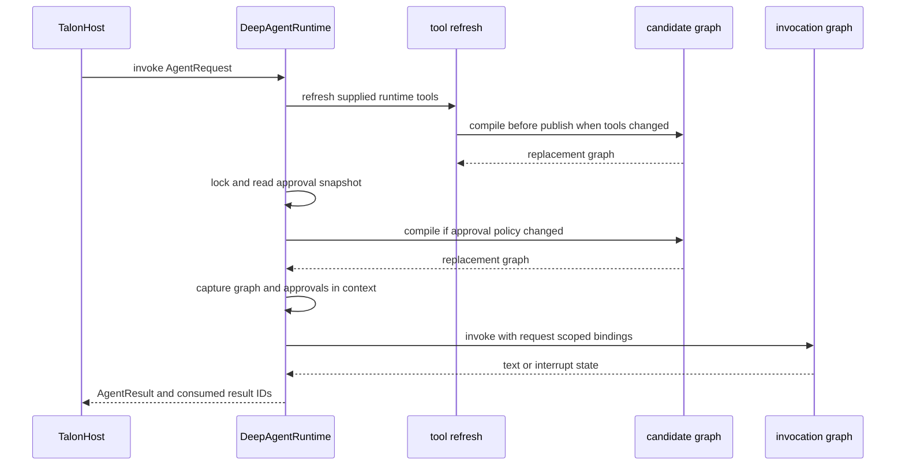

# Source Map

Use this page to find the owner of a Talon state transition or delivery boundary before changing it. It is intentionally organized by observable behavior, rather than as a file inventory. For operating context, see [Talon Runtime Integration](../integrations/talon.md), [Profiles and Models](../concepts/profiles-models.md), [Talon Channel Admission](../concepts/talon-channel-admission.md), [Runtime Behavior](./runtime-behavior.md), and the [Testing Guide](../testing/testing-guide.md).

## Change routing

| Change affects… | Start here | State owner and enforcement boundary | Focused coverage |
| --- | --- | --- | --- |
| A turn's graph, approval policy, request-scoped callbacks, hooks, model, or cleanup | `libs/talon/deepagents_talon/runtime.py` — `DeepAgentRuntime.invoke` | The runtime captures graph and approvals for one invocation, then binds and resets its context-local capabilities | `libs/talon/tests/test_runtime.py`, `unit_tests/test_tool_approval_runtime.py` |
| Runtime-tool replacement or manual MCP activation | `runtime.py` — `_refresh_runtime_tools`, `reload_mcp_configuration`, `_replace_runtime_tools` | `_tools_lock` serializes replacement; compile the candidate graph before assigning the tool set and graph | `libs/talon/tests/test_runtime.py`, `unit_tests/test_mcp_config.py`, `unit_tests/test_skill_mcp.py` |
| `/model` admission, persistence, or selected-model behavior | `host.py` — `_model_command`, then `model_selection.py` and `runtime.py` | The host owns global persisted selection; `ModelSelection` owns discovery/admission/build caching; middleware applies a turn override | `unit_tests/test_model_selection.py` |
| `/mcp-reload` command presentation | `host.py` — `_reload_mcp_configuration`, plus the optional `MCPReloadableRuntime` protocol in `interfaces.py` | The host exposes only unavailable, success, or generic failure while the runtime owns reload mechanics | `tests/test_host.py`, `tests/test_runtime.py` |
| Agent-created file delivery to the originating chat | `file_sending.py`, then `host.py` — `_file_handler` | The runtime supplies a turn-scoped handler; the host retains channel ownership, generation eligibility, staging directory, and upload | `unit_tests/test_file_sending.py`, `tests/test_host.py` |
| Channel adapter contract or a new media-capable channel | `interfaces.py` — `ChannelAdapter`, `ChannelMedia`, `SendResult` | Adapters receive only a locally staged `ChannelMedia`; retry semantics live in the common channel helper | `unit_tests/test_file_sending.py`, channel-specific attachment tests |
| Context diagnostics command behavior | `host.py` — `_context_doctor`, then `context_doctor.py` | Host command handling is bounded and content-safe; the runtime reads a checkpoint without invoking a model | `unit_tests/test_context_doctor.py` |

## Invocation scope: capture before execution

`DeepAgentRuntime.start()` resolves subagents, ensures an approval snapshot, and creates the initial graph. At the start of every `invoke()`, the runtime refreshes runtime tools, enters `_tools_lock`, reads approvals, recompiles only if the approval snapshot changed, and stores the graph and snapshot in context variables. Graph calls subsequently resolve through that captured invocation graph, so a reload or policy change after capture cannot mutate an active turn.

The request boundary then binds the operator-approval flag, pending background results, cron origin, authorization and breakout handlers, loaded hook session, progress handler, question handler, file handler, history context, checkpointer session protection, and selected model/effort. The `finally` block resets those bindings. New callback-like capabilities belong on `AgentRequest` in `interfaces.py`, must be bound around graph execution in `runtime.py`, and should be supplied only by `TalonHost` rather than channel metadata.

*Replacement construction finishes before publication; the active turn resolves graph calls through its captured context rather than a later reload.*

A failed automatic refresh logs the error, marks saved MCP changes inactive, and retains the old graph. Explicit `reload_mcp_configuration()` uses the same lock and replacement path, but re-raises to let the host present a generic failure. Subagent configuration follows the same compile-before-assignment rule, but must be explicitly reloaded; running turns and local tasks retain their original graphs. `get_agent_tools` reports this distinction through `saved_changes_inactive` and `current_turn_uses_previous_graph`.

## Model selection: host authority, runtime enforcement

Model choice has three owners. `TalonHost` accepts `/model` listing from any caller, but permits a change only from an operator. Before writing the global selection file, it asks the runtime to validate and prepare the requested model; it clears persisted state for `default`. That global selection is passed on later requests as `AgentRequest.model`, not accepted from incoming channel metadata. A model switch that races with a turn already being prepared applies on the following turn.

`ModelSelection` discovers only providers with usable credentials in Talon's environment, includes the startup default, requires an exact `provider:model` match, and lazily caches non-default models after successful construction. Gateway discovery is also constrained to the configured trusted endpoint and usable model credentials. A persisted selection that later becomes unavailable does not fail a conversation: the runtime logs it and uses the default model.

`DeepAgentRuntime._turn_models()` resolves the request's model and binds it with `ACTIVE_MODEL` only for that invocation. `ModelSelectionMiddleware` substitutes that model for main-agent calls, while `SelectedModelSummarization` constructs and caches a summarizer whose thresholds follow the selected model. This avoids graph recompilation and prevents a model with a smaller context budget from inheriting the startup model's budget; subagents retain the startup summarizer.

## MCP reload: activation is transactional, command output is not diagnostic

MCP configuration may schedule saved changes, but saved and active configuration are distinct. At the next turn, optional refresh can construct a replacement from refreshed tools. `/mcp-reload` invokes the optional `MCPReloadableRuntime` capability for an immediate attempt. Both paths build the candidate graph before publishing `tools` and `_graph`; if construction fails, the previous graph remains usable and saved changes remain inactive.

`TalonHost` is the channel-facing enforcement boundary. It routes the command while holding the conversation command path, detects runtimes without the optional capability, logs underlying exceptions, and returns only a success, unavailable, or generic failure message. Do not expose MCP config, credentials, or transport errors in this response. Add reload mechanics to the runtime protocol and runtime tests; add only presentation behavior to host tests.

## Agent-to-channel file delivery

The main Talon graph always receives a `send_file` tool built over the same backend as its filesystem tools. On a call, the tool refuses subagent execution and turns with no bound handler; otherwise it downloads one backend file, enforces the configured byte ceiling, derives a safe display name, and calls the turn-local `FileSendHandler`. Backend read failures can be shown as tool text, but channel send failures are deliberately reduced to a generic message so transport details do not enter model context.

The host creates that handler for a live chat turn and passes it through `AgentRequest`. Before staging or uploading, the handler verifies that the turn remains eligible to reach its chat: a superseding message, reset, or terminal authorization prevents late delivery. It stages bytes under `outbound_media_dir` in a fresh private directory, writes the file with exclusive no-follow creation and private permissions, derives `ChannelMedia.media_type` from the sanitized path, sends with the shared retry helper, and removes the staging directory whether upload succeeds or fails. The channel adapter therefore owns the actual `send_media` transport, while no agent filesystem path is passed to it.

`display_filename()` preserves ordinary Unicode names and extensions where possible, but replaces path separators and control or formatting characters, rejects dot-only names, and bounds the UTF-8 name length. Keep these checks both at tool display-name creation and staging: the handler protocol is an integration boundary and should treat filenames as untrusted even if a future caller bypasses the model tool.

## Protocol boundaries and focused tests

`interfaces.py` makes host/runtime coupling capability-based. `AgentRuntime` is required for lifecycle and invocation; context diagnostics, model switching, MCP reload, delivery recording, history, and inbound-media handling are optional runtime-checkable protocols. `AgentRequest` carries host-installed callbacks with `repr=False` and `compare=False`; its `model` documentation explicitly reserves population for the host. `ChannelAdapter.send_media()` accepts a local `ChannelMedia` and returns `SendResult`, including retryability, rather than exposing a transport exception to the runtime.

Use the narrowest test suite that crosses the boundary being changed:

- **Invocation and replacement:** `libs/talon/tests/test_runtime.py` covers initial construction, refresh, explicit MCP reload, approval-driven graph replacement, and failure retention. Pair new scoped capability bindings with `unit_tests/test_tool_approval_runtime.py` or the specific runtime suite.
- **Models:** `libs/talon/tests/unit_tests/test_model_selection.py` covers operator gating, persistence across restart, default reset, concurrent-turn timing, credentialed catalog admission, one-time model construction, unavailable fallback, selected-model context limits, gateway catalog validation, and selected-model summarization.
- **Host commands:** use `libs/talon/tests/test_host.py` for optional-runtime command routing and generic failure presentation. Keep `/context-doctor` coverage in `unit_tests/test_context_doctor.py` because it asserts the ten-second bound, selected-model forwarding, and content-safe diagnostics behavior.
- **File delivery:** `libs/talon/tests/unit_tests/test_file_sending.py` covers backend reads, byte limits, subagent and no-chat denial, error redaction, filename sanitization, private staging and cleanup after success or failure, media typing, and runtime handler binding. Pair host wiring changes with the host test that verifies the request receives and invokes `file_handler`.
- **Adapters:** pair a channel-specific upload change with that adapter's attachment suite as well as the shared file-sending tests. Preserve the `ChannelMedia` and `SendResult` contract rather than teaching the runtime a provider-specific upload API.
