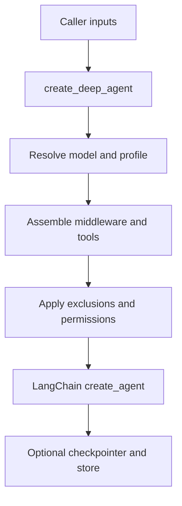
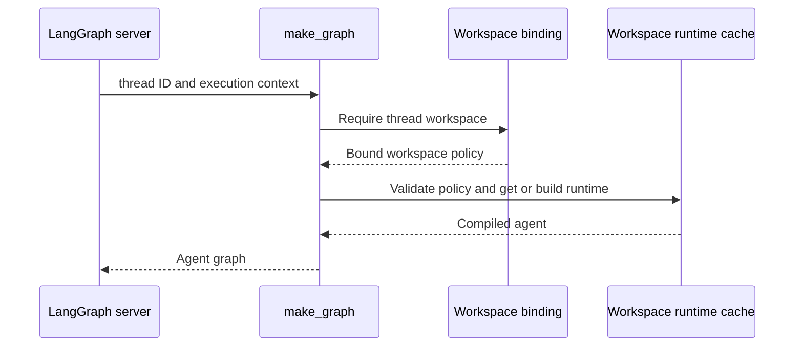
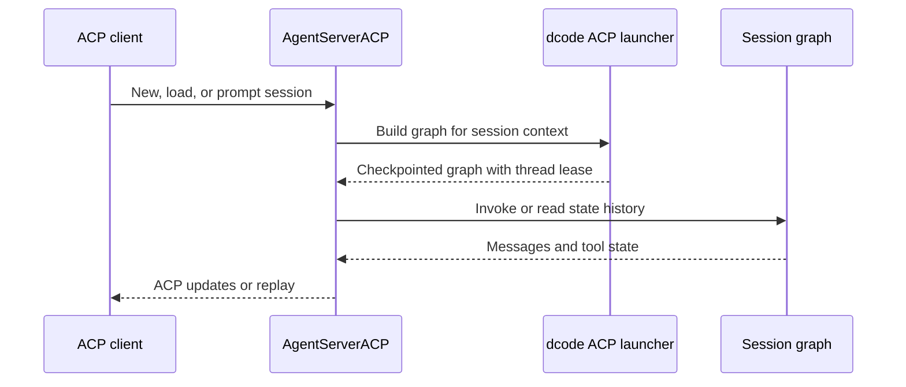
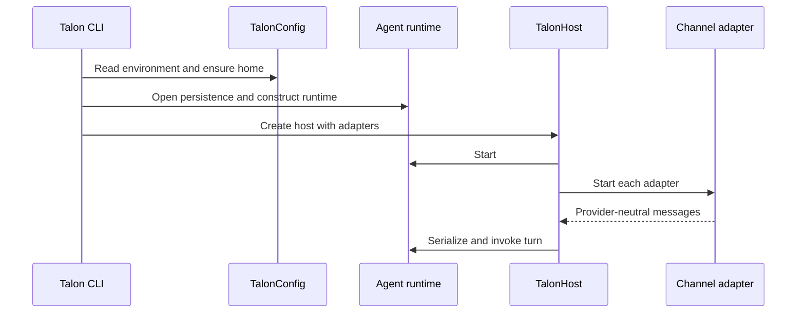

# System Source Map

Choose the owner of the contract, not merely the product where a symptom appears. The reusable `deepagents` package owns graph assembly; dcode owns CLI startup, the local LangGraph-server client boundary, and its SQLite thread helpers; `deepagents_acp` owns the protocol projection; Talon owns long-running multi-channel operation. For concepts rather than locations, see the [architecture overview](./overview.md), [code agent](./code-agent.md), [middleware stack](./middleware-stack.md), [quickstart](../quickstart.md), and [testing guide](../testing/testing-guide.md).

## Change routing

| If the change affects… | Start at | Durable state / focused tests |
| --- | --- | --- |
| The reusable agent’s built-in tools, model/profile resolution, state schema, middleware composition, subagents, permissions, or checkpoint/store wiring | `libs/deepagents/deepagents/graph.py` — `create_deep_agent` | `DeepAgentState.messages` is a `DeltaChannel`; start with `libs/deepagents/tests/unit_tests/test_graph.py`, then the applicable middleware or permissions test. |
| What consumers can import directly from the SDK | `libs/deepagents/deepagents/__init__.py` | Treat `__all__` as the curated public surface; do not require users to import an internal module without deliberately expanding it. |
| dcode package import behavior or console entry | `libs/code/deepagents_code/__init__.py` — lazy `cli_main`; `main.py` — `cli_main` | `test_imports.py`, `test_startup_fast_paths.py`, `test_main.py`. |
| dcode TUI behavior, UI lifecycle, or how an interactive launch starts the remote graph | `libs/code/deepagents_code/app.py` — `DeepAgentsApp` and its server-start worker | The app retains the handed-off `ServerProcess` for outer teardown; begin with the focused `test_app.py` case. |
| dcode’s local LangGraph-server launch, generated runtime workspace, subprocess lifecycle, or remote client handoff | `libs/code/deepagents_code/client/launch/server_manager.py` — `start_server_and_get_agent` and `server_session` | Configuration crosses the process boundary through `DEEPAGENTS_CODE_SERVER_*`; use `test_server_manager.py`, then `test_server.py` or `test_server_graph.py` as applicable. |
| dcode thread listing, local seed recovery, checkpoint connection cleanup, or thread-owned writes | `libs/code/deepagents_code/sessions.py` | The shared local database is `sessions.db`; use `test_sessions.py` and `test_thread_ownership_transitions.py`. |
| dcode ACP model/MCP setup, per-session graph construction, checkpointing, or thread exclusivity | `libs/code/deepagents_code/main.py` — `_run_acp_cli_async` | `test_main_acp_mode.py`, `test_acp.py`, and `test_thread_ownership.py`. |
| A dcode graph served by LangGraph, workspace identity, policy drift, process-wide tracing, sandbox ownership, or runtime caching | `libs/code/deepagents_code/server_graph.py` — `make_graph` and `_workspace_runtime` | Workspace bindings preserve durable history/checkpoints while a changed runtime fingerprint rebuilds the runtime; use `test_server_graph.py`, `test_workspace.py`, and `test_server_tracing.py`. |
| ACP wire behavior, session restoration, replay, configuration selection, prompts, or permission projection | `libs/acp/deepagents_acp/server.py` — `AgentServerACP` | ACP session metadata lives in the graph checkpoint thread; use `libs/acp/tests/test_agent.py` and `test_model_switching.py`. |
| Running the standalone ACP fixture | `libs/acp/deepagents_acp/__main__.py` — `main` | It only runs `_serve_test_agent`; production integrations should construct `AgentServerACP` or use dcode’s ACP route. |
| Talon CLI flags/subcommands, channels, runtime creation, checkpoint/history opening, or sandbox lifetime | `libs/talon/deepagents_talon/__main__.py` — `main`, `_run_host`, `_agent_runtime` | `libs/talon/tests/test_main.py`. |
| Talon home layout, assistant namespacing, checkpoint/history configuration, or local permissions | `libs/talon/deepagents_talon/config.py` — `TalonConfig` | Per-assistant home and its state directories are owner-only; use `libs/talon/tests/test_config.py`. |
| Talon component lifecycle, turn serialization, cancellation, or provider-neutral delivery | `libs/talon/deepagents_talon/host.py` — `TalonHost` | In-memory turn/lock state is owned by the host; use `libs/talon/tests/test_host.py`. |
| Package unit-test execution, Windows versus POSIX behavior, or release-sensitive ripgrep coverage | `.github/workflows/_test.yml` | A reusable caller supplies the package directory and Python matrix; use the package’s `make test` locally and inspect its caller for matrix selection. |
| Release-PR creation, release-commit dispatch, or a release blocked behind a pending publish | `.github/workflows/release-please.yml` | Package recognition is based on its changelog path and release subject; publishing itself is dispatched to `release.yml`. |
| Evaluation commands or Harbor launch configuration | `libs/evals/Makefile` | `make test`, `make evals MODEL=<id>`, and Harbor targets run from this package. |

## SDK graph assembly

`create_deep_agent` is the reusable construction seam. It resolves an explicit model or uses the deprecated default, chooses `StateBackend` when no backend is supplied, creates the built-in filesystem/subagent/summarization stack, merges caller middleware, applies profile exclusions, and delegates the finished definition to LangChain’s `create_agent`. It accepts a checkpointer and store rather than owning their lifetimes.

The main durable-state invariant is `DeepAgentState`: its `messages` field uses a `DeltaChannel` reducer to avoid quadratic checkpoint growth. A custom schema should extend it; if parallel tasks update another shared field, that field needs its own reducer or the graph can fail with `InvalidUpdateError`.

The graph builder deliberately protects `FilesystemMiddleware` and `SubAgentMiddleware`: profile exclusion of either raises instead of silently producing an agent without filesystem enforcement or the `task` handler. Filesystem permission rules are evaluated in declaration order; an `interrupt` rule causes human-in-the-loop handling to be installed, while direct backend use does not itself apply those rules.

The top-level `deepagents` package is the stable consumer import surface for graph construction, state, core middleware/subagent types, and harness/provider profile registration. Keep implementation-only additions behind internal modules unless they are intended public API.

*The SDK builder owns assembly and invariants; callers own the persistence implementations passed to it.*

## dcode entrypoints, local server, and persistence

Importing `deepagents_code` configures the log buffer but deliberately does not import `main.py`; its `cli_main` attribute is resolved lazily. This keeps direct imports of lower-level dcode modules from loading command parsing and startup machinery. `cli_main` itself handles the version fast path before the heavier bootstrap, skips Textual dependency checks for `--acp`, and leaves selected diagnostic commands available before the managed-configuration gate.

For the interactive local-server path, `start_server_and_get_agent` is the construction and ownership boundary. It validates an explicitly supplied MCP file before a subprocess starts, resolves a `ServerConfig`, serializes that configuration into `DEEPAGENTS_CODE_SERVER_*`, and scaffolds a temporary `langgraph dev` directory. The generated `langgraph.json` selects `deepagents_code.server_graph:make_graph`; its generated checkpointer module receives the sessions database path from the environment and wraps the saver with thread ownership. Once the graph is ready, the manager creates `RemoteAgent` and binds its workspace claim. If startup fails before handoff, it reaps the process; callers using `server_session` get cleanup of the handed-off process and MCP manager in its `finally` path.

`DeepAgentsApp` is the Textual owner above that boundary. Before it spawns the server, it installs the managed `rg` and updates `PATH`, because the subprocess snapshots its environment. The startup worker keeps the returned `ServerProcess` immediately, so application-level shutdown can stop it even if the ready event is not processed.

`session.py` is the local persistence helper rather than a second graph factory. `get_db_path` hardens the state directory and caches the `sessions.db` location; `get_checkpointer` supplies an ownership-enforcing `AsyncSqliteSaver` and drains its aiosqlite worker on exit. `list_threads` reads LangGraph checkpoints, creates a covering index opportunistically to avoid scanning checkpoint blobs, and supports exact metadata filters such as `cwd`. Remote-handoff seeding only fills an absent local thread, so later server-side checkpoint work remains authoritative.

## dcode server graph boundary

For dcode’s LangGraph server, the module-level `make_graph` is the generated `langgraph.json` entrypoint. When the server supplies an execution runtime, it requires a nonempty thread ID and workspace context, resolves the thread’s workspace binding, and returns a workspace runtime. The runtime cache key combines workspace identity and runtime fingerprint: an access-policy mismatch is refused, but a model/prompt/runtime-only change rebuilds the runtime while preserving the binding and its durable state. Process-wide tracing settings and a configured sandbox are separately constrained so incompatible workspaces do not share them.

*The serving path binds durable workspace identity to a thread before choosing a cached or rebuilt runtime.*

## ACP: generic bridge and dcode launcher

`AgentServerACP` accepts either a compiled graph or an `AgentSessionContext` graph factory. It advertises image prompts and, when enabled, durable session loading. A new session records its working directory and session selections; persistence writes ACP metadata into the graph’s checkpoint thread. Loading requires a checkpointed graph, verifies that the checkpoint is an ACP session for the requested working directory, restores supported selections, and replays persisted messages and tool calls through ACP updates. Mode or model selection resets a factory-built graph for the session.

Dcode’s `_run_acp_cli_async` is the product-specific launcher. It resolves the model and optional MCP tools, opens and initializes the checkpointer, and builds a graph for each ACP session context. Its server subclass acquires a thread-ownership lease on first session configuration and puts the lease token into graph configuration; it releases the lease when the session is forgotten and releases remaining leases in `finally`. MCP cleanup also runs in `finally`, including after server failure.

*ACP owns protocol-shaped session state and replay; dcode supplies the session graph, resource lifecycle, and ownership policy.*

## Talon operations and state

Talon’s `main` parses channel flags plus `import-fleet`, MCP, and pairing subcommands, derives `TalonConfig`, creates the assistant home, then runs the host. Channel adapters are selected by explicit flags or enabled environment variables. With no configured model it uses `EchoAgentRuntime`; otherwise it opens the sandbox around model hosting, opens the checkpointer and history archive, wraps the checkpointer in `ConversationSaver`, loads MCP tools, and constructs `DeepAgentRuntime` with the MCP middleware and optional sandbox backend.

`TalonConfig.from_env` validates the assistant ID and relevant configuration, filters the environment to runtime-visible keys, and namespaces state beneath an assistant-specific home. `ensure_home` makes the home and state directories mode `0700`, initializes the tool-approval store, and creates manifest, agents, cron, channel, and inbound-media directories. The default checkpoint location is `checkpoints.sqlite` under that state root unless a checkpoint URI is configured.

`TalonHost` owns the in-process lifecycle and turn coordination. It starts the agent before channels and scheduler, unwinds started components if startup fails, and tracks per-conversation and history locks, tasks, generations, approvals, and authorization flows. Those are process-local coordination structures; persistent config, checkpoints, archives, cron state, and channel state belong to their respective stores under the configured assistant home or configured backends.

*The CLI constructs durable dependencies, the host manages component lifetime and turn coordination, and adapters remain provider-facing edges.*

## Focused verification, CI, and release automation

Use the narrowest test suite that owns the changed contract before cross-package testing: SDK graph and middleware tests for builder semantics; dcode server-manager, sessions, ACP, server-graph, workspace, or CLI tests for the selected boundary; ACP’s session tests for protocol behavior; and Talon main/config/host tests for operational behavior. Do not treat the standalone ACP fixture as end-to-end dcode coverage.

The reusable unit-test workflow validates its JSON matrix inputs, runs with frozen `uv` resolution, installs the package test group, and checks that tests leave the working tree clean. Non-Windows legs run `make test` with sandbox tests enabled; Windows runs only the unit-test directory directly because `LocalShellBackend` requires POSIX `sh`. For release-sensitive SDK Linux runs, the workflow installs ripgrep and marks it as expected so containment coverage cannot silently skip; the narrowly scoped PR-label bypasses are intentionally exceptions, not normal behavior.

On every `main` push, `release-please.yml` first rejects empty commits, because pathless commits cannot be scoped safely. It recognizes a release commit only when both the expected package changelog changed and its `release(<component>):` subject matches, then dispatches the separate `release.yml` publisher for each recognized package. The release-please maintenance job waits or defers while a prior publish remains pending, runs serialized only after that guard positively clears it, and uses `release-please-config.json` plus `.release-please-manifest.json` to create or update release PRs. Start here—not in an individual package—when changing package-release routing, pending-label semantics, or handoff to publishing.

In `libs/evals`, `make test` runs unit tests with sockets disabled except Unix sockets. `make evals MODEL=<id>` requires `MODEL` and sets `LANGSMITH_TEST_SUITE=deepagents-evals`; `make evals-trials MODEL=<id> TRIALS=<n>` delegates repeated measurement to `scripts/run_trials.py`. Harbor targets stage local `deepagents`, dcode, ACP, and QuickJS dependencies before running configured jobs.
