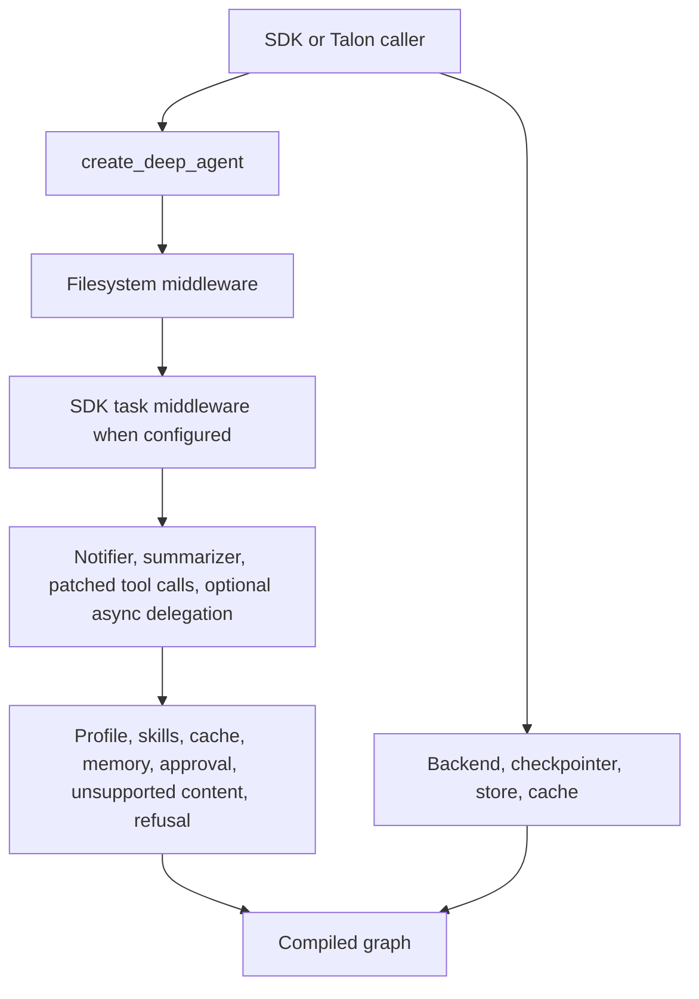
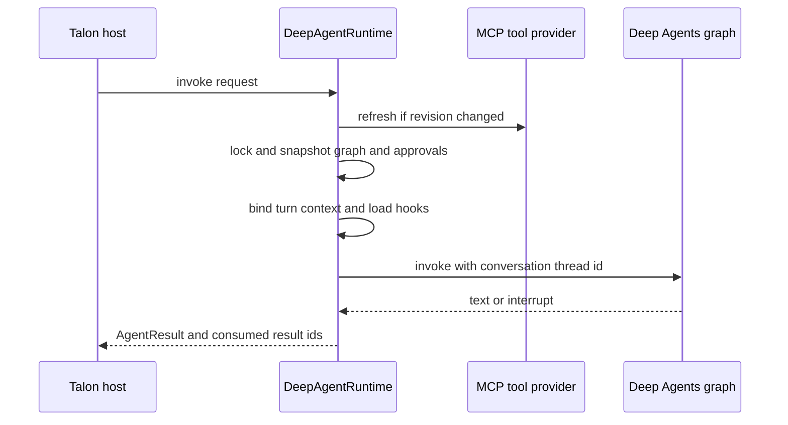
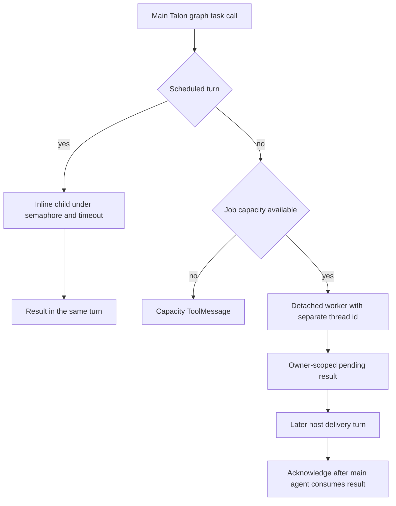

# Repository Source Map

Route a change to the component that owns its state and lifetime—not merely the API that exposes it. This map follows the seams from SDK graph construction through dcode's local server process to Talon's long-lived, channel-facing host. See also [Architecture Overview](./overview.md), [Code Agent](./code-agent.md), [Talon integration](../integrations/talon.md), [Talon channel admission](../concepts/talon-channel-admission.md), [Talon scheduling](../concepts/talon-scheduling.md), and the [testing guide](../testing/testing-guide.md).

## Change routing

| If the change affects… | Start at | Owner and boundary | Focused tests |
| --- | --- | --- | --- |
| SDK tools, profiles, middleware order, state schema, or injected persistence | `libs/deepagents/deepagents/graph.py` — `create_deep_agent` | The compiled graph; callers retain checkpointer, store, and cache ownership | `libs/deepagents/tests/unit_tests/test_graph.py`, `test_end_to_end.py`, `test_subagent_refusal.py` |
| dcode graph serving, private offload operations, startup, loopback health, restart, or reaping | `libs/code/deepagents_code/client/launch/server.py` — `generate_langgraph_json` and `ServerProcess`; `offload_api.py` | Generated `langgraph.json` is the public graph/HTTP boundary; `ServerProcess` owns its local subprocess, not the Textual app | dcode server-launch and offload API tests |
| Talon graph wiring, turn snapshots, approval changes, MCP/subagent reload, or runtime shutdown | `libs/talon/deepagents_talon/runtime.py` — `DeepAgentRuntime` | Runtime graph snapshot and invocation context variables | `libs/talon/tests/test_runtime.py`, `test_subagent_reload.py`, `test_mcp_config.py` |
| MCP server loading, OAuth availability, deferred reload, or management tools | `libs/talon/deepagents_talon/mcp.py` — `MCPToolProvider` | Provider refresh revisions and runtime graph replacement | `test_mcp_enabled.py`, `test_mcp_config.py`, `test_mcp_adapter.py` |
| MCP configuration mutation, redaction, revision conflicts, or filesystem safety | `libs/talon/deepagents_talon/mcp_config.py` — `MCPConfigStore` | One locked configuration file; the tool mediates changes but is not a filesystem secrecy boundary | `test_mcp_config.py` |
| Fresh local subagents, task-specific attachments, child approvals, hooks, or control messages | `libs/talon/deepagents_talon/subagents.py` and `subagent_control.py` | A fresh child graph plus in-memory `SubagentControl` for the worker | `test_research_subagents.py`, `test_subagent_control.py` |
| Detached task capacity, result delivery, cancellation, or scheduled delegation | `libs/talon/deepagents_talon/background.py` — `BackgroundSubagents` | Process-memory job table, keyed by owner conversation | `test_background.py`, `test_background_runtime.py` |
| Voice transcription and inbound message enrichment | `libs/talon/deepagents_talon/speech.py`, then `host.py` | Host preparation before media staging and agent invocation | `test_speech.py`, `test_voice_background.py` |
| Host startup/shutdown, channels, scheduler, background delivery, or per-conversation work | `libs/talon/deepagents_talon/host.py` — `TalonHost` | Host owns channels, scheduler, agent-turn tasks, and delivery retries | `libs/talon/tests/test_host.py`, `test_background.py` |

## SDK graph construction: order is a contract

`create_deep_agent` is the SDK construction seam: it accepts caller-provided backend, middleware, subagents, checkpointer and store dependencies, composes its protected core and tail middleware stack around them, and `DeepAgentState` uses a `DeltaChannel` reducer for messages to limit checkpoint growth.

The main graph begins with filesystem tools and optional SDK `SubAgentMiddleware`, then parent notification, summarization, and patched tool calls; optional remote async delegation follows. The captured **core** is followed by profile middleware, skills, prompt caching, optional memory, approval interrupts, unsupported-content handling, and refusal handling. Caller middleware replaces matching named slots or is inserted relative to the captured core; exclusions are checked after assembly, and excluded tool names are stripped last. Consequently, a middleware name or order change is a graph behavior change, not a cosmetic refactor.

`ModelRefusalMiddleware` is intentionally tail middleware after unsupported-content handling. This lets a caller fallback see a refusal first; the default top-level policy raises, while excluding it leaves the refusal message visible. Delegated children have a different boundary: `SubAgentMiddleware` converts model refusal errors and refusal-bearing structured-output validation failures to an actionable parent `ToolMessage`, but re-raises unrelated validation failures. Completed child projection prefers a JSON `structured_response`, then a refusal notice, then final non-empty AI text.

*The ordering shown is the assembled main-agent order; Talon replaces named slots before the SDK compiles it.*

Async remote SDK tasks remain separate from Talon's detached-worker mechanism: `AsyncSubAgentMiddleware` owns parent `async_tasks`, supplies start/check/update/cancel/list tools, polls unfinished tasks on async invocations, and reports new status notifications while leaving failed status reads to a later poll. Its terminal projection preserves content blocks where possible and normalizes a terminal refusal into the same actionable result.

Rubric evaluation is another SDK-private loop. Without `rubric` state it is inactive; otherwise it records grading state after the agent stops and may return to the model with revision feedback. Failure, grader error, or iteration limit does not replace the last model response, so consumers must inspect rubric state or events rather than infer success from visible text.

## dcode: a local graph-server process boundary

dcode's Textual app is a client/lifecycle consumer rather than Talon's runtime. `generate_langgraph_json()` registers the interactive `agent` graph. When that graph is dcode's built-in graph, it also registers `deepagents_code.offload_api:app` and enables LangGraph custom-route authentication; custom graph references deliberately do not get the offload service. The private Starlette boundary provides thread-scoped model, cost/usage, workspace, offload, handoff, cancellation, and extension routes. Production's loopback deployment uses noop route auth, whereas a deployment that configures a LangGraph auth backend gates these routes.

The app lifespan installs run-queue wakeup, starts a default runtime prebuild while clients poll health, cancels and joins that build before extensions shut down, and makes a bounded best-effort LangSmith trace flush. `ServerProcess` creates the temporary or supplied server workspace, chooses a loopback ephemeral port by default, sanitizes inherited server startup environment, starts `langgraph dev`, and waits for `/ok` health before use.

The process manager serializes asynchronous lifecycle operations and cleans up a partially started process even on cancellation. On POSIX it starts a dedicated session/process group and passes an owner-death pipe; normal stop sends a graceful signal, then escalates to a hard kill after a timeout. On Windows escalation reaches only the root process, so a surviving descendant can be orphaned. `DeepAgentsApp` owns UI adoption and calls the manager's idempotent stop from its final cleanup path.

## Talon runtime: compile first, swap only after success

`DeepAgentRuntime.start()` resolves local definitions, snapshots approvals, and constructs the first graph. `_create_graph()` builds Talon tools, removes MCP skill-only tools from the main catalog, resolves local tool names, prepares subagents, and passes the composed middleware and tools to `create_deep_agent`. Its middleware order is deliberate: Talon's filesystem replacement, selected-model summarization, model selection, and progress; approval middleware; server hooks; `TaskTools`; background dispatch; optional summarization tool; skill middleware; then caller-supplied middleware. Reverse `after_model` ordering is why hooks are appended after approvals: hook resolution runs first.

`DeepAgentRuntime` snapshots graph and approval state under its tool lock for a turn, then binds graph, approvals, authorization, pending results, cron origin, breakout handler, and hooks through context variables. A reload can therefore affect later turns without changing an in-flight turn or detached task. Replacement is transactional in practice: `_replace_runtime_tools()` compiles a replacement before assigning `tools` and `_graph`; a failed automatic refresh logs an inactive saved change, and a failed explicit reload raises while keeping the prior graph.

*Reload and approval rebuilding occur before the stable turn snapshot; graph work observes that snapshot only.*

Runtime shutdown cancels all background workers before closing the checkpointer. If workers outlive the cancellation wait, it raises and deliberately leaves runtime resources open rather than closing persistence under active writers; `TalonHost.stop()` records that component failure but continues shutting down the rest of the host.

## MCP configuration and reload

`MCPToolProvider` loads configured server tools plus management tools. It uses a monotonic refresh revision: `request_refresh()` marks saved configuration or completed OAuth work, and the runtime's pre-turn refresh loads once when the revision differs. A forced reload is exposed as `reload_mcp_configuration`; both it and configuration changes are only active after successful graph replacement, so `get_agent_tools` is the correct activation check and existing turns/tasks retain original capabilities.

`MCPConfigStore` exposes a redacted read view and compare-and-swap, single-server update. It reads only a regular non-symlink file, locks a sidecar file, checks an HMAC-derived revision, validates the replacement, atomically writes it, and schedules—not performs—the reload. Redacted values can preserve existing secrets, but an auto-approved update that reuses them may change only tool filters; changing a command, transport, URL, or other routing field is rejected because it could redirect a secret. The store warns when its path is inside the agent workspace, but this is not a confidentiality boundary: an execution-capable shell can still read an absolute path. Use environment references or OS-level isolation for secrets.

## Talon delegation: fresh children, detached workers, and control

Talon local subagents are loaded from `AGENTS.md` frontmatter, resolve exact tools from the current graph catalog, run with fresh context rather than fork mode, and `TaskTools` supplies the sole parent task tool to add validated per-task tools while compiling an isolated child graph with only applicable approvals.

`TaskTools` intentionally has the SDK middleware name `SubAgentMiddleware`, replacing the SDK instance so there is one parent `task` tool. A task may select only unique names advertised by `get_agent_tools`, and only for a named local agent; configured tools remain additive. Fresh children receive a scope-limited system contract, selected tools, MCP middleware, and `SubagentControlMiddleware`; they inherit neither parent history nor skills. Their approval map includes only attached protected tools. Precompiled children are refused when Talon approvals exist because Talon cannot enforce its policy inside them.

`BackgroundSubagents` intercepts main-agent `task` and `start_async_task` calls in ordinary chat, creates an in-memory job with a distinct worker thread ID, and returns a task ID immediately. Ownership checks protect list/cancel/inspect/message operations. The global job table caps stored jobs and running workers; a refusal at capacity is expected. Workers have a one-hour deadline, clear the authorization handler, force approval-operator false, and turn timeout/failure into redacted generic results. Completed results are injected into a later owner turn, acknowledged only after the main agent consumes them, and can be requeued if the host discards an otherwise completed reply; repeated failed delivery is bounded and eventually dropped.

A cron-triggered scheduled turn is the intentional opposite: it runs delegation inline under a separate semaphore and shorter timeout, creates no job, and returns the result in the same turn. Nested delegation remains refused. That boundary matters because scheduled work has no user or future delivery turn to receive a detached result.

*Chat delegation crosses a detached-worker boundary; scheduled delegation does not. Approval and authorization prompts are not carried into a detached worker.*

`SubagentControl` deliberately stores only bounded metadata outside model-controlled graph state. `inspect_subagent` reveals lifecycle/model/tool event names and queued/consumed message receipts, never tool arguments, outputs, or reasoning. `message_subagent` is available only for Talon-built local workers, accepts a bounded non-empty message, and injects it as a human follow-up at the next model boundary; it cannot interrupt a running model or tool call and does not relax the child's scope or approval restrictions.

## Host and speech lifecycle

`TalonHost.start()` starts the runtime before channels, then the scheduler; if a later component fails, it unwinds scheduler/channels in reverse order and stops the runtime. Once started it also runs the background-result delivery loop. `stop()` cancels that loop and all in-flight agent work, then stops channels in reverse order, the scheduler, and the agent runtime; each component stop is isolated so one failure cannot prevent remaining cleanup.

For ordinary inbound messages, the host transcribes voice before staging inbound media and before constructing model content. Voice handling is best-effort: it preserves the original message if disabled, ineligible, missing, empty, or failed, and appends successful transcript text while marking `voice_transcribed`. The default enabled local path uses NVIDIA Parakeet, caches a pipeline by model/device/cache, downloads only JSON and safetensors files, converts audio to mono 16 kHz WAV via `ffmpeg`, and deletes the temporary WAV. A non-Parakeet configured model uses the optional OpenAI SDK instead.

## Focused test plan

- Change graph order, refusal, SDK task projection, or rubric behavior with the narrow Deep Agents middleware tests and a graph-level end-to-end test when the contract crosses compilation.
- For MCP changes, pair `test_mcp_config.py` redaction, CAS, atomic-write, symlink, approval, and secret-redirection cases with provider/runtime reload coverage. Test both the unsuccessful replacement path and later-turn activation.
- For fresh-child changes, use `test_research_subagents.py` for frontmatter/catalog/approval behavior and `test_subagent_control.py` for ownership, metadata-only inspection, follow-up timing, and bounded inbox retention.
- For detached work, use `test_background.py`: owner isolation, capacity, cancellation, result acknowledgement/requeue, authorization stripping, remote target snapshotting, and scheduled inline semantics are all distinct invariants.
- For host changes, exercise partial-start unwind and stop ordering; for speech, cover disabled/ineligible/failure preservation as well as local-model loading and temporary-media cleanup.
