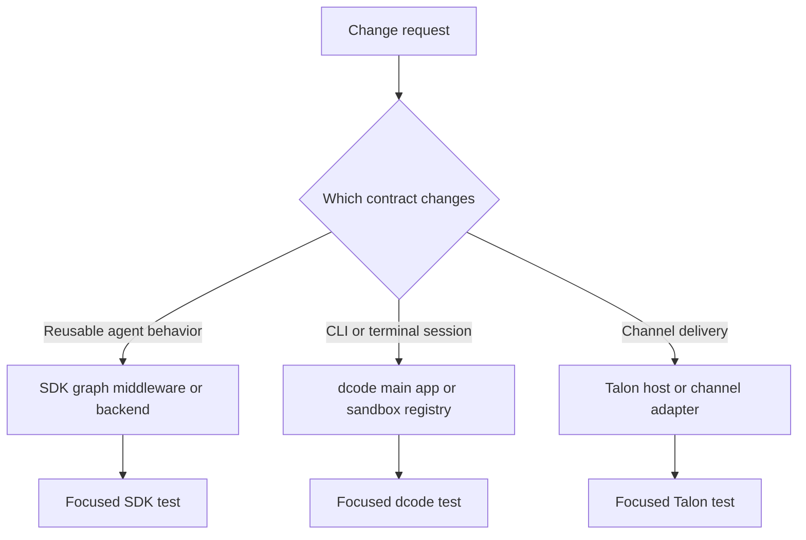
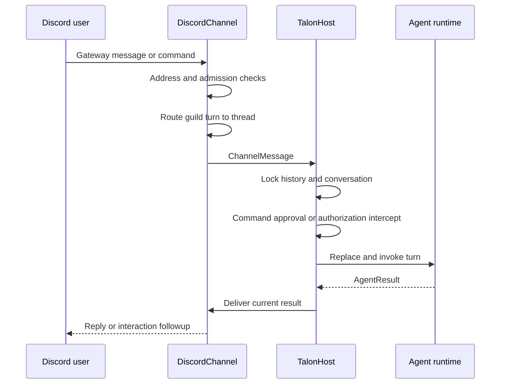

# Source Map

Route a change to the component that owns its contract, rather than the product where it was first observed. The reusable `deepagents` SDK owns graph assembly, middleware, and backends; dcode owns launch, terminal-session, and sandbox policy; Talon owns long-running channel delivery and provider adapters. See the [architecture overview](./overview.md), [code-agent architecture](./code-agent.md), [SDK construction and execution](./sdk-construction-execution.md), [backends](../concepts/backends.md), [Talon channel admission](../concepts/talon-channel-admission.md), [quickstart](../quickstart.md), and [testing guide](../testing/testing-guide.md).

## Change routing

| Change intent | Owner and entry point | Focused verification |
| --- | --- | --- |
| SDK graph inputs, profile resolution, middleware order, tool policy, or checkpoint state | `libs/deepagents/deepagents/graph.py` — `create_deep_agent` | `libs/deepagents/tests/unit_tests/test_graph.py` |
| Blocking or asynchronous delegation | `middleware/subagents.py` or `middleware/async_subagents.py` | relevant subagent unit tests; `tests/unit_tests/test_async_subagents.py` for remote-task lifecycle |
| Context compaction and offload recovery | `middleware/summarization.py` | `tests/unit_tests/middleware/test_summarization_factory.py` plus lifecycle coverage |
| Prefix-routed files, root listings, cross-route search, glob behavior, or execution capability | `backends/composite.py` — `CompositeBackend` | `tests/unit_tests/backends/test_composite_backend.py` and `test_composite_backend_async.py` |
| Ephemeral, checkpointed per-thread files or read-your-writes during a graph step | `backends/state.py` — `StateBackend` | `tests/unit_tests/backends/test_state_backend.py` |
| Persistent, cross-thread files, namespace isolation, or BaseStore pagination | `backends/store.py` — `StoreBackend` and its `NamespaceFactory` | `tests/unit_tests/backends/test_store_backend.py` |
| Shared file-data migration, byte encoding, read windows, literal grep, or glob semantics | `backends/utils.py` — `file_data_to_string`, `slice_read_response`, and matcher helpers | the State and Store backend unit suites |
| Persistent Hub-backed files | `backends/context_hub.py` — `ContextHubBackend` | `tests/unit_tests/backends/test_context_hub_backend.py`; real-Hub coverage in `tests/integration_tests/test_context_hub_backend.py` |
| dcode command dispatch, policy gates, or sandbox-default validation | `libs/code/deepagents_code/main.py` — `cli_main` | nearest `libs/code/tests/unit_tests/` CLI test |
| dcode Textual UI, session start, server handoff, thread rendering, or approvals | `libs/code/deepagents_code/app.py` — `DeepAgentsApp` | `libs/code/tests/unit_tests/test_app.py` |
| Sandbox discovery and provider precedence | `integrations/sandbox_registry.py` — `SandboxRegistry` | `libs/code/tests/unit_tests/test_sandbox_registry.py` |
| Sandbox acquisition, setup, cleanup, or provider-specific lifecycle | `integrations/sandbox_factory.py` — `create_sandbox` | `libs/code/tests/unit_tests/test_sandbox_factory.py` |
| Talon host lifecycle, turns, approvals, cancellation, scheduling, or delivery | `libs/talon/deepagents_talon/host.py` — `TalonHost` | `libs/talon/tests/test_host.py` and the narrower host suite |
| Discord admission, threads, interactions, media, or Gateway status | `libs/talon/deepagents_talon/channels/discord.py` — `DiscordChannel` | `libs/talon/tests/channels/test_discord.py`; cross-boundary behavior in `tests/integration_tests/test_discord_host.py` |
| Talon environment parsing, assistant-home layout, verbosity, or history URI validation | `libs/talon/deepagents_talon/config.py` — `TalonConfig.from_env` and `ensure_home` | `libs/talon/tests/unit_tests/test_verbosity.py` for verbosity; configuration tests for path and URI validation |
| Talon graph composition, per-turn policy snapshots, approval interrupts, and recovery | `libs/talon/deepagents_talon/runtime.py` — `DeepAgentRuntime.start`, `invoke`, and `recover_interrupted` | `libs/talon/tests/test_runtime.py` and `libs/talon/tests/unit_tests/test_tool_approval_runtime.py` |
| Main-agent narration, explicit `send_message`, or per-turn interim-message budget | `libs/talon/deepagents_talon/messaging.py` — `ProgressMessages` and `progress_messages` | `libs/talon/tests/unit_tests/test_messaging.py` and `libs/talon/tests/unit_tests/test_verbosity.py` |
| Talon MCP OAuth storage, discovery, or transport security | `libs/talon/deepagents_talon/mcp_auth.py` | `libs/talon/tests/test_mcp_auth.py` and OAuth transport tests |

*Ownership routing: choose the contract owner first, then verify at the narrowest observable boundary.*

## SDK construction, delegation, and storage

`create_deep_agent` resolves the model profile and backend, assembles subagent and middleware behavior, delegates the result to LangChain `create_agent`, and uses a DeltaChannel-backed messages state to keep checkpoint growth linear. Custom state schemas should extend `DeepAgentState` to retain that reducer; shared fields updated concurrently need their own reducer.

FilesystemMiddleware and SubAgentMiddleware are protected Deep Agents scaffolding because they respectively enforce built-in filesystem permissions and implement the task tool; excluding either through a harness profile raises instead of producing a degraded graph.

Deep Agents inserts novel caller middleware after its core stack and before the tail, replaces same-named stack entries in place, and applies profile tool exclusion last so custom middleware cannot restore an excluded tool.

The top-level `deepagents` package is the curated consumer import surface for graph construction/state, filesystem and subagent types, selected middleware, profiles, and profile registration, while `deepagents.middleware` exposes the middleware-facing feature types.

SubAgentMiddleware exposes the blocking task bridge for declarative and compiled subagents: isolated children receive a delegated description, forks receive effective summarized parent history, and completed children return one ToolMessage while private, excluded, and unchanged inherited state is withheld from the parent update.

AsyncSubAgentMiddleware runs remote Agent Protocol work without blocking the parent by persisting a local async_tasks record on launch and exposing start, check, update, cancel, and list tools; remote execution and its thread remain owned by the remote graph. Remote async task updates create an interrupting run on the existing thread and replace the tracked run ID; task checks map a successfully finished but interrupted remote thread to waiting, while cancellation of a waiting task is recorded locally because no active run exists to cancel.

Deep Agents summarization preserves raw messages while recording a private event that reconstructs the compacted request, persists a session ID for append-only backend history, and continues with a warning when history offload fails; its factory selects fraction-based defaults from max_input_tokens or fixed fallback defaults and requires a resolved BaseChatModel.

`CompositeBackend` is the virtual filesystem router: it selects the longest matching prefix, exposes route roots in a root listing, remaps routed result paths, and searches or globs across routes only from the root. A root-anchored glob that does not target a route skips that route; command execution is never routed and requires the default backend to implement `SandboxBackendProtocol`. Test both sync and async behavior when changing routing or merge semantics.

For persistent files, ContextHubBackend lazily snapshots a LangSmith Hub agent repository, treats a missing repository as empty, overlays accepted pending and in-flight mutations on reads, and batches writes before their callers return after remote durability. On a Context Hub commit conflict, ContextHubBackend reloads the remote tree and rematerializes queued edits or deletes from their original intents before retrying; incompatible rematerialization settles affected callers with the conflict.

### State and store file-data compatibility

Use `StateBackend` when files should live in the LangGraph `files` state channel for one conversation thread. It must run in graph context: it reads through `CONFIG_KEY_READ` with `fresh=True`, queues only changed keys through `CONFIG_KEY_SEND`, and therefore makes a write visible to later backend calls in the same superstep before the node boundary commits it. Deleting a directory queues `None` for its exact and descendant keys.

Use `StoreBackend` when files must persist across threads. Its caller-owned `NamespaceFactory` is the isolation boundary; namespace components are validated to reject empty, non-string, and wildcard-like components before any store lookup. It may use an injected `BaseStore` outside a graph only when the namespace factory does not require a runtime; otherwise route the call through graph execution. Store listings and searches page through all matching items rather than depending on backend-specific filter semantics.

`backends/utils.py` owns cross-backend file-data behavior. Readers accept legacy `list[str]` content and normalize it without mutating persisted data; writes and edits migrate it to a string while retaining `created_at`. Uploads store UTF-8 payloads as text and undecodable bytes as base64, and downloads reverse that encoding. Do not fork these rules in an individual backend.

The shared read helper clamps negative offsets and limits, returns an explicitly empty no-lines-requested window for a zero limit, preserves metadata on a read-only slice, normalizes returned line endings, and provides pagination metadata. Shared grep is literal, excludes base64 payloads, and reports invalid include globs as result errors rather than exceptions. Focus changes to this contract with the State and Store suites, including legacy content, binary round trips, non-positive bounds, and binary grep behavior.

## dcode entry, UI, and sandbox boundaries

dcode's `cli_main` keeps lightweight version and help paths ahead of heavy bootstrap, gates policy-sensitive commands on healthy managed configuration, and validates a managed sandbox default against SandboxRegistry before accepting it for the launch. Keep pre-TUI policy failures in `main.py`; the Textual app should receive a valid session configuration.

`DeepAgentsApp` owns the Textual terminal application boundary, including app-level interaction bindings and the background-server success and failure messages used to hand a constructed agent to the UI. Route app-level event, focus, modal, rendering, and approval behavior here; test it with `app.run_test()` when Textual scheduling matters.

SandboxRegistry merges built-in, entry-point, and configuration-declared sandbox providers, resolving collisions in configuration, entry-point, then built-in precedence; provider construction follows the same order. `create_sandbox` resolves registry metadata before acquisition, rejects unsupported or reused snapshots, merges configured and call-specific parameters, and only deletes a sandbox it created. Setup runs after acquisition; setup and body failures still trigger owned-sandbox cleanup, while cleanup failure is reported without masking the original error.

## Talon host and Discord channel path

TalonHost starts its agent before channels and scheduler, unwinds partially started components in reverse order on failure, and on shutdown cancels work before stopping channels in reverse order, then scheduler and agent.

TalonHost serializes inbound work with provider/chat history locks and per-conversation locks, handles commands, approvals, and authorization interception before replacing an agent turn, and drops stale-generation results rather than delivering them to a superseding turn.

DiscordChannel rejects self-authored Gateway messages, applies guild addressing and exposure or pairing admission before thread creation or media download, and dispatches admitted events to the host as provider-neutral ChannelMessage values.

Discord application commands are converted to the same textual command path as typed commands, deferred before dispatch, and their replies use a task-local interaction sink so unrelated work cannot be captured by the invocation.

*Discord decides whether and where an event becomes a turn; the host serializes the turn and owns agent lifecycle and delivery.*

Talon's DeepAgentRuntime is an integration caller of the SDK builder: it prepares Talon-specific tools, approvals, middleware, backend, and checkpointing, then invokes create_deep_agent, including a replacement filesystem middleware and selected-model summarization layer.

### Talon runtime seams: configuration, progress, and approval

`TalonConfig.from_env` owns the process boundary: it validates the assistant identifier and history URI, filters the inherited environment to runtime-relevant keys, and namespaces state beneath one assistant home. `ensure_home` creates that home and its state directories with mode `0700`, installs defaults without overwriting existing files, and initializes the tool-approval store. Route new settings and their validation here, rather than treating `DeepAgentRuntime.env` as an unvalidated configuration API.

`DEEPAGENTS_TALON_VERBOSITY` is deliberately small: level 1 is the default and suppresses interim updates, level 2 permits a shared maximum of two per invocation, and level 3 has no runtime cap. The level also controls whether `send_message` is exposed and the system guidance supplied to the model. `progress_messages` scopes both handler and budget with `ContextVar`s and resets them even on failure, so concurrent requests cannot cross-deliver messages. `ProgressMessages.aafter_model` automatically forwards nonblank main-agent narration only when an AI message will call tools and does not itself call `send_message`; subagent narration and duplicate explicit progress are suppressed. Delivery failures stay out of model context as a generic result.

`DeepAgentRuntime.start` snapshots the persisted approval policy and constructs the graph. Each `invoke` refreshes tools, rebuilds the graph if the persisted policy changed, then binds that graph and snapshot in invocation-local context before running it. This keeps a turn that is already awaiting approval on its original policy while later turns see the replacement. The runtime wires protected tools through `interrupt_on`; on an interrupt it sends the complete action batch to the request approval handler, resumes with matching approve or reject decisions, and auto-denies cron, background-delivery, or handler-less requests. Change policy persistence in `tool_approvals.py`; change the graph bridge, snapshot lifecycle, or denial policy in `runtime.py` and verify it with the network-free approval-runtime suite.

Talon MCP OAuth stores credentials in server-identity-scoped owner-only files and preserves a previous refresh token on refresh responses that omit it; its OAuth transport is HTTPS-only, SSRF-safe, and rejects redirects and unsafe discovered endpoints.

## Operational checks

`libs/ARCHITECTURE.md` is the SDK maintainer orientation: Deep Agents is an opinionated harness over LangChain `create_agent` and LangGraph state, checkpointing, streaming, and interrupts. The lockfile pre-commit check selects packages touched by changed paths, checks them with each package's required Python version, and computes changed manifests' transitive local consumers through tool.uv.sources paths.

For graph assembly, assert the final middleware and tool surface as well as protected-exclusion failures. For dcode UI changes, use the focused Textual suite. For Context Hub and Talon, use mocked focused tests for deterministic error paths and integration coverage for the real backend or channel-to-host boundary.
