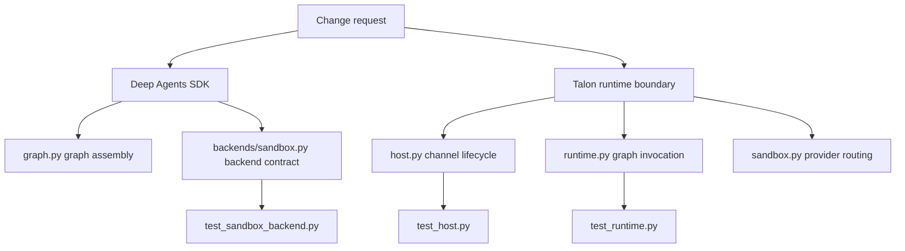
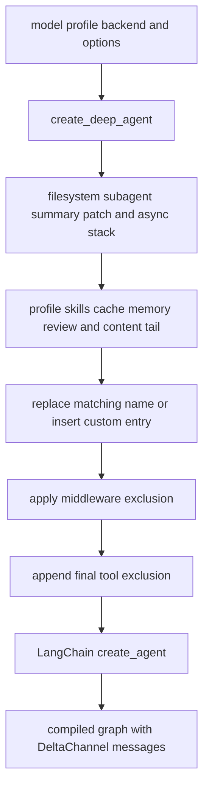
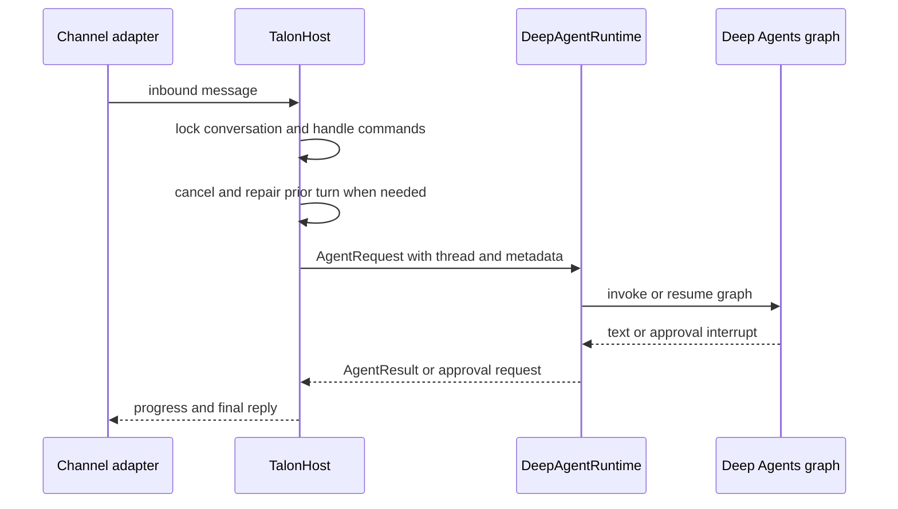
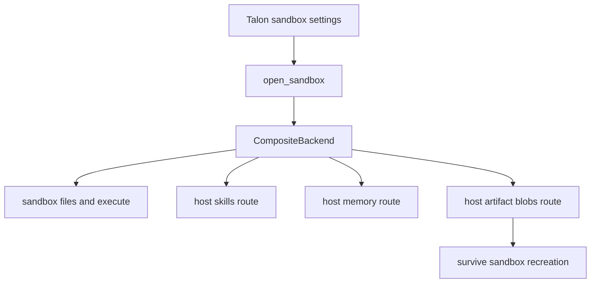

# Source Map and Ownership Boundaries

Use this page to begin a change at the owner of the behavior, then run the narrow regression suite that exercises its contract. The principal boundary is deliberate: Deep Agents owns reusable graph construction and backend behavior; Talon owns conversion between channel events and an agent request, long-running conversation lifecycle, and its runtime-specific graph wiring. See the [architecture overview](./overview.md), [middleware catalog](../concepts/middleware-catalog.md), [Talon scheduling](../concepts/talon-scheduling.md), [quickstart](../quickstart.md), and [testing guide](../testing/testing-guide.md) for broader orientation.

## Route a change

| Change intent | Owner and primary seam | Focused tests |
| --- | --- | --- |
| Change default graph state, middleware ordering, profiles, built-in tools, subagent construction, or graph compilation | `libs/deepagents/deepagents/graph.py` — `create_deep_agent` | `libs/deepagents/tests/unit_tests/test_graph.py` |
| Change normalized filesystem approval matching | `libs/deepagents/deepagents/middleware/_fs_interrupt.py` | `libs/deepagents/tests/unit_tests/test_permissions.py` |
| Change a generic remote sandbox's derived filesystem operations, transfer strategy, parsing, truncation, or shell command construction | `libs/deepagents/deepagents/backends/sandbox.py` — `BaseSandbox` | `libs/deepagents/tests/unit_tests/backends/test_sandbox_backend.py` |
| Change Talon's channel lifecycle, commands, conversation replacement/cancellation, media delivery, or host-side approval and authorization interaction | `libs/talon/deepagents_talon/host.py` — `TalonHost` | `libs/talon/tests/test_host.py` |
| Change Talon's Deep Agents graph composition, runtime tool reload, checkpoint use, retries, approval-resume loop, model selection, or local backend environment | `libs/talon/deepagents_talon/runtime.py` — `DeepAgentRuntime` | `libs/talon/tests/test_runtime.py` and `libs/talon/tests/unit_tests/test_tool_approval_runtime.py` |
| Change Talon sandbox startup or the host-versus-sandbox filesystem route set | `libs/talon/deepagents_talon/sandbox.py`, with settings in `config.py` | `libs/talon/tests/unit_tests/test_sandbox.py` |
| Change attachment normalization or safe Markdown-media extraction | `libs/talon/deepagents_talon/media.py` | `libs/talon/tests/test_media.py`, `libs/talon/tests/test_host.py`, and `libs/talon/tests/unit_tests/test_media_blobs.py` |

This map separates reusable SDK behavior from Talon's channel-facing orchestration and deployment adapter.

## Deep Agents: graph assembly is policy; a sandbox backend is transport

### `graph.py`: assemble the agent once, preserve stack invariants

`create_deep_agent` is the construction seam. It resolves the supplied model and its harness profile, defaults the backend to `StateBackend`, builds synchronous and asynchronous subagent wiring, and gives LangChain `create_agent` the final tools, prompt, state schema, checkpointer, store, and middleware list. `DeepAgentState.messages` uses a `DeltaChannel` with snapshots, so checkpoint growth is linear rather than repeatedly storing the whole message list.

The stack is a behavioral contract, not merely a list. The core begins with filesystem, synchronous subagent when present, summarization, tool-call patching, and optional async-subagent middleware. Profile behavior, skills, prompt caching, memory, generated or caller-specified human review, unsupported-content handling, and final tool exclusion form the tail. A custom middleware sharing a name replaces that position; a novel one is inserted after core middleware and before the tail. Exclusions are applied again after the merge, and tool exclusion is appended last.

`FilesystemMiddleware` and `SubAgentMiddleware` are protected scaffolding. The former supplies built-in filesystem behavior and applies permissions; the latter supplies the `task` tool. A harness profile cannot exclude either and leave a silently degraded graph. For permission work, keep the two layers distinct: filesystem middleware executes and enforces access, while graph assembly derives `HumanInTheLoopMiddleware` predicates from `interrupt` rules. Caller-supplied `interrupt_on` wins for the same tool name.

This ordering shows why a custom middleware cannot restore a profile-excluded tool and why required middleware must remain in the assembled graph.

### `backends/sandbox.py`: derive file operations from the provider primitive

`BaseSandbox` is the reusable implementation for a provider that can execute a command and upload/download bytes. It is not a containment or authorization boundary: callers with its `execute()` capability already have the shell authority the provider exposes. Provider subclasses own only `execute`, `upload_files`, `download_files`, and `id`; the base class derives listing, search, glob, read, write, edit, and deletion behavior.

The transfer mechanism is intentionally operation-specific. Listing, grep, glob, and paginated read run structured commands inside the sandbox; write first creates parents and then uploads UTF-8 bytes. Small edits run a server-side replacement script, while larger old/new payloads are uploaded to randomized temporary files and replaced server-side so the source file does not cross the boundary. Empty old strings fail before dispatch. Parsed malformed server output becomes an operation error rather than an uncaught decoding exception.

Execution-output offload is opt-in per sandbox implementation. When `enable_capture_offload` is true, `execute_with_offload` wraps the command to retain large output at a sandbox path and return only a preview while preserving the child exit code; otherwise it returns unwrapped output and lets filesystem middleware use its normal handling. Async grep and glob add outer timeouts, and their result contracts distinguish a hard error from an incomplete result.

**Change safely:** add a regression in `test_sandbox_backend.py` when changing a command template, serialized output, result parser, pagination, quote/base64 handling, or sync/async parity. Do not add Talon policy here; this class is shared backend behavior.

## Talon: host owns channel turns; runtime owns graph invocation

`TalonHost` is the long-running coordinator. It starts the runtime before channels and scheduler, binds channel callbacks, and unwinds already-started components in reverse order if startup fails. Shutdown cancels host work and attempts every component stop even if one fails. `receive_message` derives a provider-qualified conversation root, serializes history and per-conversation work, handles host commands and pending approval/authorization replies before the model, and otherwise replaces the active turn with a new task.

A replacement increments the conversation generation, cancels the old task, and asks the runtime to repair interrupted checkpoint state. A cancellation that fails to complete within the bound blocks that conversation rather than running overlapping turns. If recovery itself fails after the task stops, the successor is still started with degraded-recovery metadata. `/new` persists a reset counter that produces a new agent thread; scheduled jobs instead use an isolated per-job thread and a run timeout.

This sequence identifies the boundary: the host decides which channel interaction can become a request or approval response; the runtime decides how that request drives the graph.

`DeepAgentRuntime.start` resolves subagents, loads the approval snapshot, and creates its graph. Its graph factory supplies Talon tools, approval tools and `interrupt_on`, runtime middleware, a checkpointer, the selected model, skills, memory, and the configured backend to `create_deep_agent`. It replaces the default filesystem middleware to enable binary offload for non-state backends, and records the live tool attachment catalog after compilation. Tool, MCP, subagent, smart-model, or approval configuration changes rebuild the graph under a lock; active invocations retain their context-local graph.

For a turn, the runtime refreshes tools, snapshots approval policy, binds request-scoped context variables, invokes with the conversation as LangGraph `thread_id`, and retries only recognized transient errors. It adds pending background results and can retry empty responses with continuation prompts before requesting a forced summary. Interrupts must have unique resumable IDs. The runtime batches their action requests, asks the host-provided handler, and resumes every action with the resulting decisions; cron turns, background delivery, and channels without a handler are automatically rejected rather than waiting for an unavailable person.

### Channel media and host-facing security

The host prepares inbound text before invocation, including supported attachment description and optional Slack thread context, and separately stores validated multimodal image content in request metadata. `DeepAgentRuntime` consumes that `model_content` when present. Its replacement filesystem middleware can offload binary content to blobs for non-state backends, preventing checkpoint state from retaining a base64 image payload. On egress, the host extracts Markdown media references and accepts only media that passes the configured outbound-root containment check.

Talon's default local backend is also runtime-owned. It creates a `CompositeBackend` over `LocalShellBackend`, initializes an owner-only artifacts directory, and gives child processes an allowlisted, scrubbed environment with a fixed safe `PATH`; model credentials, tracing variables, loader-injection variables, and secret-marked names do not pass through.

Host-side approvals are interaction state, not graph policy. The host records the pending request with provider, channel conversation, agent conversation, prompt message, and originating sender. Text or reaction responses must match that context and sender before resolving the future. MCP authorization callbacks are similarly bound to the originating channel, conversation, sender, endpoint, and expiry, keeping unsolicited or cross-channel callback URLs out of the model.

## Talon sandbox mode: fail closed and route only assistant-local state home

Talon's sandbox adapter opens an optional provider session for the host lifetime. With no sandbox setting it yields no session. With one, startup runs the synchronous provider factory off the event loop and raises `SandboxStartupError` rather than silently falling back to host execution; a sandbox created after cancellation is still closed. An attached sandbox ID is not owned for deletion, while a Talon-created sandbox is closed on context exit.

The composite backend makes the sandbox the default for normal files and every `execute` call. Only the assistant's `skills/`, `memory/`, and blob namespace are host-routed. That exception set is intentional: skills and memory remain assistant-local, and blobs under host artifacts survive sandbox recreation. Approval storage such as `tools.json` is not host-routed, so it remains in the sandbox default path. Sandbox mode also limits memory candidates to the routed assistant memory directory and adds the remote working directory to the system prompt.

This route set is the safe extension point: add an explicit route only when host persistence is required and its path containment is established.

## Focused change checklist

- **Graph ordering, harness profile, subagents, or final tool list:** edit `graph.py`; cover placement, protected middleware, exclusions, and state behavior in `test_graph.py`.
- **Derived sandbox filesystem behavior:** edit `backends/sandbox.py`; cover both sync and async paths, structured parse failures, bounds, and transfer mechanism in `test_sandbox_backend.py`.
- **Channel turn sequencing, cancellation, commands, authorization, approval routing, or delivery:** edit `host.py`; use the relevant `test_host.py` cases, especially replacement/cancellation and sender/message-bound approvals.
- **Graph rebuild, context variables, retries, approval resumption, model selection, or backend child environment:** edit `runtime.py`; use `test_runtime.py` and the approval-runtime tests.
- **Media crossing the channel/runtime boundary:** change `media.py`, `host.py`, or runtime wiring according to ownership; cover inbound model content, blob offload, outbound root containment, and code masking.
- **Provider lifecycle or host route exceptions:** edit Talon's `sandbox.py` and configuration together; prove fail-closed startup, cancellation cleanup, and `skills`, `memory`, `tools.json`, and blob routing in `test_sandbox.py`.
