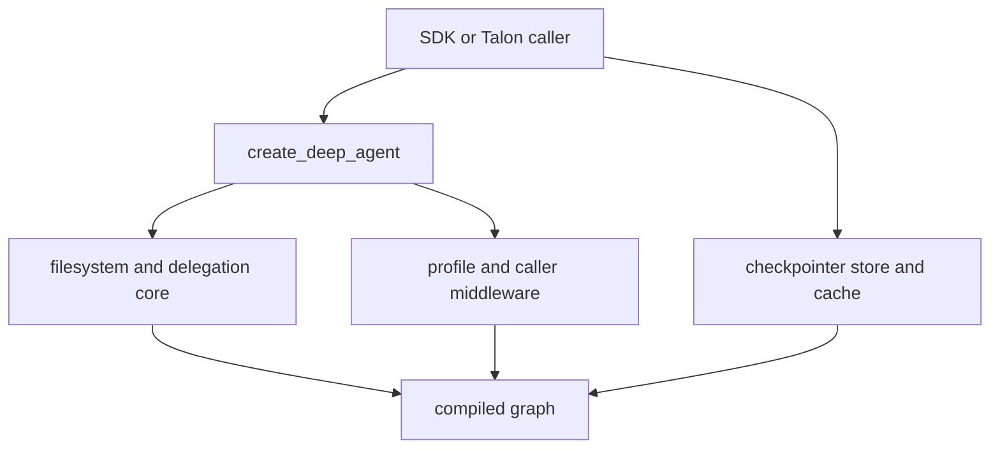
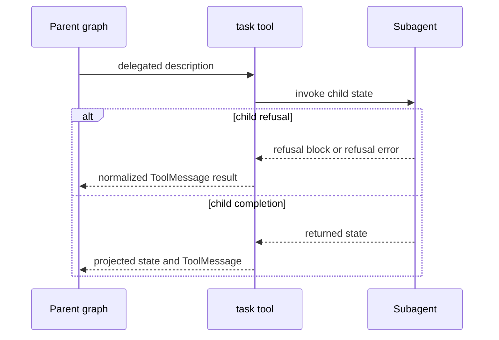
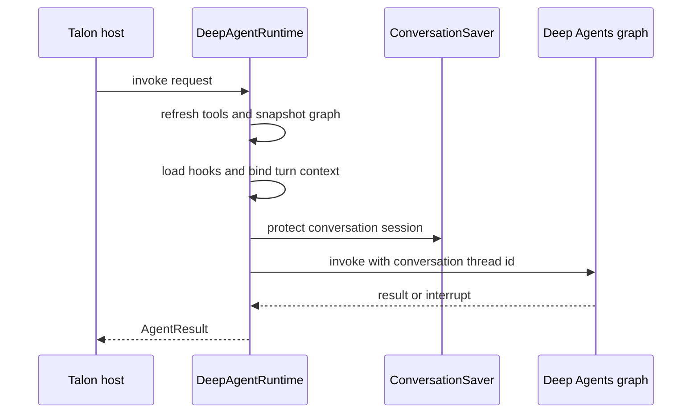

# System Source Map

Route a change to the component that owns its state and lifetime, not merely the API that exposes it. This map centers on the SDK graph-construction seam, delegation result boundaries, and Talon's host adaptations. For surrounding design, see [Architecture Overview](./overview.md), [Runtime behavior](./runtime-behavior.md), [Middleware stack](./middleware-stack.md), [Subagents and skills](../concepts/subagents-skills.md), [Quickstart](../quickstart.md), and the [testing guide](../testing/testing-guide.md).

## Change routing

| If the change affects… | Start at | State or lifecycle owner | Focused tests |
| --- | --- | --- | --- |
| SDK tools, profiles, middleware order, state schema, or persistence injection | `libs/deepagents/deepagents/graph.py` — `create_deep_agent` | The compiled SDK graph; supplied checkpointer, store, and cache remain caller dependencies | `libs/deepagents/tests/unit_tests/test_graph.py`, `test_end_to_end.py` |
| Synchronous or compiled `task` execution, fork state, result projection, or delegated-model refusal | `libs/deepagents/deepagents/middleware/subagents.py` — `SubAgentMiddleware` | The parent graph state and the `task` tool call | `libs/deepagents/tests/unit_tests/test_subagent_refusal.py` and subagent middleware tests |
| Remote Agent Protocol launch, status, update, cancellation, result projection, or notification | `libs/deepagents/deepagents/middleware/async_subagents.py` — `AsyncSubAgentMiddleware` | `async_tasks` in parent graph state | `libs/deepagents/tests/unit_tests/test_async_subagents.py`, `test_subagent_refusal.py` |
| Iterative rubric evaluation and grader feedback | `libs/deepagents/deepagents/middleware/rubric.py` — `RubricMiddleware` | Private rubric bookkeeping on the graph thread | `libs/deepagents/tests/unit_tests/middleware/test_rubric_middleware.py`, `test_end_to_end.py` |
| Talon graph wiring, turn context, tool reload, local definitions, approvals, or shutdown | `libs/talon/deepagents_talon/runtime.py` — `DeepAgentRuntime` | Runtime graph snapshot and invocation-scoped context variables | `libs/talon/tests/test_runtime.py` |
| Checkpoint-to-history projection, reset, or session deletion | `libs/talon/deepagents_talon/archive_saver.py` — `ConversationSaver` | Backing checkpointer plus independent conversation archive | `libs/talon/tests/unit_tests/test_archive_saver.py` |
| Hook transcripts, trusted hook snapshot, or hook-interrupt resume | `libs/talon/deepagents_talon/hook_transcripts.py` and `hooks.py` | A `TalonHooks` instance per turn and transcript owner directory per durable conversation | `libs/talon/tests/unit_tests/test_hook_transcripts.py`, `test_hooks.py` |
| Local subagent attachments, per-task tools, fresh child graphs, or child approvals | `libs/talon/deepagents_talon/subagents.py` | `TaskTools` and each fresh child graph | `libs/talon/tests/test_runtime.py`, `libs/talon/tests/unit_tests/test_hooks.py` |

## SDK graph construction and ordering

`create_deep_agent` is the SDK construction seam. It accepts caller-provided backend, tools, middleware, subagents, state/context schemas, checkpointer, store, cache, and response format, then delegates the completed stack to LangChain's graph compiler. Its built-in tools are additive by default. `DeepAgentState.messages` uses a `DeltaChannel` reducer, limiting checkpoint growth from repeated full-message snapshots.

The main stack begins with filesystem support and, when inline agents exist, `SubAgentMiddleware`; it then adds parent notification, summarization, tool-call patching, and optional remote async delegation. Profile material then precedes skills, prompt caching, memory, approval interrupts, unsupported-content handling, and refusal handling. Caller middleware is spliced against the captured core names, and profile exclusions are checked for coverage. Middleware naming and placement are therefore graph contracts: a replacement by name, an exclusion, or an ordering change can alter which component sees a call or exception.

`ModelRefusalMiddleware` is deliberately in the tail, allowing caller-provided fallback middleware to handle a refusal first. With the default stack, a main-agent model refusal raises; a profile can exclude the refusal middleware, in which case the refusal message remains observable rather than being converted to the default exception.

*The SDK compiles the middleware graph while the caller supplies persistence dependencies.*

## Delegation: task state, result seams, and refusals

`SubAgentMiddleware` exposes the parent's `task` tool. An isolated declarative or compiled child receives only a `HumanMessage` containing the delegated description; a fork receives selected parent state and reconstructed conversation messages. Forks deliberately omit parent-only values such as structured output, pinned skills, rubric state, and summarization session state. A fork is marked in its own initial state so a nested `task` call returns a recursion refusal instead of delegating again.

The task-result boundary is in `_return_command_with_state_update`. A compiled child must return a state with `messages`; compatible non-private, changed state fields are projected back to the parent alongside a `ToolMessage` for the original tool-call ID. Result precedence is:

1. JSON serialization of a non-null `structured_response`;
2. a normalized refusal notice when the final child message has a refusal content block; or
3. the last non-empty `AIMessage` text.

Both synchronous and asynchronous task invocation also catch a `ModelRefusalError`, and structured-output validation errors only when the associated AI message contains a refusal block. They turn those cases into a tool result that includes provider category and explanation when available and advises against retrying unchanged input. Non-refusal validation errors still propagate. This containment is intentional: a refused child informs the parent model so it can continue or rephrase, whereas a refused top-level agent follows the main graph's refusal policy.

Remote async results use the same refusal normalization. `_final_content` returns the terminal message's content blocks, but reports no output messages explicitly and falls back to string content for a remote message that LangChain cannot convert. Thus a successful remote run can still deliver a refusal result rather than masquerading as ordinary empty output.

*Delegated refusal is a parent-visible task result, while unexpected child failures retain normal exception behavior.*

### Remote async task tracking

`AsyncSubAgentMiddleware` supplies start, check, update, cancel, and list tools for Agent Protocol tasks. Starting creates a remote thread and run, then persists an `AsyncTask` record in parent `async_tasks`; the reducer merges records by task ID. A queued update keeps superseded run IDs so old-run notifications cannot complete the current task. Fork mode snapshots the parent conversation at launch, but remote model, prompt, and tools are not synchronized.

On asynchronous parent invocation, unfinished tasks are polled before the agent and before model calls. New status information becomes labeled notifications, and a newly arrived update may allow one further model pass after a final answer. Failed status reads are logged and left for a later poll instead of failing the parent turn. A remote subagent paused for its own human is `waiting`, not terminal; the parent cannot answer its interrupt. The synchronous path does not support local ASGI transport: `url=None` requires an async parent call.

## Rubric middleware

`RubricMiddleware` is inactive without a `rubric` value in invocation state. When enabled, it stores private run ID, iteration, status, frozen criteria, and evaluations, then grades after the primary agent naturally stops. A revision verdict injects feedback and loops back to the model. Satisfied, failed, grader-error, and iteration-limit outcomes stop; non-satisfied termination leaves the last model response intact, so consumers must inspect private rubric state, callbacks, or rubric events.

The grader validates pass/fail criterion shapes and requires an actionable gap for failures. It freezes the first nonempty criterion list, preventing later grading from silently reducing coverage, and will not accept an incompletely supported satisfied verdict. Cover bookkeeping and error behavior in the middleware suite, and use the end-to-end tests to protect the actual model-to-grader loop.

## Talon runtime lifecycle

`DeepAgentRuntime.start()` resolves subagents, snapshots approval policy, and compiles the first graph. `_create_graph()` is Talon's composition seam: it builds runtime and approval tools, resolves local tool names against the current catalog, adds Talon filesystem, model selection, progress, approval, server-hook, task, background, summarization, skills, and supplied middleware, then calls `create_deep_agent`. After compilation it derives a credential-free attachment inventory from the actual tool node.

Each `invoke()` refreshes dynamic tools before acquiring a stable graph and approval snapshot under the tool lock. It binds turn-specific graph, approval state, authorization handler, pending background results, cron origin, breakout handler, and hooks through context variables. The turn loads hooks in a worker thread, scopes host history, protects an archived session from deletion, and invokes with the conversation ID as thread ID. Configuration changed by reload is for later turns; in-flight work retains its captured graph and context.

Tool and subagent replacement are transactional in the useful sense: each replacement graph is compiled before runtime fields are assigned. A failed MCP refresh is logged and keeps the previous graph active; explicit reload reports its error. A failed local subagent resolution or graph compilation similarly preserves the active resolved definitions and graph.

*One Talon invocation runs against a stable graph snapshot; reloads take effect between turns.*

## Talon persistence, hooks, and local children

`ConversationSaver` wraps caller-owned checkpoint and archive stores. For eligible top-level scoped checkpoints, it writes the checkpoint before appending changed message revisions to the archive. There is no cross-store transaction: archive failure occurs after checkpoint persistence and can be repaired by retrying without duplicate revisions. Cancellation waits for both writes, and `protect_session()` prevents deletion of the active conversation. Erasure revokes and removes hook transcripts before deleting backend thread and archive data.

Talon hook transcripts live under a hashed conversation-owner directory and reject symlinked paths. A deletion marker prevents stale adapters from writing after erasure. `TalonHooks.load()` makes a trusted, per-turn snapshot, disables workspace hooks, and gives child subagents independent identities while retaining the parent snapshot. Interrupt resumption accepts only recognized hook payloads with unique IDs and matching snapshot, thread, and prompt ownership before memoizing the response.

Local definitions come from `agents/*/AGENTS.md` frontmatter, with the legacy sibling-directory fallback. Definitions select exact catalog tool names, optional model, and optional web access. Recoverably malformed files are skipped, while duplicates or invalid options fail resolution; local Talon children must use fresh context rather than fork mode.

`TaskTools` deliberately has the SDK `SubAgentMiddleware` name, replacing it so the parent exposes exactly one `task` tool. It can add only unique, advertised attachment names to a named local role, then compiles a fresh child with configured and selected tools. The child inherits neither parent history nor skills; its approval map includes only its actual tools. With hooks enabled it gets an isolated child hook adapter and in-memory checkpointer. Nested delegation is refused, and a child approval interrupt reports that the protected action did not run.

## Test selection

Start with the narrow test in the routing table and add graph-level coverage when a change crosses a stack, state-schema, or graph-rebuild boundary.

- For refusal/result changes, run `test_subagent_refusal.py` for sync and async task behavior, declarative and compiled children, structured output, provider-shaped refusal blocks, and the distinction between child containment and top-level policy.
- For async-task changes, cover persisted status, notifications, superseded runs, waiting tasks, and failed polling—not only tool schemas.
- For rubric changes, cover private bookkeeping and validation in the middleware suite plus end-to-end revision loops in `test_end_to_end.py`.
- For runtime or local-child changes, cover both assembly/reload behavior and hook-backed child execution; frontmatter parsing alone is insufficient.
- For archive and hook changes, cover ordering, retry/idempotency, cancellation, deletion protection, stale-writer rejection, snapshot ownership, and child isolation.
