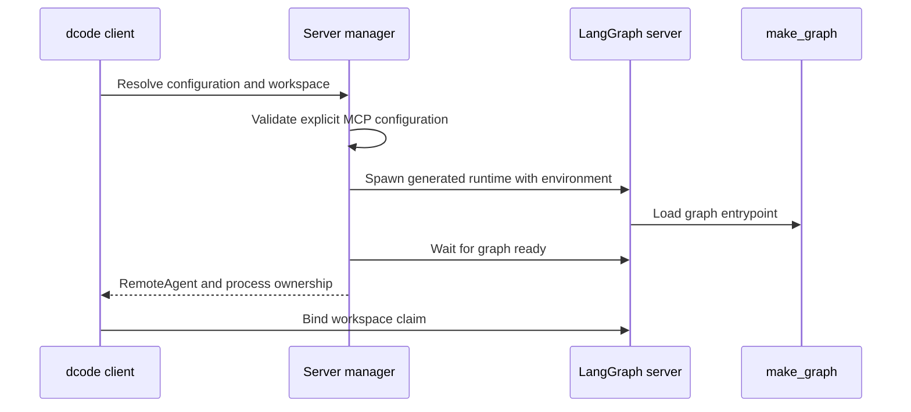

# System Source Map

Route a change to the component that owns its contract and lifecycle, rather than to the process in which its symptom happened. The reusable `deepagents` package owns agent assembly; dcode owns its client/server startup boundary, per-workspace serving policy, and local checkpoint safety; `deepagents_acp` owns ACP projection and replay; Talon owns its long-running host. See [Deep Agents Code Architecture](./code-agent.md), [dcode Configuration Layering](../concepts/config-layering.md), [State, Threads, and Persistence](../concepts/state-persistence.md), the [quickstart](../quickstart.md), and the [testing guide](../testing/testing-guide.md) for the corresponding conceptual and operational guides.

## Change routing

| Change affects… | Contract owner and starting point | Durable/lifecycle boundary and focused tests |
| --- | --- | --- |
| Reusable model/profile resolution, middleware composition, tools, subagents, permissions, state schema, or caller-supplied persistence | `libs/deepagents/deepagents/graph.py` — `create_deep_agent` | The SDK constructs the graph but callers own supplied checkpointer and store lifetimes. Start with `libs/deepagents/tests/unit_tests/test_graph.py`, then the relevant middleware or permissions tests. |
| dcode import cost, CLI fast paths, diagnostic dispatch, or mode selection | `libs/code/deepagents_code/__init__.py` and `main.py` — `cli_main` | Keep import-time work separate from startup. Start with the focused imports, fast-path, or main tests. |
| Local LangGraph server configuration, scaffolding, readiness handoff, or abandoned-process cleanup | `libs/code/deepagents_code/client/launch/server_manager.py` — `start_server_and_get_agent`, `PrespawnedServer`, and `server_session` | `ServerConfig` crosses the boundary as `DEEPAGENTS_CODE_SERVER_*`; a handed-off `ServerProcess` belongs to the caller. Use `libs/code/tests/unit_tests/test_server_manager.py`. |
| Generated server checkpointer behavior or DeltaChannel state-read performance | `server_manager.py` — `_write_checkpointer`; `libs/code/deepagents_code/_checkpointer_adapter.py` | The generated checkpointer must use the same database and ownership fence as other dcode writers. Use `test_checkpointer_adapter.py` and the generated-checkpointer case in `test_thread_ownership.py`. |
| Local `sessions.db`, connection cancellation/teardown, thread list performance, seed writes, or deletion | `libs/code/deepagents_code/sessions.py` | `sessions.db` is shared durable state; only its ownership-aware saver may mutate checkpoints. Use `test_sessions.py` and `test_thread_ownership.py`. |
| Exclusive thread use, stale server writes, fencing-token rotation, or transition cleanup | `libs/code/deepagents_code/thread_ownership.py` | A lease is a client-lifetime reservation; a token is required at every mutation. Use `test_thread_ownership.py` and `test_thread_ownership_transitions.py`, including cross-process cases. |
| A served graph’s workspace identity, policy drift, runtime rebuild, sandbox or tracing compatibility | `libs/code/deepagents_code/server_graph.py` — `make_graph`, `_resolve_bound_workspace_config`, `_workspace_runtime` | The thread-to-workspace binding is durable; runtime objects are disposable cache entries. Use `test_server_graph.py`, `test_workspace.py`, and `test_server_tracing.py`. |
| Run-start latency in the local in-memory server | `libs/code/deepagents_code/_run_queue_wakeup.py`, installed by `offload_api.py` lifespan | This is a guarded, private-upstream compatibility patch; retain stock ordering and fallback polling. Use `test_run_queue_wakeup.py`. |
| Any process working-directory read in dcode | `libs/code/scripts/check_process_cwd.py` and the call site | A multi-workspace server must use bound workspace context, not its launch directory. Add a reviewed allowlist entry only where process `cwd` is actually correct; run `test_process_cwd_check.py` or `make lint`. |
| dcode ACP model/MCP initialization, per-session graph factory, or session leases | `libs/code/deepagents_code/main.py` — `_run_acp_cli_async` and `_owned_acp_server_class` | ACP session lifetime owns its lease; the launcher owns checkpointer and MCP cleanup. Use `test_main_acp_mode.py`, `test_acp.py`, and `test_thread_ownership.py`. |
| Generic ACP wire behavior, durable session restoration, selection metadata, or replay | `libs/acp/deepagents_acp/server.py` — `AgentServerACP` | ACP metadata is stored in the graph checkpoint thread. Use `libs/acp/tests/test_agent.py` and `test_model_switching.py`. |
| Talon CLI assembly, channel selection, model runtime, MCP, history/checkpoint opening, or sandbox lifetime | `libs/talon/deepagents_talon/__main__.py` | The CLI constructs durable dependencies before handing a runtime to the host. Use `libs/talon/tests/test_main.py`. |
| Talon assistant home, state namespace, permissions, checkpoint URI, or filesystem modes | `libs/talon/deepagents_talon/config.py` — `TalonConfig` | Per-assistant state is the durable boundary. Use `libs/talon/tests/test_config.py`. |
| Talon startup rollback, conversation serialization, cancellation, approvals, or authorization state | `libs/talon/deepagents_talon/host.py` — `TalonHost` | Host locks, tasks, and generations are process-local; stores own durable records. Use `libs/talon/tests/test_host.py`. |
| CI unit-test matrix behavior or package test invocation | `.github/workflows/_test.yml` | Test the affected package locally first; the reusable workflow owns matrix validation and platform branching. |
| Evaluation targets or release routing | `libs/evals/Makefile` or `.github/workflows/release-please.yml` | These own evaluation staging and release dispatch, respectively—not dcode runtime behavior. |

## SDK graph assembly

`create_deep_agent` is the SDK construction seam: it defaults to `StateBackend`, resolves model and profile configuration, assembles the Deep Agents middleware stack, and accepts caller-provided checkpointer and store dependencies. `DeepAgentState.messages` uses a `DeltaChannel` reducer to limit checkpoint growth. Profile exclusion cannot remove `FilesystemMiddleware` or `SubAgentMiddleware`; filesystem permission rules are ordered, with interrupt rules translated to human-in-the-loop handling, while direct backend use does not enforce them. The top-level `deepagents` package is the intended consumer import surface for graph construction, state, core middleware/subagent types, and profile registration.

## dcode startup: process handoff and generated runtime

`deepagents_code` exposes `cli_main` lazily, so importing the package does not load `main.py` startup machinery. `cli_main` handles the version fast path, avoids the Textual dependency check in ACP mode, and dispatches selected diagnostics before the managed-configuration gate.

For interactive use, `start_server_and_get_agent` captures or accepts explicit project context, validates an explicit MCP configuration before spawning, resolves `ServerConfig`, writes its serialized values to `DEEPAGENTS_CODE_SERVER_*`, and scaffolds a temporary `langgraph dev` project. Its `langgraph.json` names `deepagents_code.server_graph:make_graph`. After the graph is ready it creates a `RemoteAgent` and binds the workspace claim; a missing workspace is an error rather than an unbound remote execution.

The caller owns a successfully returned `ServerProcess`. Before that handoff, the launcher is solely responsible for reaping a failed or cancelled startup. `PrespawnedServer` permits spawning while the client imports and paints, but `adopt` is the ownership transfer. `server_session` is the simpler context-manager boundary: it cleans MCP state, stops the handed-off server, and emits deferred preserved-log notices on exit.

The generated `checkpointer.py` deliberately uses `DEEPAGENTS_CODE_SERVER_DB_PATH` rather than embedding a path. It installs the checkpointer-adapter compatibility patch and yields an `owned_saver_class` SQLite saver. This keeps server mutations under the same fencing invariant as direct local sessions.

*The launcher owns bootstrap until handoff; the client owns the returned process, while the server validates execution context.*

## Server graph: binding versus runtime

`make_graph` is the serving entrypoint. For an execution-runtime request it requires a nonempty thread ID and workspace context, resolves the persisted thread binding, and returns that workspace’s agent graph. Requests without execution runtime take the default server runtime path.

Do not conflate a workspace binding with a runtime instance. A binding captures durable workspace identity and access policy for a thread. On each workspace request, `_resolve_bound_workspace_config` rejects access-policy or project-policy drift, including a disappeared extension-trust grant. It permits model, prompt, parameter, and other runtime-only changes: those alter the runtime fingerprint, so `_workspace_runtime` builds or retrieves a different cached runtime while keeping the thread’s binding and checkpoints. A process-wide sandbox and server tracing settings impose additional cross-workspace compatibility checks.

The runtime cache is load-bearing: repeated construction would rediscover MCP resources, create/leak sandbox sessions, and register duplicate shutdown work. It is bounded LRU state, not persistence; safe changes must preserve its resource lifetime rules.

## SQLite threads: ownership, fencing, and cleanup

`get_db_path` hardens the state directory and caches `sessions.db`. `get_checkpointer` owns the `aiosqlite` lifecycle, protects an interrupted open from leaking an SQLite handle, and joins the worker after close so it cannot later signal a closed event loop. `list_threads` reads checkpoint metadata, can filter `cwd` only by exact stored string, and opportunistically creates a covering index so it need not scan large checkpoint-state blobs. An index build failure leaves listing correct but slower.

`thread_ownership.py` is the write-safety owner. `try_acquire` reserves a thread using per-thread operating-system file locks and records a random owner token; it rejects `SoftFileLock`, because cooperative locks do not provide the required cross-process guarantee. A `ThreadLease` holds that reservation until release and can rotate its token without relinquishing it.

Before `OwnedSqliteSaver` calls `aput` or `aput_writes`, `writer_guard` serializes writers, validates the token, and verifies that the client reservation is still live. Thus a client exit/release fences an orphaned server, and a successor lease fences any old token. `adelete_thread` first reserves the thread and uses the same guard, refusing deletion while another client owns it. Cancellation is delayed until thread-hopped lock/database work has completed, avoiding premature release of a mutation gate or delete reservation.

Remote-handoff seeding is intentionally weaker than a durable remote server: it seeds only an absent local thread and does not replace authoritative shared-server checkpoints.

## Compatibility patches and workspace-directory guard

`_checkpointer_adapter.py` is a narrowly scoped patch for a private `langgraph_api` adapter. The upstream adapter inherits the base `get_delta_channel_history` methods, which prevents normal unknown-attribute forwarding to an inner SQLite saver. dcode patches only when those methods remain the base implementations; it forwards to an inner saver only when that saver overrides the base method, otherwise retaining the base ancestor walk. This preserves correctness while enabling SQLite’s indexed DeltaChannel history path on long threads. Remove the patch when upstream forwards these methods itself.

`_run_queue_wakeup.py` is similarly defensive. At server lifespan startup, `offload_api` attempts to patch private `langgraph_runtime_inmem.ops.Runs` methods only when their static-method signatures match the pinned shape. `Runs.put` signals an event after inserting, and a waiting `Runs.next` wakes on that event then delegates claiming to stock `next(wait=False)`. The stock queue therefore retains ordering and per-thread locking; the 0.5-second timeout remains a missed-wakeup fallback. If imports or shape checks fail, the server keeps stock polling.

A local server can serve many workspaces, so `Path.cwd()` in request code is usually the directory where the server launched, not the requested workspace. `scripts/check_process_cwd.py` AST-scans dcode for visible `Path.cwd()`, `os.getcwd()`, and `find_project_root` calls. Every detected read must match a reasoned `CallSite` allowlist entry, and every obsolete entry fails as stale. The checker is deliberately syntactic and documents spellings it cannot detect; a clean run means all reads it can see were reviewed. `libs/code/Makefile` runs it as part of `make lint`.

## ACP: protocol owner and dcode integration

`AgentServerACP` bridges a compiled graph or session-context factory into ACP. With session loading enabled, it persists working-directory and selection metadata in checkpoint threads. Loading verifies that the checkpoint represents an ACP session for the requested directory, restores supported selections, and replays persisted messages and tool calls as ACP updates.

Dcode’s `_run_acp_cli_async` resolves the model and MCP tools, initializes an ownership-fenced checkpointer, and supplies a per-session graph factory to the ACP server. Its ownership-aware subclass acquires a thread lease before session configuration/restoration, places the token in graph configuration, releases it when the session is forgotten, and releases leftovers in `finally`. The launcher also cleans MCP sessions in `finally`, including failure paths.

## Talon: durable setup and host lifetime

Talon’s CLI derives `TalonConfig`, selects configured channel adapters, and—when a model is configured—opens checkpoint/history infrastructure before constructing `DeepAgentRuntime` with MCP tools, middleware, optional sandbox backend, and host scheduler path. Without a configured model it uses `EchoAgentRuntime`.

`TalonConfig` validates and namespaces assistant state, makes its home and state directories mode `0700`, initializes tool approvals, and uses local `checkpoints.sqlite` unless a checkpoint URI is configured. `TalonHost` then owns in-process conversation locks, tasks, generations, approvals, and authorization tracking. It starts the agent before channels and scheduler, and unwinds components already started when startup fails. Persistent checkpoint, history, cron, and channel state remain in their own configured stores.

## Focused verification and repository automation

Prefer the narrowest test that owns the changed invariant. For dcode startup use `test_server_manager.py`; for adapter forwarding use `test_checkpointer_adapter.py`; for scheduler wakeup use `test_run_queue_wakeup.py`; for working-directory review use `test_process_cwd_check.py`; and for reservation, stale-write, cancellation, and UI-transition behavior use `test_thread_ownership.py` plus `test_thread_ownership_transitions.py`. Add server-graph or workspace tests when changing durable bindings or drift semantics, ACP tests for wire/replay behavior, and Talon main/config/host tests for operational lifetime.

The reusable unit-test workflow validates caller JSON matrices, uses frozen `uv` resolution and the test dependency group, runs POSIX tests through `make test` with sandbox tests enabled, runs Windows unit tests directly without the POSIX-only sandbox, and verifies a clean working tree. The eval Makefile provides socket-restricted tests, model-required evaluation and repeated-trial commands, and Harbor staging for local packages. On `main`, release-please rejects empty commits, recognizes package release commits from changelog paths plus release subjects, dispatches publishing to `release.yml`, and waits for pending publishing to clear before serialized maintenance.
