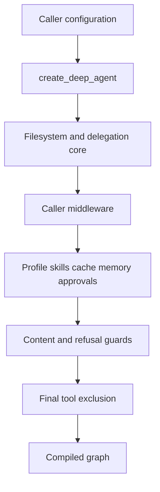
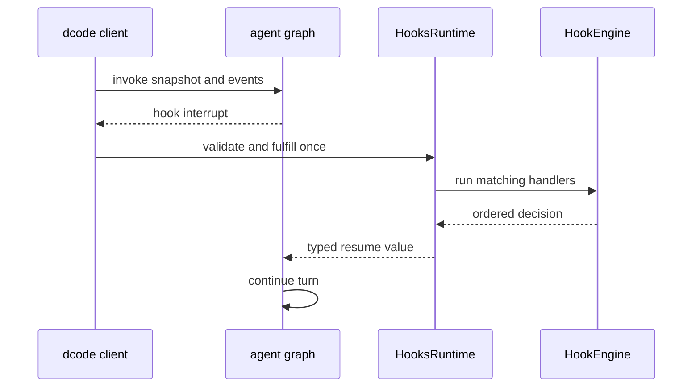
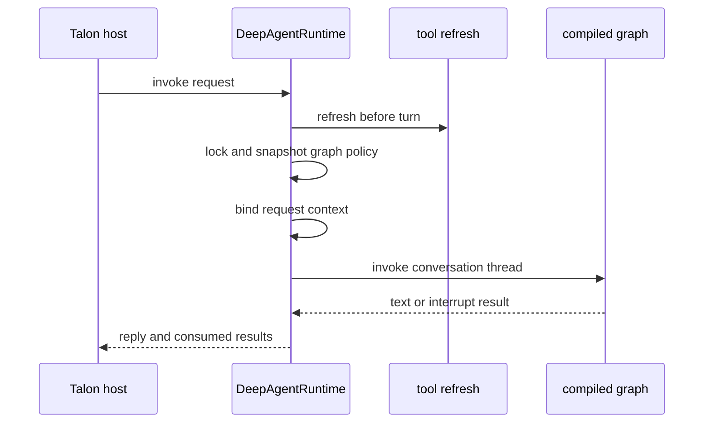

# Source Map

Use this page to find the state owner and enforcement boundary before changing a public surface. It deliberately routes by behavior rather than cataloguing files. For system context, see [Architecture Overview](./overview.md), [Runtime Behavior](./runtime-behavior.md), [CI Labeling](../operations/ci-labeling.md), [Quickstart](../quickstart.md), and [Run evaluations](../workflows/run-evals.md).

## Change routing

| Change affects… | Start here | Owner and safe-change boundary | Focused coverage |
| --- | --- | --- | --- |
| Agent construction, state schema, built-in tool visibility, caller middleware, profiles, persistence dependencies | `libs/deepagents/deepagents/graph.py` — `create_deep_agent` | The compiled Deep Agents graph; callers own the checkpointer, Store, cache, and custom middleware | `libs/deepagents/tests/unit_tests/test_graph.py`, subagent tests |
| Persistent filesystem data across threads | `libs/deepagents/deepagents/backends/store.py` — `StoreBackend` | Caller-supplied or execution-context `BaseStore`; namespace factory is the tenant boundary | `libs/deepagents/tests/unit_tests/backends/test_store_backend.py` |
| dcode model selection, credentials, provider configuration, or managed policy | `libs/code/deepagents_code/model_config.py` — `ModelConfig` | Merged default configuration and its `models.allowed` policy; an explicit path intentionally bypasses managed policy | `libs/code/tests/unit_tests/test_model_config.py` |
| dcode CLI graph assembly, policy, hook placement, or subagent middleware | `libs/code/deepagents_code/agent.py` — `create_cli_agent` | The paired main and declarative-subagent stacks | `libs/code/tests/unit_tests/test_agent.py`, `hooks/test_server_lifecycle.py` |
| Non-interactive dcode streaming, approval/hook resumes, quiet output, or exit behavior | `libs/code/deepagents_code/client/non_interactive.py` | One headless session and its client-owned stream state | `libs/code/tests/unit_tests/test_non_interactive.py` |
| Hook snapshot/trust, command execution, tool denial/rewrite, or lifecycle interrupts | `libs/code/deepagents_code/hooks/runtime.py`, then `hooks/engine.py` and `hooks/server_middleware.py` | Client owns trusted handler execution; graph owns checkpointed placement and resumes | `hooks/test_engine.py`, `hooks/test_server_lifecycle.py` |
| JavaScript subagent cost attribution in dcode | `libs/code/deepagents_code/_js_cost.py` | Durable receipt checkpoints and the parent session-cost transfer channel | `libs/code/tests/unit_tests/test_js_cost_tracking.py`, `test_js_cost_sync.py` |
| The public QuickJS REPL, persistence, programmatic tool calls, or filesystem exposure | `libs/partners/quickjs/langchain_quickjs/middleware.py` — `CodeInterpreterMiddleware` | Private LangGraph REPL state and the process-local slot registry | `libs/partners/quickjs/tests/unit_tests/test_repl_middleware.py`, `test_snapshot_persistence.py`, `test_ptc.py` |
| Talon graph construction, approval changes, tool/MCP reload, model selection, or per-turn context | `libs/talon/deepagents_talon/runtime.py` — `DeepAgentRuntime` | A compiled graph snapshot and context variables captured for the invocation | `libs/talon/tests/test_runtime.py`, `unit_tests/test_tool_approval_runtime.py` |
| Talon durable history and semantic search | `libs/talon/deepagents_talon/store_archive.py` | Caller-owned metadata Store plus an optional separate vector Store | `libs/talon/tests/unit_tests/test_store_archive.py`, `store_archive_contract.py` |
| Release-PR dependency validation | `.github/workflows/check_dep_freshness.yml` and `.github/scripts/release/check_wheel_dep_freshness.py` | The release workflow builds and validates one artifact; comments are advisory | release script tests and workflow validation |
| Unified benchmark dispatch, cross-model pool sizing, Harbor leaves, shards, or artifacts | `.github/workflows/unified_evals.yml`, then `.github/workflows/_harbor_run.yml` | Unified prep owns the expected matrix; Harbor owns one validated leaf and category aggregation | `.github/scripts/tests/evals/test_unified_workflow.py`, `test_unified_prep.py`, `test_shard_matrix.py` |

## Graph construction: the SDK seam

`create_deep_agent()` is the SDK construction seam. It uses `DeepAgentState.messages` with a `DeltaChannel` so checkpoint growth is linear rather than quadratic, binds a caller-provided backend to middleware that consumes one, and sends caller persistence dependencies to the compiled LangGraph agent. The filesystem and synchronous delegation middleware are protected scaffolding: a harness profile cannot exclude them. This means changes to stack order, middleware names, or exclusions are behavior changes, not cosmetic refactors.

*Construction preserves the core capability boundary, then applies caller and profile customization before the final tool filter.*

Custom middleware with a matching name replaces its default in place; a new name is inserted after the core stack and before the tail. Declarative, compiled, and async subagents take different paths: synchronous children use the `task` boundary, while async specs become remote task lifecycle tools. When changing state fields, account for private-key filtering at the subagent boundary and preserve the final exclusion pass so custom middleware cannot restore a profile-excluded tool.

`StoreBackend` is the durable cross-thread filesystem adapter. It resolves a caller namespace against an explicit or runtime `BaseStore`, validates namespace components so they cannot widen Store searches, and preserves text or binary data. Its tests are the change boundary for Store pagination, encoding, and literal recursive deletion.

## dcode: configuration, hooks, and headless execution

### Model and policy configuration

`ModelConfig.load()` is the dcode configuration read boundary. The default read merges user configuration with managed policy and caches the result; an explicit path reads only that file. A `DEEPAGENTS_CODE_` environment variable takes precedence even when it is empty, deliberately suppressing its canonical counterpart. That precedence is important when diagnosing why a stored credential does not reach a provider.

The `models.allowed` policy is three-valued: `None` means unrestricted, an empty tuple denies every model, and non-empty entries allow exact `provider:model` values or `provider:*`. A malformed declared allowlist becomes deny-all rather than silently becoming unrestricted. Model creation and UI preflight should use this policy gate rather than independently interpreting provider strings.

### Hooks and command execution

`HooksRuntime` freezes the trusted client configuration for a workspace and supplies the snapshot ID, transcript projection, and configured server events to the graph. Its project hooks are conditional on resolved workspace trust. `HookEngine` executes matching command handlers concurrently under per-handler timeout/output limits, but reduces their results in configuration order. The server middleware is intentionally a separate graph-side bridge: it checkpoints the expected hook context, routes lifecycle interrupts only for enabled events, and applies pre-tool decisions before normal approval routing.

*The graph decides where an interrupt belongs; the trusted client snapshot decides whether and how handlers run.*

`create_cli_agent()` installs server-owned hook middleware on both parent and subagent stacks. The main stack places it after HITL so pre-tool policy is settled before approval routing; subagents retain tool hooks but do not emit their own `Stop` lifecycle. Preserve that paired-stack property when adding policy or telemetry middleware.

The server middleware checkpoints private hook state and a per-turn snapshot/event gate, and rejects a resume that changes this context. Its private fields stay out of public graph I/O and subagent result merges. It evaluates pre-tool hooks before execution and approval routing: a hook can deny a call or rewrite only eligible local `execute` commands. Completed calls are checkpointed before post-tool or post-failure handling; a `Stop` decision may feed feedback into a bounded continuation. The fulfillment path rejects another snapshot and de-duplicates repeated `(snapshot_id, invocation_id)` deliveries before returning the typed resume value.

`run_non_interactive()` owns one headless stream session. It applies the resolved shell allow-list and explicit project-hook trust, resumes hook and interrupt responses in a bounded loop, routes response text to stdout in quiet mode, and returns 124 when its turn budget is exhausted. `cli_main()` surrounds that path with best-effort OSC status publication; status never changes the process exit result.

`ProgramStatusReporter` owns thread-safe, best-effort OSC 7501 output: it validates and size-bounds records, sanitizes and encodes display text, de-duplicates records, clears tracked subtrees, and honors the global terminal-escape opt-out. `AgentStatusTracker` separately owns TUI precedence and lifecycle: the newest blocker wins over working and prior outcome; starting work clears prior outcome; a closed non-error blocker returns to idle while an error remains visible; a new conversation removes transcript-mounted blockers; and close prevents later writes. In headless runs, `cli_main()` publishes initial working then final done, error, or clear status without affecting the exit code.

### JavaScript cost transport

`CostAwareCodeInterpreterMiddleware` subclasses the QuickJS middleware solely to transport accounting across JavaScript-dispatched subagents. On an async `eval`, it wraps the exposed `task` tool with request-isolated checkpoint namespaces, waits for active dispatches to settle or cancel, totals durable child receipts, and emits `_session_cost_transfers` back to the parent graph. Receipt writes are idempotent by checkpoint namespace so graph replay does not charge the same local delta twice. Synchronous execution intentionally delegates unchanged.

Use `test_js_cost_tracking.py` for child completion, interruption, cancellation, replay, and receipt attribution; use `test_js_cost_sync.py` to retain the no-regression synchronous tool path.

## QuickJS integration: private state, capability boundaries, and persistence

`CodeInterpreterMiddleware` exposes an `eval` tool backed by a per-thread QuickJS slot. Its private state contains a slot ID and, in thread mode, a delta-replayed snapshot payload plus optional HMAC. `before_agent` prepares or validates the slot and discards a stale live context; `after_agent` either snapshots thread state or closes non-thread contexts. A bad, missing, oversized, or failed snapshot is cleared rather than executed or retained.

Programmatic tool calling binds only the current request's allowed `BaseTool` objects, keeps deferred tools callable but out of the prompt until discovery, and excludes the REPL tool itself. `task()` dispatch can run subagents concurrently within the REPL limit, but it is inside the approved `eval` call rather than the parent ToolNode path.

Treat `fs=True`, PTC, and unbounded limits as capability decisions. The JavaScript `fs` bridge calls the backend directly, bypassing Deep Agents filesystem permissions and HITL; PTC-invoked tools also bypass per-tool parent HITL. The VM timeout excludes time spent awaiting host tool calls, so it does not bound wall-clock time. Use a sandboxed backend and retain explicit limits for untrusted code.

## Talon: compile first, replace only after success

`DeepAgentRuntime.start()` resolves subagents and approval configuration before compiling the initial graph. `_create_graph()` builds the current tool catalog, resolves local subagent tool names, attaches approval tools and Talon middleware, then delegates to `create_deep_agent`. `invoke()` refreshes tools before acquiring the tool lock, recompiles when approval configuration changed, and snapshots the graph and approval policy into context variables before binding authorization, background results, cron origin, breakout behavior, hooks, and selected model state.

*Reload happens before the per-turn snapshot, so an active invocation cannot observe a half-replaced graph.*

Tool and subagent replacement compile a candidate graph before assigning it. On failed automatic MCP refresh, the previous graph remains usable and saved edits are flagged inactive. Approval or reload changes apply on a later turn; running work keeps its original graph and capabilities. This is the key invariant for MCP, tool-approval, and subagent-reload changes.

Talon's `StoreConversationArchive` is distinct from graph checkpointing. It stores scoped idempotent records in a caller-owned metadata Store, uses a separate vector Store only when indexing is enabled, indexes user text and host-confirmed replies, bounds retrieval scans, and journals vector-first deletion for restart-safe recovery.

## CI and evaluation ownership

`.github/LAYOUT.md` defines the CI topology: entry workflows trigger on events and reusable workflows are `_*.yml`; helper scripts are organized by checks, evals, labeling, and release domains with matching test directories. Start with the workflow entrypoint, then follow the named script and its mirrored test before adding a new CI path.

### Release artifact gate

`check_dep_freshness.yml` applies only to release-please-style PR titles. It resolves the release target, reports dependency-minimum freshness, builds exactly one wheel with the target Python version, validates that wheel's metadata against PyPI and sibling source constraints, then installs it with dependencies resolved only from PyPI. The separate comment job is advisory: it preserves an existing warning on an indeterminate or crashed check and degrades a 403 comment failure to a warning.

The release-please scope gate is different: its detector identifies potential multi-package fan-out from trusted base-revision configuration, while the workflow turns that report into the merge-facing decision and supports the explicit `ci:allow-lockfile-release` acknowledgement.

### Unified evaluations and Harbor leaves

`unified_evals.yml` is the manual cross-model dispatcher. Its prep job validates and resolves models, categories, harnesses, branch SHAs, task profile, and expected leaves; for a full profile it enumerates the same category task sets used by the leaf path. It passes one per-model pre-expanded `flat_matrix` to `_harbor_run.yml`, caps concurrent model jobs with the derived outer pool, and records the requested/resolved setup even if prep fails. LangSmith usage collection is best-effort and isolated from the publishing job, so the job with repository write permission does not receive the LangSmith API key.

`_harbor_run.yml` owns a single-model evaluation leaf. Its prep either expands a single dataset into shards or passes through a unified flat matrix, derives a matching aggregate matrix, and caps the leaf runner pool. The Harbor job verifies provider, sandbox, verifier, and research-search credentials before installing dependencies; validates task, category, timeout, boolean, and local-dataset inputs before use; and partitions the exact selected task list across shards. It stages the Deep Agents, dcode, ACP, and QuickJS sibling packages together so editable path dependencies resolve inside the sandbox. A failed optional snapshot prewarm does not block leaves, while an empty legitimate shard writes a marker so aggregation can distinguish it from a missing artifact.

## Focused test plan

- **Graph and Store:** begin with `libs/deepagents/tests/unit_tests/test_graph.py`, then pair Store changes with `unit_tests/backends/test_store_backend.py` and its async counterpart.
- **dcode policy and hooks:** use `libs/code/tests/unit_tests/test_model_config.py`, `hooks/test_engine.py`, and `hooks/test_server_lifecycle.py`; pair headless changes with `test_non_interactive.py` and status/CLI tests.
- **JavaScript:** use `libs/code/tests/unit_tests/test_js_cost_tracking.py` for durable transfer accounting. In `libs/partners/quickjs/tests/unit_tests/`, pair lifecycle/persistence work with `test_repl_middleware.py` and `test_snapshot_persistence.py`; pair tool binding or approval-boundary work with `test_ptc.py` and `test_subagent_replay.py`.
- **Talon:** use `libs/talon/tests/test_runtime.py` for replacement and turn-context behavior, and `unit_tests/test_tool_approval_runtime.py` for approval snapshots. Retain archive contract coverage for durable history.
- **Evaluations:** use `.github/scripts/tests/evals/test_unified_workflow.py` for dispatch-to-reusable-workflow wiring and `test_unified_prep.py` for input/matrix validation. Pair shard algorithm changes with `test_shard_matrix.py` and reusable-workflow changes with its workflow contracts.
- **Release:** preserve release script parser/metadata tests and workflow coverage for target resolution, one-wheel validation, and PyPI-only installation.
