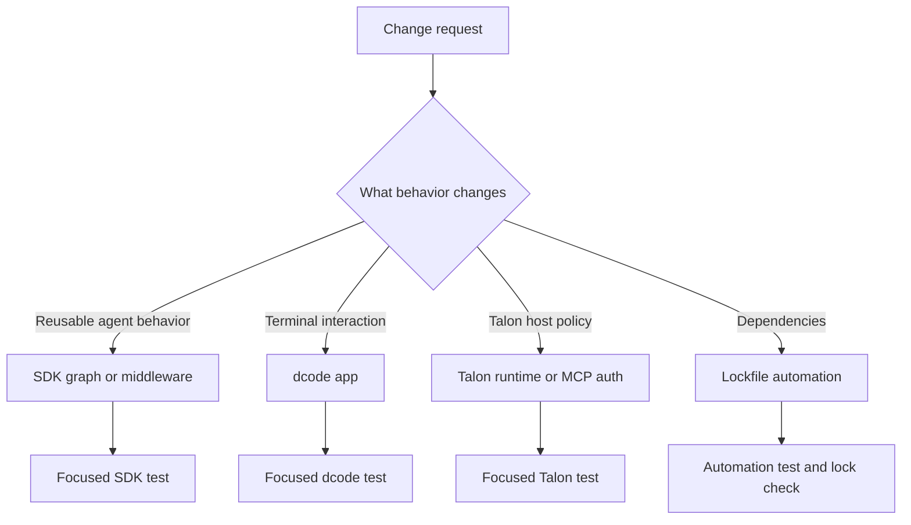
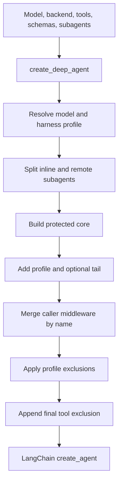
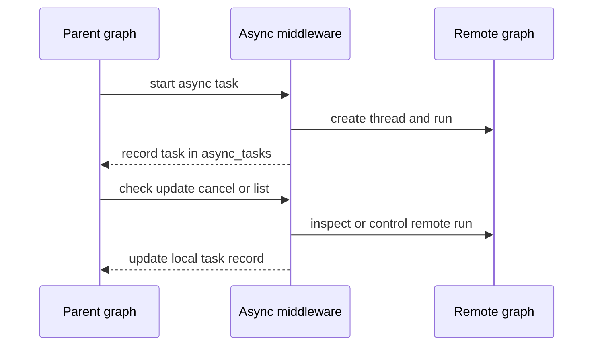

# Source Map and Ownership Boundaries

Route a change by the behavior it changes, not by the product where it was observed. The reusable `deepagents` SDK owns graph assembly, backends, profiles, and middleware; dcode and Talon are consumers which own their product-specific composition, interaction, and operational policy. For system context see the [architecture overview](./overview.md), [code-agent architecture](./code-agent.md), [middleware stack](./middleware-stack.md), [quickstart](../quickstart.md), and [testing guide](../testing/testing-guide.md).

## Change routing

| Change intent | Owner and entry point | Start with |
| --- | --- | --- |
| SDK graph inputs, state schema, profile resolution, default backend, middleware order, permissions, or compilation | `libs/deepagents/deepagents/graph.py` — `create_deep_agent` | `libs/deepagents/tests/unit_tests/test_graph.py` |
| Public SDK import or compatibility surface | `libs/deepagents/deepagents/__init__.py`; feature exports in `middleware/__init__.py` | Import/API coverage nearest to the exported component, then graph tests if construction changed |
| Blocking `task`, child compilation, fork context, or parent/child state crossing | `libs/deepagents/deepagents/middleware/subagents.py` — `SubAgentMiddleware` | Subagent tests under `libs/deepagents/tests/unit_tests/middleware/`, plus graph coverage for assembly |
| Remote Agent Protocol delegation and `async_tasks` lifecycle | `libs/deepagents/deepagents/middleware/async_subagents.py` — `AsyncSubAgentMiddleware` | `libs/deepagents/tests/unit_tests/test_async_subagents.py` |
| Context compaction, offload, overflow recovery, or summary policy | `libs/deepagents/deepagents/middleware/summarization.py` | `libs/deepagents/tests/unit_tests/middleware/test_summarization_factory.py` and the nearest lifecycle test |
| Terminal UI, UI/server lifecycle, thread switching, rendering, or dcode approval interaction | `libs/code/deepagents_code/app.py` — `DeepAgentsApp` | `libs/code/tests/unit_tests/test_app.py`, then a narrower neighboring dcode suite |
| Talon graph composition, runtime tools, approvals, progress, background work, or checkpointing | `libs/talon/deepagents_talon/runtime.py` — `DeepAgentRuntime._create_graph` | The nearest Talon runtime test |
| Talon MCP OAuth storage, discovery, redirect, or SSRF policy | `libs/talon/deepagents_talon/mcp_auth.py` | `libs/talon/tests/test_mcp_auth.py` and `libs/talon/tests/unit_tests/test_oauth_transport.py` |
| A package manifest, lockfile, or local editable-consumer closure | `.github/scripts/checks/check_lockfiles_pre_commit.py` | `.github/scripts/tests/checks/test_refresh_lockfiles.py`; run `cd libs && make lock-check` |



*The route is determined by the owner of the reusable contract or product policy, then validated at its closest observable boundary.*

## SDK graph construction and public surface

`create_deep_agent` is the SDK construction seam. It resolves the model and harness profile, selects `StateBackend()` if no backend is supplied, separates inline from remote subagent specifications, builds the system prompt and middleware, and hands the result to LangChain `create_agent`. The returned graph receives Deep Agents metadata and a recursion limit. The public arguments are therefore the extension boundary for tools, middleware, subagents, skills, memory, permissions, backend, state/context schemas, interrupts, persistence, cache, and graph name.

Deep Agents inserts novel caller middleware after its core stack and before the tail, replaces same-named stack entries in place, and applies profile tool exclusion last so custom middleware cannot restore an excluded tool.

`DeepAgentState.messages` is a `DeltaChannel` with a snapshot frequency, rather than a whole-history checkpoint value. A custom `state_schema` must extend `DeepAgentState` to preserve that reducer; parallel subagents changing the same custom field need a reducer or LangGraph rejects the conflicting update.

FilesystemMiddleware and SubAgentMiddleware are protected Deep Agents scaffolding because they respectively enforce built-in filesystem permissions and implement the task tool; excluding either through a harness profile raises instead of producing a degraded graph.

The top-level `deepagents` package is the curated consumer import surface: it exports graph construction/state, filesystem and subagent types, selected middleware, profiles, and profile-registration functions. The `deepagents.middleware` package separately exposes middleware-facing subagent, async-task, filesystem, memory, rubric, skills, summarization-tool, and unsupported-content types. Add a public capability deliberately in these modules; do not make consumers import an internal implementation incidentally.



*Graph assembly applies policy after extension merging, so a profile remains authoritative over the visible tool surface.*

## Middleware and delegation ownership

`SubAgentMiddleware` owns the blocking `task` bridge for declarative `SubAgent` specifications and caller-provided `CompiledSubAgent` runnables. An isolated child gets allowed parent state and a delegated human message; a fork gets effective parent history after applying the summarization event. The child returns a `Command` to its parent, rather than exposing its complete private graph state.

SubAgentMiddleware exposes the blocking task bridge for declarative and compiled subagents: isolated children receive a delegated description, forks receive effective summarized parent history, and completed children return one ToolMessage while private, excluded, and unchanged inherited state is withheld from the parent update.

AsyncSubAgentMiddleware runs remote Agent Protocol work without blocking the parent by persisting a local async_tasks record on launch and exposing start, check, update, cancel, and list tools; remote execution and its thread remain owned by the remote graph.

Remote async task updates create an interrupting run on the existing thread and replace the tracked run ID; task checks map a successfully finished but interrupted remote thread to waiting, while cancellation of a waiting task is recorded locally because no active run exists to cancel.

An async spec without a URL uses local ASGI transport and therefore needs an asynchronous parent invocation; synchronous callers need a reachable URL. For forks, the middleware snapshots effective compacted history, removes artifacts, restores offloaded tool content, and serializes portable child messages. Treat the parent `async_tasks` record as monitoring state, not as ownership of the remote graph's tools, approvals, or schema.



*The parent tracks a remote task durably while the remote graph retains execution and approval ownership.*

## Context compaction

Deep Agents summarization preserves raw messages while recording a private event that reconstructs the compacted request, persists a session ID for append-only backend history, and continues with a warning when history offload fails; its factory selects fraction-based defaults from max_input_tokens or fixed fallback defaults and requires a resolved BaseChatModel.

Use `create_summarization_middleware` for default threshold and model-profile policy; use `SummarizationMiddleware` for lifecycle, persistence, media handling, and overflow-retry changes. The factory test proves construction branches, but an altered compaction or recovery behavior needs a direct lifecycle regression near its implementation.

## Product-owned seams: dcode and Talon

`DeepAgentsApp` is dcode's Textual application boundary. It owns terminal key bindings, screen and modal lifecycle, session/thread presentation, message rendering, user approvals, and background server-startup handoff through `ServerReady` and `ServerStartFailed`. Do not move terminal presentation policy into SDK middleware; when an edit crosses the client/server handoff, use `test_app.py` and a focused suite for the affected UI or thread behavior.

Talon's DeepAgentRuntime is an integration caller of the SDK builder: it prepares Talon-specific tools, approvals, middleware, backend, and checkpointing, then invokes create_deep_agent, including a replacement filesystem middleware and selected-model summarization layer.

Talon MCP OAuth belongs in `mcp_auth.py`, not in the generic graph builder. `FileTokenStorage` isolates credentials by a hash of the server identity and optional OAuth configuration, stores token/client information atomically under owner-only permissions, and preserves an existing refresh token when a refresh response omits one. Its provider restores persisted expiry and rejects unsafe OAuth endpoints and redirects using an HTTPS-only SSRF-safe transport; preserve those checks when changing discovery or authorization flows.

## Package and lockfile operations

`libs/ARCHITECTURE.md` is the maintainer orientation for the SDK's LangChain/LangGraph layering and directs behavior changes from `create_deep_agent` into middleware, backends, profiles, exports, and tests. It is a navigation document; code is the authority for a runtime contract.

The pre-commit lockfile check maps changed paths to package directories that own lockfiles; when manifests change, the related refresh workflow must also cover transitive consumers declared through local `[tool.uv.sources]` paths. It runs `uv lock --check` using each package's required interpreter and stops at the first stale lockfile with the command needed to refresh it. Validate automation changes against its temporary-repository tests rather than a repository-wide lockfile accident.

## Focused verification

Run package commands from the owning package. Typical first commands are:

```bash
cd libs/deepagents
make test TEST_FILE=tests/unit_tests/test_graph.py
make test TEST_FILE=tests/unit_tests/test_async_subagents.py
make test TEST_FILE=tests/unit_tests/middleware/test_summarization_factory.py

cd ../code
make test TEST_FILE=tests/unit_tests/test_app.py

cd ../talon
make test TEST_FILE=tests/test_mcp_auth.py

cd ..
make lock-check
```

For an assembly edit, assert the final middleware/tool surface and failure paths such as protected exclusions. For delegation, assert returned `Command` state and serialized child input, not only mocked internal calls. For dcode, mount or exercise the real Textual app where event routing matters. For OAuth and lock automation, use isolated filesystem or temporary-repository tests so credential permissions, redirect/SSRF failure behavior, and dependency closure are observable deterministically.
