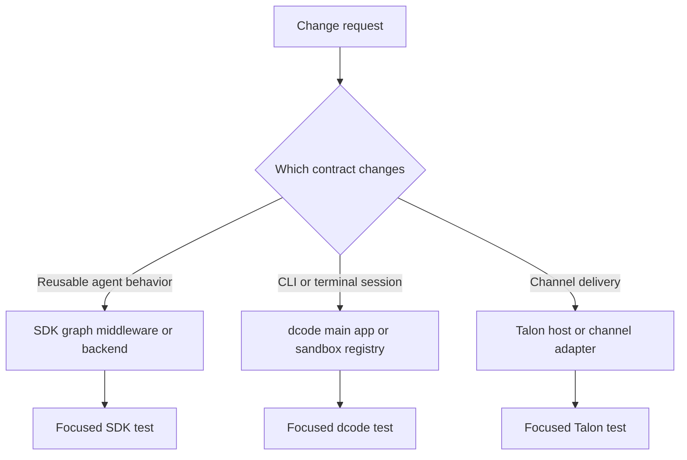
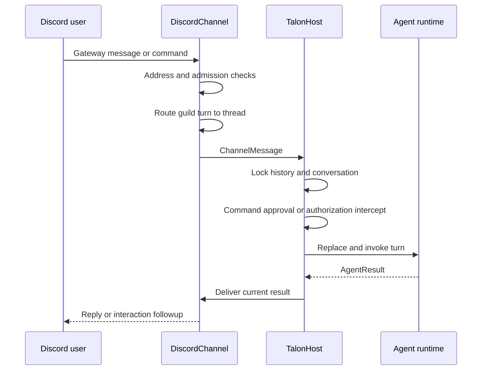

# Source Map

Route a change to the component that owns its contract, rather than to the product where it was first observed. The reusable `deepagents` SDK owns graph assembly, middleware, and backends. dcode owns CLI, terminal-session, and sandbox selection policy. Talon owns long-running channel delivery and its provider adapters. For broader orientation, see the [architecture overview](./overview.md), [code-agent architecture](./code-agent.md), [backends](../concepts/backends.md), [Talon integration](../integrations/talon.md), [quickstart](../quickstart.md), and [testing guide](../testing/testing-guide.md).

## Change routing

| Change intent | Owner and entry point | Focused verification |
| --- | --- | --- |
| SDK graph inputs, profile resolution, middleware order, tool policy, or checkpoint state | `libs/deepagents/deepagents/graph.py` — `create_deep_agent` | `libs/deepagents/tests/unit_tests/test_graph.py` |
| Blocking or asynchronous delegation | `middleware/subagents.py` or `middleware/async_subagents.py` | Subagent unit tests; `tests/unit_tests/test_async_subagents.py` for remote-task lifecycle |
| Context compaction and offload recovery | `middleware/summarization.py` | `tests/unit_tests/middleware/test_summarization_factory.py` plus a lifecycle test |
| Persistent Hub-backed files | `backends/context_hub.py` — `ContextHubBackend` | `tests/unit_tests/backends/test_context_hub_backend.py`; real-Hub coverage in `tests/integration_tests/test_context_hub_backend.py` |
| dcode command dispatch, policy gates, ACP/headless selection, or sandbox default validation | `libs/code/deepagents_code/main.py` | nearest `libs/code/tests/unit_tests/` CLI test |
| dcode Textual UI, session start, server handoff, thread rendering, or approvals | `libs/code/deepagents_code/app.py` — `DeepAgentsApp` | `libs/code/tests/unit_tests/test_app.py` |
| Sandbox discovery or a provider collision/instantiation rule | `libs/code/deepagents_code/integrations/sandbox_registry.py` | sandbox-registry tests in `libs/code/tests/unit_tests/` |
| Talon host lifecycle, turns, approvals, cancellation, scheduling, or delivery | `libs/talon/deepagents_talon/host.py` — `TalonHost` | `libs/talon/tests/test_host.py` and the narrower host suite |
| Discord admission, message/thread mapping, interactions, media, or Gateway status | `libs/talon/deepagents_talon/channels/discord.py` — `DiscordChannel` | `libs/talon/tests/channels/test_discord.py`; cross-boundary behavior in `tests/integration_tests/test_discord_host.py` |
| Talon graph composition and SDK configuration | `libs/talon/deepagents_talon/runtime.py` — `DeepAgentRuntime` | nearest Talon runtime test |
| Talon MCP OAuth storage/discovery/transport security | `libs/talon/deepagents_talon/mcp_auth.py` | `libs/talon/tests/test_mcp_auth.py` and OAuth transport tests |

*Choose the contract owner first, then verify at the narrowest observable boundary.*

## SDK construction and delegation

`create_deep_agent` is the reusable assembly seam: it resolves the model, harness profile, and backend; separates inline and remote subagents; assembles middleware; and delegates compilation to LangChain `create_agent`. `DeepAgentState.messages` uses a `DeltaChannel`, so checkpoint growth stays linear rather than repeatedly storing the full history. A custom state schema needs to extend `DeepAgentState` to keep that reducer; concurrent updates to any shared custom field need a reducer.

FilesystemMiddleware and SubAgentMiddleware are protected Deep Agents scaffolding because they respectively enforce built-in filesystem permissions and implement the task tool; excluding either through a harness profile raises instead of producing a degraded graph.

Deep Agents inserts novel caller middleware after its core stack and before the tail, replaces same-named stack entries in place, and applies profile tool exclusion last so custom middleware cannot restore an excluded tool.

The top-level `deepagents` package is the curated consumer import surface for graph construction/state, filesystem and subagent types, selected middleware, profiles, and profile registration, while `deepagents.middleware` exposes the middleware-facing feature types.

`SubAgentMiddleware` owns synchronous `task` delegation. `AsyncSubAgentMiddleware` is the separate bridge for remote Agent Protocol work: its locally persisted `async_tasks` state is task-monitoring data, while the remote graph retains ownership of its execution thread, tools, schema, and approvals. An async spec without a URL uses ASGI transport and therefore requires asynchronous parent invocation; synchronous callers need a reachable remote URL.

SubAgentMiddleware exposes the blocking task bridge for declarative and compiled subagents: isolated children receive a delegated description, forks receive effective summarized parent history, and completed children return one ToolMessage while private, excluded, and unchanged inherited state is withheld from the parent update.

AsyncSubAgentMiddleware runs remote Agent Protocol work without blocking the parent by persisting a local async_tasks record on launch and exposing start, check, update, cancel, and list tools; remote execution and its thread remain owned by the remote graph.

Remote async task updates create an interrupting run on the existing thread and replace the tracked run ID; task checks map a successfully finished but interrupted remote thread to waiting, while cancellation of a waiting task is recorded locally because no active run exists to cancel.

## Context policy and persistent storage

Deep Agents summarization preserves raw messages while recording a private event that reconstructs the compacted request, persists a session ID for append-only backend history, and continues with a warning when history offload fails; its factory selects fraction-based defaults from max_input_tokens or fixed fallback defaults and requires a resolved BaseChatModel.

For a persistent file backend, `ContextHubBackend` maps absolute-looking backend paths to a LangSmith Hub agent repository. It lazily pulls one tree snapshot, treats a missing repository as an empty tree, and overlays accepted pending and in-flight mutations on reads. A write, edit, or delete waits for durability after the short batching window; a Hub conflict reloads the remote snapshot and rematerializes mutations from their original intents before retrying. Do not treat a successful local overlay as an uncommitted fire-and-forget write.

Use mocked backend tests to cover cache visibility, error translation, batching, and conflict paths. The integration suite is the place to prove actual Hub creation, cross-instance persistence, CRUD/search behavior, and parent-commit conflict recovery.

## dcode entry, session, and sandbox seams

`cli_main` is dcode's process entrypoint. It preserves lightweight version and help paths, parses arguments, gates policy-sensitive commands on healthy managed configuration, and only then performs state/credential bootstrap and selects a launch mode. Keep pre-TUI policy failures in `main.py`: the Textual app should receive an already valid interactive-session configuration.

`DeepAgentsApp` is dcode's Textual application boundary. It owns terminal key bindings, screen and modal lifecycle, session/thread presentation, message rendering, user approvals, and background server-startup handoff through `ServerReady` and `ServerStartFailed`. The app runner installs the stderr guard, runs Textual, always stops an owned server process, releases thread leases when server state was used, and returns the app's final thread ID for teardown hints.

dcode's DeepAgentsApp owns the Textual terminal application boundary, including app-level interaction bindings and the background-server success and failure messages used to hand a constructed agent to the UI.

`SandboxRegistry` is discovery and construction policy, not agent graph policy. It merges curated built-ins, `deepagents_code.sandbox_providers` entry points, and `[sandboxes.providers]` configuration; a name resolves with config precedence over entry point over built-in. The CLI validates a managed default against this registry before assigning `args.sandbox`, so an unavailable enforced provider exits rather than silently falling back to host execution.

## Talon host and Discord channel path

`TalonHost` is the lifecycle and serialization boundary for a running assistant. Startup creates the home, starts the agent before bound channels and scheduler, and unwinds already-started components in reverse order on failure. Shutdown cancels work, stops channels in reverse order, then scheduler and agent, while attempting every cleanup step. Per-conversation locks serialize turns; history locks serialize archive access for a provider/chat scope.

For an inbound message, the host handles help immediately, derives the channel and agent conversation identifiers, then under the history and conversation locks handles commands, pending approval replies, and OAuth callback interception before replacing the active agent turn. On completion it drops stale-generation results rather than delivering them to a superseding turn, and requeues associated background results when they were not deliberately suppressed.

`DiscordChannel` is an adapter over an injectable Gateway boundary. It rejects the bot's own Gateway messages to prevent feedback loops, requires a mention for guild turns unless the configured optional-mention policy permits a human message, applies exposure/pairing admission before creating a thread or downloading media, and dispatches only admitted provider-neutral `ChannelMessage` values to the host. A guild-channel turn attempts to open a public thread; an existing thread remains its own conversation and can contribute bounded, filtered thread context. Discord interactions are translated to the same textual command path, deferred, and use a task-local reply sink so an interaction response cannot capture unrelated channel output.

*The channel decides whether and where a provider event becomes a turn; the host serializes and owns its agent lifecycle and delivery.*

Talon's DeepAgentRuntime is an integration caller of the SDK builder: it prepares Talon-specific tools, approvals, middleware, backend, and checkpointing, then invokes create_deep_agent, including a replacement filesystem middleware and selected-model summarization layer.

Talon MCP OAuth stores credentials in server-identity-scoped owner-only files and preserves a previous refresh token on refresh responses that omit it; its OAuth transport is HTTPS-only, SSRF-safe, and rejects redirects and unsafe discovered endpoints.

## Operational checks

`libs/ARCHITECTURE.md` is the SDK maintainer orientation: Deep Agents is an opinionated harness over LangChain `create_agent` and LangGraph state, checkpointing, streaming, and interrupts. Use it to find the layer that owns a concern, but use the implementation and targeted tests as the runtime authority.

The lockfile pre-commit check selects packages touched by changed paths, checks them with each package's required Python version, and computes changed manifests' transitive local consumers through tool.uv.sources paths.

For graph assembly, assert final middleware and tool surface as well as failure paths such as a protected exclusion. For dcode UI changes, use `app.run_test()` where Textual event routing or asynchronous server-ready behavior matters. For Context Hub and Talon, prefer the mocked focused suite for deterministic failure branches and the integration suite for a real backend/channel-to-host boundary.
