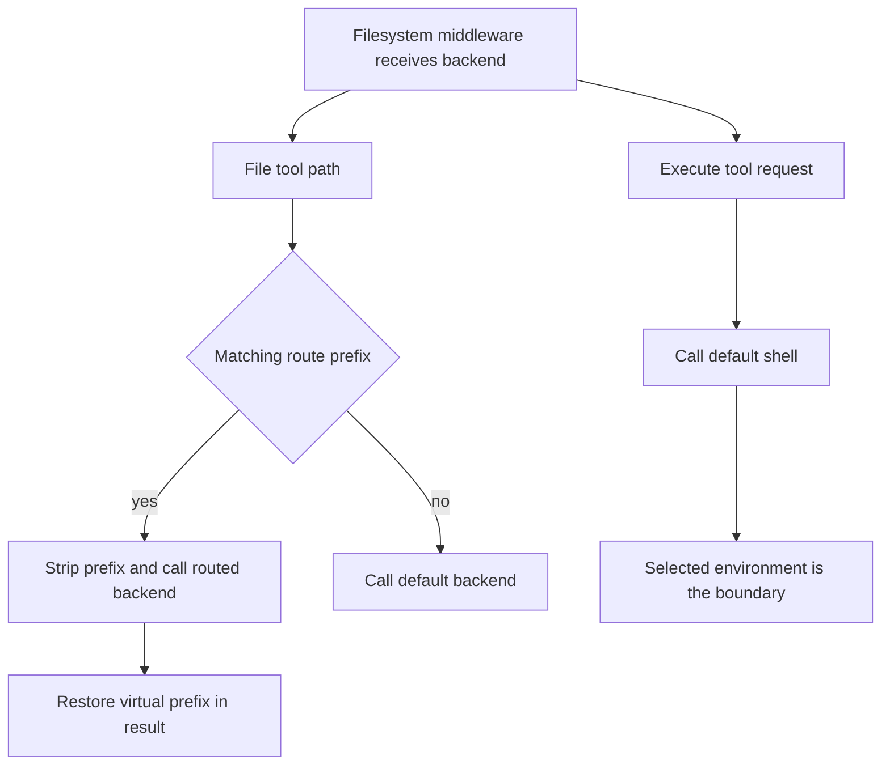
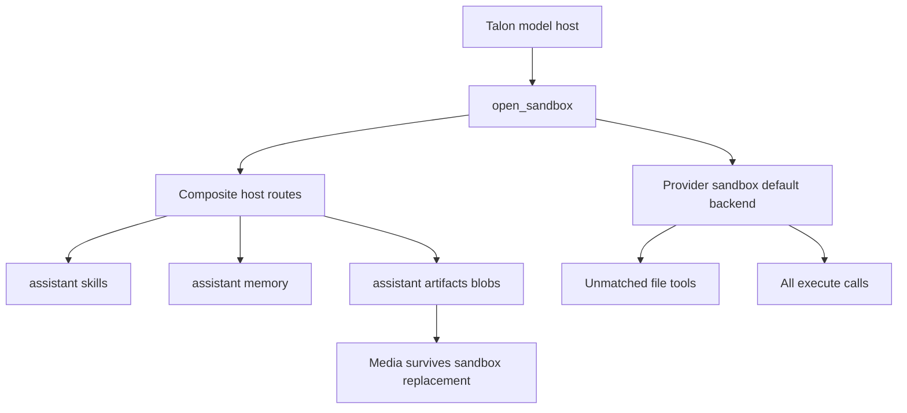

# Backends

A **backend** is the implementation boundary behind agent file operations. It determines where files live, how long they persist, how virtual paths are routed, where middleware artifacts are written, and whether a shell exists. It is not a model-visible tool or an authorization policy: [filesystem tools](/openwiki/concepts/tools-filesystem.md) register and dispatch operations, while storage selection determines persistence and execution behavior.

> **Security boundary:** routing is not filesystem sandboxing. A route selects a backend for file-tool calls; it neither authorizes access nor constrains a shell. The composite default selects the environment that runs commands. In particular, a local shell remains a host shell even when its file API exposes a virtual root. Use an isolated sandbox for untrusted execution.

## Contract and result semantics

`BackendProtocol` is the uniform, deliberately partial interface. Its file operations—`ls`, `read`, `grep`, `glob`, `write`, `edit`, optional `delete`, and batch upload/download—default to `NotImplementedError`, so an implementation can provide only the operations it supports. File operations live on this base protocol rather than the shell subtype: `StateBackend` and `StoreBackend` can search their data in Python but have no process to execute.

File tools are not shell fallbacks. The search contract is literal, not regex; it produces structured `GrepResult` and `GlobResult`, honors `max_count`, and preserves filesystem permission behavior. `GlobResult.truncation_reason` differentiates a search budget from unreadable paths or transport clipping. Glob patterns are relative to the search root: a pattern without `/` matches a basename at any depth, a leading `/` anchors at that root, and dot names need a dot-prefixed pattern. A refused traversal in a glob is returned as an error rather than executed.

Operations report ordinary failures in typed result dataclasses such as `ReadResult`, `WriteResult`, `EditResult`, `DeleteResult`, `LsResult`, `GrepResult`, and `GlobResult`, rather than by raising. Batch transfer returns one `FileUploadResponse` or `FileDownloadResponse` per input in input order, so partial success is representable with standardized errors.

### Reads, edits, and asynchronous calls

Backends return raw file content; middleware adds model-facing line-number gutters. `ReadResult` validates pagination at construction: its shown line window is co-present and forward, `total_lines` covers that window, and `next_offset` is exactly the first unshown line. A non-positive text limit is represented as an uninspected, empty window through `no_lines_requested`; it cannot be combined with an error or pagination metadata. Binary reads are not line-paginated. Exact edit requires a unique old string unless `replace_all=True`.

Every synchronous protocol method has an async counterpart. Default async methods use `asyncio.to_thread`; `agrep` also bounds the caller wait, conditionally passes `max_count` to compatible concrete implementations, and trims afterward when needed. That timeout does not stop an already-running worker thread. `delete` is optional, so capability checks use `_supports_delete` instead of invoking the base method merely to discover its `NotImplementedError`.

`SandboxBackendProtocol` adds `id`, `execute()`, and `aexecute()` to the file contract. `ExecuteResponse` reports combined output, an optional exit code, and output truncation; a nonzero command exit is still a completed execution, so consumers must inspect `exit_code` rather than treating a completed tool call as command success.

## Capability decision and routing path

This flow shows that file paths can be routed, while commands always use the composite default backend.

A prefix does not grant permission and does not make a routed backend's files available to the default shell. Middleware exposes `execute` only when the backend is a `SandboxBackendProtocol`; for a composite it checks the default backend.

## Storage scope and lifecycle

| Backend | Storage scope | Shell capability |
| --- | --- | --- |
| `StateBackend` | LangGraph `files` state, within one thread | No |
| `StoreBackend` | Namespaced LangGraph `BaseStore`, across threads | No |
| `FilesystemBackend` | Local disk beneath a configured root in virtual mode | No |
| `LocalShellBackend` | Local disk and host process environment | Yes—unrestricted host shell |
| `LangSmithSandbox` | Isolated LangSmith sandbox filesystem | Yes |
| `ContextHubBackend` | Remote LangSmith Hub agent repository with commits | No |
| `CompositeBackend` | Default backend plus mounted routes | Only when its default has it |

### State and durable stores

`FilesystemMiddleware()` defaults to `StateBackend()` and accepts initialized backend instances rather than callable factories. During initialization it recursively inspects a composite default and every nested route. If any branch is a `StateBackend`, it uses a state schema containing the `files` channel; a topology with no state-backed branch uses the base schema. See [State and persistence](/openwiki/concepts/state-persistence.md).

`StateBackend` is graph-context dependent: it stores files in LangGraph agent state under `files` through Pregel `CONFIG_KEY_READ` and `CONFIG_KEY_SEND`. Its `fresh=True` read provides read-your-writes within a superstep; queued updates commit at the node boundary. Checkpointed state persists within a conversation thread, not across threads. Direct use outside a graph execution context, or without required graph config, raises `RuntimeError`; pre-populate files through agent invocation state rather than calling this backend outside the graph.

`StoreBackend` is the cross-thread option. A caller supplies a `NamespaceFactory` that scopes data in a `BaseStore`; each namespace component is validated as non-empty safe text, rejecting wildcard and glob syntax so a namespace cannot broaden a store lookup. The backend uses an explicit store when supplied or resolves one through `get_store()` at call time. A namespace factory that depends on `Runtime` still needs graph context; an explicit store plus a factory that does not inspect runtime can be used directly.

`ContextHubBackend` persists remote Hub repository content. It caches the tree and overlays accepted pending and in-flight mutations so reads see local changes. A worker batches mutations briefly, each mutator waits for its commit outcome, and a Hub conflict refreshes the tree and rematerializes write, edit, or delete intents before retrying. It has file semantics, not shell execution.

The shared state/store format represents UTF-8 uploads as text and non-UTF-8 uploads as base64. Downloads restore original bytes; a later text write replaces the binary encoding with `utf-8` while retaining the original creation timestamp.

### Local filesystem versus a real sandbox

`FilesystemBackend(root_dir, virtual_mode=True)` maps virtual paths under `root_dir`, blocks traversal, and checks resolved containment. It is a virtual-path guardrail, **not** process isolation or a general permission system. With `virtual_mode=False`, absolute paths bypass `root_dir` and relative traversal can escape it; use that mode only in trusted local workflows.

`LocalShellBackend` combines the filesystem backend with `SandboxBackendProtocol`, but its commands run on the host with the user's permissions. `virtual_mode` applies only to file operations, never `execute()`. Its default execute timeout is 120 seconds; commands use `root_dir` as their working directory, but are not confined there. Do not rely on route prefixes, virtual paths, or middleware path rules to contain it.

`BaseSandbox` is the extension point for an execution environment. Concrete subclasses implement `execute()` and `upload_files()`; the base derives listing, searching, reading, writing, editing, deletion, and download behavior from those capabilities. `LangSmithSandbox` is a `BaseSandbox` adapter over an isolated LangSmith sandbox. Partner packages provide the same adapter shape for Daytona, Modal, Runloop, and Vercel sandboxes; see [sandbox partners](/openwiki/integrations/sandbox-partners.md) for setup and provider behavior.

## Composite mounts and artifact placement

`CompositeBackend` routes paths by prefixes sorted longest-first. A matching prefix is stripped before delegation—the routed backend sees its root as `/`; unmatched paths go to `default`; returned paths are re-prefixed. `ls('/')` combines the default listing with synthetic route directories. Batch uploads and downloads group inputs by backend, then restore virtual paths and original input order.

Root searches aggregate the default and routes. They surface the first backend error rather than presenting partial success; glob merging ORs truncation and gives `unreadable` precedence over a simultaneous `budget` reason. Root-wide composite `grep` treats `max_count` as a global cap, gives each route the remaining budget, and conservatively marks output truncated when later routes are skipped. A root-anchored glob skips routes unless the pattern explicitly targets the route prefix, preserving the protocol's search-root anchoring semantics.

`execute` is intentionally not path-routable: it delegates only to `default` and raises `NotImplementedError` when that backend is not a `SandboxBackendProtocol`. A composite can mount a `StoreBackend` at `/memories/` beneath a sandbox default, but that does not make `/memories/` shell-visible. Middleware can provide a virtual-to-host mapping only when the default is `LocalShellBackend` and the route is a `FilesystemBackend`; store routes and local routes combined with a remote sandbox default must be accessed through file tools.

A `CompositeBackend` also owns `artifacts_root`, defaulting to `/`. `FilesystemMiddleware` normalizes this root and places large tool-result files, conversation-history files, and binary blobs below it. A non-composite backend uses `/`. Choose the artifact root because of the storage route it resolves to, not because routing supplies a security policy.

### Binary payload persistence

Set `offload_binary_content=True` to keep binary `read_file` blocks and inline `HumanMessage` media out of persisted message history. Middleware batches decoded payloads to `<artifacts_root>/blobs/<sha256>`, replaces only successfully uploaded base64 blocks with a `deepagents_blob` digest reference, and hydrates references before a model call. On a `read_file` tool call it offloads the immediate result; before a model call it also replaces eligible historical `HumanMessage` and `read_file` tool-message payloads, including imported history. The original input write can remain inline in a checkpoint. The per-run base64 cache is private and untracked; persisted blobs allow a resumed thread to reload content.

This is best effort rather than a data-loss transformation: an upload exception or an individual upload error leaves that payload inline. Hydration accepts only a 64-hex reference whose downloaded bytes hash to that digest. A missing, malformed, unreadable, or tampered blob is replaced with a text notice instead of being sent to the model. Middleware disables offload with a warning when the resolved `blobs/` route is a `StateBackend`, because that would retain bytes in checkpointed state and defeat the option.

## Configuration and operational guidance

The `tools` allowlist controls model visibility independently of backend capability: an explicit list must contain `read_file`, and listing `execute` or `delete` has no effect when the selected backend does not support it. Tool-level filesystem permissions are enforced by `FilesystemMiddleware`, not by backend routing. Since a shell can bypass path restrictions, middleware rejects unscoped permission rules with execution-capable backends; this does not turn a shell into a restricted filesystem.

Use `StateBackend` for thread-local scratch files, `StoreBackend` for namespace-scoped durable memory, `FilesystemBackend` for trusted local file access without a shell, and `LocalShellBackend` only for trusted development or controlled CI. Use an isolated `BaseSandbox` implementation for command execution, `ContextHubBackend` for versioned Hub content, and `CompositeBackend` when these scopes must coexist. Choose the composite default deliberately because it determines shell capability, and choose `artifacts_root` deliberately because it determines artifact persistence location.

### Talon sandbox routing and lifecycle

Talon enables remote execution only when `DEEPAGENTS_TALON_SANDBOX` resolves to a provider. For a model-backed host, the host opens that sandbox before constructing `DeepAgentRuntime`, passes the resulting composite backend and provider working directory into the runtime, and keeps the context open for the model host lifetime. The runtime adds a system-prompt notice that shell and file tools run in the remote working directory. When the setting is absent, `open_sandbox()` yields `None` and the runtime uses its normal local-shell default.

In sandbox mode, `sandbox_backend()` makes the provider `SandboxBackendProtocol` the composite default, so every unmatched file operation and every `execute` call remains sandbox-routed. It creates restrictive (`0700`) host directories and mounts exactly three assistant-owned areas as virtual routes: `<assistant_dir>/skills/`, `<assistant_dir>/memory/`, and `/blobs/`, the last backed by `<assistant_dir>/artifacts/blobs/`. Thus `tools.json`, `AGENTS.md`, and other assistant-home paths are not host routes and are read or written in the sandbox; a traversal attempt from the host-routed memory mount cannot reach `tools.json`. Keeping blobs on the host lets offloaded media survive replacement of the remote sandbox.

This routing model shows the only assistant-owned data deliberately retained on the host during sandbox mode; commands and all unmatched paths stay with the provider sandbox.

The runtime aligns its metadata loading with that boundary. It fingerprints and reloads host skills only from `<assistant_dir>/skills/` in sandbox mode, ignoring skill-directory environment paths because those paths would resolve inside the sandbox. It likewise retains configured or manifest memory only if its resolved path lies beneath `<assistant_dir>/memory/`, logs and drops other candidates, and rejects paths that escape through `..`. Binary offload remains enabled for the composite backend, so inbound image bytes are stored once in the host blob route while the hydrated content is supplied to the model.

`open_sandbox()` calls the optional provider factory in a worker thread with the provider name, optional attached `sandbox_id`, resolved snapshot name, and optional setup script. A Talon-created sandbox is closed on context exit, whereas an attached existing sandbox is not deleted by Talon. Startup errors are wrapped as `SandboxStartupError` (with a snapshot-name hint for snapshot failures), escape the CLI as exit status 1, and never fall back to host execution. Cancellation is also fail-closed: an `_Handoff` coordinates the worker and awaiting task so a sandbox that finishes starting after cancellation is closed rather than leaked.

For LangSmith without an attached sandbox ID, Talon defaults the snapshot to `talon-<assistant_id>` unless `DEEPAGENTS_TALON_SANDBOX_SNAPSHOT` supplies one or the provider's own `LANGSMITH_SANDBOX_SNAPSHOT_NAME` override is set. Operators can use `DEEPAGENTS_TALON_SANDBOX_ID` to attach rather than own a sandbox, and `DEEPAGENTS_TALON_SANDBOX_SETUP` to pass a host script to the provider factory. Talon warns when `DEEPAGENTS_TALON_SKILLS_DIRS` or `SKILLS_DIRS` is set in sandbox mode because those locations are not host-mounted.

Focused tests cover state-schema selection for direct and nested state branches, artifact-root normalization, blob upload failure and tamper rejection, the shared state/store file format, and composite search/routing boundaries. Talon's sandbox tests additionally verify that approvals stay out of host routes, blobs land under the host artifact directory, provider cleanup occurs on normal exit and cancelled startup, configured startup fails closed, and non-routed memory paths are excluded. They are useful safeguards when changing persistence, routing, or model-visible tool behavior.
