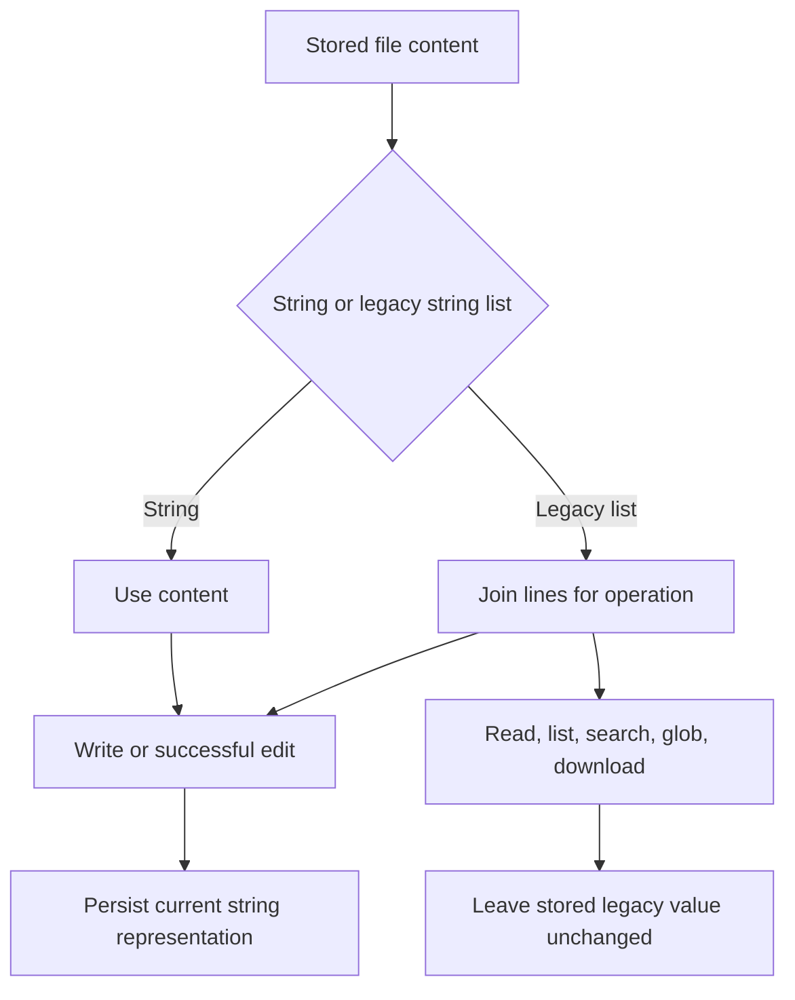
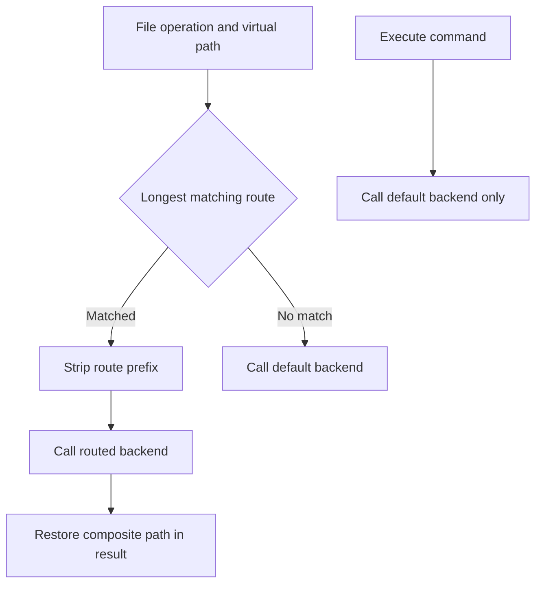

# Backends, Virtual Filesystems, and Execution

A backend is the storage and execution boundary behind agent file tools. `BackendProtocol` makes file operations portable across graph state, stores, host filesystems, and remote sandboxes; it does **not** imply that every backend can execute a process. `SandboxBackendProtocol` is the additional capability required for `execute()`. Consequently, `StateBackend` and `StoreBackend` can read, write, search, glob, and transfer files without offering a shell. `create_deep_agent()` chooses `StateBackend()` when no backend is supplied.

This is an important separation of concerns:

- **Backend routing** selects where a virtual path is stored.
- **Persistence scope** is determined by the selected backend and its configuration.
- **Permissions** are enforced by `FilesystemMiddleware` at the built-in tool layer, not by a direct backend call.
- **Execution isolation** is supplied only by the chosen execution backend. A virtual path prefix is not a sandbox.

See [Filesystem tools](/openwiki/concepts/tools-filesystem.md) for agent-facing tools, [State persistence](/openwiki/concepts/state-persistence.md) for checkpoint and store lifecycle, [permissions and HITL](/openwiki/concepts/permissions-hitl.md) for tool approval, and [security operations](/openwiki/operations/security.md) for deployment guidance.

## The capability contract

`BackendProtocol` uses structured result objects rather than requiring callers to parse command output. The common surface includes `ls`, windowed `read`, literal `grep`, `glob`, `write`, exact-string `edit`, `delete`, and upload/download batches. Results carry either data or an error; transfer responses are per input so a batch can partially succeed. The base protocol supplies asynchronous fallbacks, while implementations may provide native async I/O.

`ReadResult` also records pagination metadata. A valid returned text window has paired `start_line` and `end_line`; when supplied, `next_offset` is the line immediately after that window. Backends must tolerate a negative offset and non-positive limit rather than throwing. In the shared Python slicer, a zero limit returns `no_lines_requested=True`, distinguishing an uninspected window from an empty file.

Search semantics are backend-level rather than shell semantics: `grep` searches a literal substring (not a regular expression) and `max_count` is a total match cap. Glob patterns without `/` match a basename at any depth; slash-containing patterns are relative to the requested root, and a leading `/` anchors to that root. Backends report a refused glob such as one containing `..` as a structured error.

## File data and legacy compatibility

The current `FileData` form is a string plus an encoding and optional timestamps:

```python
{
    "content": str,
    "encoding": "utf-8" | "base64",
    "created_at": "...",  # optional
    "modified_at": "...",  # optional
}
```

Text uses UTF-8. Binary data is represented by base64 text with `encoding: "base64"`, enabling upload/download to round-trip bytes while text edit rejects binary files. File sizes in the state and store implementations are calculated from UTF-8 bytes of normalized content.

Older state or store records may use `content: list[str]`. The compatibility conversion joins the strings with `"\n"` (and maps an empty list to `""`). Reads, listing size calculation, searches, globs, and downloads can use that normalized view without rewriting the persisted legacy record. Values other than a string or a list consisting solely of strings raise `TypeError`; malformed persisted data is not silently treated as text.



This is a lazy migration path: observation is non-mutating, but a successful content mutation writes the current representation.

A write creates or replaces string content and records `utf-8`. An update retains an existing `created_at` when available and refreshes `modified_at`; an edit retains its existing encoding unless the file is rewritten as text. Failed edits do not persist a converted legacy value.

## State and store are different persistence scopes

| Backend | Owner and scope | Lifecycle and operational constraint |
| --- | --- | --- |
| `StateBackend` | The current graph's `files` state channel | Graph/thread-local state; checkpoint configuration controls survival between invocations. |
| `StoreBackend` | A LangGraph `BaseStore` namespace selected by a caller factory | Cross-thread persistence within that namespace; durability is that of the supplied store. |

### `StateBackend`: graph-local files

`StateBackend` may only operate in a LangGraph graph context. It reads `files` through `CONFIG_KEY_READ` with `fresh=True`, which applies pending channel writes before the read. It sends partial updates through `CONFIG_KEY_SEND`; the channel's dictionary merge preserves unrelated keys, and subsequent reads in the same superstep see the queued changes before the node boundary commits them. A delete queues `None` for the exact path and every descendant under `path + "/"`.

There is deliberately no private in-memory fallback outside a graph: missing execution configuration produces an actionable `RuntimeError`. Seed files by passing `files` in invocation state. Use this backend for files whose natural lifetime is the agent thread, not for shared durable records.

### `StoreBackend`: durable namespace-scoped files

`StoreBackend(namespace=..., store=...)` uses an explicitly supplied `BaseStore`, or resolves a graph store at call time. Without either, it raises an actionable `RuntimeError`. The namespace factory receives the active `Runtime`; with an explicit store, a factory that ignores its argument can also run outside graph execution. A runtime-dependent factory outside a graph fails clearly instead of attempting to dereference an absent runtime.

The namespace is a store scope, not a filesystem path. It must be a nonempty tuple of nonempty string components drawn from alphanumerics plus `-`, `_`, `.`, `@`, `+`, `:`, and `~`; wildcard-like and path-like characters are rejected before lookup. This prevents wildcard injection into store lookup, but application identity and authorization must still decide which namespace a caller may use.

Store listing, search, globbing, and recursive deletion page through matching store items and perform virtual-path filtering locally. Recursive deletion removes the exact key plus descendants, treating wildcard-looking keys literally. Its asynchronous operations use native store methods such as `aget`, `aput`, `abatch`, and `asearch`.

## `CompositeBackend`: one virtual tree, multiple owners

`CompositeBackend` presents a default backend plus route-prefix backends as one virtual tree. It chooses the longest matching route. A path equal to a route root such as `/memories` maps to `/` inside that route; a descendant has the prefix stripped; an unmatched path stays with `default`.



The diagram shows path routing, not a security or execution boundary.

For `ls`, the composite lists only a matched route; at `/`, it combines the default listing with synthetic directories for each route. Routed listings, grep matches, glob matches, mutation results, and transfer responses are remapped back to composite paths. A routed backend lacking `delete` yields a `DeleteResult` error rather than leaking `NotImplementedError`.

Uploads and downloads are grouped by selected backend, one batch is sent per group, and results are restored to original input order and paths. This preserves per-file partial failures without requiring every backend to receive one transfer at a time.

A root (`/` or `None`) grep searches default and routes. `max_count` is global: the composite forwards only the remaining budget and conservatively marks the result truncated if it skips unvisited routes after the budget is reached. Root glob merges default and routes. A leading `/` anchors a glob to the composite root, so routes are skipped unless the pattern explicitly names their prefix; a named route pattern is rewritten relative to that backend. Merge operations surface the first backend error instead of reporting a misleading partial success.

### Routing never routes a command

`execute()` is intentionally different: it delegates only to `default` when that backend implements `SandboxBackendProtocol`, otherwise it raises `NotImplementedError`. A route mounted from `StoreBackend` is accessible through file operations, not through a shell. A composite is therefore a storage composition mechanism, not access control or containment.

A typical mixed-lifetime layout is:

```python
CompositeBackend(
    default=StateBackend(),
    routes={"/memories/": StoreBackend(namespace=lambda _rt: ("filesystem", "alice"))},
)
```

This makes `/memories/` durable in the selected store namespace while other paths remain graph-local. It does not grant a user access to that namespace.

## Local shell execution is host execution

`LocalShellBackend` combines `FilesystemBackend` with `SandboxBackendProtocol`, but it is explicitly **not** a sandbox. `execute()` invokes `subprocess.run(..., shell=True)` on the host with the process user's permissions and `root_dir` as its working directory. Commands can access accessible host paths, make network connections, modify files and configuration, and spawn processes. Backend operations are not reversible.

> **Danger:** Do not expose `LocalShellBackend` to untrusted users, production services, or multi-tenant workloads. Use a genuinely isolated sandbox backend for service-side execution, and apply tool permissions and human approval as defense in depth. See [sandbox partners](/openwiki/integrations/sandbox-partners.md).

`virtual_mode=True` makes *filesystem-tool* paths relative to `root_dir` and rejects traversal such as `..` and `~`. It does not constrain shell syntax or shell paths: `execute("cat /etc/passwd")` is still governed only by host permissions. Likewise, placing a local shell backend inside a composite changes which backend receives file paths but cannot confine commands beyond the rule that the composite executes on its default.

The default command timeout is 120 seconds and must be positive. A timed-out command returns exit code `124`; an empty command returns an error response. The backend captures stdout and stderr, prefixes stderr lines with `[stderr]`, appends nonzero exit status information, and truncates output by UTF-8 byte budget without emitting partial Unicode. Its default command environment is empty apart from supplied `env`; `inherit_env=True` copies the parent environment and overlays `env`. These are operational controls, not isolation guarantees. `stdin=DEVNULL` avoids interactive input, and non-Windows execution starts a new session.

## Focused regression coverage

The backend tests cover the compatibility boundary from both state and store: legacy list reads without mutation, failed malformed values, successful write/edit migration, timestamps, binary transfer round trips, and edit refusal for binary data. State tests additionally cover graph-context behavior; store tests cover namespace validation, paging, recursive literal-key deletion, and native async paths.

Composite tests cover longest-prefix and route-root handling, remapped result paths, root listings, grouped transfers and response order, global grep budgets, anchored glob semantics, merge truncation, error propagation, and default-only execution. Local-shell tests cover working-directory sharing, timeouts, stderr and exit formatting, byte-safe output truncation, environment behavior, and the difference between virtual filesystem paths and unrestricted shell paths. These tests establish observable behavior; they do not make host shell execution safe.
