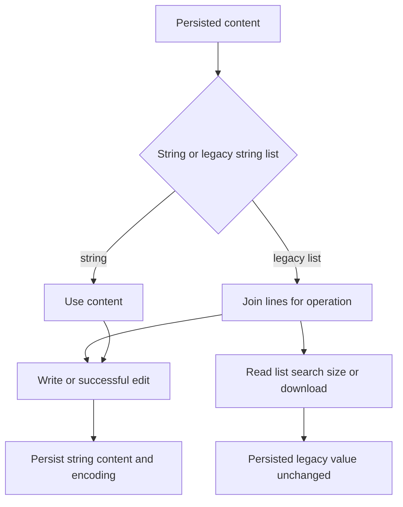
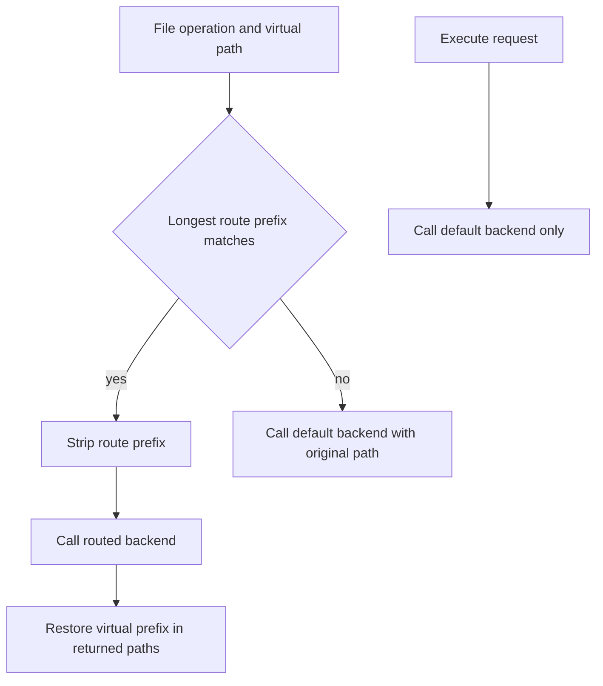
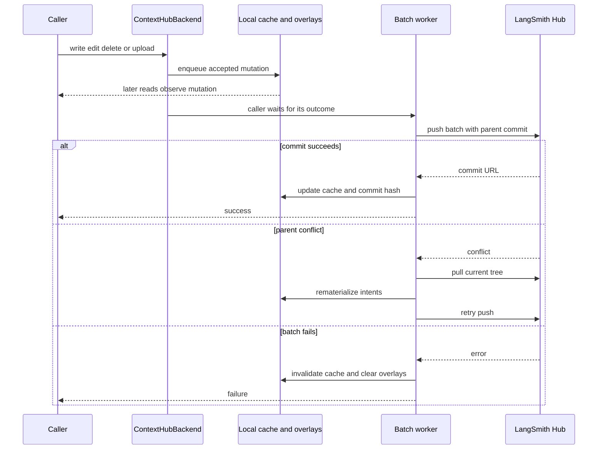

# Backends and Durable File State

A backend implements the storage side of the agent's file operations. The shared `BackendProtocol` provides structured results for listing, reading, writing, editing, deletion, search, globbing, and batch transfer; only `SandboxBackendProtocol` adds shell execution. Thus `StateBackend` and `StoreBackend` offer file tools but no process to execute in. `create_deep_agent()` uses `StateBackend()` when no backend is supplied.

This page separates three concerns that should not be conflated:

- **Format compatibility:** current `FileData` has string `content`, an `encoding`, and optional timestamps. Old persisted values may instead have `content: list[str]`.
- **Persistence scope:** `StateBackend` writes the current graph thread's state channel, whereas `StoreBackend` writes a caller-chosen LangGraph store namespace that can be shared across threads.
- **Routing and policy:** `CompositeBackend` is virtual-path dispatch, not authorization or shell containment. Tool permissions are applied by `FilesystemMiddleware`, not by direct backend calls.

See [Filesystem tools](/openwiki/concepts/tools-filesystem.md) for the model-facing adapter and policy, [State persistence](/openwiki/concepts/state-persistence.md) for the wider checkpoint/store distinction, and [the source map](/openwiki/architecture/source-map.md) for code ownership.

## Shared file representation and compatible reads

The current persisted representation is conceptually:

```python
{
    "content": str,
    "encoding": "utf-8" | "base64",
    "created_at": "...",  # optional
    "modified_at": "...",  # optional
}
```

Text content is UTF-8; binary uploads are base64 text with `encoding: "base64"`. Upload/download therefore round-trip bytes, while grep excludes base64 files. `FileInfo.size` is the UTF-8 byte length of normalized content, rather than its Python character count.

### Legacy `list[str]` is a read compatibility format

Both state and store data may contain legacy `content: list[str]`. The shared conversion joins those strings with `"\n"`; an empty list becomes `""`. This is a *read-time view*, not an eager migration: `read`, `ls`, `grep`, `glob` size reporting, and `download_files` operate on the normalized string without changing the stored legacy value. It also preserves timestamps and defaults a missing encoding to `"utf-8"` in the returned file data.



This flow shows lazy compatibility: observations do not rewrite old records, but a successful content mutation persists the current string representation.

Malformed content is not silently coerced: a value that is neither a string nor a list containing only strings raises `TypeError`. This prevents an apparently successful search or edit from interpreting arbitrary persisted objects as text.

### Writes are the migration boundary

`write()` creates or replaces a file with string content and explicitly records UTF-8 encoding. `edit()` first normalizes legacy content, performs the exact replacement, and on success stores the resulting string. Metadata behavior is intentional: an update preserves `created_at` when present, refreshes `modified_at`, and retains the previous encoding until a text `write()` changes it to UTF-8. An unsuccessful edit—including an empty old string, a missing or ambiguous match, or an EOF-newline mismatch—does not persist a converted value.

Text reads use the shared line-window behavior: negative offsets clamp to the first line and a non-positive limit returns an empty, uninspected window rather than raising. Known binary paths bypass line slicing. Grep is a literal substring search, not regex; `max_count` is a total match budget, and base64 entries neither appear in results nor consume it. Glob patterns use the same root-relative contract across these backends: a pattern without `/` matches a basename at any depth, a slash-containing pattern matches relative paths, and a leading `/` anchors at the requested root. Refused patterns, including a `..` component, are returned as structured result errors.

## Choosing state scope or durable store scope

| Backend | Data owner and scope | Execution context | Durability and lifecycle |
| --- | --- | --- | --- |
| `StateBackend` | The current graph's `files` channel | Must run inside a LangGraph graph node or tool | Updates are checkpointed with graph state; files persist within a conversation thread, not across threads. |
| `StoreBackend` | A `BaseStore` under the namespace returned by `namespace(runtime)` | Uses its supplied `store`, or resolves the graph store at call time | Records are cross-thread within that namespace; durability depends on the supplied `BaseStore`. |

### StateBackend: graph-local files

`StateBackend` reads the `files` channel through `CONFIG_KEY_READ` with `fresh=True`, which applies pending task writes through the reducer before the read. Mutations send a partial update through `CONFIG_KEY_SEND`; the channel's dictionary-merge reducer preserves unrelated files, and the pending update is visible to later backend reads in the same superstep before it commits at the node boundary. Deletes are `None` markers and remove the exact key plus descendants sharing `file_path + "/"`.

The backend must be called from LangGraph graph execution: outside that context it raises an actionable `RuntimeError` rather than inventing an in-memory fallback. To seed its data, pass `files` in the graph invocation state. This backend is the default selected by `create_deep_agent()`, but checkpoint configuration determines whether that thread state survives a later invocation.

### StoreBackend: namespace-scoped durable files

Construct `StoreBackend(namespace=..., store=...)` with a namespace factory. If no store is injected, it obtains one from the active graph context; without either, operations fail with an actionable `RuntimeError`. The factory receives the active `Runtime`; a factory that ignores its argument may be used outside a graph when an explicit store is supplied, while one that reads runtime attributes requires graph execution.

The namespace is not a pathname. It is a nonempty tuple of nonempty string components validated to allow alphanumerics plus `-`, `_`, `.`, `@`, `+`, `:`, and `~`; wildcard and path-like characters are rejected before store lookup. Use a stable, deliberately selected namespace—for example a user or assistant identity plus `"filesystem"`—to control which records share a durable file tree. This validation prevents wildcard/glob injection in store lookups; it does not replace the application's identity and authorization design.

Store listings, grep, glob, and recursive deletion retrieve all matching namespace items through paginated store searches and filter virtual paths locally. A recursive deletion deletes the exact key and descendants in one `batch`/`abatch` call; wildcard-looking file keys are treated literally. Asynchronous read/write/edit/delete use native `aget`, `aput`, `abatch`, and paginated `asearch` paths rather than dispatching their store I/O through a worker thread.

A common composition keeps transient work in state and mounts durable records separately:

```python
CompositeBackend(
    default=StateBackend(),
    routes={"/memories/": StoreBackend(namespace=lambda _rt: ("filesystem", "alice"))},
)
```

This is a storage-scope choice. It does not itself grant a user access to that namespace or make the route visible to a shell.

## Composite virtual-path routing

`CompositeBackend` composes a default backend and route-prefix mapping into one virtual path tree. It selects the longest matching prefix. A path equal to a route root (for example, `/memories`) is routed as that backend's `/`; a path below it has the prefix stripped. Unmatched paths go to `default`.



This diagram distinguishes virtual file-operation routing from command execution, which is always owned by the default backend.

### What is routed

`read`, `write`, `edit`, `delete`, `ls`, `grep`, `glob`, and batch transfers dispatch by route. Result paths from routed listings, searches, and transfers are restored to the caller's composite path. At `/`, `ls` combines the default listing with synthetic directories for each mounted route; listing a route itself queries only that route. If a routed backend does not implement deletion, the composite converts `NotImplementedError` into a `DeleteResult` error rather than leaking the exception.

`upload_files()` and `download_files()` group inputs by selected backend, call each backend once per group, then put responses back in input order with the original composite paths. This preserves partial-success reporting while still allowing a backend to batch its own transfer work.

### Root searches, glob anchoring, and execution boundary

A search scoped to a route searches only that route; a non-route path searches only `default`; `None` or `/` merges default and all routes. Root `grep` applies `max_count` globally, passing the remaining budget to each route and stopping once it is consumed. Its truncation flag is deliberately conservative when unvisited routes are skipped.

Root `glob` has an additional path-semantics rule. A leading `/` anchors the pattern to the composite root, so routed results are excluded unless the pattern explicitly names that route. When a pattern does name a route, the composite rewrites it relative to that route before delegation. Bare patterns remain eligible to search each route. Both merged search types return the first backend error rather than silently treating partial results as success; glob merging ORs truncation and gives `unreadable` precedence over `budget` as the reported reason.

`execute()` is intentionally outside this routing scheme. It delegates exclusively to `default` when it implements `SandboxBackendProtocol`, forwarding an explicitly supplied timeout only to defaults that accept one. Otherwise it raises `NotImplementedError`. A mounted store or Context Hub route therefore remains reachable through file tools, not through the shell. Routing selects storage for an operation; it is not an authorization mechanism or execution sandbox.

## Context Hub as a commit-backed text backend

`ContextHubBackend(identifier, client=None)` uses `pull_agent` and `push_agent` to present a Hub agent repository as a file backend. It has no shell capability. The identifier accepts an `owner/name` or `-/name` Hub handle, and a `langsmith.Client` is created when no client is provided.

On its first operation, the backend loads a tree under one condition lock. A missing Hub repository is an empty tree, which permits lazy creation on the first successful write. Ordinary `FileEntry` content becomes the file cache; linked agent and skill entries are kept separately and available through `get_linked_entries()`. `has_prior_commits()` reflects whether the loaded snapshot has a commit hash.

### Visibility before durability

A mutation is accepted into a local queue before it is remotely durable. The backend overlays both pending and in-flight changes onto its cached snapshot, so reads and derived operations observe accepted writes, replacements, and deletions immediately. The mutation caller still blocks on its own completion event and receives success only after its commit succeeds, or an operation result error if it fails.



This flow shows read-your-accepted-mutation behavior, not remote durability or cross-client visibility.

### Batch lifecycle and commit lineage

The first pending mutation starts a daemon worker and fixes a 50 ms batch deadline; later mutations join but do not extend that deadline. The worker serializes pushes. It merges mutation changes in enqueue order, so the final same-path change in a batch wins, and sends the cached commit hash as `parent_commit`. After a successful push, it obtains the next hash from current or legacy commit URL forms. If the URL has no usable hash, it pulls an authoritative snapshot; failure to obtain a hash turns the burst into a failure.

A valid `upload_files()` call decodes all inputs as UTF-8 and submits valid siblings in one mutation. Each non-UTF-8 input independently receives `invalid_path`, and duplicate input paths use the last supplied content. Downloads encode cached text as UTF-8 bytes; a missing file is the normal `file_not_found` result.

### Optimistic conflict recovery

A parent-commit conflict does not cause a stale batch to be blindly resent. The worker pulls a fresh tree and rematerializes each intent in order: writes replay their requested changes, edits recompute their exact replacement against current text, and deletes recalculate all current paths at or below their deletion root. It retries at most three times after the initial push.

This behavior preserves unrelated remote changes while making conflicts observable where a precondition no longer holds. An edit whose expected old text is absent, or whose target disappeared, fails rather than overwriting current remote content. Failed commit bursts settle both in-flight and pending waiters, clear overlays, and invalidate the snapshot so a later operation pulls again.

### Errors and search semantics

A missing file remains an ordinary operation-specific not-found result. `LangSmithError` failures during a supported Hub operation are reported as `Hub unavailable: ...`; unexpected non-LangSmith exceptions propagate. This distinction matters operationally: a not-found result says something about the loaded tree, whereas a Hub-unavailable result means the snapshot or commit could not be obtained.

`grep` searches literal text in the visible cache and can enforce `max_count`; it uses case-normalized `fnmatch` against the full Hub path for its optional filter. That is intentionally different from `glob()`, which uses the shared include-glob contract relative to the requested root: bare patterns match basenames at any depth, slash-containing patterns match relative paths, and leading `/` anchors. Do not assume that `grep(..., glob=...)` and `glob()` interpret the same pattern alike.

## Focused regression coverage

For State and Store backends, test the shared format contract from both persistence boundaries: legacy string lists normalize for read/list/search/size/download without mutating storage; successful write and edit persist strings; invalid list members fail; UTF-8 byte size is reported; and binary upload/download round-trips without grep matches. Also cover StateBackend's graph-context error and StoreBackend namespace validation, runtime-factory failure modes, paging, literal wildcard deletion, and batched recursive deletes.

Focused composite tests cover longest-prefix routing, route-root handling with and without a trailing slash, restored result paths, root listing, grouped batch transfers, global grep budgets, root-anchored glob behavior, result truncation, error propagation, and default-only execution. Context Hub unit tests cover cold-cache and missing-repository handling, linked entries, accepted-mutation overlays, coalescing, commit-hash recovery, upload partial success, conflict rematerialization and exhaustion, plus cache invalidation after failure. Integration tests, skipped unless `LANGSMITH_API_KEY` is configured, exercise lazy repository creation, persistence between backend instances, real conflict recovery, and single-commit uploads. See the [testing guide](/openwiki/testing/testing-guide.md) for package-local commands and conventions.
