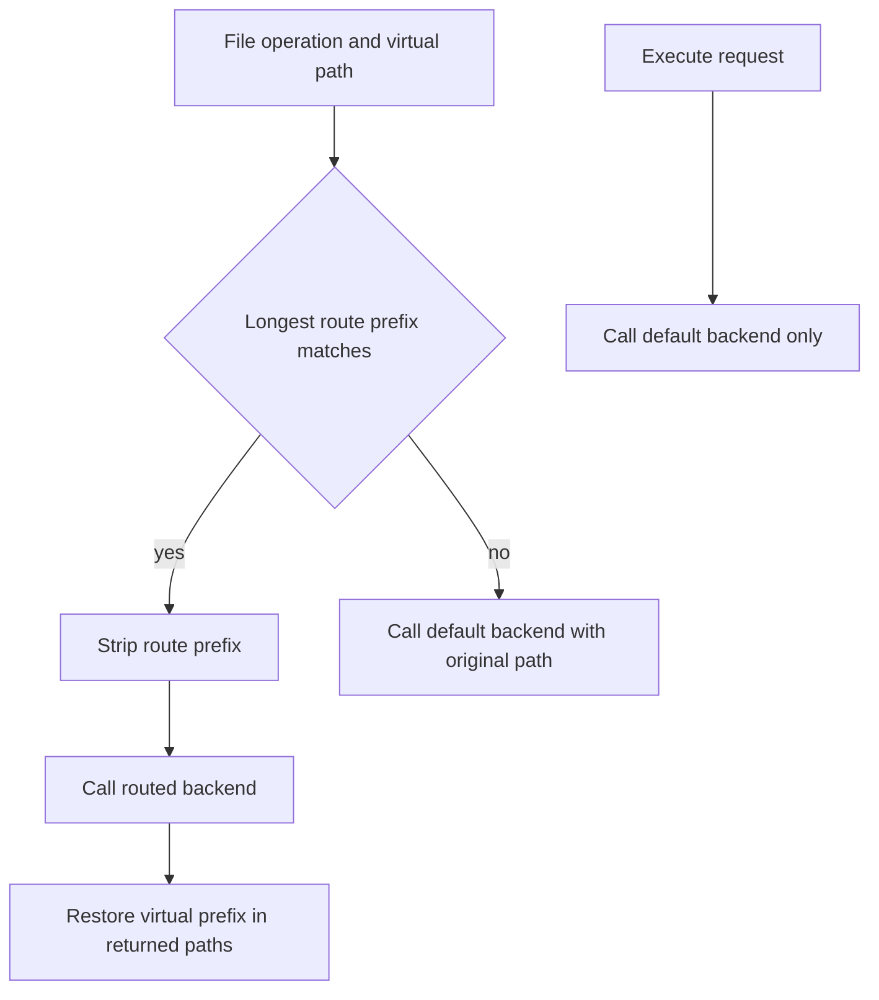
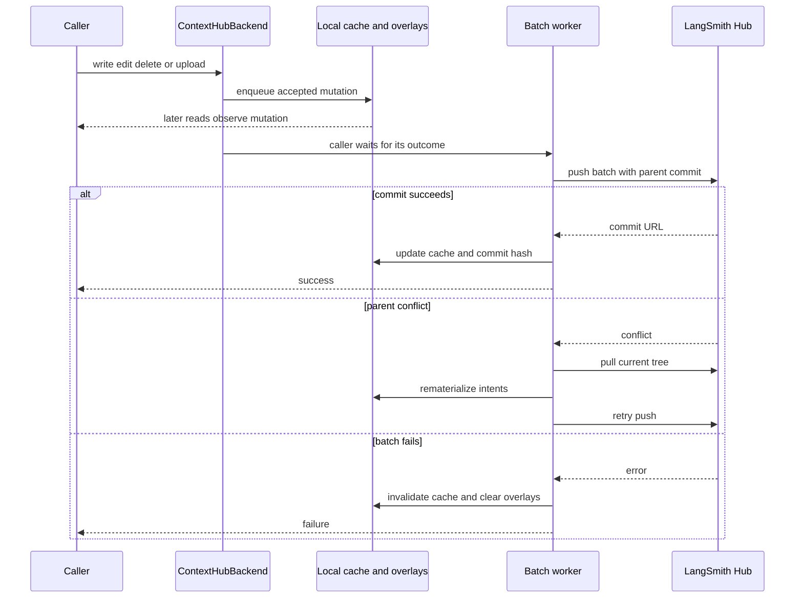

# Backends and Durable File State

A backend is the storage implementation behind the agent's file operations. `CompositeBackend` composes several such implementations into one virtual path space, while `ContextHubBackend` persists UTF-8 text files to a LangSmith Hub agent repository. Neither feature is an authorization mechanism or a shell sandbox: routing selects a backend for a file operation; it does not grant access, constrain a process, or expose routed files to a default shell. For tool exposure and permissions, see [Filesystem tools](/openwiki/concepts/tools-filesystem.md); for durable graph state, see [State persistence](/openwiki/concepts/state-persistence.md).

> **Critical boundary:** a route is a dispatch rule, not containment. In particular, `CompositeBackend.execute()` always uses its default backend and never chooses a backend from a virtual file path. Use an isolated sandbox implementation for untrusted command execution.

## Composite virtual-path routing

Construct a composite with a `default` backend and a mapping of virtual route prefixes to backends. It selects the longest matching prefix. A path equal to a route root (for example, `/memories`) is routed as that backend's `/`; a path below it has the prefix stripped. Unmatched paths go to `default`.

This diagram distinguishes virtual file-operation routing from command execution, which is always owned by the default backend.

### What is routed

`read`, `write`, `edit`, `delete`, `ls`, `grep`, `glob`, and batch transfers dispatch by route. Result paths from routed listings, searches, and transfers are restored to the caller's composite path. At `/`, `ls` combines the default listing with synthetic directories for each mounted route; listing a route itself queries only that route. If a routed backend does not implement deletion, the composite converts `NotImplementedError` into a `DeleteResult` error rather than leaking the exception.

`upload_files()` and `download_files()` group inputs by selected backend, call each backend once per group, then put responses back in input order with the original composite paths. This preserves partial-success reporting while still allowing a backend to batch its own transfer work.

### Root searches, glob anchoring, and failure behavior

A search scoped to a route searches only that route; a non-route path searches only `default`; `None` or `/` merges default and all routes. Root `grep` applies `max_count` globally, passing the remaining budget to each route and stopping once it is consumed. Its truncation flag is deliberately conservative when unvisited routes are skipped.

Root `glob` has an additional path-semantics rule. A leading `/` anchors the pattern to the composite root, so routed results are excluded unless the pattern explicitly names that route. When a pattern does name a route, the composite rewrites it relative to that route before delegation. Bare patterns remain eligible to search each route. Both merged search types return the first backend error rather than silently treating partial results as success; glob merging ORs truncation and gives `unreadable` precedence over `budget` as the reported reason.

`execute()` is intentionally outside this routing scheme. It delegates exclusively to `default` when it implements `SandboxBackendProtocol`, forwarding an explicitly supplied timeout only to defaults that accept one. Otherwise it raises `NotImplementedError`. A mounted store or Context Hub route therefore remains reachable through file tools, not through the shell.

## Context Hub as a commit-backed text backend

`ContextHubBackend(identifier, client=None)` uses `pull_agent` and `push_agent` to present a Hub agent repository as a file backend. It has no shell capability. The identifier accepts an `owner/name` or `-/name` Hub handle, and a `langsmith.Client` is created when no client is provided.

On its first operation, the backend loads a tree under one condition lock. A missing Hub repository is an empty tree, which permits lazy creation on the first successful write. Ordinary `FileEntry` content becomes the file cache; linked agent and skill entries are kept separately and available through `get_linked_entries()`. `has_prior_commits()` reflects whether the loaded snapshot has a commit hash.

### Visibility before durability

A mutation is accepted into a local queue before it is remotely durable. The backend overlays both pending and in-flight changes onto its cached snapshot, so reads and derived operations observe accepted writes, replacements, and deletions immediately. The mutation caller still blocks on its own completion event and receives success only after its commit succeeds, or an operation result error if it fails.

This flow shows read-your-accepted-mutation behavior, not remote durability or cross-client visibility.

### Batch lifecycle and commit lineage

The first pending mutation starts a daemon worker and fixes a 50 ms batch deadline; later mutations join but do not extend that deadline. The worker serializes pushes. It merges mutation changes in enqueue order, so the final same-path change in a batch wins, and sends the cached commit hash as `parent_commit`. After a successful push, it obtains the next hash from current or legacy commit URL forms. If the URL has no usable hash, it pulls an authoritative snapshot; failure to obtain a hash turns the burst into a failure.

A valid `upload_files()` call decodes all inputs as UTF-8 and submits valid siblings in one mutation. Each non-UTF-8 input independently receives `invalid_path`, and duplicate input paths use the last supplied content. Downloads encode cached text as UTF-8 bytes; a missing file is the normal `file_not_found` result.

### Optimistic conflict recovery

A parent-commit conflict does not cause a stale batch to be blindly resent. The worker pulls a fresh tree and rematerializes each intent in order: writes replay their requested changes, edits recompute their exact replacement against current text, and deletes recalculate all current paths at or below their deletion root. It retries at most three times after the initial push.

This behavior preserves unrelated remote changes while making conflicts observable where a precondition no longer holds. An edit whose expected old text is absent, or whose target disappeared, fails rather than overwriting current remote content. Failed commit bursts settle both in-flight and pending waiters, clear overlays, and invalidate the snapshot so a later operation pulls again.

### Errors and search semantics

A missing file remains an ordinary operation-specific not-found result. `LangSmithError` failures during a supported Hub operation are reported as `Hub unavailable: ...`; unexpected non-LangSmith exceptions propagate. This distinction matters operationally: a not-found result says something about the loaded tree, whereas a Hub-unavailable result means the snapshot or commit could not be obtained.

`grep` searches literal text in the visible cache and can enforce `max_count`; it uses case-normalized `fnmatch` against the full Hub path for its optional filter. That is intentionally different from `glob()`, which uses the shared include-glob contract relative to the requested root: bare patterns match basenames at any depth, slash-containing patterns match relative paths, and leading `/` anchors. Do not assume that `grep(..., glob=...)` and `glob()` interpret the same pattern alike.

## Operational guidance and focused regression coverage

Mount `ContextHubBackend` where versioned remote text belongs, for example as a `/memories/` route in a composite, but choose the composite default independently for unmatched file operations and command capability. A route makes neither the Hub repository visible to a default shell nor the default filesystem visible through the Hub route. See [security guidance](/openwiki/operations/security.md) and [sandbox partners](/openwiki/integrations/sandbox-partners.md) when execution isolation is required.

Focused composite tests cover longest-prefix routing, route-root handling with and without a trailing slash, restored result paths, root listing, grouped batch transfers, global grep budgets, root-anchored glob behavior, result truncation, error propagation, and default-only execution. Context Hub unit tests cover cold-cache and missing-repository handling, linked entries, accepted-mutation overlays, coalescing, commit-hash recovery, upload partial success, conflict rematerialization and exhaustion, plus cache invalidation after failure. Integration tests, skipped unless `LANGSMITH_API_KEY` is configured, exercise lazy repository creation, persistence between backend instances, real conflict recovery, and single-commit uploads. See the [testing guide](/openwiki/testing/testing-guide.md) for test execution conventions.
