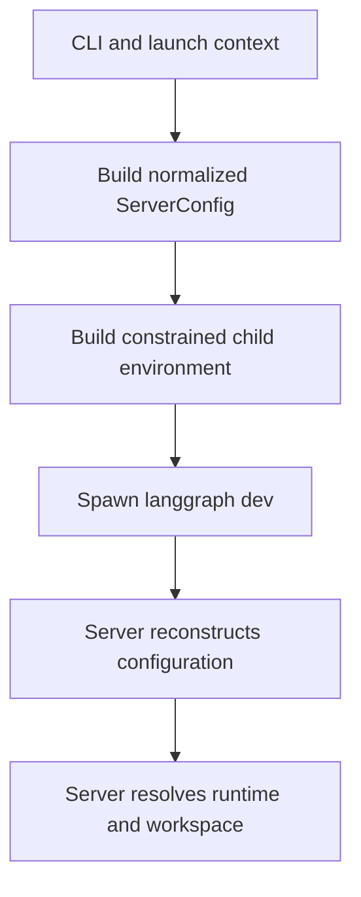

# dcode Configuration Layering

`dcode` resolves ordinary settings through its typed configuration system, but the client and the LangGraph agent server are separate processes. This page describes the boundaries that keep bootstrap, CLI choices, model construction, and child-process environment state from being conflated.

For the broader runtime architecture, see [Code agent](/openwiki/architecture/code-agent.md); for model selection, see [profiles and models](/openwiki/concepts/profiles-models.md).

## Startup order and bootstrap

`cli_main()` parses arguments and installs the CLI provider before lazy credential bootstrap. It deliberately lets help and selected diagnostic commands (`config`, `doctor`, and `auth path`) avoid the managed-policy health gate; other non-help paths must have enforceable managed configuration before normal initialization. Credential access then triggers bootstrap.

Bootstrap is process-local, lock-protected, and one-shot. It snapshots LangSmith selectors, establishes project context, loads dotenv sources, refreshes debug configuration, records the original LangSmith project, and applies stored tracing/auth settings. A failure is recorded and logged but still marks bootstrap complete, avoiding an infinite sequence of partial bootstrap attempts. The server has its own process and its own bootstrap state.

## Model and profile layers

Model construction occurs where the model is built, normally in the server. `create_model()` canonicalizes an explicit or inferred provider/model specification and checks model policy before credential bridging, provider profile hooks, or provider imports. A prohibited model therefore cannot activate stored credentials or provider initialization side effects.

Model profile metadata is layered after construction: configured provider/model overrides apply before `--profile-override`, so the explicit CLI override wins. A configured override that cannot be assigned warns and leaves the original profile; an explicit CLI override that cannot be assigned fails construction. The final profile supplies context-limit and modality metadata.

## Typed process handoff

`ServerConfig` is the typed transport contract. The client path-normalizes launch-relative values, serializes `DEEPAGENTS_CODE_SERVER_*` variables, and the server reconstructs them with `ServerConfig.from_env()`. `None` clears a variable rather than sending an empty string. This is invocation configuration, not a transfer of the client resolver cache or process state.

The parent sends explicit invocation values; the child owns its runtime resolution.

## Child environment boundary

The server environment is derived from, but is not a raw copy of, the client environment. It strips values injected by client dotenv loading, interpreter/startup-hijack variables, and LangGraph control-plane credentials. Profile selection and internal carrier variables are pinned against persistent or scoped overrides so a caller cannot make the server use a different profile or forge internal state.

A launch `PYTHONPATH` never reaches the server interpreter import path. dcode carries it through an internally owned variable and reapplies it only for approval-gated agent `execute` commands. LangSmith selectors are likewise encoded from bootstrap snapshots rather than trusted from an inherited carrier, allowing agent commands to restore user tracing intent without inheriting agent tracing state.

## Change guidance

Keep client configuration, server runtime state, and project-scoped execution grants distinct. For a new CLI setting, decide whether it is a local parsing concern, an explicit `ServerConfig` field, or server-resolved policy. Add server-environment tests when a value can affect interpreter startup, profile selection, authentication, or shell execution. Test model-policy ordering before credential/provider side effects and test both configured and explicit profile override failure behavior.
