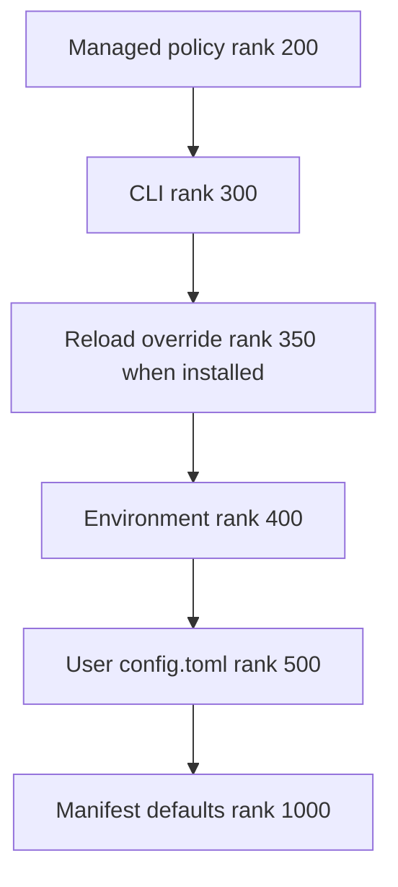
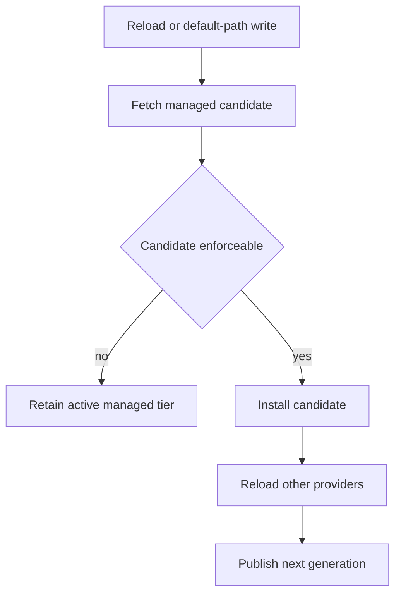
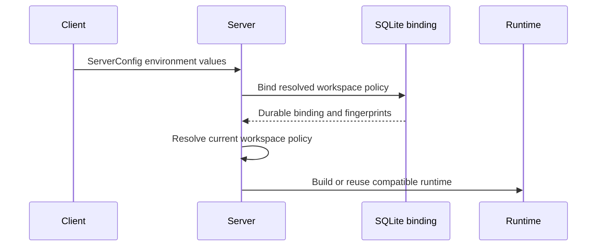

# dcode Configuration Layering

`dcode` uses a typed, ranked resolver rather than a single configuration file. That design gives managed policy stronger precedence than user-controlled settings while retaining useful per-invocation and per-project inputs. It also draws an explicit boundary between user-authorized configuration and values carried by a checkout.

For the client/server split, see [Code agent](/openwiki/architecture/code-agent.md). For MCP operation, see [MCP](/openwiki/integrations/mcp.md); for security posture, see [Security](/openwiki/operations/security.md).

## Typed resolution and precedence

The manifest is the configuration surface: it declares scalar option types, typed defaults, TOML locations, environment names, merge strategies, and redaction metadata. Structured configuration is deliberately handled by dedicated typed loaders rather than flattened into scalar options. Invalid environment or TOML values become an invalid provider result, so resolution can use a weaker valid value without discarding valid siblings. Credential-bearing structured tables are presence-only in configuration introspection.

Providers return `Found`, `Unset`, or `Invalid`; the resolver owns rank, health, provenance, and merge semantics. Lower numeric rank is stronger.

The standard ordering of configuration tiers. Reload retention is a caller-installed tier, not part of every resolver.

For ordinary replacement options, the strongest usable result wins; a higher-precedence durable result masks a weaker non-durable one. `union` and `deep_merge` options instead retain valid values from every tier; deep merges also preserve leaf-level provenance. Defaults are a fallback, not an accumulated contribution. This is essential for deny lists, where allowing a user replacement to erase a managed denial would be fail-open.

`resolver_from_snapshots()` requires keyword-only `managed=` and `user=` snapshots, preventing same-typed inputs from being swapped and accidentally granting user content managed rank. `get_config_resolver()` caches one resolver generation for normal process readers, and rejects a different CLI provider for the same process. A resolver built ad hoc from snapshots has no CLI tier unless the caller supplies it.

## Generations, reloads, and writes

Configuration files are not watched. A cached resolver generation stays in force until `/reload` or a committed write to the default user configuration path advances it; this avoids a read observing a partially applied edit. The environment tier is the notable live exception: `EnvProvider` reads the active environment at resolution time. Outside scoped construction it is `os.environ`; inside `use_environment()` it is an immutable, context-local mapping.

Managed policy is fetched and validated before replacing the resolver tier, avoiding network I/O while the resolver lock is held and preventing a bad refresh from dropping restrictions.

A TOML provider retains its last usable snapshot when a later candidate is unreadable or malformed; an initial failed read falls through. A managed candidate must be usable and enforceable before it can replace the active policy. Source diagnostics are reset per generation, so a continuing error is reportable again after another reload.

`update_user_config()` is the supported user-file transaction. It serializes read-modify-write operations, refuses the managed path and malformed existing TOML, writes beside the destination, and atomically replaces the target. After a successful default-path write it best-effort refreshes the shared resolver; refresh failure leaves the landed write intact and is reported as stale in-process state, not as a failed write.

## Environment, dotenv, and sensitive values

For prefix-aware credentials and provider settings, `DEEPAGENTS_CODE_{NAME}` takes precedence over `{NAME}` even when the prefixed variable is empty. That presence rule permits an explicit empty prefixed variable to suppress a canonical credential or stored value.

Project dotenv loading derives an explicit environment snapshot. Inherited environment values win; the nearest project `.env` and global profile dotenv only fill absent keys. The trusted global dotenv controls whether the project file is read; if that file cannot be read, dcode skips the project dotenv rather than assuming that loading an untrusted project file is safe.

A project `.env` cannot inject project-MCP trust lists, Auto classifier model or timeout, MCP tool timeout, forked-subagent behavior, the upstream recursion fallback, or `TERM_PROGRAM`. These security-sensitive settings remain available through the shell and, where applicable, the trusted global dotenv or user configuration. The boundary stops a cloned checkout from choosing its own authorization conditions or trace metadata.

At workspace construction, dcode derives a dotenv mapping and credential snapshot, freezes it, and uses it to construct the runtime. Later process-environment changes therefore do not alter an already-built workspace. LangSmith tracing uses process-wide SDK state, so workspaces on one server must agree on its selectors and secret-redaction setting. If an active upload target requests redaction but the redacting client cannot be installed, tracing is disabled rather than uploading unredacted data.

## MCP controls

MCP configuration interpolates only `${VAR}` and `${VAR:-default}` in `command`, `url`, `args`, `env`, `headers`, and `oauth`. The default form applies when a variable is unset or empty. Unsupported fields are copied verbatim. Malformed braced references, an unset required variable, or a wrong supported-field shape fail before the resolved configuration is used.

Disabled MCP servers are an accumulating policy: user and managed disabled-server names union and are filtered before validation, connection, or tool exposure. A managed deny-list read or validation failure fails closed by disabling every candidate rather than treating the policy as empty.

## Client/server handoff and project trust

The interactive client and agent server are separate processes and do not share the resolver cache. `ServerConfig` is the typed handoff: the client serializes it to `DEEPAGENTS_CODE_SERVER_*` variables, with `None` clearing a variable; the server reconstructs and validates it. In particular, malformed or unsafe filesystem-tool allowlists are rejected instead of becoming unrestricted access.

The process handoff, durable binding, and per-request validation are distinct safeguards.

A workspace binding canonicalizes an existing workspace directory and persists server-resolved non-secret policy plus separate policy and runtime fingerprints in SQLite. It atomically refuses a different workspace or incompatible policy. A compatible runtime-only identity change updates the runtime fingerprint and rebuilds the runtime without discarding the binding or its checkpoints.

Project-scoped MCP, sandbox setup, extension paths, and trust are valid only for the launch project. Resolving another or unresolvable project drops MCP and sandbox grants and re-evaluates extension trust. On each request, the server compares current project and durable policy with the binding: policy drift or revoked extension trust refuses execution, while runtime-only drift causes a rebuild.

## Diagnostics and change guidance

Bindings retain a bounded, allowlisted snapshot for conflict diagnostics. Only reportable policy scalars and lists are persisted. Paths, credentials, environment values, model data, and prompts are excluded from persistence and logs; a refusal either shows safe changed values or marks them unavailable.

When changing configuration, define the option in the manifest or a dedicated structured loader; decide its merge behavior and invalid-value fallback; keep project dotenv untrusted for authorization-sensitive settings; and classify server-facing fields as policy or runtime identity. Tests should target rank and merge behavior, generation retention, failed managed refresh, handoff validation, and policy/runtime drift—not only parsing.

Focused tests in `test_config_manifest.py` verify manifest/runtime alignment, bounded resolution, invalid-value fallback, and secret redaction. Resolver, workspace, and server-graph tests cover precedence, generation and refresh behavior, durable binding, scoped project policy, safe diagnostics, refusal, and rebuild paths.
