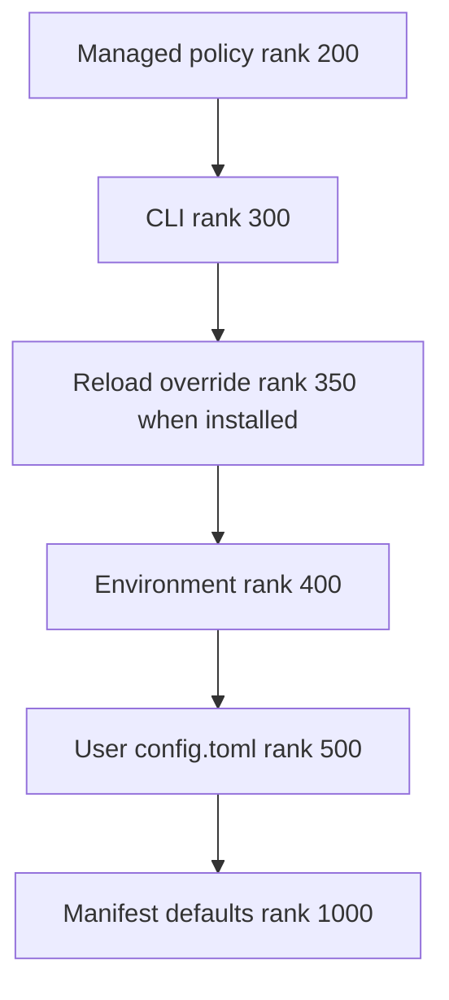
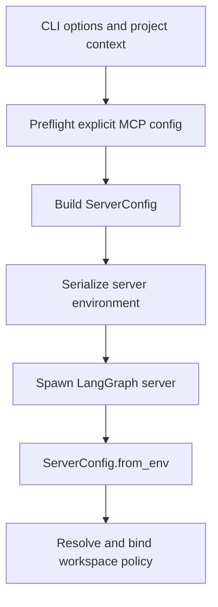

# dcode Configuration Layering

`dcode` resolves configuration through a typed, ranked provider chain rather than treating one file as the whole configuration surface. This preserves session, shell, and user settings while giving organization-managed policy the strongest authority. Resolution retains contributing tiers and diagnostics, making the effective result inspectable.

For the process boundary, see [Code agent](/openwiki/architecture/code-agent.md). Related topics are [plugins](/openwiki/concepts/plugins.md), [profiles and models](/openwiki/concepts/profiles-models.md), [MCP](/openwiki/integrations/mcp.md), and [running a dcode session](/openwiki/workflows/run-dcode-session.md).

## Typed surface and precedence

`config_manifest.py` is the canonical description of scalar settings. A `ConfigOption` supplies a typed default, TOML location, environment-variable names, optional CLI binding, merge strategy, and redaction behavior. Structured tables use dedicated typed loaders; credential-bearing tables are represented only by source and presence in introspection.

Providers normalize each value to `Found`, `Unset`, or `Invalid`. Bad environment or TOML input therefore falls through to a weaker valid tier without discarding valid sibling settings. `ResolvedValue` retains selected ranks, provider health and diagnostics, masking, and rank/path provenance.

Lower numeric rank is stronger. The usual chain is managed policy, parsed CLI input, an optional reload override, environment, user `config.toml`, then manifest defaults.

The ranked configuration chain; the reload tier is caller-installed rather than universal.

For `replace` options, the strongest usable value wins. A durable stronger result masks weaker non-durable results, but an invalid durable value falls through and remains visible in ranked health diagnostics. `union` and `deep_merge` options accumulate every valid tier contribution and retain provenance. Union values are ordered and deduplicated; deep merge applies stronger leaves over weaker tables. Defaults are fallback-only, not an accumulated contribution. This is important for restrictive controls such as MCP deny lists: a user replacement must not erase an administrator denial.

`resolver_from_snapshots()` accepts keyword-only `managed=` and `user=` inputs, avoiding a positional swap that could grant writable user configuration managed precedence. The shared resolver caches one generation for ordinary readers and rejects installation of a different CLI provider in the same process. Files are not watched: reload, invalidation, or a committed write at the default user path advances the generation. The environment provider is deliberately live, except when a context-local environment snapshot is active.

## Managed policy and safe updates

Managed configuration uses OS-controlled paths: `/etc/dcode/managed_config.toml` on Linux-like systems, `/Library/Application Support/dcode/managed_config.toml` on macOS, and `ProgramData/dcode/managed_config.toml` on Windows. Windows production lookup gets ProgramData from HKLM rather than a user-controlled environment variable; registry fallback uncertainty is recorded as indeterminate rather than as absent policy.

A TOML provider retains its last usable snapshot after a failed reload. An initially unreadable or malformed source contributes no values, allowing weaker tiers or defaults to resolve. Managed refresh first obtains and validates a candidate; only a usable snapshot replaces the active managed tier. A broken refresh therefore cannot silently remove restrictions.

`update_user_config()` is the supported transaction for user `config.toml`: it serializes read-modify-write operations, rejects the managed path and malformed existing TOML, atomically replaces the destination, then only best-effort refreshes the shared resolver. A refresh problem does not falsely report an already committed write as failed.

## Environment and dotenv trust boundary

For prefix-aware credentials and provider settings, `DEEPAGENTS_CODE_{NAME}` wins over `{NAME}` by presence, even if the prefixed value is empty. An explicit empty prefixed value can consequently suppress a canonical credential or setting.

Workspace construction creates an explicit dotenv environment rather than repeatedly mutating process environment. Inherited shell values win; the nearest project `.env` fills missing keys, then the trusted global dotenv fills still-missing keys. Both files interpolate against the original shell baseline, so project values cannot influence interpolation in the global file. `use_environment()` exposes the result as an immutable context-local snapshot during construction; outside its scope configuration reads use live `os.environ`.

A dotenv file is not permitted to turn loading configuration into execution or move the selected trust root. **Neither** project nor global dotenv may inject profile selection, loader paths, shell-startup hooks, dynamic-loader variables, Python/Node startup paths, Git execution/config variables (including numbered `GIT_CONFIG_KEY_n`/`GIT_CONFIG_VALUE_n` forms), the project-dotenv toggle, or the internal Python-path and user-LangSmith carriers. Denied-key matching is case-insensitive so a Windows spelling variant cannot become active after environment normalization.

A project `.env` is checkout content, not an authorization source. In addition to the universal denial set, it cannot set project-MCP allow/deny trust lists; Auto classifier model or deadline; MCP tool timeout; forked-subagent behavior; the upstream recursion fallback; terminal trace metadata; experimental-extension enablement or extension trust; plugin cache location; shell approval allowlists; or extra skill containment roots. Shell exports and the user's global dotenv remain valid sources for project-specific denials, but the global file cannot set universally denied values. This prevents a cloned repository from self-approving MCP or extension code, widening unprompted shell/skill access, weakening review controls, relocating trusted plugin state, or leaking launch values through trace metadata.

`startup.read_project_dotenv` is itself excluded from dotenv injection. Before the project file is touched, dcode reads that one toggle directly from the trusted global file and resolves it with managed policy, shell environment, and user configuration. An unreadable global dotenv fails closed by skipping the project file unless another trusted tier explicitly enables it. If the toggle is false, global dotenv defaults still load.

Each server runtime receives a frozen workspace dotenv and credential snapshot, preventing later process-environment changes from changing that runtime. LangSmith selector values and secret-redaction choice must match for all workspaces that share a server because the SDK has process-wide environment caches and a default client. If active upload tracing requests secret redaction and installation of the redacting client fails, tracing is disabled rather than uploading unredacted data.

## Reload behavior

`Credentials.preview_reload_from_environment()` builds a prospective dotenv environment and reports changes without mutating credentials or `os.environ`. `reload_from_environment()` refreshes only runtime-reloadable credentials, cloud/project, tracing-project, and selected resolver-backed controls; it deliberately leaves runtime model metadata and the original user LangSmith project alone. It builds the replacement before publishing it, so a reload failure leaves the active credential snapshot intact. Reload reports API-key transitions as `set`/`unset`, rather than printing secrets; corrupt user TOML is retained and reported as a kept previous snapshot.

## MCP resolution and launch preflight

MCP interpolation supports only `${VAR}` and `${VAR:-default}` in `command`, `url`, `args`, `env`, `headers`, and `oauth`. The default form applies when a variable is absent or empty. Malformed references, missing required variables, and invalid shapes in supported fields are rejected before the resolved configuration is used.

Disabled server names are cumulative: managed and user deny lists are unioned and filtered before validation, connection, or tool exposure. If the managed deny list is unreadable or invalid, every candidate server is disabled rather than treating the restriction as empty.

`start_server_and_get_agent()` preflights an explicit `--mcp-config` before spawning the server. It skips this only if `--no-mcp` is active or no explicit path was provided. Missing files and ordinary value/type validation failures become actionable `MCPConfigError` messages containing the path; existing `MCPConfigError` is preserved, while unrelated runtime failures are not masked. Discovered project and user MCP files are intentionally not fatal preflight input: their loader errors remain visible in the MCP viewer.

## Typed client-to-server handoff

The client and LangGraph server are separate processes and do not share a resolver cache. `ServerConfig` is their typed transport contract. The client normalizes launch-relative paths using `ProjectContext`, writes `DEEPAGENTS_CODE_SERVER_*` variables, and the server uses `ServerConfig.from_env()` to reconstruct the configuration. In serialization, `None` means clear a variable rather than emit an empty string.

The launch process validates an explicit MCP file before transport; the server reconstructs configuration and binds its own workspace policy.

Filesystem-tool serialization is a security boundary. An absent `ALLOW_FS_TOOLS` means the SDK default unrestricted set, but a present value must be a non-empty JSON list of recognized tool names. The explicit list must include `read_file`; malformed JSON, wrong shape, unknown names, an empty list, or omission of `read_file` raises instead of falling through to unrestricted access.

### Session claims are not project policy

A client may claim only invocation-scoped session policy, such as filesystem, shell, sandbox, approval, and interaction controls. At remote-agent setup it sends that claim and its **session-claim fingerprint**. It does **not** claim project-scoped fields: `mcp_config_path`, `sandbox_setup`, `extension_paths`, `trust_project_mcp`, and `trust_project_extensions` are execution grants tied to a checkout.

The server resolves those project fields for each canonical workspace. The launch project keeps its resolved values. For another project—or an unresolvable target—it drops project MCP and sandbox setup, clears extension paths, and re-evaluates extension trust. This distinction prevents a client from applying one directory's grants to another directory merely by transporting a configuration payload.

## Binding, drift, and privacy-safe diagnostics

A workspace binding canonicalizes an existing absolute directory, creates a stable identity, and stores server-resolved non-secret policy in SQLite. It records separate durable policy and full runtime fingerprints. Binding is atomic: a thread bound to another workspace or incompatible access policy is refused. If only compatible runtime identity changes, such as model, parameters, prompt, or runtime-only settings, the binding and checkpoints remain and the runtime can rebuild.

Every request re-resolves workspace policy. Project-policy drift, access-policy drift, revoked extension trust, incompatible tracing settings, or an invalid workspace is refused. Runtime-only fingerprint drift is logged as a rebuild condition, not treated as a policy refusal. The runtime cache uses the current full runtime fingerprint, while durable compatibility is based on the narrower policy identity.

Bindings persist a bounded, versioned snapshot only of allowlisted diagnostic values. Reportable fields are booleans, integers, short identifiers, and tool or command allowlists. Paths, credentials, environment values, model specifications and parameters, profile data, and prompts are excluded from both snapshots and logs. A refusal can identify safe old/current values when both are known, name a changed but non-reportable field as `values_unavailable`, or report that a legacy snapshot is unavailable. A refused rebind never overwrites the original comparison snapshot.

## Safe change practice and focused tests

When changing configuration, define scalar settings in the manifest or add a dedicated structured loader; select replacement, union, or deep merge deliberately; retain invalid-value fallback; and do not grant authorization-sensitive behavior through project dotenv. Add a project-dotenv denial whenever a new environment control can approve execution, weaken a security bound, relocate trusted state, broaden containment, or disclose launch metadata. Classify server-facing changes as durable policy identity or rebuildable runtime identity. Explicit launch-only files should receive parent-side validation when server-process failures would be opaque.

Focused tests cover rank ordering and durable masking, composition provenance, malformed-value fallback, reload retention and atomic publication, atomic writes, dotenv precedence and baseline interpolation, global-dotenv failure and project-dotenv opt-out, universal environment-hijack denials, expanded project approval/security denials, server environment round trips and filesystem allowlist rejection, explicit MCP preflight, the session-claim/project-policy partition, workspace binding and runtime rebuild behavior, tracing compatibility, and safe diagnostic snapshots.
