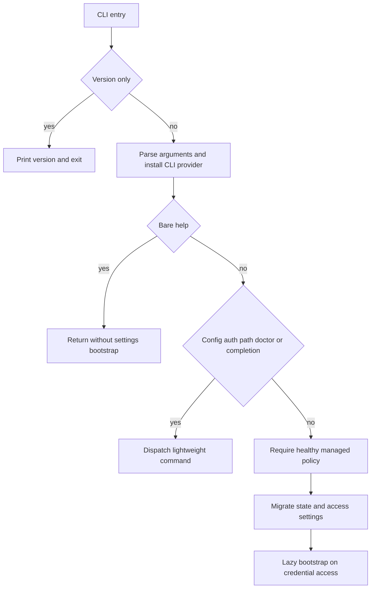
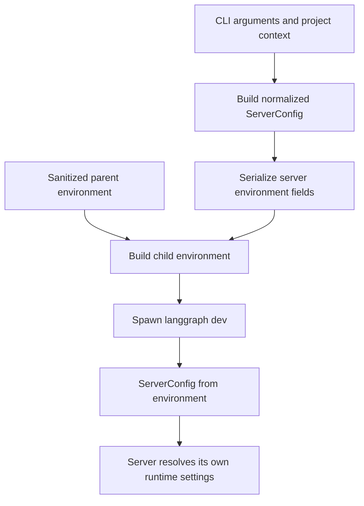

# dcode Configuration Layering

`dcode` configuration is a process-level policy and invocation system, not runtime graph state. It has two related jobs: resolve durable and launch-time choices consistently inside a process, and explicitly hand the subset needed for an invocation to the separately spawned LangGraph server. The graph, thread state, and resolver cache are not serialized as configuration.

For model-selection detail, see [Profiles and models](/openwiki/concepts/profiles-models.md). For an end-to-end invocation, see [Run a dcode session](/openwiki/workflows/run-dcode-session.md).

## Configuration surface and precedence

`config_manifest.py` is the catalog for user-tunable scalar options: it defines the option key, type/coercion, default, environment-variable and TOML locations, optional CLI binding, and sensitivity metadata. Structured tables remain owned by their dedicated typed loaders; the manifest lists them for discovery but does not flatten them. Credential-bearing structured tables are marked redacted, allowing `dcode config` to report their source and presence without printing their contents.

The shared `ConfigResolver` resolves a snapshot through ordered providers. Lower rank wins:

1. managed TOML policy;
2. parsed session CLI flags;
3. retained runtime reload values where applicable;
4. process environment;
5. user `~/.deepagents/config.toml`;
6. the typed manifest default.

An invalid value does not make the whole configuration unusable: malformed numeric, list, duration, or ISO values, unrecognized booleans, and wrong-typed TOML values are diagnosed and resolution falls through to the next layer. This means an administrator can impose managed policy above a CLI flag; when the manifest detects that a supplied flag was masked, it reports the winning source. Options that accumulate restrictions use their declared merge strategy rather than ordinary replacement.

The resolver is process-cached around a consistent user and managed snapshot. The CLI provider is installed after parsing but before normal resolution; it is deliberately light and can be retained until the first real resolver construction. A different CLI provider for the same process is rejected, preventing one argv from silently replacing another's session tier. A configuration reload advances the shared generation; a hand edit does not affect later consumers until that reload occurs.

`dcode config` uses the same manifest and resolver model as runtime reads, so `config` and `config get` can show options, values, sources, and set-via locations without maintaining a parallel configuration schema. `dcode config path` additionally discovers the managed file, user config, nearest project `.env`, global `.env`, and related state paths.

## Discovery and dotenv trust boundary

Bootstrap finds the nearest project `.env` by walking upward from the relevant start directory, then layers the profile-global `.env`. Existing process environment values win over both files, and the trusted global file only fills gaps left by the project file. Project dotenv values are not an unrestricted configuration channel: dcode blocks all dotenv keys that could trigger unsafe startup behavior and blocks additional user-level trust decisions from a project `.env`. These include project-MCP allow/deny lists, Auto reviewer model and timeout, extension trust, shell allow-list, extra skill directories, profile-adjacent locations, and the upstream recursion default. Those values can still come from the shell or the user's global dotenv/configuration surfaces.

The prefixed environment namespace is centrally registered in `_env_vars.py`. Callers using `resolve_env_var` receive a deliberate credential convention: `DEEPAGENTS_CODE_{NAME}` overrides `{NAME}`. Direct environment reads do not get that behavior, so new variables should use a manifest/provider or an intentional direct-read contract rather than assuming all environment reads have identical precedence. Boolean parsing similarly distinguishes recognized true/false tokens from unrecognized values, which normally fall through to the next source.

## Startup paths and lazy bootstrap

`cli_main()` first handles the version-only fast path, parses argv, and installs the CLI provider. Bare command-group help returns before settings resolution. `config`, `auth path`, `doctor`, and completion are dispatched before the managed-policy health gate so operators can inspect or diagnose a broken managed file; remaining non-help paths require enforceable managed policy and exit with status 78 if it cannot be enforced. State migration and credential/settings access occur only after these fast paths.

This shows why parsing a CLI option is not itself a settings bootstrap or runtime initialization.

Bootstrap is process-local, lock-protected, and one-shot. It snapshots tracing selectors before dotenv changes, establishes the project context, loads dotenv values, refreshes debug logging, records the original LangSmith project, and applies stored tracing/auth settings. Any exception is retained and logged, but the completion flag is set in `finally`; an incomplete bootstrap proceeds with the current environment rather than retrying partial work indefinitely. The server is another Python process and consequently has independent bootstrap and resolver state.

Focused subprocess tests protect this performance boundary: help-only commands must not import heavy agent, model, LangChain/LangGraph, Textual, or HTTP modules, and must not complete settings bootstrap. Tests also distinguish lightweight diagnostics from credential-resolving auth commands, which do need dotenv-loaded settings.

## Model and profile layers

Model construction canonicalizes an explicit or inferred `provider:model` specification, then checks `models.allowed` before credential bridging, provider profile hooks, or provider imports. A prohibited model therefore cannot copy stored credentials into environment variables or cause provider initialization side effects. After construction, bundled fallback metadata can apply, then configured provider/model profile overrides, then explicit `--profile-override` values. The explicit CLI layer wins over configured profile metadata. Failure to assign a configured override only warns; failure to assign an explicit CLI override is fatal. The resulting profile supplies metadata such as context limit and modality support.

This order is intentionally distinct from the scalar manifest ranking: profiles are model metadata merged during construction, while manifest options are independently resolved settings. Do not treat a model profile mutation as a global resolver update.

## Typed client-to-server handoff

`ServerConfig` is the explicit transport contract between the client and the server interpreter. The client creates it from parsed launch choices and project context, normalizing launch-relative paths such as MCP configuration paths into absolute values. It serializes fields as `DEEPAGENTS_CODE_SERVER_*` variables; JSON is used for structured values and `None` clears a variable rather than becoming an ambiguous empty string. The server calls `ServerConfig.from_env()` to reconstruct and validate that invocation payload.

The client transfers deliberate invocation intent, not its resolver cache, graph state, or mutable session state. New fields must be handled as a versioned boundary: give them a typed default, validation, serialization and parsing behavior, and decide whether they should instead remain server-resolved policy.

## Child-environment boundary

The child environment derives from the parent but is constrained before spawning `langgraph dev`. dcode removes values loaded from dotenv and startup-hijack variables such as loader, Python startup, and import-path controls, plus LangGraph control-plane credentials. It pins the active profile and internal carriers against both persistent and scoped override maps, so an override cannot select another profile, forge the user tracing carrier, or inject an interpreter `PYTHONPATH`.

A launch `PYTHONPATH` is captured in an owned internal carrier before it is removed from the server interpreter environment. It is later reapplied only for approval-gated agent `execute` commands. User LangSmith selectors are likewise encoded from bootstrap snapshots rather than accepted from an inherited carrier. These controls preserve user launch intent where it is needed without allowing untrusted import-time execution or caller-forged internal state.

## Safe change and operations checklist

When adding a setting:

- Put scalar cross-surface settings in the manifest with typed coercion, default, sources, and redaction/merge behavior. Keep structured tables in their dedicated loader.
- State the precedence and invalid-value fallthrough. If the option is a security grant or changes startup/import behavior, decide explicitly whether project dotenv must be denied.
- Bind a CLI flag through the installed CLI provider only when it is truly session-scoped; managed policy may intentionally override it.
- For a server-needed launch choice, add a validated `ServerConfig` field and round-trip test. Do not use an ad-hoc inherited environment variable to transfer client state.
- Preserve help and diagnostics fast paths by avoiding heavy imports or settings bootstrap before their dispatch.
- Test the material invariant: precedence/masking and invalid fallthrough for manifest values, bootstrap/fast-path behavior, model-policy ordering before credentials, and child-environment stripping and pinning for sensitive values.
