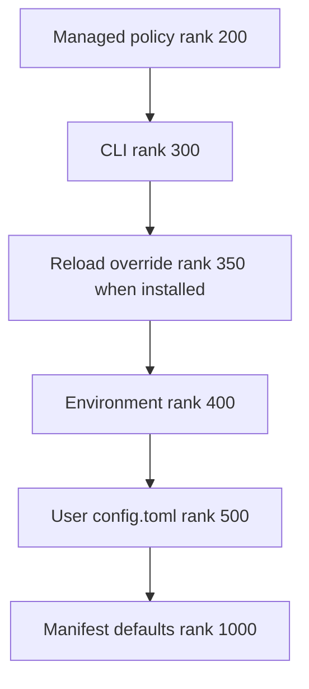
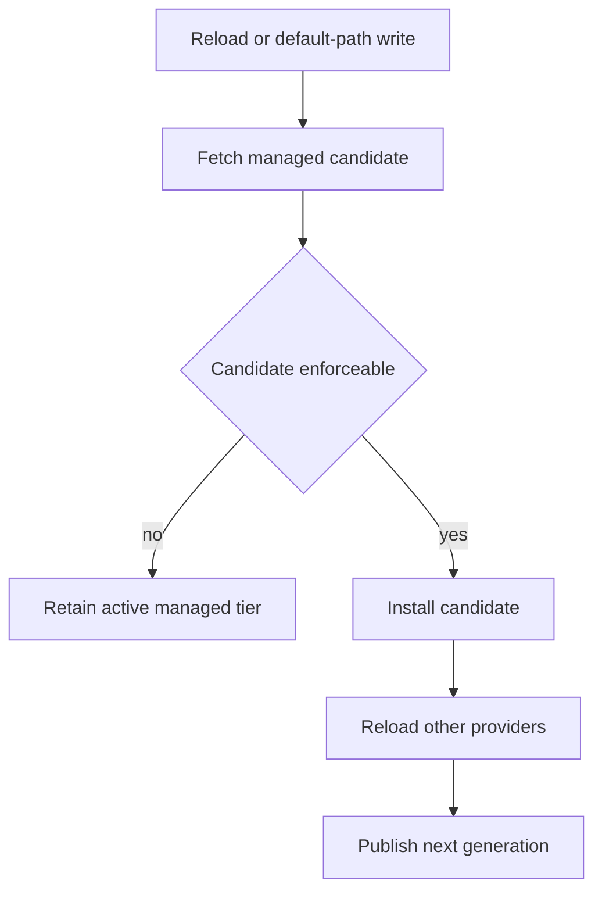
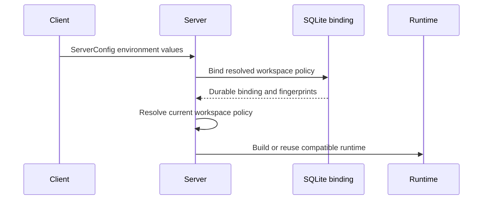

# dcode Configuration Layering

`dcode` resolves configuration through a typed, ranked provider chain rather than treating one file as the entire configuration surface. This preserves useful session, shell, and user settings while ensuring that organization-managed policy has the strongest authority. The same design makes both the winning value and its contributing source tiers inspectable.

For the client/server boundary, see [Code agent](/openwiki/architecture/code-agent.md). Related concerns include [profiles and models](/openwiki/concepts/profiles-models.md), [MCP](/openwiki/integrations/mcp.md), [sandbox partners](/openwiki/integrations/sandbox-partners.md), and [running a dcode session](/openwiki/workflows/run-dcode-session.md).

## Configuration surface and providers

`config_manifest.py` is the canonical description of scalar settings. A `ConfigOption` identifies its key, type/coercion kind, typed default, TOML path, environment variables, optional CLI binding, merge strategy, and whether display must redact its raw value. It rejects incoherent declarations at construction time—for example, a mutable or wrong-typed default, a scalar option using an accumulating merge strategy, or an invalid CLI specification.

The manifest deliberately does **not** flatten user-defined structured tables into scalar environment variables. Those tables are marked `STRUCTURED` for discovery and read by dedicated typed loaders. Credential-capable structured tables, including provider authentication/parameters and asynchronous-subagent headers, are presence-only in `dcode config` output.

Each provider normalizes its own input into `Found`, `Unset`, or `Invalid` before the resolver considers precedence. Environment and TOML coercion rejects wrong types and invalid tokens rather than throwing away the rest of the source: an invalid setting falls through to a weaker valid tier, while valid sibling settings remain usable. `ResolvedValue` carries the resulting value, selected ranks, provider health, diagnostics, masked ranks, and rank/path provenance.

## Precedence, durable policy, and composition

Lower numeric rank is stronger. The standard chain has a managed TOML tier, an optional parsed-CLI tier, live environment values, user `config.toml`, and typed defaults. A caller may also install a retained reload override tier.

The standard configuration tier order. The reload tier is caller-installed rather than universal.

For ordinary `replace` options, the strongest usable `Found` value wins. A durable result at a stronger rank masks weaker non-durable values, preventing an environment value from bypassing a managed or durable policy result; the masking is directional, so a weaker user-file result cannot hide a stronger environment value.

`union` and `deep_merge` mean a setting is intentionally cumulative. They retain every valid tier contribution rather than selecting a winner: unions preserve ordered, deduplicated list entries, and deep merges apply stronger leaves over weaker tables while retaining leaf-level provenance. Defaults are excluded from those accumulated contributions and used only as a fallback. This matters for restrictions such as MCP deny lists, where allowing a user replacement to erase an administrator denial would be fail-open. If an accumulating tier has an incompatible shape, resolution falls back to a copied strongest value rather than allowing a weaker value to displace policy.

`resolver_from_snapshots()` takes keyword-only `managed=` and `user=` snapshots. Since both arguments have the same type, this blocks an accidental positional swap that would grant a writable user configuration managed precedence. `ConfigResolver` also rejects duplicate ranks.

## Managed policy boundary

Managed configuration comes from an operating-system-controlled fixed path: `/etc/dcode/managed_config.toml` on Linux-like platforms, `/Library/Application Support/dcode/managed_config.toml` on macOS, and `ProgramData/dcode/managed_config.toml` on Windows. Production Windows lookup uses the HKLM registry value for ProgramData rather than a user-controlled process environment variable. If that registry lookup fails, the fallback path is explicitly marked indeterminate rather than reported as confidently absent policy.

Managed policy is durable and must remain enforceable throughout reload. A provider that has previously loaded a usable TOML snapshot keeps serving it when a later candidate is unreadable or malformed; an initial unreadable source instead contributes no values and lets resolution continue. A managed refresh is fetched and policy-validated before installation. An unusable or unenforceable candidate cannot replace the active managed tier, so a broken refresh does not silently discard restrictions and reveal weaker values.

## Generations, reloads, and writes

The shared resolver caches one generation for normal process reads. Files are not watched: an on-disk edit is not visible until a reload, resolver invalidation, or a committed write to the default user configuration path advances the generation. The environment provider is deliberately different: it reads the active environment at resolution time.

A managed refresh is obtained before resolver replacement so a failed refresh cannot remove an enforced policy.

`get_config_resolver()` owns the process cache and prevents a second, different CLI provider from being installed in the same process. A resolver constructed directly from snapshots includes no CLI tier unless the caller supplies one. Reloading resets deduplicated source diagnostics, so a source that remains bad is reported again during the next repair attempt.

`update_user_config()` is the supported transaction for user `config.toml`: it serializes read-modify-write operations, rejects the managed path and malformed existing TOML, writes a replacement beside the destination, and atomically replaces the destination. Once the bytes are committed, it best-effort refreshes the shared resolver for the default path. A refresh error leaves the completed write intact, with stale in-process state reported separately rather than misrepresenting the write as failed.

## Environment and dotenv trust boundary

For prefix-aware credentials and provider settings, `DEEPAGENTS_CODE_{NAME}` takes precedence over `{NAME}` by *presence*, including an empty prefixed variable. An explicit empty override can therefore suppress a canonical credential or setting.

Workspace construction derives an explicit dotenv environment rather than mutating the process environment as part of every read. The inherited shell environment wins; the nearest project `.env` fills absent keys, followed by the trusted global profile dotenv for keys still absent. Dotenv interpolation uses the original baseline, so project values cannot steer interpolation in the global file. `use_environment()` exposes such a mapping as an immutable, context-local snapshot during construction; outside that scope reads use live `os.environ`.

A project `.env` is untrusted checkout content. It cannot set project-MCP trust lists, Auto classifier model or timeout, MCP tool timeout, forked-subagent behavior, the upstream recursion fallback, or `TERM_PROGRAM`. The trusted global dotenv controls whether the project file may be read; if the global file cannot be read, dcode fails closed by skipping the project dotenv unless another trusted source explicitly opts in. These controls prevent a clone from selecting its own authorization boundary or exporting launch metadata through tracing.

Each server runtime is built from a frozen workspace dotenv and credentials snapshot, so later process-environment changes do not change an existing runtime. LangSmith selectors and the redaction setting must agree across workspaces on a server because the SDK uses process-wide state. If an active upload target requests secret redaction but dcode cannot install the redacting client, it disables tracing instead of uploading unredacted data.

## MCP configuration is policy-aware

MCP configuration interpolates only `${VAR}` and `${VAR:-default}` in `command`, `url`, `args`, `env`, `headers`, and `oauth`. The default form is used when the variable is absent or empty. Unsupported fields are copied unchanged. Malformed references, an unset required variable, or an invalid supported-field shape are rejected before the resolved configuration is used.

Disabled MCP servers are cumulative: user and managed names are unioned, then filtered before validation, connection, or tool exposure. If the managed deny list cannot be read or validated, dcode fails closed by disabling every candidate server rather than interpreting a broken restriction as an empty list.

## Client/server handoff and workspace continuity

The interactive client and agent server are separate processes and do not share a resolver cache. `ServerConfig` is their typed handoff: the client serializes fields to `DEEPAGENTS_CODE_SERVER_*` environment variables, `None` clears a variable, and the server reconstructs and validates the schema. In particular, malformed or unsafe filesystem-tool allowlists are rejected rather than interpreted as unrestricted filesystem access.

The handoff, durable binding, and request-time validation are distinct safeguards.

A binding canonicalizes an existing workspace directory and records server-resolved, non-secret policy plus separate policy and runtime fingerprints in SQLite. It atomically refuses a different workspace or incompatible policy. A compatible runtime-only identity change rebuilds the runtime without deleting the binding or checkpoints.

Project-scoped MCP, sandbox setup, extension paths, and extension trust apply only to the launch project. Resolving another or unresolvable project removes project MCP and sandbox grants and re-evaluates extension trust. On execution, policy drift or revoked extension trust refuses the request; runtime-only identity drift is a rebuild condition.

## Diagnostics and safe change practice

Bindings retain a bounded allowlisted snapshot for refusal diagnostics. Only reportable policy scalars and lists are persisted. Paths, credentials, environment values, model data, and prompts are excluded from both persistence and logs; diagnostics either identify safe changed values or state that the old value is unavailable.

When adding or changing configuration, define scalar options in the manifest or provide a dedicated structured loader; choose whether the setting replaces, unions, or deep-merges; preserve invalid-value fallback; and do not let project dotenv define authorization-sensitive controls. Server-facing changes must be classified as durable policy identity or rebuildable runtime identity.

Focused tests cover rank ordering, durable masking, union/deep-merge provenance, malformed-value fallback, source retention after failed reload, managed-refresh safety, default-path writes, dotenv precedence and trust boundaries, workspace snapshot isolation, server handoff validation, and policy/runtime drift. These boundaries—not parsing alone—are the behavior that makes layered configuration safe to evolve.
