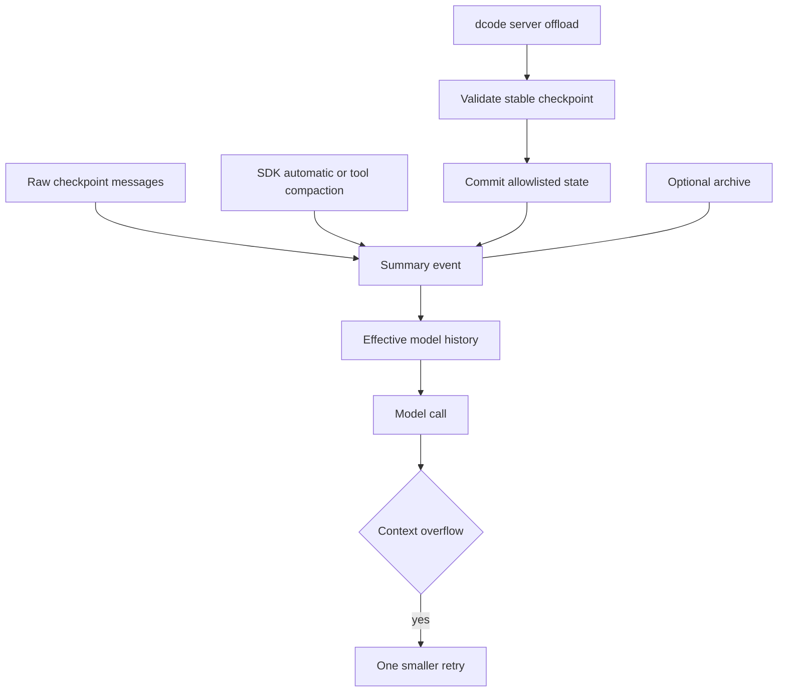
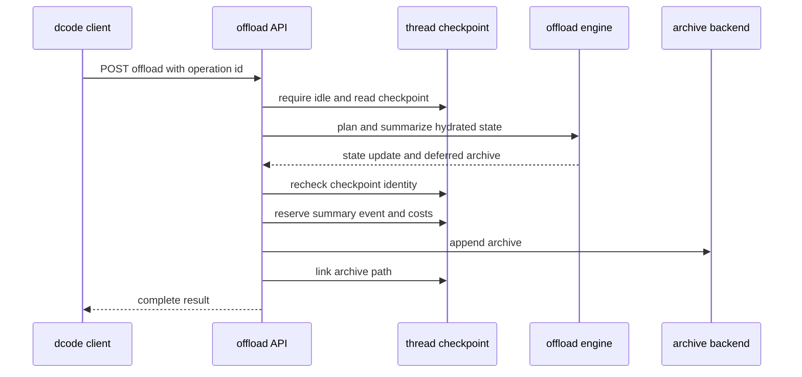

# Context Management and Offload

Context reduction is not one destructive operation. Deep Agents SDK compaction changes the **model-visible view** of a conversation; dcode server-owned offload adds a guarded checkpoint commit; archives are a separate recovery-retention layer; and managed-memory protection preserves machine-owned text in memory files. These boundaries matter when operating or extending a long-running session.

- **SDK compaction** automatically summarizes according to its triggers and request budget, or is invoked by the model through `compact_conversation`.
- **dcode `/offload`** is a server operation against a stable thread checkpoint. `/compact` is a UI alias, not a client-side state mutation.
- **Archives** may preserve compacted history, but a successful summary can intentionally have no archive path.
- **Managed memory** is not conversation history: it protects a marker-delimited onboarding block in configured memory files.

See [Middleware Stack](/openwiki/architecture/middleware-stack.md) for placement, [State, Checkpoints, and Sessions](/openwiki/concepts/state-persistence.md) for checkpoint ownership, [Tools and Filesystem](/openwiki/concepts/tools-filesystem.md) for filesystem tool behavior, and [Cost and Sessions](/openwiki/operations/cost-and-sessions.md) for summary-cost accounting.

*SDK compaction changes the effective history; server offload additionally protects the checkpoint commit boundary and may link an archive afterward.*

## SDK compaction: raw retention and effective history

`SummarizationMiddleware` retains raw `messages` in state. A `SummarizationEvent` records the raw cutoff, generated summary, optional archive path, and creation index; it reconstructs the next model input as the summary followed by the retained raw suffix. Thus an event is an interpretation layer over checkpoint history, rather than replacement of that history.

Chained events translate a new effective-history cutoff back to raw-state coordinates and retain a session ID so successive operations can address the same archive. For messages that predate an event, `created_at_index` identifies retained provider-bound reasoning that must be omitted from effective history after summarization, while raw state remains unchanged.

Automatic compaction partitions older history, attempts archival, and creates the summary event. Archive failure is nonfatal in this path: a useful in-context summary may commit with `file_path=None`, which means the removed portion is not recoverable through that archive. Context-overflow recovery is bounded: it retries at most once with a strictly smaller, locally budget-valid request, otherwise raises terminal `ContextOverflowError`.

## Manual SDK compaction

`SummarizationToolMiddleware` exposes `compact_conversation` for model-initiated compaction and shares the summary-event and session-ID state used by automatic compaction. It does not run itself in the background. Its admission gate opens only when at least one trigger clause is roughly half way to its configured automatic threshold; an ineligible request or zero cutoff returns a correlated “nothing to compact” tool result.

A `None` archive path is still successful, non-recoverable compaction. In contrast, an exception while generating the summary or archive returns a correlated error `ToolMessage` and does not write summary-event state. This distinction avoids treating failed state construction as successful compaction.

## dcode server-owned offload

`CLICompactionMiddleware` keeps the SDK tool behavior while adding hook-aware automatic compaction and a state-only planning entry point for forced dcode offload. A `PreCompact` hook can veto automatic compaction, including overflow recovery; asynchronous automatic and model-initiated paths serialize archive append cycles by session ID.

The HTTP `/offload` boundary owns the concurrency protocol. It locks the thread, permits only idle or errored threads without pending graph work, hydrates the checkpoint, runs summarization, then rechecks checkpoint identity before committing. A checkpoint that advanced during summarization produces a conflict and no commit. The endpoint trusts model settings recorded in the checkpoint rather than request-supplied model settings, preventing a transport client from substituting a summary model.

Only `OffloadStateUpdate` channels may cross this boundary: the summary event, summary session ID, and cost channels. In particular, an offload never writes `messages`; the runtime allowlist rejects any other channel as well. This prevents an operation that commits against the latest checkpoint from clobbering messages attributed to a concurrent graph run. Cost records drained for the operation are committed when a write might have landed, but rolled back when the unchanged checkpoint proves it did not.

*The server reserves compacted state before the deferred archive append, then links the archive only after it is written.*

A forced plan rejects a degenerate chained compaction that cannot advance the raw cutoff, avoiding a paid summary-of-a-summary that would not offload history. Its staged archive append saves the previous content. If the archive append cannot be completed, it is rolled back; if the later checkpoint link is confirmed absent, that completed append is also rolled back. A summary event without an archive path can still be committed and reported as such. Commit settlement defers request cancellation until the in-progress write reaches a terminal state.

### Handoff is different from compaction

The handoff route summarizes a source thread for a new thread but does **not** compact source context: the source receives only summary cost channels. Its recovery transcript is written under a source-owned archive name, so cleanup can remove it with the source thread even if child creation fails. Do not interpret a handoff summary as proof that the source checkpoint has been compacted.

## Archive persistence and lifecycle

Local conversation archives normally live in the hardened `conversation_history` directory beneath `DEEPAGENTS_HOME` (by default `~/.deepagents`). The archive subdirectory, rather than the shared configuration root, is restricted to the current user and probed for writability. If persistent storage is unavailable, dcode uses hardened temporary storage and marks it ephemeral; it may not survive restart. Server and sandbox archives belong to their backend rather than this local directory.

`history.retention_days` is resolved through normal configuration precedence; `0` disables sweeping. Cleanup considers only expired regular `.md` children immediately in the archive directory, rechecks mtime on an open descriptor before unlinking, and swallows cleanup failures. Thread deletion is best effort: it deletes that thread's local archive and source-owned handoff snapshots, while rejecting an empty or path-escaping thread ID.

## Idle cache maintenance is not a compaction trigger

`history.idle_compaction_tokens` defaults to `0` (disabled). A positive setting enables a dcode UI optimization, not SDK automatic compaction. The UI schedules at most one server offload per thread and prompt-cache expiry window, only in the final 20% of a known cache window and no more than 120 seconds before expiry.

It requires exact context usage at or above the threshold, a remote agent, and a quiescent UI. Active work, queued input, typing, modals, reconciliation, connection work, thread switching, and other competing activity prevent scheduling. This separates the cost trade-off of preserving a warm prompt cache from context-limit safety.

## Protected machine-managed memory

Onboarding writes a normalized preferred name into the user agent `AGENTS.md` as a block delimited by `deepagents:onboarding-name` HTML-comment markers. Memory injection strips those comments, so the model cannot reliably infer that this region is machine-owned. `ManagedMemoryGuardMiddleware` therefore intercepts `write_file`, `edit_file`, and `delete` for configured, resolved memory paths.

For a write or edit that changes the block, the guard restores the exact prior block and preserves unrelated edits where it can. If the block was removed or partially malformed, it removes lines derived from the old block before re-inserting a valid one; formatting around the region can be normalized. It returns an error even after successful restoration, and also returns an error if restoration fails, so the model never treats a managed-block mutation as successful. Reads and restoration writes use no-follow filesystem operations to resist symlink substitution.

Deletion is checked before the tool executes. Deleting the guarded file or a parent directory is rejected when the file contains the managed block. A missing guarded file may be deleted, and a readable file without the block may be deleted; however, an existing unreadable file is rejected **fail closed** because the guard cannot safely conclude that it has no protected block.

## Operations and focused verification

1. Treat raw checkpoint messages, summary events, and archive files as distinct persistence layers. Never replace `messages` merely because effective history is shorter.
2. Preserve the meaning of `file_path=None`: it can indicate successful in-context compaction without durable recovery, not necessarily a failed summary.
3. Do not widen the server offload state allowlist to include `messages` without redesigning the checkpoint concurrency protocol.
4. Configure `history.retention_days` for archive sensitivity and lifetime. Treat temporary fallback storage as nonpersistent.
5. Enable idle compaction only when its summarization cost is justified by prompt-cache retention; it is independent of SDK thresholds.
6. Keep onboarding marker generation and guard configuration aligned. A guard with no resolvable configured paths logs an error because protection would otherwise silently disappear.

Focused tests in `test_memory_guard.py` cover restoration, preservation of unrelated edits, marker damage, symlink resistance, parent-directory deletion, and unreadable-file fail-closed behavior. `test_offload_api.py` covers state allowlisting, checkpoint-change conflicts, deferred archive rollback/linking, cancellation settlement, cost handling, and checkpoint-owned model configuration. `test_idle_compaction.py` covers the final-window boundary, exact-token threshold, UI blockers, single reservation, and cancellation release.
