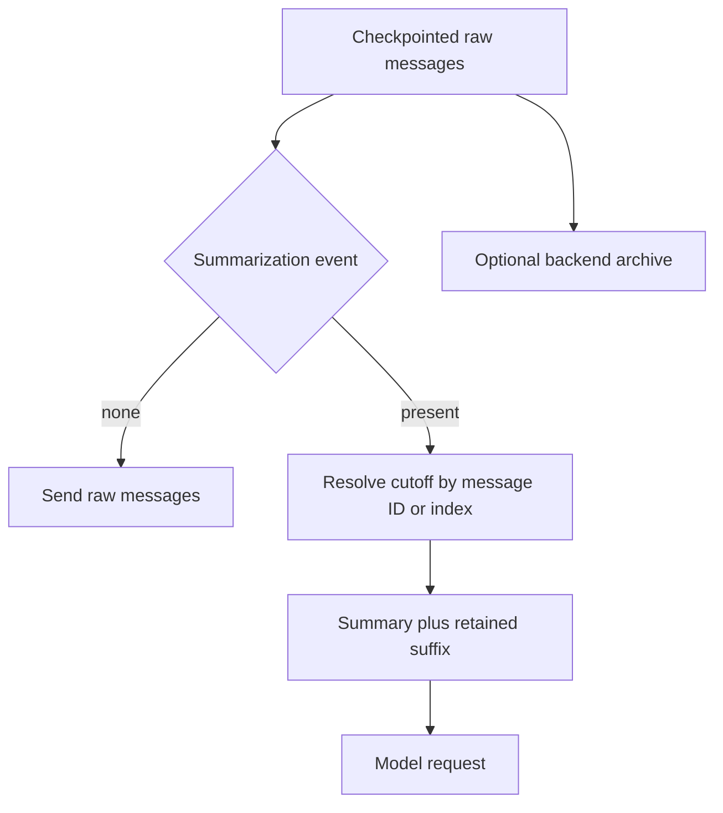
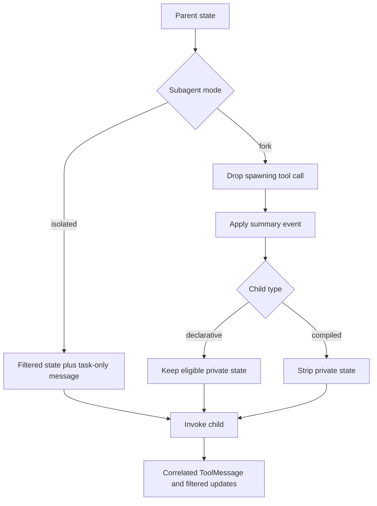

# Context Management

Deep Agents distinguishes **stored state** from the context sent to a model. `messages` remains the raw conversation state; `SummarizationMiddleware` records a private `_summarization_event` that reconstructs a shorter effective history for a request. Delegation has a second boundary: ordinary subagents are isolated, while experimental forks receive a carefully projected continuation of the parent's effective context.

See [State and Persistence](/openwiki/concepts/state-persistence.md) for checkpoint ownership, [Subagents and Skills](/openwiki/concepts/subagents-skills.md) for the wider delegation model, and [SDK Construction and Execution](/openwiki/architecture/sdk-construction-execution.md) for stack assembly.

## Compaction is a request-time view

A `SummarizationEvent` contains a state cutoff, an optional ID for the message at that cutoff, a synthetic summary `HumanMessage`, an optional archive path, and the message count at which it was created. Before a model call, the middleware replaces the evicted prefix with that summary and retains the suffix. It prefers `cutoff_message_id` when that message is still present, so an earlier state edit does not silently shift the boundary. If the event is malformed, the middleware logs it and uses the unmodified messages; if its cutoff is beyond the state list, only the summary remains visible.

When a retained message predates the event's creation boundary, provider-bound reasoning blocks are removed from that message before reuse. This avoids replaying reasoning that is tied to the earlier conversation. Chained compaction translates a cutoff chosen in effective-history coordinates back to raw state coordinates, accounting for the synthetic summary entry.

*The event changes the model-visible view; it does not itself remove the raw message history.*

## Automatic compaction, recovery, and archives

`SummarizationMiddleware` counts the effective messages together with the system message and tools. It can first shorten oversized `write_file` and `edit_file` arguments in older AI tool calls, leaving the configured recent window unchanged. Compaction then follows configured token, message, or context-fraction triggers and retention settings. `create_summarization_middleware()` derives defaults from a model profile: it uses fraction-based thresholds when `max_input_tokens` is available and conservative fixed defaults otherwise.

For a compaction, the middleware partitions old and retained messages, converts inline `data:` media to deduplicated backend files where possible, offloads the old portion, generates a summary, and returns the model response with state updates for the event and a per-invocation session ID. The session ID is retained on subsequent turns, so archive sections append to one `/conversation_history/{session_id}.md` file. Existing synthetic summary messages are not re-archived. Archive failure is non-fatal: the summary still takes effect, but its `file_path` is `None` and the old content is not recoverable from the backend. Failed media likewise becomes an explicit placeholder rather than being silently omitted.

The middleware reserves output-token budget and 5% input headroom when model profile information is available. A recognized provider context overflow triggers compaction/reduction and at most one strictly smaller retry. It rejects an unchanged rejected request or one that still exceeds the local budget with `ContextOverflowError`, rather than repeatedly calling the provider.

`SummarizationToolMiddleware` exposes the same mechanism as `compact_conversation`; its factory constructs the engine but registers only the tool layer. To have threshold-based automatic compaction as well, register `SummarizationMiddleware` too (as `create_deep_agent()` normally does). The tool refuses to compact too early, at roughly half the automatic trigger threshold.

## Delegation: isolate by default, fork deliberately

The synchronous `task` tool accepts a declarative `SubAgent` or a caller-owned `CompiledSubAgent`. In the default `isolated` mode, the child receives a filtered state projection but its `messages` are replaced with one `HumanMessage`: the delegated description. This is the safe default when the task description can carry the needed context.

`mode="fork"` is beta and changes the input contract, not the fact that `task` blocks for a local child. Fork preparation drops the parent AI message that contains the currently in-flight tool calls, applies the summary event to create the parent's effective history, and appends a human task message. That message has a preamble explaining that delegation already occurred, optional fork-specific instructions, and the task description. A marker on the child's initial state keeps the real `task` tool available for a matching tool surface, but makes recursive `task`/`atask` calls return a refusal.

*Forking continues the parent's effective conversation, whereas isolation starts the child from the delegated task.*

A fork is not unrestricted shared state. It always excludes the parent's summary event and session ID (because the event has already been folded into messages), structured response, pinned skills, rubric, and disclosed-skill-tool state. A declarative child can retain other private channels so mirrored middleware rebuilds request-derived state. A compiled runnable is opaque to the SDK, so its fork receives only allowed non-private keys. On return, the boundary filters excluded and private keys as well as values unchanged from child input; the result message carries the task call ID and may include the child checkpoint namespace as a non-model-visible artifact.

## Fork prompt and middleware invariants

A declarative fork mirrors the parent's prompt-producing custom middleware. `create_deep_agent()` sets the child graph's `system_prompt` to the already assembled parent prompt, then puts the spec's own `system_prompt` into the task message. This keeps the system prefix—and, when the effective history and tools also match, its provider prompt cache—reusable. The fork's custom middleware combines inherited parent middleware and spec middleware by `.name`; a spec entry with the same name replaces the parent entry in place.

Forks cannot set the declarative `skills` field, because that would make their skill sources diverge. A caller can nevertheless provide a `SkillsMiddleware` in the spec middleware and replace the inherited skills slot. Similarly, middleware that rewrites the inherited system prompt or changes tools can break request-prefix identity and give up cache reuse. Treat that as an intentional performance and cost tradeoff, not transparent inheritance.

## Safe configuration and focused tests

- Use `isolated` unless the child genuinely needs the parent conversation. Forks are experimental, cannot declare `skills`, and must not be used to form recursive task trees.
- Treat `_summarization_event` and `_summarization_session_id` as middleware-private state. Do not copy them into a child or mutate raw history merely to reproduce a compacted view.
- A successful summary with `file_path=None` is still a compaction; it is not an archived recovery point. Monitor backend warnings if recovery history matters.
- Keep a fork's prompt-producing middleware and tools aligned with its parent if prompt-cache reuse is operationally important.

`test_fork_payload.py` serializes real Anthropic and OpenAI fork requests and verifies system/tool-prefix identity, task-delivered instructions, and history shape. `test_subagent_middleware_init.py` covers fork prompt placement, dangling spawning-call removal, cache-sensitive tool ordering, skills rejection, and nested-delegation refusal. `test_compact_tool.py` exercises event application and the `compact_conversation` tool; `test_summarization_middleware.py` covers cutoff handling and effective-history behavior.
