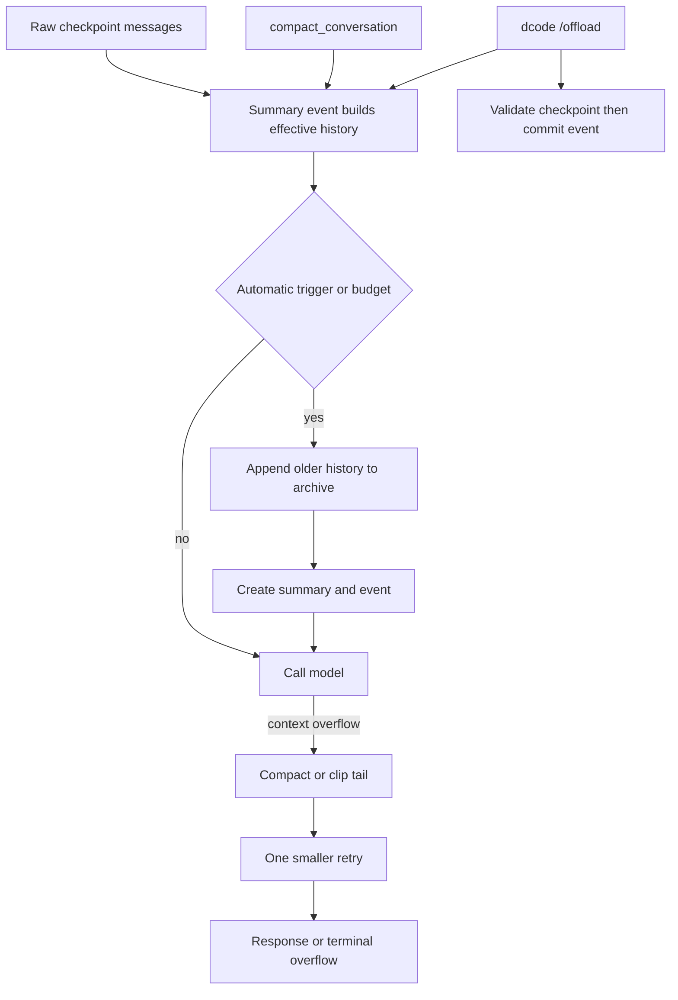

# Context Management and Offload

Context management is a **view and retention** problem, not simply message deletion. The SDK's `SummarizationMiddleware` preserves the raw `messages` state and stores a compacting event that determines what the next model call sees. Deep Agents Code (`dcode`) builds on that mechanism with an explicit, server-owned `/offload` operation, durable archives where possible, and guards for machine-managed memory.

This page distinguishes three decisions that are easy to conflate:

- **Automatic SDK compaction** runs when its configured trigger or request budget requires it.
- **Manual `compact_conversation`** is a model tool and an eligibility gate; it may run before the automatic threshold, but it does not schedule itself.
- **dcode `/offload`** is an explicit client request executed by the server against a stable checkpoint. Separately, opt-in idle compaction may invoke that operation shortly before a warm prompt cache expires.

See [State, Checkpoints, and Sessions](/openwiki/concepts/state-persistence.md) for checkpoint ownership, [Middleware Stack](/openwiki/architecture/middleware-stack.md) for ordering, and [Run a dcode Session](/openwiki/workflows/run-dcode-session.md) for operator workflow.

*Compaction changes the model-visible effective history through an event; dcode offload additionally protects the checkpoint commit boundary.*

## SDK compaction: raw state and effective history

A `SummarizationEvent` records a raw-state `cutoff_index`, a generated summary message, an optional archive path, and (for new events) `created_at_index`. Before a model call, the middleware applies that event as **summary + raw suffix beginning at the cutoff**. This leaves raw checkpoint messages available for persistence and later transformations. A malformed event falls back to raw messages; a cutoff beyond the message list yields the summary alone.

Chained compaction must translate the new cutoff from effective-history coordinates back to raw-state coordinates: the earlier event cutoff plus the new effective cutoff minus the synthetic summary position. The session ID is also retained in state, allowing later compactions to append to the same archive.

`created_at_index` addresses a provider protocol concern after a summary replaces earlier conversation. In retained messages that existed when the event was created, the middleware removes provider-bound reasoning content before presenting the effective history. Raw state remains unchanged, and later reasoning remains visible.

### Automatic flow, archive behavior, and overflow recovery

For an automatic run, the middleware derives effective history, optionally truncates old `write_file`/`edit_file` tool arguments, evaluates the compaction trigger and budget, then partitions older messages from the retained suffix. It attempts to archive the older portion before generating the summary. An archive write failure is nonfatal to automatic compaction: the event is still written with `file_path=None`, so the summary must not claim the history is recoverable.

A recognized context overflow can enter the same recovery path. The middleware reserves output tokens and headroom from a model input limit when available. It may clip the trailing tool-result tail and retry only once; the reduced request must actually be smaller and locally within budget. An unrelated provider error is propagated, and a second recognized overflow becomes terminal `ContextOverflowError` rather than an unbounded retry loop.

## Manual SDK compaction

`SummarizationToolMiddleware` registers `compact_conversation` and delegates to a configured `SummarizationMiddleware`. It deliberately never performs background compaction: it only supplies a normal tool call and, optionally, a system-prompt nudge to help the model discover that tool. Automatic and manual paths share `_summarization_event` and session-ID state, so either path can follow the other.

The tool has a lower **admission threshold**, not a second automatic threshold. At least one configured trigger clause must reach approximately half the automatic threshold; token and fraction clauses use reported usage metadata, and every threshold inside a dictionary clause must be satisfied. If it is ineligible, or if the calculated cutoff is zero, the tool returns a correlated “nothing to compact” `ToolMessage`.

Once admitted, the tool generates the summary and attempts the archive, then constructs its state update. A `None` archive path is a successful non-recoverable compaction. By contrast, an exception from summary generation or archiving returns a correlated error `ToolMessage` with no summary-event or session-ID update. This makes the checkpoint-side operation atomic even though successful no-archive compaction is allowed.

## dcode server-owned offload

In dcode, `/offload` (with `/compact` as a UI alias) is not a client-side mutation of conversation state. The HTTP service locks the thread, rejects active or pending graph work, reads and hydrates the checkpoint, runs the server-bound offload operation, and rechecks the checkpoint identity before committing. If another run advanced the thread while summary generation was underway, dcode discards the completed work and commits no state.

The commit boundary is deliberately narrow: a server-owned offload may write the summary event, summary session ID, and cost channels, but never `messages`. This avoids an offload request clobbering message updates that belong to a concurrent graph run. Cancellation is deferred until a commit in progress settles, so the result is not left ambiguous merely because the HTTP request was cancelled.

Forced offload plans the summary first and stages a reversible archive append. The append captures the prior archive content so it can be rolled back if the archive write does not settle. dcode also avoids paying for a degenerate chained compaction that cannot advance its raw cutoff. Like SDK automatic compaction, an archive failure can still produce a useful summary event with no archive path; the returned status reports that distinction.

`CLICompactionMiddleware` retains the SDK's model-initiated `compact_conversation` behavior while adding dcode's hook-aware automatic and forced paths. Its asynchronous automatic and manual paths serialize archive append cycles per session ID. A `PreCompact` hook can veto automatic compaction, including the fallback following a provider context overflow.

## Archive persistence and retention

In local mode, offload history normally uses `conversation_history` below `DEEPAGENTS_HOME` (default `~/.deepagents`). The directory is hardened to current-user access and probed for writability. If the persistent location cannot be used, dcode chooses hardened temporary storage and exposes that it is ephemeral; archive paths may therefore not survive restart. Server or sandbox archives instead belong to their backend.

`history.retention_days` controls the archive sweep through the standard configuration resolution path; zero disables it. The sweep only deletes expired regular `.md` children directly under the archive directory, tolerates failures by returning zero, and checks a file descriptor immediately before unlinking to reduce a race with archive refresh. Thread deletion performs best-effort cleanup of its archive and source-owned handoff snapshots, while rejecting a thread ID that would escape the archive directory.

## Cache-aware idle offload is separate from context thresholds

`history.idle_compaction_tokens` defaults to disabled. When a positive threshold is configured, the TUI considers automatic idle offload only for exact (not approximate) context usage at or above that threshold, on a remote agent, while the UI is quiescent. It reserves at most one operation for each thread and cache-expiry window.

The scheduling window is the last 20% of known prompt-cache retention, capped at 120 seconds. The UI declines to start if there is active work, pending input, typing, a modal, reconciliation, or other competing activity. These guards prevent a cache-maintenance cost optimization from racing an interactive turn; normal automatic summarization and manual compaction keep their own SDK-trigger semantics.

## Protected machine-managed memory

`ManagedMemoryGuardMiddleware` protects marker-delimited onboarding-name content in configured memory files. It intercepts `write_file`, `edit_file`, and `delete` calls targeting those resolved paths. An edit that changes the managed block keeps unrelated edits where possible, restores the prior block, and returns an error so the model does not interpret the mutation as successful. If restoration fails, it still returns an error rather than failing silently.

Deletion is rejected before the tool runs when the guarded file contains the managed block, or when an existing guarded file cannot be inspected. The latter is deliberately fail-closed: a missing file has nothing to protect, but an unreadable existing file must not be irreversibly deleted on an assumption that it lacks protected content.

## Operational guidance and focused tests

1. Treat raw checkpoint messages, summary events, and archive files as separate persistence layers. Do not replace raw messages merely because the effective history is shorter.
2. Distinguish a successful compaction without recoverable archive (`file_path=None`) from an exception that must leave no event update.
3. Configure `history.retention_days` for archive sensitivity and lifetime; regard temporary fallback storage as nonpersistent.
4. Do not change the server-owned offload allowlist to include `messages` without redesigning its checkpoint concurrency guarantees.
5. Enable idle compaction only when its summary cost is justified by warm prompt-cache retention; it is not an automatic SDK context threshold.
6. Keep protected-memory markers and guard placement aligned with the files that onboarding manages.

Focused coverage in `test_compact_tool.py` verifies event construction, chained cutoff translation, eligibility, no-archive success, and exception atomicity. `test_cache_expiry.py` exercises cache-expiry UI behavior; the idle scheduler itself requires the final-cache-window, exact-token, reservation, and quiescence guards. The offload implementation encodes the complementary server-side checkpoint and archive rollback invariants, while `memory_guard.py` makes protected-memory failures visible rather than silent.
