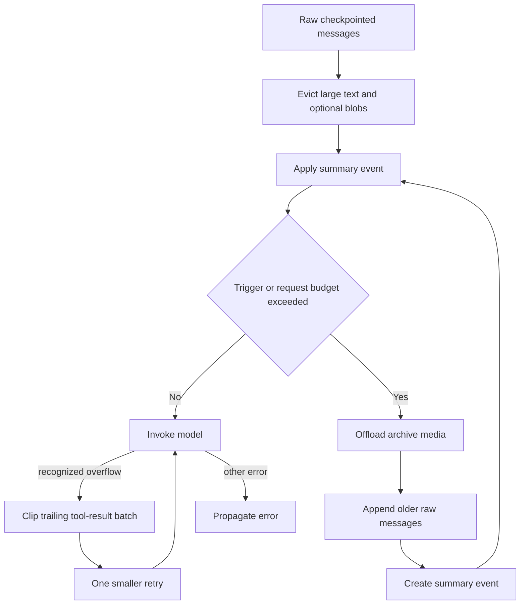

# Context Management

Context management changes what the model sees; it does not necessarily delete the raw conversation. Deep Agents addresses four different pressures:

- **Large textual results and inputs** are replaced with a short, recoverable preview after the complete value is written to the configured backend.
- **Binary payloads** can be content-addressed and replaced in checkpointed messages with a blob reference, then restored only for the request or tool that needs them.
- **Long conversations** are represented to the model as a generated summary plus a recent raw suffix, while the raw message log remains in state and older material may be archived.
- **Unexpected provider overflow** has a tightly bounded retry path that further clips only the trailing tool-result tail.

`read_file` is the recovery boundary for text artifacts and conversation archives. Artifact routes, retention, and tool-call integrity are therefore part of safe context management, not merely storage details. See [Filesystem Tools and Policies](/openwiki/concepts/tools-filesystem.md), [State, Checkpoints, and Sessions](/openwiki/concepts/state-persistence.md), and [Middleware Catalog](/openwiki/concepts/middleware-catalog.md).

*The model receives a shaped effective history; raw messages and recovery artifacts remain distinct state and storage concerns.*

## Recoverable text eviction and artifact routing

`FilesystemMiddleware` derives its artifact prefixes from `CompositeBackend.artifacts_root` when the backend is composite, otherwise from `/`. A composite defaults that root to `/`, selects the route with the longest matching public-path prefix, and passes the selected backend a stripped path. Thus a custom artifact root can place context artifacts on a routed backend, but every pointer shown to the model must resolve through that same backend's `read_file` contract.

| Artifact | Location beneath artifact root | Recovery behavior |
| --- | --- | --- |
| Generic large tool result | `large_tool_results/{sanitized-tool-call-id}` | Preview points to the written full text. |
| Large human message | `conversation_history/{uuid}.md` | Full content stays checkpointed; only the model request gets a preview. |
| Conversation archive | `conversation_history/session_{uuid}.md` | Later compactions append timestamped older-history sections. |
| Archived inline media | `conversation_history/media/{sha256-prefix}.{ext}` | Archive and summary carry a typed path reference. |
| Binary blob | `blobs/{sha256}` | Checkpointed content holds a `deepagents_blob` digest reference. |

Generic tool-result eviction occurs only after extracted text exceeds its configured token-derived character threshold. The middleware writes before replacing: write failure leaves the original result intact. The replacement keeps the `ToolMessage` identity and non-text blocks and presents a line-numbered head-and-tail view, explicitly marking both omitted middle lines and individually clipped long lines.

Oversized latest human input has intentionally different semantics. After a successful write, graph state retains its full content and adds `lc_evicted_to`; outbound requests alone contain the preview. The same-id state update avoids overwriting an AI result produced in the same graph step. Failed writes leave the human message untagged and untruncated.

### Binary content offload is opt-in and integrity checked

With `offload_binary_content`, `FilesystemMiddleware` finds inline base64 blocks in human messages and `read_file` results, decodes each unique payload, and uploads it once under its SHA-256 digest. Successfully uploaded blocks retain their metadata but replace `base64` with `deepagents_blob`; an upload exception or an individual upload error leaves that payload inline. The in-run `_blob_payloads` cache is private and untracked, so it is not another checkpointed copy of the binary data.

Before a model call, blob references are hydrated from the cache or by backend download. Downloaded content is accepted only if its computed digest matches the reference; unavailable, erroneous, or tampered blobs become an explicit text notice rather than unverified media. A request-scoped blob-store context gives filesystem tools on-demand hydration while they run. Enabling this feature for a blob path routed to `StateBackend` is disabled with a warning because the data would remain in checkpointed state and provide no offload benefit.

## Conversation compaction: raw history versus effective history

`SummarizationMiddleware` records compaction in private state instead of deleting `messages`. A `SummarizationEvent` contains an absolute `cutoff_index`, a summary `HumanMessage`, and an optional archive `file_path`. For each model call, it reconstructs effective history as the summary followed by raw messages at the cutoff. Repeated compactions translate an effective cutoff back to the raw index, and a persisted internal session ID names the archive reused by later compactions. Malformed events safely fall back to raw messages; an oversized cutoff produces the summary alone.

Before a full summary, optional argument truncation can shorten old `write_file` and `edit_file` arguments while preserving the configured recent keep window. This is model-request shaping rather than mutation of the raw checkpoint history.

The summary decision counts the full request: effective conversation, system prompt, and tool schemas when the configured token counter supports `tools=`. It runs when its configured trigger fires or when this complete request exceeds the calculated input budget. The factory derives a trigger at 85% and a keep fraction of 10% from a valid integer `profile["max_input_tokens"]`; absent that profile it uses a 170,000-token trigger, keeps six messages, and uses 20-message thresholds for argument truncation. Custom token counters, summary prompts, and summarizers remain extension points.

The default Deep Agents prompt explains that archive media XML references are backend paths, not visual evidence, and asks the summarizer to retain useful references so a later model can use `read_file`.

## Archive, media, and manual compaction behavior

When compaction is selected, older non-summary messages are rendered into a timestamped Markdown section. The middleware appends to the per-session archive by reading and editing an existing file or writing a new one. Archive failure is nonfatal to automatic compaction: an in-context summary event is retained with `file_path=None`, but it must not promise recoverability. Async media processing precedes concurrent archive writing and summary generation.

Inline `data:` media is decoded, content-addressed, uploaded once, and rewritten as a path reference before it reaches the archive or summary prompt. Decode and upload failures become visible `failed_to_offload` placeholders, not silent omission. This lets an operator distinguish an irrecoverable archive block from a message that never contained media.

`SummarizationToolMiddleware` exposes the eligibility-gated `compact_conversation` tool and reuses a configured `SummarizationMiddleware`; it writes the same event and session-id state as automatic compaction. Ineligible calls and a zero cutoff return a correlated “nothing to compact” tool result. A `None` archive path is a successful but non-recoverable compaction. In contrast, an archival exception or summary-generation exception returns a correlated failure `ToolMessage` and does not write a partial event.

## Overflow recovery and history integrity

A provider error is eligible for recovery only when it is `ContextOverflowError`, or an HTTP 400, 413, or 422 with a recognized context-limit marker. Other invalid requests propagate. Recovery clips only a final consecutive `ToolMessage` batch: a `read_file` result retains its original source path and is head-sliced without duplicating an artifact; other results use generic large-result eviction and remain original if that write fails.

There is at most one recovery retry. It must be strictly smaller than the rejected request and must pass the locally calculated budget before provider invocation; another recognized overflow produces terminal `ContextOverflowError`. This prevents retry loops and avoids treating arbitrary bad requests as context pressure.

Compaction or truncation must never leave an AI tool call without a corresponding tool result. `PatchToolCallsMiddleware` runs before the agent and scans both valid and invalid tool calls. For every unanswered id it inserts an error `ToolMessage` immediately after its AI message, distinguishing malformed or truncated arguments from an interrupted or cancelled call, then replaces the complete message list atomically. This preserves the message protocol expected by later model calls after interruptions or context shaping.

## Deep Agents Code: explicit, idle, and durable offload

Deep Agents Code provides server-owned `/offload` (also `/compact`) rather than asking the UI to mutate a checkpoint directly. The operation derives effective history from the existing summary event, refuses a no-advance chained compaction before paying for a model call, creates the summary, and persists the same absolute event cutoff and session ID. Archive failure still commits useful in-context compaction with no path; the caller can report that old material is not recoverable.

For local mode, conversation history normally lives in the hardened `conversation_history` subdirectory of `DEEPAGENTS_HOME` (normally `~/.deepagents`). If it cannot be made writable, storage falls back to a hardened temporary directory and reports that it is ephemeral. Archive directories are restricted to the current user. The history retention sweep deletes only expired regular Markdown children and returns zero rather than raising on failure; thread deletion removes its archive and source-owned handoff snapshots best-effort, while refusing a suspicious escaping thread ID.

Idle compaction is disabled by default through `history.idle_compaction_tokens`. When enabled, the TUI reserves at most one offload per thread and warm prompt-cache expiry, only in the final 20% of cache retention (capped at 120 seconds), with exact rather than approximate token usage at or above the threshold. It requires a quiescent UI and remote agent; it rechecks that no new input arrived before executing, and cancellation releases the reservation. This spends a summarization call to preserve cache-value context without racing an interactive turn.

## Operational checklist and focused tests

1. Route `artifacts_root` to durable storage accessible through `read_file`; test both sync and async routes.
2. Treat raw `messages`, summary events, archive storage, and untracked blob cache as separate layers. Do not replace raw state merely because effective history is shorter.
3. Preserve successful-write-only replacement semantics and explicit media/blob failure notices; a pointer without accessible backing storage is worse than the original content.
4. Preserve absolute cutoff translation and the distinction between nonfatal no-archive compaction and exception failure.
5. Preserve trailing-tool-batch boundaries, one-smaller-retry recovery, and tool-call/result pairing when changing context logic.
6. For Deep Agents Code, set a retention policy suitable for the sensitivity and lifetime of archives, and consider temporary fallback storage nonpersistent.

Focused coverage includes `test_compact_tool.py` for shared event state, eligibility, no-archive success, and exception behavior; compaction recovery and end-to-end tests for retry and recovery-path behavior; artifact-root tests for routed placement; and `test_idle_compaction.py` for cache-window guards, input races, and cancellation. Blob-offload behavior is exercised at the filesystem middleware boundary: upload failure must retain inline payloads and hydration must verify downloaded bytes before restoring them.
