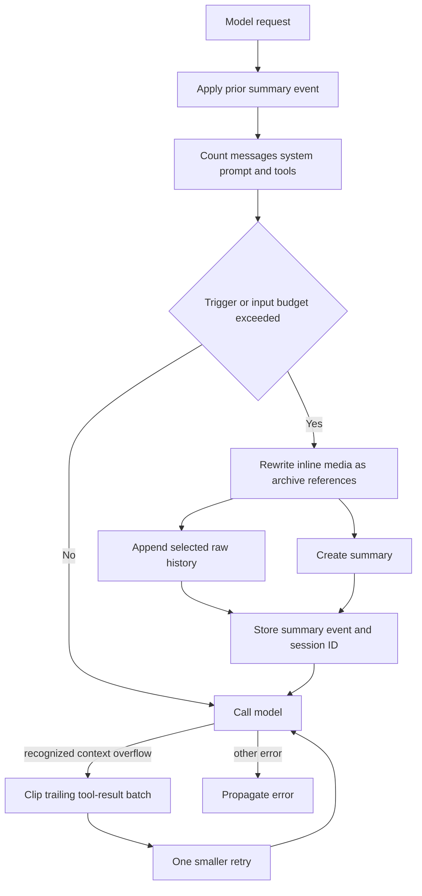

# Context Management

Deep Agents manages two distinct pressures at the model boundary:

- **A single result is too large.** `FilesystemMiddleware` can replace oversized tool text or human input with a recoverable preview while storing the complete content in the configured backend.
- **The effective conversation is too large.** `SummarizationMiddleware` creates a summary event over raw history, optionally archives the replaced portion, and sends the summary plus a retained suffix to the model.

These mechanisms do not make filesystem storage optional from an operational perspective: any model-visible path must be readable through the backend exposed by `read_file`. See [Filesystem Tools and Policies](/openwiki/concepts/tools-filesystem.md), [State, Checkpoints, and Sessions](/openwiki/concepts/state-persistence.md), and [Middleware Catalog](/openwiki/concepts/middleware-catalog.md).

*Automatic compaction changes the effective request through private state; raw `messages` remain available while archival and summary generation prepare the replacement context.*

## Recoverable eviction and artifact placement

`CompositeBackend.artifacts_root` controls where the middleware places artifacts. It defaults to `/`; a composite routes a public path by its longest matching prefix while passing the stripped path to the selected backend. `FilesystemMiddleware` and summarization therefore use the composite root when present and otherwise root-level directories. Route that root to storage that `read_file` can access, or a preview/archive pointer will not be recoverable.

| Artifact | Default location | Meaning |
| --- | --- | --- |
| Generic large tool result | `/large_tool_results/{sanitized-tool-call-id}` | Full text for a tool-result preview or generic overflow clip. |
| Large human message | `/conversation_history/{uuid}.md` | Full human input retained in state and represented as a model-only preview. |
| Conversation archive | `/conversation_history/session_{uuid}.md` | Timestamped sections of compacted raw history. |
| Archived inline media | `/conversation_history/media/{sha256-prefix}.{ext}` | Content-addressed payload referenced from archive and summary inputs. |

For generic tool output, eviction happens only when extracted text exceeds the configured token limit converted to characters. The complete text is written first; only a successful `write`/`awrite` yields a replacement `ToolMessage`. A failed write preserves the original message. The replacement preserves the message identity, metadata, artifact, status, and non-text blocks; its text preview is line-numbered and distinguishes omitted middle lines from individually clipped long lines.

Large human input has a different state contract. When the latest untagged `HumanMessage` exceeds its character-derived threshold, middleware writes it, tags the checkpointed message with `lc_evicted_to`, and substitutes a preview **only** in outbound model requests. The full original content stays in graph state. A failed write leaves the message untagged and untruncated. Sync and async paths use corresponding backend operations and enforce the same successful-write-only rule.

## Automatic compaction: configuration and state

`create_deep_agent()` installs `create_summarization_middleware(model, backend)` in its core stack before tool-call repair and before optional async subagent middleware. The factory requires a resolved `BaseChatModel`, not a model-name string, and derives thresholds from the model being managed:

| Model profile | Automatic trigger and retained context | Pre-summary tool-argument truncation |
| --- | --- | --- |
| Valid integer `profile["max_input_tokens"]` | trigger at 85% of context; keep 10% | trigger at 85%; keep 10% |
| No usable profile limit | trigger at 170,000 tokens; keep 6 messages | trigger at 20 messages; keep 20 messages |

The factory defaults `trim_tokens_to_summarize` to `None`, so selected old history is not additionally trimmed. Constructing `SummarizationMiddleware` directly instead defaults that setting to 4,000 tokens. Both accept a custom `token_counter`, `summary_prompt`, and `summarizer`; a custom summarizer can replace the summary-model call, while the managed model still supplies profile limits and token counting.

The default summary prompt adds media-reference instructions to LangChain's summary prompt. It tells the summarizer that XML media references are recoverable backend paths, not visual evidence, and to preserve relevant references so a later model can call `read_file`.

### Event representation and lifecycle

Compaction does not remove raw state history. `_summarization_event` contains:

- `cutoff_index` — absolute index in raw `messages`;
- `summary_message` — the generated `HumanMessage`, marked `lc_source="summarization"`;
- `file_path` — archive path, or `None` when history archival was unavailable.

For every model call, the middleware reconstructs effective history as the event's summary followed by raw messages from the cutoff. A later compaction translates its effective cutoff back to an absolute raw index, so repeated compaction advances through one raw log. `_summarization_session_id` is private persisted state: it is generated only when absent and names the one archive file to which later compactions append. A malformed event falls back to the raw history; an out-of-range cutoff yields the summary alone rather than indexing invalid state.

Before full compaction, optional `truncate_args_settings` can shorten only old `write_file` and `edit_file` arguments. It leaves the configured keep window untouched and can reclaim enough context to avoid summarization. This is request shaping, not a rewrite of the raw checkpoint log.

## Archive and media failure semantics

The selected non-summary messages are rendered as an XML-formatted Markdown section under a timestamp header. The middleware reads an existing archive and uses `edit` to append or `write` to create it. A backend error, a `None` result, or an exception returns no archive path; automatic compaction still creates the in-context summary event, but its summary does not claim storage recovery and a warning records that older messages are unrecoverable.

Inline `data:` media is processed before both archival and summarization. Each decodable payload is uploaded once per SHA-256 prefix under `conversation_history/media`, then rewritten to a typed path-reference block. This deduplicates matching content across messages and prevents raw inline bytes reaching either the archive or summary prompt. Decode errors, upload response errors, and upload exceptions become explicit `failed_to_offload` placeholders, preserving evidence that a block existed. If the archive itself succeeds with such placeholders, the middleware warns that those original media blocks cannot be recovered.

The asynchronous path awaits media processing first, then runs archive writing and summary generation concurrently because both consume the already-rewritten messages. Its archive and error behavior otherwise matches the synchronous path.

## Manual `compact_conversation`

`SummarizationToolMiddleware` exposes `compact_conversation`, but it never compacts by itself. It wraps a `SummarizationMiddleware` engine and, on a tool call, first applies the current summary event and then checks eligibility at roughly half of the automatic trigger. Token and fraction eligibility use reported usage metadata; message thresholds use message count. A dictionary trigger clause requires all its thresholds, while multiple clauses are alternatives.

Manual and automatic compaction share `_summarization_event` and `_summarization_session_id`, archive formatting, cutoff translation, summary creation, and the backend. They therefore compose rather than creating separate history formats. The tool returns a correlated “nothing to compact” `ToolMessage` when it is ineligible or there is no usable cutoff.

Failure behavior is deliberately split:

- An ordinary archive failure represented by `None` is nonfatal: the tool returns a successful compaction event with `file_path=None` and a summary that has no recovery-path promise.
- An exception while creating the summary **or** while invoking archival is caught by the tool. It returns a correlated `Compaction failed` `ToolMessage` and does not write a summary event or session id, so conversation compaction has not occurred.

This distinction matters to backend implementations: return an error result for a best-effort archive failure if compaction may safely proceed; an exception means the manual operation reports failure and leaves compaction state unchanged.

## Budgeting and overflow recovery

Token accounting includes effective messages, the system message, and tool schemas when the configured counter accepts `tools=`. The middleware reserves configured output (`max_tokens`, `max_completion_tokens`, or `max_output_tokens`) plus 5% of advertised input capacity. It compacts when its configured trigger fires **or** the complete request is over that calculated input budget.

A provider failure is an overflow only for `ContextOverflowError`, or for HTTP 400, 413, or 422 errors containing a recognized context-limit marker. Other invalid requests propagate unchanged. Recovery considers only a final consecutive batch of `ToolMessage`s:

- A `read_file` result is head-sliced and points to the original `file_path`; it does not duplicate the file under large-result storage.
- Other tool results are offloaded through the normal large-result helper. A failed offload keeps the original result.

The recovery path can submit at most one smaller retry. Before that retry, it rejects a request that did not become strictly smaller after a rejected provider call, and it rejects a request that the local budget still proves oversized. A second recognized overflow or exhausted recovery is surfaced as terminal `ContextOverflowError`; it does not loop or mislabel unrelated bad requests as context failures.

## Change checklist and focused tests

1. Keep the artifact root, composite route, and `read_file` path contract aligned before advertising a recovery pointer.
2. Keep raw `messages` separate from `_summarization_event`; preserve cutoff translation when changing either automatic or manual compaction.
3. Preserve media reference instructions in the summary prompt and explicit placeholders on media-offload failure.
4. Do not turn a manual summary-generation/archive exception into a partial event. Conversely, preserve the valid no-archive event when archival returns `None`.
5. Count all request contributors and preserve the one-smaller-retry limit, trailing-tool-batch boundary, and tool-call/result identity.

Focused regressions include `test_summarization_factory.py` for profile and fallback defaults, media prompt rendering, custom controls, and custom summarizers; `test_compact_tool.py` for eligibility, shared-event cutoff arithmetic, success without an archive, and exception versus `None` failure behavior. The summarization middleware tests exercise media deduplication, placeholders, timestamped append behavior, and async concurrency. End-to-end overflow tests prove that clipped `read_file` results reuse original paths without new large-result files, while `ls` and arbitrary tool results receive recoverable large-result artifacts. Run the owning package's focused tests as described in the [Testing Guide](/openwiki/testing/testing-guide.md).
