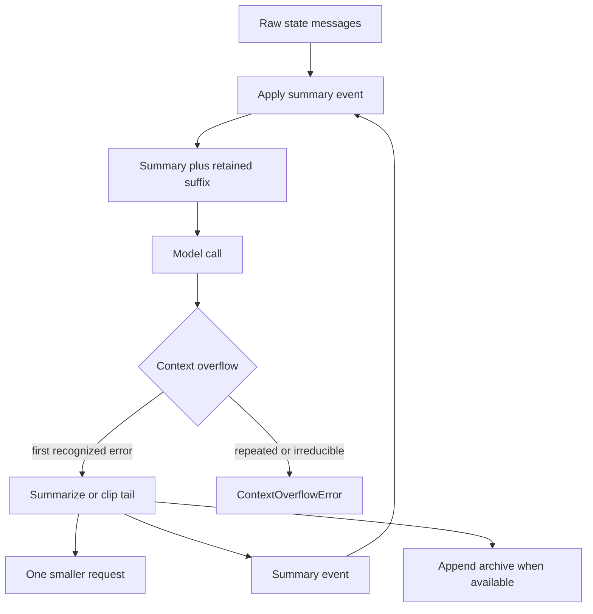
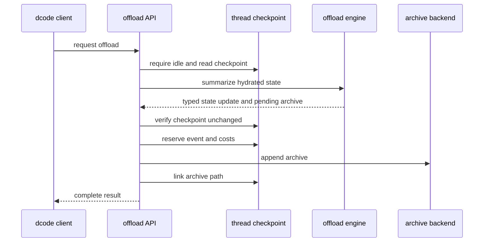

# Context Management and Offload

Context reduction is not a destructive rewrite of one conversation transcript. The SDK records a **summary event** over retained state, derives a shorter history for each model call, and can archive the covered portion. dcode adds a server-owned commit protocol around that operation. These are separate persistence and safety boundaries:

- **Raw state** is the checkpoint's `messages` list. A summary event does not replace it.
- **Effective history** is the message view sent to the model: a synthetic summary plus the retained suffix.
- **An archive** is optional recovery storage. An event can be valid when `file_path` is `None`.
- **Server offload** is an operation on a stable dcode thread checkpoint, not a client-side messages update.

See [Runtime Behavior](/openwiki/architecture/runtime-behavior.md), [Middleware Catalog](/openwiki/concepts/middleware-catalog.md), and [State, Checkpoints, and Sessions](/openwiki/concepts/state-persistence.md) for middleware placement and checkpoint ownership.

*The event changes the request view, while the archive is a separate best-effort recovery artifact.*

## Summary events and effective-history reconstruction

`SummarizationMiddleware` stores its current event at `_summarization_event` and the archive session identifier at `_summarization_session_id`. An event contains a raw `cutoff_index`, the `summary_message`, an optional `file_path`, and two compatibility/reconciliation fields:

- `cutoff_message_id` identifies the first raw message retained after the cutoff. On reconstruction, the middleware resolves that ID in the current state first. This keeps the cutoff correct if earlier checkpoint messages were removed after the event was created. Events created before that field, or whose ID no longer exists, fall back to the stored numeric index.
- `created_at_index` records how many state messages existed when the event was made. For the part of the retained suffix that was already present then, provider-bound reasoning is stripped from the effective request. The raw messages themselves remain intact; messages created later retain their reasoning. Older events without this field preserve the old behavior.

The effective list is therefore `summary_message + messages[resolved_cutoff:]`, with the reasoning adjustment above. A malformed event falls back to the raw message list; an out-of-range cutoff produces the summary alone. This is intentionally a request-time interpretation layer, not transcript deletion.

### Chained compaction and cutoffs

A new cutoff is initially calculated in **effective-list** coordinates. If a prior event exists, the synthetic summary at effective index zero has no raw-state counterpart, so the middleware translates the new cutoff back to state coordinates. New events also save the matching message ID. Consequently, extensions that prune or otherwise transform old checkpoint messages must preserve the cutoff message if they want ID-based reconciliation; otherwise the system deliberately uses the legacy numeric fallback.

Automatic compaction first derives effective messages, optionally truncates older large tool-call arguments, decides whether its trigger or the input budget requires compaction, and partitions the older prefix from the kept suffix. It archives the prefix before generating a summary, then returns a state update containing the event and session ID. Apart from overflow-tail replacements, it does not write a replacement `messages` list merely because it summarized.

## Archives, media, and failure meaning

The SDK appends each archive section to `/conversation_history/{session_id}.md` on its configured backend and filters earlier synthetic summary messages to avoid archiving a summary of history already saved. A successful archive path is included in the summary message so an agent with filesystem access can reopen the detailed history.

Archive persistence is best effort. The synchronous and asynchronous archive helpers treat backend read, write, response-error, and ordinary backend exceptions as a `None` path. Automatic compaction logs and warns that the older history is unrecoverable, but still creates an in-context summary event. Thus `file_path=None` means **successful compaction without a recoverable archive**, not necessarily a failed compaction.

Inline `data:` media needs a second preservation path because the archive renderer cannot retain inline payloads. Before the archive is rendered, the middleware uploads decoded media under its conversation-history media location and rewrites archive content to path references. Identical payloads are deduplicated by a short SHA-256 key. A decode or upload failure becomes a visible `failed_to_offload` placeholder and is reported as an unrecoverable media warning; it does not silently disappear or prevent the textual history from being archived.

## Explicit `compact_conversation`

`SummarizationToolMiddleware` registers the `compact_conversation` tool but is not an automatic middleware by itself. It delegates to a configured `SummarizationMiddleware`; when both layers are registered, automatic and manual compaction share the same event and archive-session state. `create_summarization_tool_middleware(...)` constructs this tool layer and its engine, while `create_deep_agent` supplies the normal automatic summarization layer by default.

The tool is an admission-gated, model-initiated operation rather than a background trigger. It accepts a call only if at least one configured trigger clause reaches approximately half of its automatic threshold; compound dictionary clauses require all of their fields. It then applies any prior event, requires a nonzero cutoff, summarizes the selected prefix, attempts the archive, and returns a correlated confirmation `ToolMessage` with the new event and session ID.

Failure handling has an important distinction:

| Outcome | Tool state update | Meaning |
|---|---|---|
| Archive helper returns a path | Event, session ID, confirmation message | Compacted and recoverable through that path. |
| Archive helper returns `None` | Event, session ID, confirmation message | Compacted, but the summarized source is not recoverable from an archive. |
| Summary generation, partitioning, or an escaping offload error fails | Error `ToolMessage` only | No new event or session ID is written; the conversation was not compacted. |
| Ineligible request or zero cutoff | “Nothing to compact” `ToolMessage` only | No compaction is performed. |

The sync and async paths have the same state contract. Tests cover successful first and chained events, no-path success, correlated error messages, malformed-event fallback, and the half-trigger eligibility gate.

## Overflow recovery and budgets

Compaction is also a recovery mechanism for recognized provider context overflows. The middleware recognizes `ContextOverflowError` and specific context-limit HTTP errors, but does not retry unrelated bad requests. It reserves configured output tokens and five percent headroom from a model profile's advertised input limit when checking a request budget.

When an over-budget request cannot be summarized further, or a provider rejects a request, the middleware may clip/offload large trailing tool results and send **at most one** smaller retry. Before that retry reaches the provider, it verifies both that it is strictly smaller than the rejected request and that the complete request—including system prompt, tools, and output reservation—is within the local budget. A repeated overflow, unchanged reduction, or irreducible overhead becomes terminal `ContextOverflowError`, rather than an unbounded retry loop.

## dcode server-owned offload

The dcode `/offload` route makes compaction a checkpoint-guarded server operation. It locks the target thread, allows only an idle or errored thread with no pending graph work, hydrates the checkpoint, and runs the offload plan. It then rechecks that the checkpoint has not advanced. If it has, the completed summary is discarded rather than committed to changed state.

The HTTP boundary removes request-provided model settings and restores the model spec and parameters saved in the target checkpoint. A thread that predates model checkpointing instead uses the startup summarizer. This prevents a request client from changing the provider or endpoint that receives archived conversation history.

Only the allowlisted `OffloadStateUpdate` channels may be committed: the summary event, summary session ID, and cost channels. In particular, server offload cannot write `messages`; this prevents a delayed operation from overwriting messages attributed to another run.

*The server reserves the summary state before it writes and links a deferred archive, while prohibiting conversation-message writes.*

Forced dcode offload stages the archive append with the prior content so a failed append can be rolled back. If the subsequent archive-link checkpoint write is confirmed absent, it also rolls back the completed append. A successful compaction may still commit an in-context event without an archive path. If a state write fails, cost records are rolled back only when the original checkpoint is confirmed unchanged; an advanced or unreadable checkpoint leaves them claimed to avoid double charging and reports an indeterminate outcome.

### Handoff is not source compaction

A handoff summarizes a source thread to seed another thread but does not install a summary event on the source. The source receives only summary-cost channels. Its recovery transcript is named with source-thread ownership so cleanup can delete it with the source, including after a failed child creation.

## Local archive lifecycle and idle maintenance

For local dcode operation, archives normally live in a hardened `conversation_history` directory below `DEEPAGENTS_HOME` (normally `~/.deepagents`). If that persistent location cannot be created or written, dcode uses hardened temporary storage and marks it ephemeral. `history.retention_days` controls best-effort cleanup; `0` disables sweeping. Cleanup only considers expired regular `.md` children and swallows failures, while thread deletion also best-effort removes its archive and source-owned handoff snapshots.

`history.idle_compaction_tokens` is separate from SDK automatic compaction and defaults to disabled. When enabled, dcode schedules no more than one server offload per thread and prompt-cache window, only in the final 20 percent of that window and no more than 120 seconds before expiry. It additionally requires exact context usage at the threshold, a remote agent, and a quiescent UI. This is a prompt-cache optimization, not a context-limit safety trigger.

## Related context safeguards

Provider output truncation is distinct from input overflow. dcode normalizes truncation metadata and turns an empty truncated final reply into `ModelOutputTruncatedError`, so a model node does not checkpoint a silent empty success. Task-subagent failures become error `ToolMessage` values; partial subagent responses retain their content with a warning.

Managed memory is also distinct from conversation history. `ManagedMemoryGuardMiddleware` protects configured marker-delimited blocks in memory files: it intercepts writes, edits, and deletion, restores a changed managed block where possible, and fails the operation even after restoration. It rejects deletion of a protected or unreadable existing file before the underlying tool runs. Its reads and restoration writes use no-follow operations, so a symlink replacement produces a visible restoration failure rather than overwriting the link target.

## Operational checklist and focused tests

1. Treat raw messages, summary events, and archive files as separate layers. Do not replace `messages` just because effective history is shorter.
2. Preserve both `cutoff_index` and `cutoff_message_id` when constructing or migrating events; the ID is what makes the cutoff robust to earlier-message removal.
3. Treat `file_path=None` as a recoverability warning, not proof that compaction failed. Inspect the event and tool-message status.
4. Keep the one-retry and budget checks intact when changing overflow behavior; system prompt, tool schemas, and output reservation count toward the input budget.
5. Do not widen dcode's offload write allowlist to include `messages` without redesigning the checkpoint concurrency protocol.
6. Configure archive retention for sensitivity and lifetime, and treat temporary fallback storage as nonpersistent.

`test_summarization_middleware.py` covers event reconstruction, message-ID cutoff reconciliation, chained compaction, provider-bound reasoning removal, media archival, and automatic overflow fallback. `test_compact_tool.py` covers tool registration, success with and without an archive path, event state, ineligible calls, and error results. `test_compaction_recovery.py` verifies the strictly smaller single retry, budget rejection before provider calls, and terminal recovery errors. dcode tests cover the checkpoint, allowlist, archive, and cost-settlement protocol described above.
