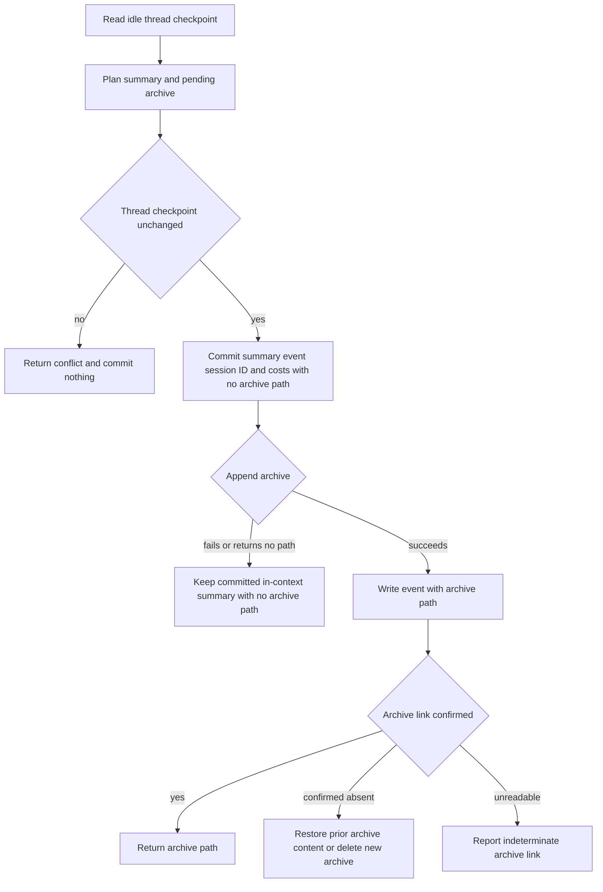
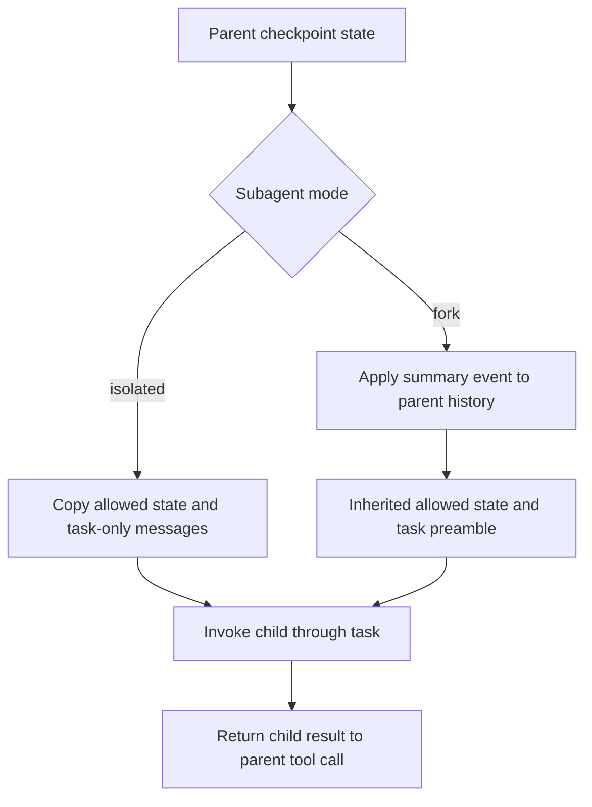

# Context Management

Context management has three separate layers. Checkpointed `messages` preserve the raw conversation; a `_summarization_event` changes the **effective** history sent to a model; and an archive is an optional recovery artifact. A shorter model request therefore does not imply that the checkpoint transcript was deleted. dcode's server `/offload` adds a concurrency-controlled commit protocol because it operates on a persisted thread rather than within the normal agent turn.

See [State, Checkpoints, and Sessions](/openwiki/concepts/state-persistence.md) for state ownership, [Code Agent Architecture](/openwiki/architecture/code-agent.md) for the runtime, and [Running a dcode Session](/openwiki/workflows/run-dcode-session.md) for user-facing operations.

## Effective history and durable cutoffs

`SummarizationMiddleware` retains raw messages and reconstructs model-visible history as a synthetic summary followed by the retained suffix. Its event stores the numeric cutoff, the retained-boundary message ID, summary, optional archive path, and creation index. It resolves `cutoff_message_id` before falling back to `cutoff_index`, so removal of messages before the boundary does not move the effective-history cut incorrectly.

This distinction is important for dcode. Before it reads an event, dcode calls `anchor_summarization_event`: when the boundary ID is still present at a new raw index, it returns a copy with `cutoff_index` moved there and shifts `created_at_index` by the same delta. Consumers which only understand numeric cutoffs then agree with ID-aware readers. A malformed, negative, boolean, or out-of-range cutoff is not clamped: it is treated as invalid, because clamping a stale cutoff could hide live surviving turns.

A forced plan first applies the prior event, computes the proposed cutoff in effective-history coordinates, converts it to an absolute state cutoff, and refuses a non-advancing chained plan before spending on a summary. The committed event records the absolute cutoff and the ID at that boundary; the session ID is also persisted so subsequent compactions append to the same history file.

## Automatic, explicit, and forced compaction

The SDK exposes `compact_conversation` through `SummarizationToolMiddleware`. The model-initiated tool shares the automatic summarizer's event and archive-session state, but its admission gate requires a configured trigger clause to reach about half of the automatic threshold. Archive-helper failure is not equivalent to summary failure: a `None` archive path still yields a valid in-context event, while summary or escaping offload failures return an error `ToolMessage` and do not update event/session state.

`CLICompactionMiddleware` keeps that tool behavior and layers dcode policy on top:

- Before threshold-based automatic compaction, it can dispatch a `PreCompact` hook. A denial skips automatic compaction; for provider-overflow fallback, the original overflow is re-raised rather than bypassing the hook.
- It selects a summarizer for the runtime model configuration. Thresholds and input counting follow the active main model; a configured summary-model override is constructed lazily and has its own input trim budget and token counter. If that optimization cannot be built or invoked, summary generation falls back to the main model instead of breaking the session.
- The forced `/offload` entry point plans only: it generates the summary and returns a pending archive append without writing archive storage. The HTTP owner decides when that side effect is allowed.

Recognized provider context overflow gets at most one strictly smaller retry. The recovery path rejects a request known to exceed local budget before it reaches the provider and terminates with `ContextOverflowError` once recovery is exhausted.

## Server-owned `/offload`

The HTTP boundary accepts an operation ID, runtime context, hook responses, and an optional handoff flag; the thread ID is taken from the path. It strips client transport/model selection, then reconstructs the model spec and parameters from the target checkpoint. This protects a checkpointed private endpoint from a client-chosen offload destination; older checkpoints without model metadata use the server startup summarizer.

Before executing, the route holds a per-thread lock, requires an idle or errored registered thread, rejects pending graph work, hydrates serialized messages and the event summary message, and requires its bound workspace. After planning it checks idle status and checkpoint ID again. A changed checkpoint produces a conflict and discards the completed summary rather than committing it to newer state.

The server permits only `_summarization_event`, `_summarization_session_id`, and session-cost channels. In particular, it cannot write `messages`, because this asynchronous operation commits against the latest thread checkpoint and must not clobber messages attributed to another run. Forced hook approval is also fail-closed: missing hook outcome state refuses compaction. Hook-interrupt resume re-executes the operation from the start, using the stable client operation ID to derive a stable forced tool-call ID for that attempt.

### Archive reservation, link, and rollback

*The summary reservation is committed before archive mutation; rollback is for an append whose follow-up link is known not to have landed.*

A pending append snapshots whether the archive existed and its prior content. Its guarded write refuses to overwrite an existing archive when the backend read failed, preventing a transient read failure from becoming destructive truncation. Archive operations for the same session are serialized in-process.

After the reservation checkpoint write succeeds, dcode appends the archive. An append exception or `None` result leaves the already-committed event with `file_path=None`: compaction is useful but not recoverable from archive storage. If the append succeeds but the link checkpoint write errors, dcode reads the checkpoint back. A confirmed linked path is accepted; a confirmed absent link rolls back the append; an unreadable checkpoint is reported as indeterminate because it cannot safely decide whether rollback would erase a linked archive.

Cost settlement follows the same conservative principle. A failed state write rolls back drained cost records only when readback proves the original checkpoint remains unchanged. An advanced or unreadable thread commits the cost claim and reports an indeterminate result, avoiding a future double charge. The commit task is allowed to settle before request cancellation is re-raised.

### Handoff versus compaction

A handoff summarizes all source messages to seed another thread, but it does not write a summary event to the source: only the source cost channels are persisted. Its recovery snapshot is assigned a source-thread-prefixed session ID before writing, which allows deletion cleanup to find it even if child creation fails. A failed handoff archive is a failed handoff result, since no summary event exists on the source to provide an in-context replacement.

## Idle cache maintenance

Idle compaction is opt-in through `history.idle_compaction_tokens`. The TUI schedules at most one offload for a thread and prompt-cache expiry timestamp, requires exact—not approximate—context usage at or above the threshold, a remote agent, and a quiescent UI. It runs only while the cache has positive remaining lifetime within the final 20 percent of its window, capped at 120 seconds. New queued input is checked again by the worker and prevents the maintenance offload. This is a cache-warming optimization, not the context-overflow safety path.

## Local archive lifecycle and related safeguards

Local dcode archives normally use a hardened `conversation_history` directory below `DEEPAGENTS_HOME`. If persistent storage cannot be created or written, dcode uses hardened temporary storage and marks the result ephemeral. Cleanup is best effort and uses `history.retention_days`; cleanup failures do not interrupt the session. Handoff recovery snapshots are named for their source thread so thread deletion can remove them.

Context overflow concerns model input. Provider output truncation is distinct: dcode normalizes truncation metadata and raises `ModelOutputTruncatedError` for an empty truncated final reply, preventing a silent empty checkpointed success. Task-subagent failures become error `ToolMessage` values; partial replies retain content with a warning.

Managed memory is also not conversation history. `ManagedMemoryGuardMiddleware` protects configured marker-delimited blocks in memory files, restoring a changed protected block where possible and rejecting protected/unreadable-file deletion before the underlying tool runs. It uses no-follow reads and restoration writes, so a guarded-file symlink replacement fails visibly rather than overwriting its target.

## Model-visible boundaries

Not every checkpointed `HumanMessage` is user conversation. Goal control and goal-state notices are framework-owned messages marked with `lc_source`; they participate in normal provider ordering but are hidden from transcript, title, and derived-conversation views. The current goal-state notice is fingerprinted and schema-versioned. It embeds actionable objective/status text and active rubric criteria as escaped, explicitly marked context data; oversized state is replaced by bounded guidance that tells the model not to act on it.

Local-context refresh messages use the same boundary. After a valid new summarization cutoff, `LocalContextMiddleware` detects the environment again; if its fingerprint differs from the recorded baseline, it appends a model-only message stating that the refreshed facts supersede earlier local-context facts and that the tagged data is untrusted, not instructions. It records the processed cutoff even when detection produces no output, preventing repeated work for the same compaction event.

## Runtime context and delegation boundaries

### Per-run configuration is not conversation state

`CLIContext` is the client-facing payload passed to `astream` or `ainvoke`; the graph registers `CLIContextSchema` as its `context_schema`. Local runs therefore receive the dataclass, while RemoteGraph/API runs receive JSON-shaped dictionaries. `from_payload` is the single normalization boundary used by consumers: it preserves usable model, summary-model, profile-override, model-context-limit, workspace, thread, approval, and hook fields, but turns malformed containers into empty values, rejects boolean token limits, and fails closed for a non-boolean `auto_approve` value.

This is deliberately separate from checkpoint state. It selects the active model and its parameters for this run, can select a summary-only model, supplies an effective context limit to profile-aware compaction, and binds a server run to its validated workspace. It should not be used as a durable replacement for `messages` or summary-event state. In particular, a summary-model choice affects summary generation only: normal thresholds and token accounting continue to follow the main model.

### Subagent context modes

The SDK's declarative `SubAgent` defaults to `isolated`: it receives a state copy whose `messages` are just the delegated task. `mode="fork"` is the explicit, experimental alternative. A fork receives the parent's **effective** conversation—applying the summary event rather than replaying evicted raw history—plus a task preamble that says delegation in the earlier history has already happened. Its task tool is then refused, preventing recursive delegation.

Forking is intentionally not a general state-sharing mechanism. Private middleware fields and defined excluded channels are withheld where appropriate; ordinary child results return to the parent through the `task` tool's final response/state-update path. A declarative fork may inherit private channels so its matching middleware can rebuild the parent's prompt, but a compiled runnable is treated as opaque and is not given those private channels. Forked specifications cannot declare their own skills, and their authored `system_prompt` is appended to the task rather than replacing the inherited system prefix; both restrictions protect prompt consistency and cache reuse.

*An isolated subagent receives only the delegated task as message history; a fork receives compacted effective history, but neither path makes the child a free writer of parent state.*

dcode configures its generated `general-purpose` subagent as a fork when `FORKED_SUBAGENTS` is enabled (the default). It separately injects dcode's filesystem-tool allowlist into every custom subagent because the SDK's usual automatic general-purpose inheritance path is not used. Thus changing `--allow-fs-tools` must keep the parent and delegated tool surfaces aligned.

### Input composition versus saved history

The external editor is only a prompt-composition boundary: it writes the current draft to a temporary UTF-8 Markdown file, invokes the resolved editor without a shell, reads back normalized line endings, and deletes the file best-effort. A nonzero editor exit or blank result normally means no replacement draft; callers that need submit-time validation may retain blank content with `allow_empty=True`. This prepares user input but does not itself modify a checkpoint or model history.

Shell completion is similarly outside model context. It introspects the same argparse parser used for real invocations, filters emitted completion words through an allowlist, and renders static scripts for bash, zsh, or fish. Keeping this command surface parser-derived avoids an unreviewed, divergent set of executable-looking completion candidates.

## Operational guidance and focused tests

1. Treat raw `messages`, summary events, and archives as independent layers. Never infer deletion from a compact request.
2. Preserve both cutoff forms when transforming state. Anchor events before index-based accounting and reject invalid/out-of-bounds cutoffs rather than clamping them.
3. A missing archive path is a recoverability condition, not necessarily a failed compaction. Check whether the event reservation committed.
4. Do not widen the `/offload` allowlist to include `messages` without a new concurrency design.
5. Diagnose a checkpoint-write error through readback before restoring costs or rolling back an archive; uncertain outcomes deliberately favor avoiding duplicate cost or destructive cleanup.
6. Keep framework-owned `lc_source` values in every user-facing transcript/title filter, while retaining them in model requests when they carry live control state.
7. Choose `isolated` unless the child needs the parent conversation. Treat `fork` as an explicit cache- and state-coupled mode; do not give it divergent skills or expect it to delegate again.
8. Treat `CLIContext` as untrusted, per-run transport at a RemoteGraph boundary. Normalize it once and do not promote its model or workspace fields into checkpointed conversation state.

`test_compact_tool.py` covers runtime model budgets, pending archive planning, cutoff anchoring, archive-read protection, and dedicated summary-model fallback. `test_offload_api.py` covers checkpoint/model hydration, the no-`messages` commit boundary, handoff source preservation, archive-link rollback, and cost settlement under write failure. `test_idle_compaction.py` exercises the cache-window, idleness, threshold, duplicate-scheduling, and new-input guards. `test_agent.py` covers dict-to-schema preservation of compaction fields and workspace-bound execution descriptions. `test_completion.py` exercises parser-derived, shell-safe candidates and generated script parsing; `test_editor.py` covers editor cleanup and the Windows launcher boundary.
