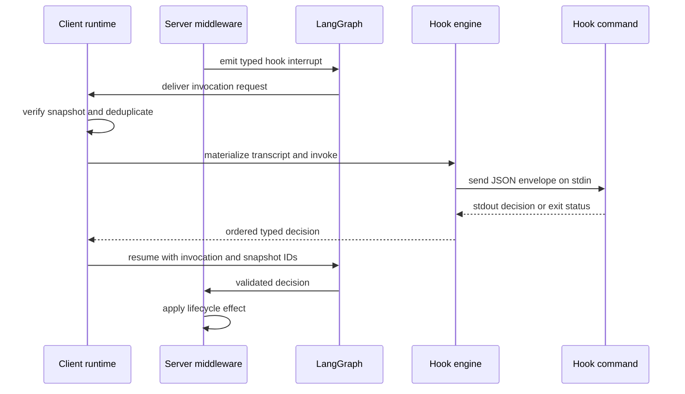

# dcode Hook Lifecycle

Hooks are executable lifecycle configuration. They let a user, a trusted workspace, or an enabled plugin run a local command when a dcode lifecycle event occurs and return a structured decision. They are useful for prompting, notifications, workflow checks, contextual guidance, and selected lifecycle controls. They are **not** a sandbox, a general authorization system, or a substitute for backend containment and operating-system isolation. A hook command is code execution; treat the authority to configure it accordingly.

This page covers Hooks v2. It separates the client-owned configuration and command runtime from the server-owned agent lifecycle. See [Configuration Layering](/openwiki/concepts/config-layering.md) for general configuration precedence, [Permissions and Human Approval](/openwiki/concepts/permissions-hitl.md) for the independent approval and backend boundary, and [Security](/openwiki/operations/security.md) for operational hardening.

## Design and ownership

The capability registry defines twelve supported events and associates each with an owner, matcher field, default timeout, output policies, and reduction policy. Client-owned events are `SessionStart`, `UserPromptSubmit`, `SessionEnd`, `PermissionRequest`, and `Notification`. Server-owned events are `PreToolUse`, `PostToolUse`, `PostToolUseFailure`, `PreCompact`, `Stop`, `SubagentStart`, and `SubagentStop`.

The client creates one `HooksRuntime` for a session. It loads and freezes the configuration snapshot, owns transcript projection, runs matching commands, presents progress/diagnostics, and deduplicates interrupt fulfillment. The server does not load or execute user hook configuration. Instead, its middleware emits configured server-owned events as versioned LangGraph interrupts and applies only the typed decision returned by the client. The session context carries the frozen snapshot ID and the configured server event names, allowing the server to avoid emitting unused events and preventing a changed context from silently changing behavior in the middle of a turn.

*Server-owned events cross to the client for execution; the returned decision crosses back through the matching interrupt.*

## Configuration, trust, and snapshots

The normal hook documents are JSON files at `{project_root}/.deepagents/hooks.json` and `~/.deepagents/hooks.json`; enabled plugins can also contribute `hooks.json` documents. Trusted project configuration is loaded first, then user configuration, then plugin documents. This is **reduction precedence**, not an execution exclusion rule: matching handlers from every source run, but declaration order controls how their effects are combined. In an untrusted workspace, the project file is not loaded at all; user configuration remains available. Plugin contributions are deliberately least-authority and retain their source provenance and environment overlay.

A document has a top-level `hooks` mapping, event names, matcher groups, and ordered `command` handlers. A handler accepts `command`, optional legacy-compatible `argv`, positive `timeout`, `statusMessage`, and `onError` (`continue` by default or `deny`). Unknown future fields are tolerated during configuration parsing, but unsupported handler kinds and `async: true` are rejected/diagnosed rather than executed. Invalid entries do not discard valid siblings where recovery is possible. Legacy list-shaped configuration is migrated only for lifecycle events whose semantics are equivalent, and is deprecated for removal after September 1, 2026.

Loading produces a canonical SHA-256 `snapshot_id` over the normalized configuration and plugin provenance. `HooksSnapshot.from_config()` verifies a supplied ID against that canonical representation, compiles matchers once, freezes mappings and handler order, and retains load/compile diagnostics. A session runtime is immutable in the relevant sense: the trust decision, snapshot identity, configured event set, source provenance, and handler list cannot change while the runtime is used. If the working directory changes, the manager must create a runtime for the new trust scope rather than reuse the old one.

A project hook that was loaded requires workspace trust again at invocation time; the runtime raises rather than executing it if that invariant is violated. Hook subprocesses receive a sanitized inherited environment that removes secret-looking variable names. This reduces ambient secret exposure, but does not turn a trusted hook into untrusted code: it still runs with the client process's working directory, accessible files, and whatever authority the operating environment provides.

### Matching and declaration order

A matcher is event-specific. Tool lifecycle and permission events match the compatible wire tool name; notification events match notification type; session events match cause; compaction matches trigger; and subagent events match agent name. Events without a matcher field reject nontrivial matchers. Empty and `*` match all. Matchers consisting only of compatible name characters are exact name sets, supporting comma or `|` alternatives; other forms are unanchored regular expressions. Invalid regexes are excluded during snapshot compilation with a diagnostic.

The snapshot returns matching handlers in declaration order. That order reflects source concatenation and group/handler order, even though command processes may finish in a different order. This distinction is essential when handlers can block, set a reason, contribute context, or set permission.

## Invocation protocol and command boundary

Each invocation combines a discriminated domain event with `HookContext`: thread ID, current working directory, optional prompt ID, approval mode, effort, agent identity, and optional transcript revision. The engine projects this into a Claude-compatible JSON wire envelope with `hook_event_name`, `session_id`, event-specific fields, and materialized transcript paths. Domain payloads remain strongly typed; for example, a `PostToolUse` result is JSON-projected before it crosses an interrupt boundary rather than carrying a live `Command` or `ToolMessage`.

Before command execution, the runtime materializes a client-owned, append-only JSONL transcript for the thread and, when applicable, a separate subagent transcript. Records are normalized and redacted, directories and files are private, and materialization flushes accepted buffered records under locking and returns a revision identity. The file may lag live graph/UI state, so `Stop` and `SubagentStop` also carry `last_assistant_message` for callers that need the just-completed turn. Transcript paths are execution inputs, not graph state exposed to the server.

Only synchronous command handlers are currently supported. The runner writes the JSON payload to stdin, captures stdout and stderr independently, and uses a handler-specific timeout or the event default. It retains at most 100,000 bytes per output stream, starts a process session, and terminates/reaps the process tree on timeout or cancellation. `argv` uses direct exec; otherwise `command` is intentionally shell form and therefore supports shell syntax. Operators should prefer `argv` when they control configuration and do not require shell features.

A zero exit with JSON stdout is protocol-validated. Empty stdout is neutral. Non-JSON stdout is context only for events that permit plain context and otherwise becomes a malformed-output diagnostic. Exit code 2 is converted into a synthetic block result; the event capability determines whether that means block, deny, feedback, stop-loop continuation, context, diagnosis, or ignore. Other nonzero exits, launch errors, I/O errors, timeouts, truncation, invalid output, and projection failures become structured diagnostics rather than uncontrolled exceptions.

## Concurrent execution and ordered reduction

For one invocation, the engine serializes the input once and starts all matching handlers concurrently, each with independent timeout and progress updates. `asyncio.gather()` returns results in input order, so reduction remains stable configuration order irrespective of completion order. The reducer combines common effects and event-specific output into the appropriate typed `HookDecision`.

Reduction is deliberately conservative:

- `continue` values combine so any false result stops processing; the first applicable `stopReason` wins and later reasons are diagnosed.
- User notices and validated terminal sequences accumulate. Terminal sequences are restricted to a small allowlist of OSC controls and BEL.
- Permission outcomes use a rank where `deny` outranks `ask`, which outranks `allow`, which outranks no opinion.
- `PreToolUse` can add context and, for the built-in non-MCP `execute` tool only, replace a valid `command` input. Unsupported edits are diagnosed; an allow/ask associated with an invalid edit is not honored.
- Post-tool events contribute feedback and context; `UserPromptSubmit` can add context and suppress the original prompt.
- A `Stop` decision can feed the model another turn, but continuation is capped at eight consecutive attempts.
- `SubagentStop` block behavior is not implemented as a resumable block: its reason is retained as parent context with a diagnostic.

`onError: "deny"` is a narrowly scoped fail-closed option. It applies only to handler failure diagnostics on `PreToolUse`, turning a failure such as timeout, invalid command/output, nonzero exit, truncation, or projection failure into a deny. It does not convert ordinary warnings such as ignored unsupported fields into a denial, and it does not make all hook events authorization gates.

## Server lifecycle effects

`ServerHooksMiddleware` checkpoints an expected session gate at the start of each agent turn. It validates that later resume context has the same snapshot ID and enabled-event set. This protects a turn from a client swapping hook configuration/context while it is paused.

After the model proposes tool calls, the middleware runs `PreCompact` for a compaction call and `PreToolUse` for configured calls before downstream HITL middleware. A deny returns an error `ToolMessage` rather than running the tool; explicit allow/deny outcomes are kept per call so stock approval routing does not ask again after a hook has settled permission. An `ask` still routes through human approval. This is an integration point with the approval flow, not a replacement for its policy or for backend enforcement.

Tool execution records a duration at a checkpointed boundary. Before the next model step, the middleware uses the committed result to emit either `PostToolUse` or `PostToolUseFailure`; it then applies feedback/context while preserving committed `ToolMessage` results. `task` calls additionally emit `SubagentStart` before execution and `SubagentStop` after the result. At a natural main-agent end, `Stop` may append hook feedback as a human message and jump back to the model, subject to the continuation cap. Pre-compaction, pre-tool, post-tool, stop, and subagent effects are therefore lifecycle-specific rather than a generic arbitrary mutation API.

The server derives deterministic invocation UUIDs from snapshot ID, thread/prompt context, event identity, and a logical event identity. It puts protocol version, deadline, invocation ID, snapshot ID, run ID, and typed invocation into a `hook_invocation` interrupt. The client rejects requests for another snapshot, executes a matching request once per `(snapshot_id, invocation_id)` even under concurrent/repeated delivery, presents its decision, and resumes the graph with a response carrying the same IDs. The server treats malformed response *shape* as a neutral decision with a warning, while a response whose invocation or snapshot IDs do not match remains fatal.

## Private lifecycle state and subagents

The middleware's gate, stop count, pre-tool outcomes, and pending post-tool bookkeeping are marked `PrivateStateAttr`. They remain checkpointed and usable by graph nodes across an interrupt/resume, but are omitted from public graph input/output schemas. Subagent result merges strip these private hook fields, so child state cannot overwrite parent lifecycle bookkeeping and parallel subagents do not race by returning the same hook channels. This isolation is about graph-state ownership; it does not prevent a subagent from receiving a lifecycle event or make hook commands a security boundary.

## Operational guidance and verification

Use project hooks only after explicitly trusting the workspace. Keep commands short, deterministic, bounded, and side-effect-aware; set a tighter `timeout` for interactive boundaries such as `UserPromptSubmit` (whose default is 30 seconds) rather than relying on the common 600-second event default. Treat hook JSON and enabled plugin hook documents as reviewable executable configuration. Review shell-form `command` strings with the same care as shell scripts, and use `argv` for literal executable/argument invocation where practical.

Test a change at the boundary it changes:

- Configuration tests cover trusted/untrusted source selection, project-before-user ordering, canonical snapshot identity, invalid-entry recovery, legacy migration, and path canonicalization.
- Engine tests cover matcher behavior, every wire-event projection, unsupported matchers, typed decisions, runner bounds, ordered reduction, and failure policy.
- Server lifecycle tests exercise actual compiled graphs: pre-tool denial blocks execution across checkpoint resume, interrupt request/response validation is round-tripped, and private hook state cannot leak from one or parallel subagents into their parent.

When adding an event or handler type, update the capability registry, domain and wire models, projection, snapshot matching, reducer semantics, runtime/server lifecycle owner, and focused end-to-end tests together. Adding a model enum alone is not an extension: without each boundary, it cannot be safely configured, transported, executed, reduced, and applied.
