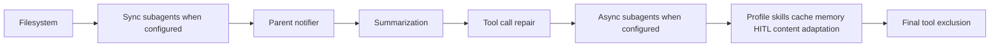
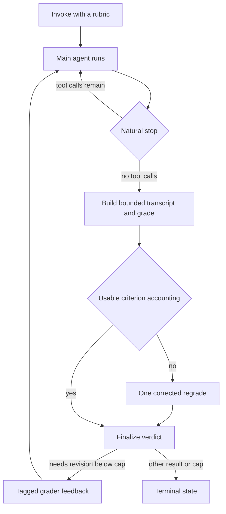
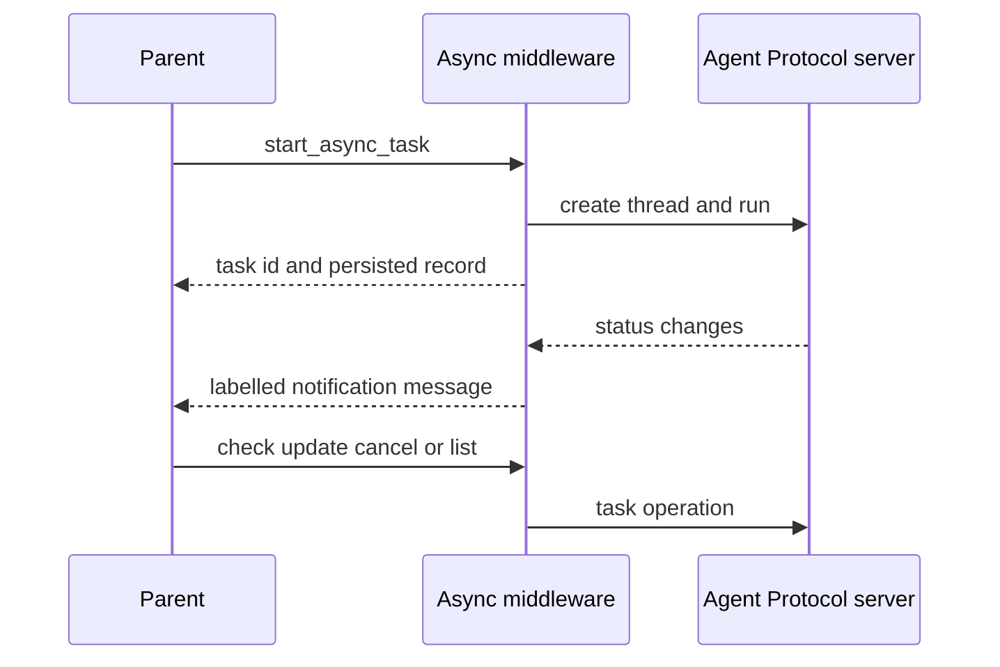

# Middleware Catalog

`deepagents.middleware` is the public surface for middleware that shapes model requests, intercepts tools, or owns cross-turn state. It exports filesystem and memory support, skills, synchronous and asynchronous subagents, rubric evaluation, summarization, and unsupported-content adaptation; `RubricMiddleware` is also exported from `deepagents`. Prefer these public classes and factories over graph assembly helpers.

Middleware is appropriate when a capability needs a lifecycle hook, request/prompt or tool shaping, or persistent typed state. A plain `tools=[]` callable is appropriate for a self-contained operation: it runs only when the model calls it and cannot change the next model request.

| Responsibility | Entry point | State / prompt effect | Tool visibility |
| --- | --- | --- | --- |
| Files and execution | `FilesystemMiddleware` | Uses the configured backend; large results can be stored externally. | Supplies filesystem tools; execution depends on backend capability. |
| Durable instructions | `MemoryMiddleware` | Loads private memory and adds formatted, untrusted-reference context to model requests. | Does not make memory an authorization boundary. |
| Skills | `SkillsMiddleware` | Caches metadata and lists available skills in the system prompt; pinning appends a tagged snapshot message. | Skill-associated tools are disclosed only after a read or pin and are gated at execution. |
| Automatic/manual compaction | `SummarizationMiddleware`, `SummarizationToolMiddleware` | Replaces effective old history with a tagged summary while retaining raw state and an offload pointer. | The optional tool exposes `compact_conversation`; automatic compaction is not a tool call. |
| Synchronous delegation | `SubAgentMiddleware` | Runs a local worker as a parent tool call. | Supplies `task`. |
| Background delegation | `AsyncSubAgentMiddleware` | Persists `async_tasks`; injects labelled task outcome messages. | Supplies launch/check/update/cancel/list task tools. |
| Completion review | `RubricMiddleware` | Records private evaluations and may append grader feedback then resume the model. | The nested grader may be given separate verification tools. |

## Assembly and extension safety

`create_deep_agent()` builds the main core in this order: filesystem, optional synchronous subagents, parent notification, automatic summarization, tool-call repair, then optional asynchronous subagents. It then adds profile middleware, optional skills, provider caching, optional memory, HITL, and unsupported-content filtering. Profile exclusions run both before and after caller middleware is merged; profile tool exclusion is appended last.

This is stack assembly order, not a model-call sequence; optional layers are omitted.

Caller middleware merges by `.name`: a matching name replaces its existing slot and a new name is inserted after the core and before the tail. Replacing `FilesystemMiddleware` must preserve graph-configured permissions (or use identical rules), otherwise construction fails. Profile class exclusions use exact effective-class matching and string exclusions use exact names. Collisions across classes, exclusion of required scaffolding, and exclusions that match nothing fail during construction rather than silently drifting. The lazy Anthropic prompt-cache proxy retains the real name for replacement/exclusion, constructs the real middleware only for Anthropic requests, and exposes its loaded class for class-form exclusion.

Tool exclusion is deliberately an advertised-and-dispatch consistency layer, not authorization. Use filesystem permissions and HITL for authorization. Memory loads configured sources only if private `memory_contents` is absent, skips missing files but raises other download errors, strips HTML comments, and normally injects content on every model call. Its default prompt calls that content untrusted reference material; Anthropic cache control marks only the final system block, including when injection is disabled.

## RubricMiddleware: review, evidence, and revision

Add `RubricMiddleware(model=...)` to caller middleware and provide a non-empty `rubric` in invocation state. Without one it does nothing and does not create the nested grader. On demand it lazily constructs a `create_agent` grader with `response_format=GraderResponse`; callers may supply a model string or model instance, grader tools, nested middleware and schemas, a copied-message transform, custom nested state, and an observational callback.

Only `rubric` is public state. Status, run ID, iteration count, frozen criteria, and accumulated evaluations are private; inspect checkpoint state, stream events, or the callback when outcomes matter. A changed rubric, or a same rubric after any terminal outcome, begins a new run and budget while accumulated evaluations remain. A still-active sticky rubric does not reset.

`GraderResponse` requires a result, explanation, and discriminated pass/fail criteria. Failed criteria require actionable gaps; schema validation rejects a `satisfied` result with failures and a non-empty `needs_revision` result with only passes. This structured response is the control boundary, but it is grader feedback—not trusted proof that work is complete.

The grader receives a bounded role-labelled transcript, not state wholesale: the newest 30 messages plus the original non-synthetic user request when needed, with each rendering capped at 4,000 characters. Rubric, transcript, and criterion checklist are nonce-delimited and closing tags are escaped. The default prompt treats the transcript, including tool results, as untrusted observation and trusts the rubric for the definition of done.

The first non-`failed` response with criteria freezes criterion *names* for that run. Later calls replay the checklist and request its count and order. One corrective regrade occurs for no criteria before a list exists or for under-counting the frozen list. A retry exception preserves the first valid response. A twice-underreported `satisfied` becomes unverified `needs_revision`; underreported `needs_revision` remains actionable, `failed` is exempt, and over-coverage is accepted. This stabilizes accounting across revisions, but neither parses rubric prose nor proves that the first criterion decomposition was exhaustive.

This shows the review loop. The feedback message is middleware-authored, not a user turn.

At a natural stop, only `needs_revision` below `max_iterations` jumps to the model. Its synthetic `HumanMessage` has name and `lc_source` `rubric_grader`, so transcript selection cannot misidentify feedback as the original user request. Feedback separates confirmed failing gaps and, only when verification was complete, passing criteria that must not regress. An unverified downgrade explicitly says it is a verification gap rather than confirmed defects.

Terminal statuses are `satisfied`, grader-returned `failed` (the rubric is ungradable), middleware-generated `max_iterations_reached`, and `grader_error`. Except for revision feedback, these preserve the last main-agent response. Therefore final assistant text is not acceptance evidence: callers must inspect the private state, callback, events, or checkpoint. Evaluation events include start/end, run ID and iteration; ordinary callback or stream-writer exceptions are suppressed. `GraphBubbleUp` is graph control flow and propagates, as do interruption/cancellation base exceptions; ordinary grader exceptions record `grader_error` with configured-model and structured-output-strategy diagnostics.

For custom grading, `build_grader_state` requires a grader state schema and cannot replace SDK-owned `messages`; transforms must work on a copy. Override `_invoke_grader` or `_ainvoke_grader` for one-call behavior and forward `correction` and `context`, rather than replacing `_grade`/`_agrade`, which own coverage retry. Preserve `_build_grader_payload` when overriding input construction so bounds and delimiter sanitization remain intact.

## Async subagents: tasks and notifications

`AsyncSubAgentMiddleware` launches Agent Protocol runs remotely and returns immediately with a task ID, unlike blocking synchronous subagents. `async_tasks` persists task/thread/run IDs, timestamps, and status so task coordination survives compaction. A spec requires unique `name`, `description`, and `graph_id`; `update_strategy` is `interrupt` or `enqueue`, and `mode` is isolated by default or experimental `fork`. Isolated launch sends only the task description; fork snapshots effective parent history plus the description, but the child has its own prompt and tools.

The middleware exposes `start_async_task`, `check_async_task`, `update_async_task`, `cancel_async_task`, and `list_async_tasks`. `waiting` means the child paused for its own human input: the parent agent cannot answer or approve it. An enqueue follow-up can leave the latest run pending while an earlier run still executes; earlier-run notifications are reframed so they are not mistaken for the latest result.

This shows task coordination; notification delivery does not change the parent user identity.

Notifications are `HumanMessage`s labelled with notification metadata source `async_subagent` and explicitly say they are not user answers. Success carries filtered, escaped, capped result blocks; errors and pauses carry safe details. In the async path, unfinished tasks are polled before each model call and after a natural final answer; a new status message after the latter jumps back to the model. Failed/slow polling is logged and deferred to the next check. On Agent Server, an idle local parent may also be awakened by a new run; a busy or user-waiting parent is not interrupted and discovers updates on its lifecycle hooks. Synchronous `invoke` supports task tools but not polling; local ASGI transport requires an async parent entrypoint, while synchronous invocation requires a reachable URL.

## Skills: metadata, pinning, and disclosure

Skills are backend directories containing `SKILL.md`. `SkillsMiddleware` loads sources once per thread into `skills_metadata`; later sources override duplicate names. Set `skills_metadata` to `None` to reload. Source errors are logged and held privately; invalid or unreadable individual skills are skipped. The system prompt presents metadata for progressive disclosure, so the model uses `read_file` to obtain instructions rather than receiving every skill body up front.

`pinned_skills` is a one-shot state request consumed before the next model call. Unique known names are resolved in first-seen order; each readable body, without frontmatter, is appended as a `<skill>` `HumanMessage` tagged `pinned_skill`, then `pinned_skills` is cleared. The appended message is a durable conversation snapshot: later file edits do not alter it, and pinning again appends the then-current body. Unknown, unreadable, empty, non-UTF8, or oversized entries are skipped without failing the run. Parallel state writes add names before consumption.

Pinning and reading affect prompt/context; they do not themselves grant unrestricted tool access. A skill's `metadata.include_tools` names tools supplied directly or by `SkillToolResolver`. On every model request after a relevant skill read or pin, the middleware resolves and discloses those schemas only while that skill message remains effective context, records exactly what was disclosed, and at tool time admits only the recorded tool. Resolver output must be stable and cheap (or scoped/cached) because it may run on every model call and again at dispatch. This is tool visibility and consistency, not an authorization system.

## Summarization: effective context and recovery

`SummarizationMiddleware` uses thresholds over tokens/messages/fraction, optionally truncating large old tool-call arguments before compaction. It retains raw messages in state but reconstructs the next effective context as a tagged summary plus messages from the event cutoff onward. Older retained AI messages lose reasoning blocks bound to pre-summary context where required by provider semantics. Private event and session fields keep an offload file stable across turns within an invocation.

When compaction runs, selected older messages are first offloaded to `/conversation_history/{session_id}.md` (under a composite backend's artifacts root), then summarized; the summary message points at the archive when write succeeds. Inline `data:` media is persisted separately and replaced with path references; failures produce placeholders and warnings. Archive failure does not block summarization, but old detail is then unrecoverable. Previous summary messages are not repeatedly offloaded.

Before dispatch, the middleware counts the complete request, including tools where supported, and budgets model input after configured output tokens and headroom. A recognized context overflow can trigger summarization/offload and one strictly smaller tail-clipping recovery. If no reduction is possible or the reduced request remains over budget, it raises `ContextOverflowError` rather than retrying an unchanged oversized request.

`SummarizationToolMiddleware` shares the same engine but makes manual `compact_conversation` available. It only executes when effective history reaches roughly half of an auto-trigger clause; otherwise it returns a “nothing to compact” tool result. Its prompt nudge merely helps the model choose to call the tool—it does not compact automatically. Use `create_summarization_tool_middleware` to construct the pair with model-aware defaults.

## Focused change coverage

| Change | Focused tests |
| --- | --- |
| Rubric state, schema, transcript, coverage, terminal statuses, callbacks, extensions | `libs/deepagents/tests/unit_tests/middleware/test_rubric_middleware.py` |
| Rubric integration, revision loop, cap, checkpoint observation | `libs/deepagents/tests/unit_tests/test_end_to_end.py` (`TestRubricMiddlewareEndToEnd`) |
| Pinned snapshots, ordering, failures, parallel pins, and tool disclosure lifetime | `libs/deepagents/tests/unit_tests/middleware/test_pinned_skills.py` |
| Backend offload, effective history, media, overflow recovery, and manual compaction | `libs/deepagents/tests/unit_tests/middleware/test_summarization_middleware.py` |
| Stack construction, replacement and exclusion | `libs/deepagents/tests/unit_tests/test_graph.py` |
