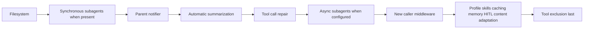
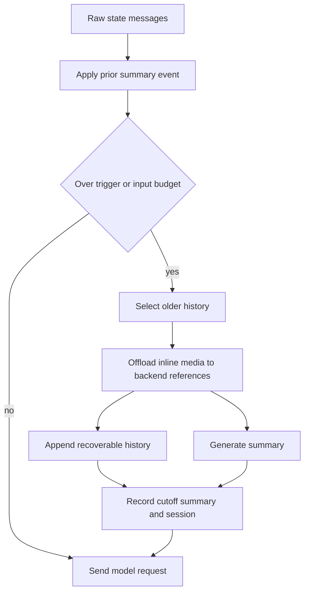
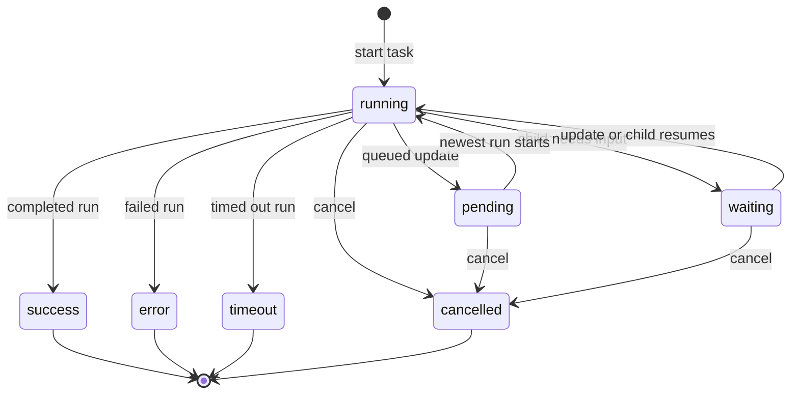

# Middleware Catalog

`deepagents.middleware` is the public import surface for middleware that changes a model request, tool execution, or cross-turn state. The package exports filesystem, memory, skills, summarization, synchronous and asynchronous subagent, rubric, and unsupported-content middleware, plus their public configuration and result types. Graph-only helpers—such as prompt caching, tool-call repair, parent notification, and tool exclusion—are implementation components rather than public extension APIs.

## How to choose the mechanism

| Need | Module / entrypoint | What it does |
| --- | --- | --- |
| Plan and track work | `TodoListMiddleware` supplied through caller middleware or a harness profile | Adds the `write_todos` facility. It is opt-in; the default main agent and its default general-purpose subagent do not receive it. |
| Read, search, mutate, or execute against a backend | `FilesystemMiddleware` | Provides filesystem tools, adds `execute` only for a sandbox-capable backend, and manages oversized content. |
| Govern filesystem access or seek approval | `FilesystemPermission` plus `permissions=` / `interrupt_on=` | Matches read/write paths for allow, deny, or HITL interruption. This is the authorization boundary, not profile tool visibility. |
| Carry durable project instructions | `MemoryMiddleware` | Loads configured `AGENTS.md` sources once into private state and appends a formatted memory fragment per model request. |
| Discover workflows on demand | `SkillsMiddleware`, `SkillMetadata`, `SkillToolResolver` | Lists skill metadata first; instructions and skill-scoped tools are disclosed only after a skill is read or pinned. |
| Limit context without losing recoverability | `SummarizationMiddleware` or `create_summarization_tool_middleware` | Archives older history, summarizes it, and projects effective context for the request. |
| Delegate and await an answer | `SubAgentMiddleware`, `SubAgent`, `CompiledSubAgent` | Provides blocking `task` delegation to local declarative or compiled workers. |
| Delegate background work | `AsyncSubAgentMiddleware`, `AsyncSubAgent`, `TaskEvent` | Starts and monitors remote Agent Protocol work while the parent continues. |
| Repair interrupted history | internal `PatchToolCallsMiddleware` | Adds error results for dangling valid or invalid tool calls before an agent run. |
| Review an answer | `RubricMiddleware` | Optionally grades a natural completion and can request another model turn. |
| Adapt multimodal content | `UnsupportedContentMiddleware` | Produces a filtered outbound copy for the resolved model without erasing the original thread. |

Use middleware rather than a plain `tools=[...]` callable when a capability must alter the prompt or visible tools per request, intercept a tool boundary, or retain typed state. Plain tools are appropriate for isolated consumer-specific operations: they run only after the model selects them and cannot prepare every model request.

This shows the lifecycle boundary middleware adds around a model and its tools.

## Assembly: the default stack is an ordered policy

`create_deep_agent()` begins the main stack with `FilesystemMiddleware`; it adds `SubAgentMiddleware` when inline subagents exist, then parent notification, automatic summarization, and tool-call repair. Configured async subagents finish this core. Harness-profile middleware, optional skills, provider prompt caching, optional memory, optional HITL, and unsupported-content adaptation form the tail. A new caller middleware is placed after the core; a caller middleware with the same name replaces the existing entry in place. Profile exclusions are applied around customization, and profile-controlled tool exclusion is always appended last.

This is the main-agent assembly order; optional layers are omitted and a same-name replacement preserves its slot. The automatically inserted general-purpose subagent has its own stack (filesystem, summarization, repair, profile middleware, optional skills, and caching), not an arbitrary copy of the main stack. Only caller overrides for its original middleware slots can be inherited.

Harness profiles are beta runtime configuration applied after model construction. They tune prompts, visibility, extra middleware, and the default general-purpose worker; required filesystem, subagent-dispatch, and permission scaffolding cannot be excluded. A profile may supply `TodoListMiddleware` through `extra_middleware`: that is why some profiles expose `write_todos`, while a default agent does not.

`_ToolExclusionMiddleware` removes excluded names from the request and returns an error for a matching call at the tool boundary. It preserves consistency between advertised and dispatchable tools after later wrappers run; its implementation explicitly says it is not a security surface. Use filesystem permission rules and HITL for protection.

## Filesystem, content, and approvals

`FilesystemMiddleware` works through `BackendProtocol`, defaulting to ephemeral `StateBackend`. It registers `ls`, `read_file`, `write_file`, `edit_file`, `delete`, `glob`, and `grep`; `execute` is usable only when the resolved backend supports sandbox execution. A `tools=` allowlist omits unlisted tools from the dispatchable node—not merely from the model schema—and must include `read_file`. Capability checks can still remove `execute` or `delete`.

The middleware applies its backend-aware prompt and visible-tool filtering on each model call, offloads oversized tool and human content, and can offload binary media as content-addressed backend blobs while rehydrating it for a request. On a `ModelInvalidRequestError`, it retries only when replacing rejected file content produces a changed request; otherwise it re-raises. Put `UnsupportedContentMiddleware` last when constructing an agent directly so provider-incompatible `read_file` output is adapted after filesystem work.

`FilesystemPermission` classifies operations as `read` or `write` and supports `allow`, `deny`, and `interrupt` modes. Paths must be absolute and cannot contain `..` or `~`. For a real `FilesystemBackend`, deny checks apply to both the requested path and its symlink-resolved target, preventing a symlink escape. `interrupt` rules are converted into `HumanInTheLoopMiddleware` configuration during graph construction; broad unanchored bulk-search patterns can conservatively interrupt more operations. Tool-level permission enforcement for `execute` is not implemented, so unsupported permission-plus-execution configurations fail rather than silently claiming protection.

The internal message-eviction helper is shared by filesystem middleware and summarization overflow recovery. It offloads a large tool result only after a successful backend write, replaces text with a line-numbered head-and-tail preview, preserves non-text blocks, and leaves the original result intact on failure.

## Memory, skills, and prompt caching

`MemoryMiddleware` reads configured sources in order before the first agent run and stores path-to-content mappings in private `memory_contents`; missing files are skipped, whereas other download failures raise `ValueError`. It strips HTML comments and appends the sources in order to its system-prompt template on every request. Passing `system_prompt=None` still loads private state but suppresses prompt injection. The default memory guidance treats files as reference material rather than trusted hidden instructions and says not to store credentials.

`SkillsMiddleware` is the progressive-disclosure alternative: it scans backend skill sources once per thread into `skills_metadata`, with later sources overriding duplicate names. Set that state key to `None` to force a reload. The system prompt receives metadata and load warnings, while a `pinned_skills` request appends named readable `SKILL.md` bodies before a model call. A model can also read a skill through filesystem `read_file`.

Skill frontmatter can declare `metadata.include_tools`. Such tools are not advertised merely because they exist: reading or pinning the relevant skill discloses them for the request and records the disclosure in private state; the tool wrapper only resolves and runs a matching disclosed tool. `SkillToolResolver` may be sync or async and is called on every relevant model call and again at tool execution, so it must return stable per-thread results and be inexpensive or cached. Async resolvers require an async entrypoint.

The graph places skills after compaction and any profile routing but before caching, so discovery sees the effective conversation and resolved model. `append_prompt_caching_middleware` always adds the Anthropic middleware with unsupported models ignored, and conditionally adds Bedrock or Fireworks middleware when their optional integration packages import successfully. When graph-assembled memory is enabled, it adds an Anthropic cache-control breakpoint after memory content without applying it to other model wrappers.

## Context compaction and recovery

The graph installs `create_summarization_middleware(model, backend)`. It requires an already resolved `BaseChatModel`: when the model profile supplies `max_input_tokens`, defaults use fraction-based trigger, retention, and argument-truncation settings; otherwise they fall back to fixed token and message thresholds. A string model is rejected, making model resolution explicit outside graph assembly.

The automatic engine retains raw `state["messages"]`. Private summary-event and session state instead record a cutoff, summary message, and optional history path; later calls reconstruct effective history from the summary plus messages after the cutoff. Evicted messages are appended to a session-specific backend history file. History archival failure is non-fatal, but leaves no recovery path in that event.

This automatic path changes effective request context without rewriting the raw log. It also truncates older large write/edit arguments before full compaction and handles provider context-overflow rejection by compacting and retrying. The default summary prompt instructs the model to retain offloaded-media references rather than invent their visual content.

`SummarizationToolMiddleware` exposes `compact_conversation` but does not compact by itself. It shares the automatic engine's event/session state, waits until usage is about half the automatic trigger, and emits a no-op or error `ToolMessage` without updating the event when it cannot compact. On success it writes the same event, session ID, and correlated confirmation as automatic compaction; an archive operation that returns `None` is still a successful but non-recoverable compaction, whereas an exception returns the error result without state updates. `create_summarization_tool_middleware()` resolves a model string if necessary and registers only this explicit tool layer; pair it with `SummarizationMiddleware` when automatic behavior is desired.

## Delegation and completion control

The synchronous `task` tool runs a selected declarative or compiled subagent and returns one parent `ToolMessage`: it serializes `structured_response` when present, otherwise selects the last non-empty `AIMessage` text. A forked declarative worker receives the parent's effective compacted history and cannot recursively delegate through `task`; an isolated worker starts from the delegated description.

`AsyncSubAgentMiddleware` instead exposes `start_async_task`, `check_async_task`, `update_async_task`, `cancel_async_task`, and `list_async_tasks` for Agent Protocol servers. It persists a merge-reduced `async_tasks` map keyed by task ID. Each record identifies the remote thread and newest run, names the agent type, stores a string status, and records creation, check, and update timestamps; queued follow-ups also retain superseded run IDs. Construction rejects an empty specification list, duplicate names, invalid `isolated`/experimental `fork` modes, and invalid `interrupt`/`enqueue` update strategies. An isolated launch sends only the description. Experimental `fork` serializes effective summarized conversation and task after removing artifacts and rehydrating offloaded media; the remote agent owns its own prompt, tools, and runtime.

*The parent persists its view of the remote task; `waiting` is nonterminal because the child thread awaits its own user or approval.*

`update_async_task` either interrupts the active run or, for a specification configured with `enqueue`, queues a follow-up and temporarily reports `pending`. Async lifecycle polling is meaningful only on the async path: at agent start and before model calls it refreshes unfinished `running`, `pending`, and `waiting` tasks. After a natural final response, a newly observed outcome is added as a marked notification and the middleware jumps back to `model` for another turn. Per-task check failures or five-second timeouts are logged and deferred to a later poll; synchronous hooks pass through. A missing remote URL selects local ASGI transport and requires asynchronous parent invocation; synchronous invocation needs a reachable server URL.

`RubricMiddleware` is dormant without a `rubric` in invocation state. When present, it initializes private iteration state, grades natural completion, and can return to the model with revision feedback. Failed grading, grader errors, and exhausted iterations leave the last model response unchanged; callers that need a decision should inspect rubric state, callbacks, or stream events.

`UnsupportedContentMiddleware` runs late because it evaluates the resolved request model after routing/fallback decisions. It copies only affected human and tool messages for that outgoing request, replacing blocks the active model cannot accept while preserving the original thread for a later capable model.

## Focused change coverage

Test stack order, name-based replacement, profile exclusion validation, and the final exclusion boundary. Cover filesystem backend capability filtering, allowlist dispatch removal, symlink-deny behavior, HITL conversion, offload failure, and rejected-content retry. For memory and skills, cover first-load versus reload state, source precedence, missing versus failed reads, pinning, tool disclosure expiry, resolver stability, and async resolver use.

For context, cover model-profile versus fallback defaults, cutoff reconstruction, history/media archive failure, provider-overflow recovery, and the distinction between automatic and explicit compaction. For delegation, cover isolated/fork payloads, output adaptation, recursion refusal, async record persistence, terminal updates, cancellation, and notifications. Rubric tests should cover no-rubric pass-through, revision loops, iteration limits, and grader errors; compatibility tests should assert that filtering affects only the outbound copy.
