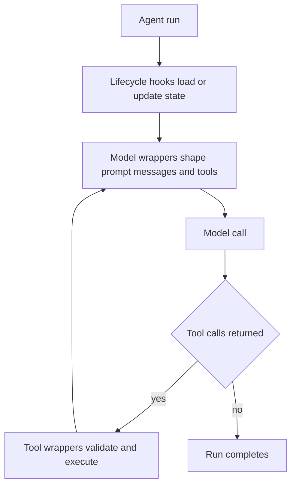
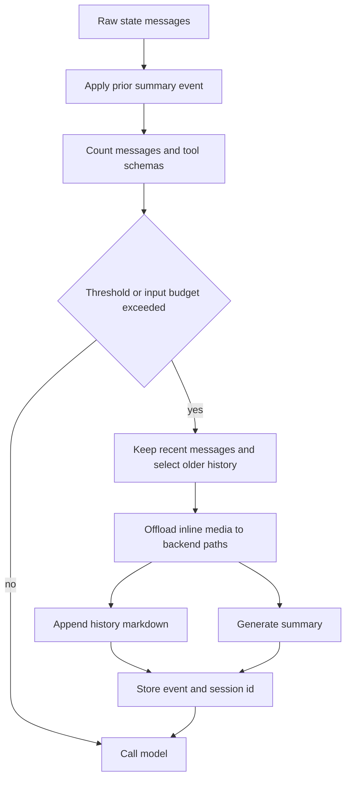
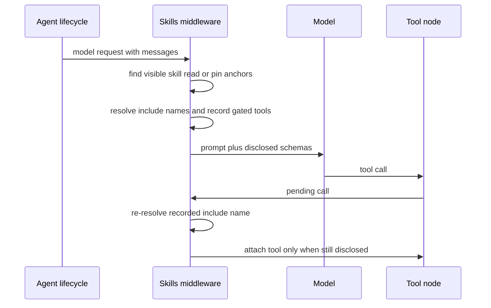
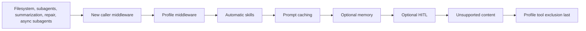

# Middleware Catalog

`deepagents.middleware` is the public import surface for filesystem, summarization, skills, synchronous and asynchronous subagents, memory, rubric, and unsupported-content middleware, plus their key types. `create_deep_agent()` assembles those layers around LangChain's agent lifecycle; it also uses internal layers such as `PatchToolCallsMiddleware`, prompt caching, and the final tool-exclusion filter.

## Why middleware rather than an ordinary tool?

A callable passed as `tools=[...]` is selected and invoked *after* the model requests it. An `AgentMiddleware` participates before and around the model and tool boundaries. In particular, `wrap_model_call()` can change every outbound request's system message, messages, selected tools, or behavior based on state and the resolved model; tool wrappers can validate or replace a pending tool call. Use middleware for request-sensitive behavior, cross-turn state, or policy. Use an ordinary tool for a self-contained capability.

This lifecycle shows why middleware has control before every model request while an ordinary tool runs only after the model selects it.

## Public catalog

| Responsibility | Primary entrypoint | State and request or tool effect |
| --- | --- | --- |
| Files, shell, and file policy | `FilesystemMiddleware`, `FilesystemPermission` | Supplies file and execution tools, adapts capabilities to the backend, enforces filesystem rules, and manages large or binary read results. |
| Context management | `SummarizationMiddleware`, `SummarizationToolMiddleware` | Automatically compacts at a threshold or exposes the model-callable `compact_conversation` tool. |
| Persistent instructions | `MemoryMiddleware` | Loads configured `AGENTS.md` sources into state and normally appends their content to the system prompt. |
| Skills and conditional tools | `SkillsMiddleware`, `SkillMetadata`, `SkillsState`, `SkillToolResolver` | Loads a skill index, adds progressive-disclosure instructions, and exposes skill tools only when their instruction anchor is present. |
| Synchronous delegation | `SubAgentMiddleware`, `SubAgent`, `CompiledSubAgent` | Provides the blocking `task` tool for declarative or precompiled workers. |
| Background delegation | `AsyncSubAgentMiddleware`, `AsyncSubAgent` | Provides Agent Protocol task launch and management without blocking the parent. |
| Completion review | `RubricMiddleware` | Grades a proposed completion and can append revision feedback and return control to the model. |
| Provider compatibility | `UnsupportedContentMiddleware` | Replaces model-unsupported human and tool content blocks in the outbound request only. |

## Context compaction: automatic engine and optional tool

`create_deep_agent()` installs `create_summarization_middleware(model, backend)` in its core stack. This factory requires a resolved `BaseChatModel` and chooses limits from the active model profile: with an integer `max_input_tokens`, it triggers and retains at `0.85` and `0.10` of the window; without that profile it uses a `170000`-token trigger, keeps six messages, and applies tool-argument truncation at 20 messages. Factory options for a prompt, token counter, trim budget, and alternate summarizer are keyword-only. The factory deliberately defaults `trim_tokens_to_summarize` to `None`, unlike direct construction, which defaults to 4000.

The automatic middleware preserves raw `state["messages"]`. Instead it records a private `_summarization_event` containing the absolute cutoff, a summary `HumanMessage`, and the history path; on later requests, the effective transcript is that summary followed by messages at the cutoff. `_summarization_session_id` is also private and persists a per-invocation filename, so subsequent events append rather than overwrite. This keeps the raw log available to replay and lets the compact tool share the same event state.

This is the automatic compaction path. The synchronous implementation archives before generating the summary; the asynchronous path runs those independent operations concurrently after media is prepared.

Evicted history is appended as XML-formatted markdown at `/conversation_history/{session_id}.md` (under a composite backend's artifacts root). Inline media is uploaded separately under `conversation_history/media/` and replaced by references before both archiving and summarization. The default Deep Agents summary prompt tells the summarizer to retain those media references without inventing visual details, and tells the later agent it can use `read_file` on the referenced path. Failure to archive does **not** prevent a summary, but leaves `file_path=None` and warns that old material cannot be recovered; failed media becomes an explicit placeholder in saved history.

Before automatic compaction, older tool-call arguments can be truncated under `truncate_args_settings` while the keep window remains intact. The complete outbound request also reserves configured output tokens and five percent headroom. If a provider signals a recognized context overflow, the middleware attempts compaction and then at most one strictly smaller tail-clipped retry; an unchanged or still-over-budget request raises `ContextOverflowError` rather than repeatedly resending it.

### `compact_conversation` is a separate, explicit capability

`SummarizationToolMiddleware` owns exactly the `compact_conversation` tool and never compacts on its own. It delegates to a supplied `SummarizationMiddleware` engine and writes the same private event/session keys, so manual and automatic compaction interoperate. Its factory, `create_summarization_tool_middleware(model, backend, *, system_prompt=None)`, resolves a model string if necessary and creates an engine, but registers **only** the tool layer. In a normal `create_deep_agent()` graph, add this middleware alongside the built-in automatic engine when the model should proactively compact.

The tool refuses early compaction until reported usage reaches roughly half of the automatic trigger, returns a “Nothing to compact” `ToolMessage` if no eligible cutoff exists, and returns a `Command` containing a confirmation message plus the event on success. Summary or archive exceptions become an error `ToolMessage` without changing the summary event. An optional string `system_prompt` can nudge the model to use the tool; `None` leaves the tool registered but makes no prompt modification.

## Filesystem, memory, and compatibility seams

Filesystem permissions are evaluated in declaration order and the first matching rule wins; unmatched operations are allowed. `deny` returns a permission error, whereas `interrupt` contributes an approval rule to `HumanInTheLoopMiddleware` (with caller-supplied `interrupt_on` taking precedence for a tool). These rules apply to built-in filesystem tools, not direct backend use. Subagents inherit parent permissions unless their specification supplies a replacement list.

With `offload_binary_content=True`, `FilesystemMiddleware` content-addresses valid base64 `read_file` payloads under `{artifacts_root}/blobs/<sha256>`, stores `deepagents_blob` references, and rehydrates verified payloads for a model request. It also replaces inline human media and `read_file` results found in history at the next model call. A failed upload remains inline; missing, malformed, tampered, or unavailable blobs become a text notice. The option is disabled with a warning when the `blobs/` route is a `StateBackend`, because that route would keep the payload in checkpointed state rather than offloading it.

`MemoryMiddleware` loads sources once when `memory_contents` is absent, strips HTML comments before prompt injection, and permits `system_prompt=None` when callers want state without injected instructions. In the assembled graph it requests an Anthropic-only cache-control breakpoint after the generic caching middleware. `UnsupportedContentMiddleware` must be late: it evaluates the *actual request model* and replaces unsupported multimodal blocks only in a copied request, preserving the original thread for a later capable model.

## Skills: progressive disclosure and a per-request gate

`SkillsMiddleware` enumerates `SKILL.md` files through backend APIs. It loads sources in order, with the last duplicate name winning, and caches the result in per-thread `skills_metadata`: a list, including `[]`, suppresses another load; missing or `None` reloads. Load diagnostics are recorded privately in `skills_load_errors` and logged. The default prompt lists metadata and asks the model to `read_file` the selected skill; `system_prompt=None` suppresses only that prompt addition.

`pinned_skills` is an explicit alternative to waiting for a read. Before the next model call, each known, readable named skill is appended as a `HumanMessage` containing its `SKILL.md` body without frontmatter, then the pending names are cleared. Parallel writes accumulate; unknown or unreadable names are skipped.

A skill may declare space-separated `metadata.include_tools`. Tools owned by the skills middleware are intentionally omitted from ordinary agent registration. A successful `read_file` result for the loaded skill's `SKILL.md` anchors disclosure only while it remains in the request messages. A call cannot use a gated tool before that anchor, including in the same model turn that requested the read; compaction that removes the anchor withdraws it.

This sequence shows that visibility is determined for one request and execution is checked again at the tool boundary.

A `SkillToolResolver` may map one include name to several runtime-specific tools. It must return a sequence of `BaseTool` instances; the middleware keeps the first occurrence of each name and rejects a non-sequence or non-tool entry. A `tools` sequence is normalized the same way, but a bare tool, provider-native tool dictionary, or duplicate name is rejected at construction. Synchronous execution rejects an awaitable resolver result; asynchronous execution awaits it.

The middleware records only **gated** tools from the latest model call in private `_skill_tools_disclosed`, mapping tool name to include name, and writes this record on every call, including `{}`. At tool time it re-resolves the recorded include name and attaches the result only if the requested name is still returned. An undisclosed call, a malformed or legacy record, or a tool the resolver no longer returns remains an invalid tool. `disclosed_skill_tool_names(state)` exposes the gated names for another middleware that needs the same gate; deferred request tools are deliberately excluded.

Existing request tools named by an include are already callable. If such a tool is marked `extras={"defer_loading": True}`, reading or pinning the skill reveals its schema but does not gate execution. For models without inline additions, disclosure removes that marker on the request copy and appends gated tools to its bindings. A `ChatAnthropic` or `BaseChatOpenAI` model whose profile declares `mid_conversation_tools` receives provider-native blocks instead: Anthropic `tool_addition` blocks and OpenAI Responses `additional_tools` blocks. These additions are inserted after the complete anchoring tool-result batch and queued user or empty-assistant messages, never in front of a user turn; the same visible anchor produces the same inserted bytes, preserving a cached prefix. Already-bound non-deferred tools add nothing, and a request tool with the same name takes precedence over a resolver result.

Anthropic rejects a root `oneOf`, `anyOf`, or `allOf` in an input schema. Before either binding or inline serialization, the middleware withholds such disclosed tools (including deferred ones), logs a warning, and removes them from the gate record. This prevents the entire provider request from failing and keeps authorization aligned with the schemas actually sent. OpenAI disclosure does not apply that Anthropic-specific filter.

## Subagents, state boundaries, and skill sources

A declarative `SubAgent` receives an independently assembled middleware stack; a `CompiledSubAgent` supplies its own runnable. Isolated workers receive only the delegated task by default. Experimental `mode="fork"` instead continues the parent's effective, compacted conversation, rebuilds inherited prompt-producing behavior, and refuses recursive `task` delegation at call time. A fork cannot declare its own `skills`: it inherits the top-level sources so its skill registry does not diverge.

The `task` tool rejects an unknown subagent type and requires a tool-call ID. A child result becomes one parent `ToolMessage`: it serializes `structured_response` when supplied, otherwise takes the last non-empty `AIMessage` text. Ordinary parent/subagent exchange excludes `skills_metadata`, `pinned_skills`, and the last skill-tool disclosure, as well as fields marked `PrivateStateAttr`; this prevents a worker's skill loading and per-call authorization record from leaking across agents. A custom state schema whose annotations cannot be resolved at runtime is a risk boundary: its private fields cannot be discovered and are forwarded with a warning.

### Remote asynchronous subagents

`AsyncSubAgentMiddleware` is a distinct remote-delegation path, not a nonblocking variant of `task`. Each `AsyncSubAgent` names an Agent Protocol `graph_id` and can supply a server `url` and headers. The middleware creates `start_async_task`, `check_async_task`, `update_async_task`, `cancel_async_task`, and `list_async_tasks`; it rejects an empty spec set, duplicate names, and any mode other than `isolated` or experimental `fork`.

Starting a task creates a remote thread and run, returns immediately, and writes an `AsyncTask` record to the parent's `async_tasks` state keyed by its task/thread ID. The record retains the agent name, current run ID, status, and timestamps, so it survives compaction and can be checked later. `check_async_task` fetches the run and returns the final remote message on success; `list_async_tasks` refreshes non-terminal statuses but falls back to the stored status if the status request fails. `update_async_task` interrupts the current run by starting a new run on the same remote thread and replaces its run ID; cancellation marks the tracked task cancelled after the remote cancellation succeeds.

An isolated remote launch sends only the description. A remote fork sends a snapshot of the parent’s effective, summarized conversation plus the task, rehydrates offloaded tool media before serializing it, and drops local artifacts and eviction tags. The remote agent still owns its system prompt, tools, and runtime. Omit `url` only for an async parent entrypoint such as `ainvoke`; synchronous launching requires a reachable URL. Platform credentials normally come from the SDK environment, while self-hosted authentication belongs in `headers` (the middleware supplies `x-auth-scheme: langsmith` unless overridden).

Skill configuration is scoped deliberately:

- `create_deep_agent(skills=[...])` populates the automatic main and default general-purpose stacks. A declared isolated worker must use its own `skills` or its own standard-named `SkillsMiddleware`; a fork inherits the top-level sources.
- A custom `SkillsMiddleware` named `SkillsMiddleware` takes the reserved skills slot. When `skills=None`, its sources also supply the automatic stack and general-purpose worker; replacements with the same name keep the slot, and the last replacement wins.
- A differently named `SkillsMiddleware` subclass is ordinary custom middleware. It does not create or replace the automatic skills slot.
- The default general-purpose worker mirrors only caller middleware that replaces one of its own default slots. New caller middleware stays main-agent-only.

## Assembly order and safety-critical replacement

The main stack starts with `FilesystemMiddleware`, synchronous subagents when available, summarization, `PatchToolCallsMiddleware`, and asynchronous subagents when configured. New caller middleware is inserted immediately after that core. Profile middleware, automatic skills, prompt caching, optional memory, optional HITL, and unsupported-content adaptation form the tail; profile tool exclusion is appended last.

This is the normal main-stack assembly; absent optional entries are simply skipped.

Name controls replacement. Assembly applies profile exclusions once to the base stack, merges caller middleware, then applies exclusions again before appending the final tool filter. A custom middleware whose `.name` remains present replaces the corresponding surviving layer in place; otherwise it is inserted after the last core layer and before the tail. Thus replacing `SkillsMiddleware` by name preserves its placement, while adding a second, novel skills layer changes wrapper interactions. The second exclusion pass prevents caller middleware from reintroducing a profile-excluded entry. Profile `excluded_middleware` rejects an unmatched, ambiguous, private-name, or protected-scaffolding exclusion rather than silently creating a degraded agent. `FilesystemMiddleware` and `SubAgentMiddleware` are protected scaffolding.

Skills belongs after compaction and routing or fallback middleware, but before caching, so it sees compacted messages and the actual model. The final `_ToolExclusionMiddleware` removes excluded tool names from the request **and** rejects matching tool calls at execution. It prevents later custom wrappers from restoring profile-excluded tools, but is explicitly a visibility and consistency guard rather than a security boundary; filesystem permissions are the authorization mechanism.

## Focused regression coverage

The summarization tests cover profile-based and profile-less factory defaults, a rendered default prompt containing escaped media-reference syntax, custom summary engines, compact-tool registration and prompt suppression, event-cutoff arithmetic, successful sync/async compaction, backend/archive failure, and summary failure. They establish the distinction between an automatic engine and a tool-only factory, and that failed explicit compaction cannot silently update summary state.

When changing the rest of this stack, test ordering rather than only individual methods: name replacement versus new insertion; protected and final profile filtering; placement of skills after fallback or routing and before caching; default, declarative, and forked skill sourcing; and general-purpose inheritance. Skill-tool coverage should exercise successful and failed reads, pin anchors, same-turn rejection, compaction withdrawal, malformed disclosure records, resolver re-resolution and validation, deferred tools, name collisions, and Anthropic schema rejection. Provider-payload tests assert addition placement, prefix stability, fallback behavior, and inline-versus-bound disclosure.

For delegation, test the state boundary and result adapter as well as the tool schema: isolated versus forked message construction, recursion refusal, private-state stripping, structured-output serialization, and compiled-runnable requirements. Async coverage should use mocked SDK clients to verify task creation and persisted IDs, invalid types and duplicate specs, status and result handling, update replacement of the run ID, cancellation, terminal-status behavior, and both isolated and forked launch payloads. These tests protect the invariant that the model's advertised tools, the selected model, and tool-time execution agree.
