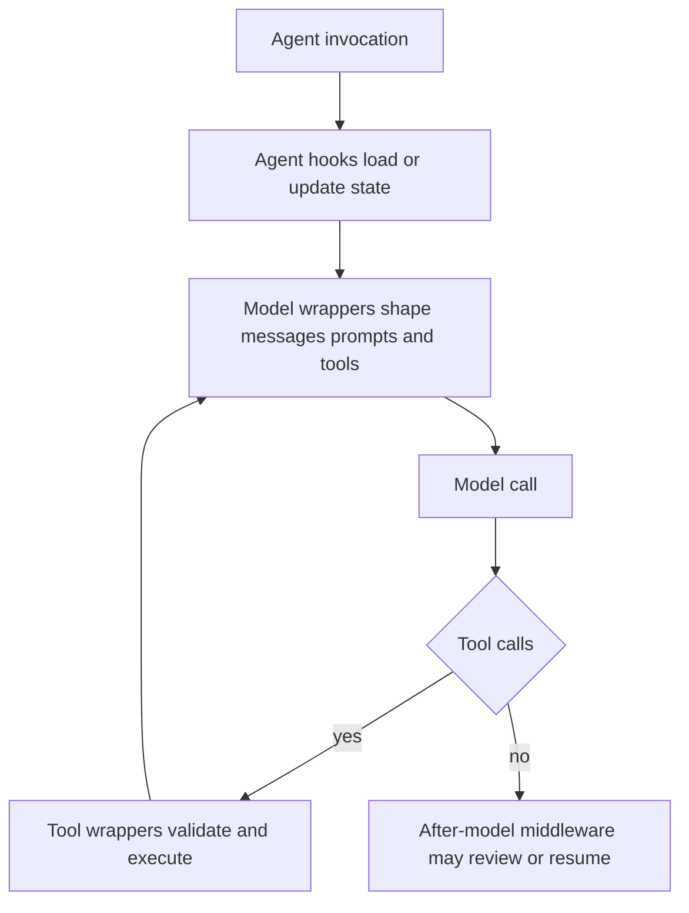
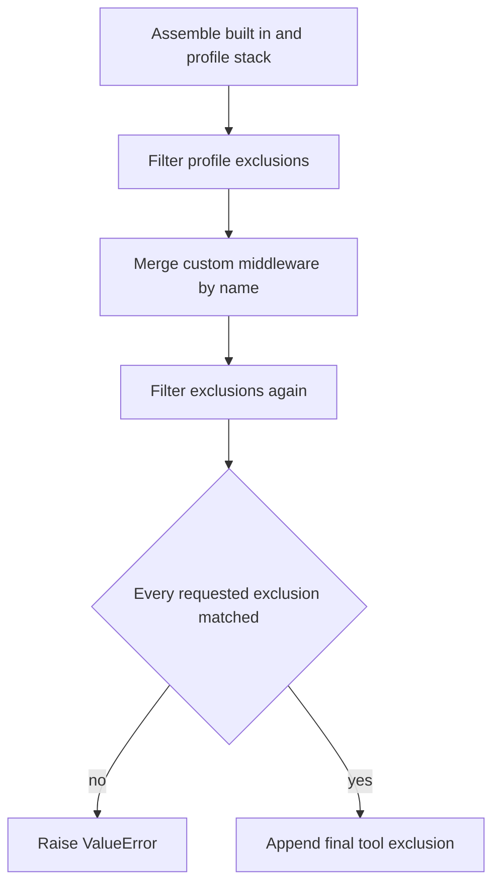
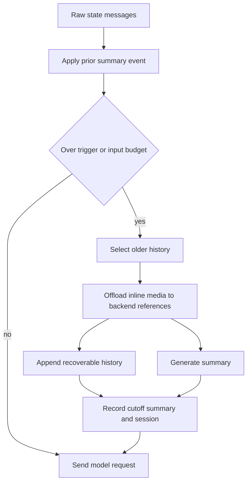

# Middleware Catalog and Extension Rules

`deepagents.middleware` is the public import surface for middleware that prepares a model request, intercepts tool execution, or owns cross-turn state. It re-exports filesystem permissions, memory, skills and `SkillToolResolver`, summarization, synchronous and asynchronous subagents, rubric evaluation, and unsupported-content filtering. Use these public classes and factories as extension points. Graph-only helpers—prompt caching, parent notification, tool-call repair, and tool exclusion—are assembly details rather than consumer APIs.

Middleware differs from a plain `tools=[]` callable because it can run at agent, model, and tool hooks, shape the request on every model call, and persist typed state. Use a plain tool for a self-contained consumer operation; use middleware when the capability needs prompt/tool shaping, policy enforcement, or lifecycle state.

| Responsibility | Public entrypoint | Lifecycle / boundary |
| --- | --- | --- |
| Backend files and execution | `FilesystemMiddleware` | Supplies filesystem tools through `BackendProtocol`; adds execution only for `SandboxBackendProtocol`; evicts oversized results to backend storage. |
| File access policy and approval | `FilesystemPermission` | Matches read/write path rules for allow, deny, or interruption. This—not profile visibility—is the authorization boundary. |
| Durable instructions | `MemoryMiddleware` | Loads configured sources into private state before the agent and appends formatted memory on model requests. |
| Progressive workflow discovery | `SkillsMiddleware`, `SkillToolResolver` | Loads skill metadata, injects discovery context, and discloses declared tools only when their skill is read or pinned. |
| Context management | `SummarizationMiddleware`, `SummarizationToolMiddleware` | Projects effective history and automatically compacts, or exposes explicit `compact_conversation`. |
| Blocking delegation | `SubAgentMiddleware` | The `task` tool invokes a local declarative or compiled worker and returns a parent tool result. |
| Background delegation | `AsyncSubAgentMiddleware` | Launches, polls, updates, cancels, and lists remote Agent Protocol work while the parent continues. |
| Completion review | `RubricMiddleware` | Optionally grades a natural completion and can return control to the model for revision. |
| Model compatibility | `UnsupportedContentMiddleware` | Makes an outbound copy containing replacements for blocks unsupported by the resolved model. |

This shows the relevant middleware lifecycle: model wrappers apply on every turn, while tool wrappers are the last interception point before dispatch.

## Default assembly is a policy order

`create_deep_agent()` builds a core stack of filesystem, optional synchronous subagents, parent notification, automatic summarization, tool-call repair, and optional asynchronous subagents. Profile middleware, optional skills, provider caching, optional memory, HITL, and unsupported-content filtering form the tail. Profile exclusions are applied before caller middleware and again afterward; caller middleware therefore cannot restore an excluded entry. Finally, profile-controlled tool exclusion is appended last.

```mermaid
flowchart LR
    Fs["Filesystem"] --> Sync["Sync subagents when present"]
    Sync --> Notify["Parent notifier"]
    Notify --> Summary["Automatic summarization"]
    Summary --> Repair["Tool-call repair"]
    Repair --> Async["Async subagents when configured"]
    Async --> Profile["Profile middleware and skills"]
    Profile --> Cache["Provider caching and memory"]
    Cache --> Safety["HITL and content adaptation"]
    Safety --> Exclude["Middleware filtering then tool exclusion"]
```

This is the main-stack assembly order; optional layers are omitted. The general-purpose subagent has a separate filesystem/summarization/repair/profile/skills/caching stack. Declarative subagents build their own stack for their resolved model; a fork also mirrors parent prompt-producing middleware. Only overrides of original general-purpose slots are inherited from the main agent. `TodoListMiddleware` is not in either default stack, but may be enabled explicitly or injected through a harness profile's `extra_middleware`.

`_ToolExclusionMiddleware` is deliberately last: it removes excluded tools from model requests and returns an error for a matching call at the tool boundary. It keeps advertised and dispatchable tools consistent; it is explicitly not a security surface. Protect filesystem operations with permissions and HITL instead.

## Replacement and exclusion are safety controls

### Replacement uses the public `.name` slot

Caller or subagent `middleware=` is merged by `.name`, not Python subclass identity. A matching name replaces the assembled entry in the same position; a new name is inserted after the core stack and ahead of the profile/prompt-caching/memory tail. Replacements of `FilesystemMiddleware` must retain the graph's permission rules (or use exactly the same rules), preventing a replacement from silently weakening configured filesystem policy. Because later duplicate custom names overwrite earlier candidates during merge, use one deliberate instance per name.

A same-name subclass can intentionally replace `SummarizationMiddleware`; a differently named subclass is a distinct capability and remains alongside the default. Name choice is therefore a compatibility and ordering decision, not cosmetic metadata. In a forked declarative subagent, spec middleware wins over inherited parent middleware with the same name.

### Exclusion matching, aliases, and audit failures

`HarnessProfile.excluded_middleware` accepts runtime classes or public name strings. These forms have intentionally different safety properties:

- **Class form is exact type matching**, not `isinstance`. Excluding a base class does not remove a caller's subclass. This prevents a broad exclusion from deleting an intentional replacement.
- **String form is exact `.name` matching**, including public aliases such as `SummarizationMiddleware` for the private implementation. It is appropriate for declarative configuration, where classes cannot be passed.
- A string that matches more than one concrete effective class **in a single stack raises `ValueError`** rather than removing all colliding middleware. Resolve the ambiguity with the runtime class form.
- Each requested exclusion must match an assembled stack. Main-profile matches are accumulated across the main and general-purpose stacks; a miss raises `ValueError` as a typo or stale-profile signal. Declarative subagent profiles are audited against their own assembled stack.
- `FilesystemMiddleware` and `SubAgentMiddleware` are required scaffolding and cannot be excluded by class or name: they back filesystem/permission enforcement and `task` dispatch. Config grammar also rejects empty, colon-containing, and underscore-prefixed string names.

The lazy Anthropic cache stand-in preserves the real middleware's name, so name-based replacement or exclusion is stable without importing `langchain_anthropic`. For class-based exclusion it exposes `excluded_as`: once the real class is already loaded—necessarily true when the caller imports that class—the filter treats the stand-in as that class. This aliasing is needed so lazy loading does not create an exclusion bypass.

This filtering sequence prevents excluded profile or caller middleware from re-entering a stack and turns configuration drift into an assembly failure.

## Filesystem and content invariants

`FilesystemMiddleware` provides filesystem tools through `BackendProtocol`, conditionally adds execution for `SandboxBackendProtocol`, and can evict oversized tool results to backend storage so model context is not saturated. The shared internal message-eviction helper offloads a large tool result only after the backend write succeeds, replaces text with a line-numbered head-and-tail preview while preserving non-text blocks, and otherwise leaves the original message intact. This helper is also used by summarization overflow recovery.

`FilesystemPermission` supports allow, deny, and interrupt effects for read/write path rules. Permission paths must be absolute and cannot contain `..` or `~`; on real filesystem backends, checks cover both the requested path and its symlink-resolved target. Do not treat profile exclusion as an authorization substitute.

## Memory, skills, and caching

`MemoryMiddleware` loads configured sources only when private `memory_contents` is absent. Missing files are skipped, other download errors raise, and formatted memory is injected into each model request unless its system prompt is disabled. The default prompt explicitly treats the loaded files as untrusted reference material: user instructions, safety policy, and verified tool evidence take priority. HTML comments are stripped before injection, so authoring markers do not reach the model.

The constructor requires a string template containing `{agent_memory}`, or `None` to suppress the memory fragment while retaining loading. With `add_cache_control=True`, it tags the final system-message block with Anthropic's ephemeral cache-control marker only for the resolved `ChatAnthropic` request model. Graph assembly enables this for configured main-agent memory (and fork memory), creating a breakpoint after mutable memory without sending an Anthropic-specific field to other providers.

`SkillsMiddleware` caches source metadata in state per thread, with later duplicate names overriding earlier sources. Set `skills_metadata` to `None` to request reload. Pinned skills append their readable instructions before the next model call. A skill's declared tools are disclosed only after its skill is read or pinned, with disclosure recorded in state; the middleware resolves eligible tools again at the tool boundary and leaves undisclosed calls invalid. A resolver should therefore be stable for the thread and support the invocation mode being used.

Prompt-caching assembly always appends Anthropic caching with unsupported-model behavior ignored, and conditionally appends Bedrock and Fireworks caching when their optional middleware imports are available. The Anthropic entry is initially lazy: it passes non-Anthropic requests through and imports/constructs the real caching middleware only on the first Anthropic request, then retains that delegate for subsequent requests.

## Context compaction: effective history, not log mutation

The summarization factory chooses fraction-based trigger, retention, and argument-truncation defaults when the resolved model profile supplies `max_input_tokens`, and falls back to fixed token and message thresholds otherwise. It rejects a string rather than a resolved `BaseChatModel`.

Automatic summarization retains raw message state and records private event and session state. A later request reconstructs effective history from the summary message and cutoff, while evicted messages are appended to a session-specific backend history file. It first projects raw messages through any prior event, may truncate older large tool-call arguments, and persists the new event and session ID while leaving raw messages intact. Archive failure does not block compaction, but produces an event with no recovery path.

This shows compaction's effective-history projection; raw messages remain checkpoint state.

The default Deep Agents summary prompt explains that offloaded-media references must be preserved and may be read later; automatic compaction converts inline media to backend references before archive and summary generation.

`SummarizationToolMiddleware` registers `compact_conversation` but never compacts automatically. It shares automatic-engine event state, gates execution until roughly half the automatic trigger, and reports no-op or compaction failure through `ToolMessage` without updating the event. The manual-compaction factory resolves a model string, constructs a model-aware engine, and registers only `SummarizationToolMiddleware`; automatic compaction requires separately registering `SummarizationMiddleware`—which `create_deep_agent()` already adds.

## Delegation and completion controls

The synchronous `task` tool runs a selected declarative or compiled subagent and returns one parent `ToolMessage`, serializing `structured_response` when present or otherwise selecting the last non-empty `AIMessage` text. Forked declarative subagents receive effective compacted history and refuse recursive `task` delegation.

An isolated async launch sends only its description. Experimental fork mode serializes the parent’s effective summarized conversation and task after removing artifacts and rehydrating offloaded media; the remote agent owns its prompt and tools. A URL-less local ASGI transport requires asynchronous parent invocation.

`AsyncSubAgentMiddleware` provides launch, check, update, cancel, and list tools for remote Agent Protocol work. It persists merge-reduced `async_tasks` records containing remote identifiers, status, timestamps, and queued-run lineage; construction rejects empty or duplicate specifications and unsupported modes or update strategies. Its asynchronous lifecycle hooks poll unfinished work and give the model another turn after a newly observed outcome; synchronous hooks do not poll.

`RubricMiddleware` is inactive without a rubric in invocation state. Otherwise it initializes private iteration state, grades at natural completion, can jump back to the model for revision, and leaves the last model response unchanged for failed, grader-error, or max-iteration outcomes. `UnsupportedContentMiddleware` runs late against the resolved request model and copies only human and tool messages whose blocks need replacement, preserving the original thread for a later capable model.

## Focused change coverage

Route changes to the narrow suite first, then graph integration tests when order or configuration changes are involved.

| Change | Focused tests |
| --- | --- |
| Stack construction, name replacement, exclusion coverage/collisions, lazy cache aliases, and profile-supplied todo middleware | `tests/unit_tests/test_graph.py` |
| Filesystem initialization, execution routing, blobs/video and permissions | `tests/unit_tests/middleware/test_filesystem_middleware_init.py`, `test_execute_route_prompt.py`, `test_blob_offload.py`, `test_filesystem_video.py` |
| Memory loading, prompt templates/comment stripping, and Anthropic cache breakpoint | `tests/unit_tests/middleware/test_memory_middleware.py`, `test_memory_middleware_async.py` |
| Metadata/reload, pinned skills, declared-tool resolution | `tests/unit_tests/middleware/test_skills_middleware.py`, `test_skills_middleware_async.py`, `test_pinned_skills.py`, `test_skill_tools.py`, `test_skill_tool_resolver.py` |
| Factory defaults, automatic recovery, explicit compaction | `tests/unit_tests/middleware/test_summarization_factory.py`, `test_summarization_middleware.py`, `test_compaction_recovery.py`, `test_compact_tool.py` |
| Local subagent configuration and remote async lifecycle | `tests/unit_tests/middleware/test_subagent_middleware_init.py`, `tests/unit_tests/test_async_subagents.py` |
| Rubric loops and content compatibility | `tests/unit_tests/middleware/test_rubric_middleware.py` and the relevant filesystem/graph integration tests |
