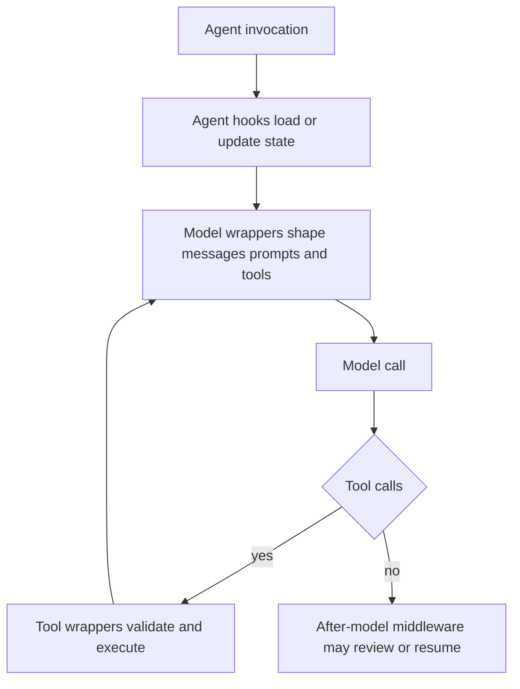
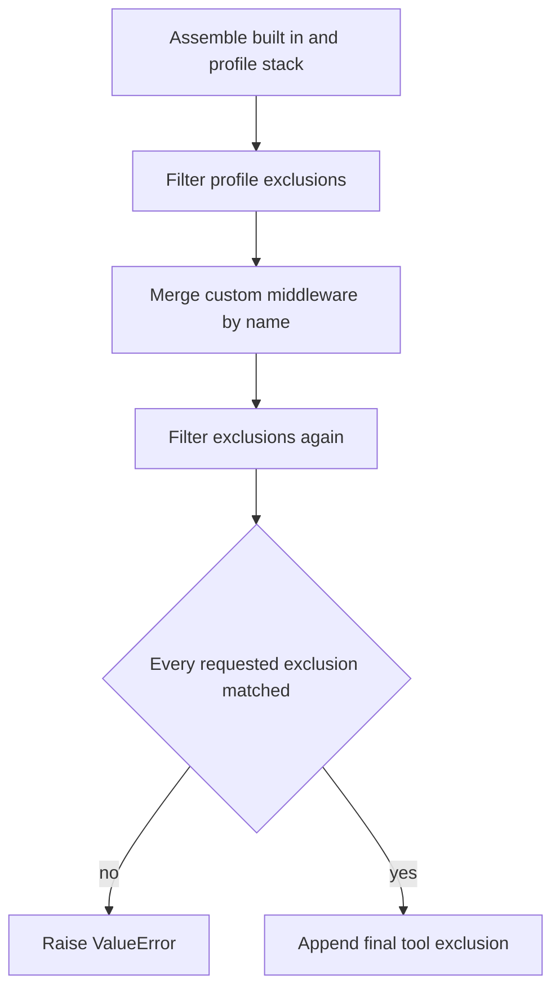
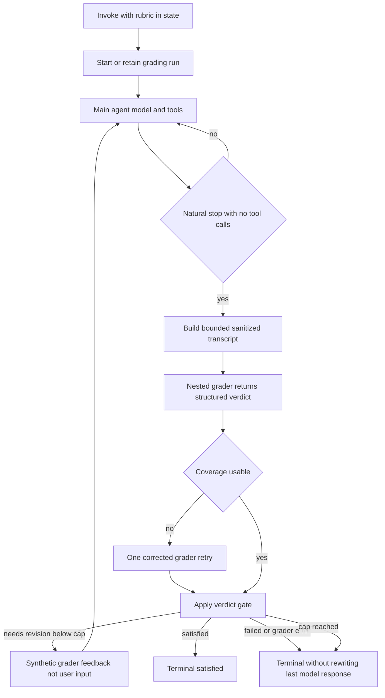

# Middleware Catalog and Extension Rules

`deepagents.middleware` is the public import surface for middleware that prepares a model request, intercepts tool execution, or owns cross-turn state. It re-exports filesystem permissions, memory, skills and `SkillToolResolver`, summarization, synchronous and asynchronous subagents, rubric evaluation, and unsupported-content filtering. `RubricMiddleware` is also exported from `deepagents`. Use these public classes and factories as extension points. Graph-only helpers—prompt caching, parent notification, tool-call repair, and tool exclusion—are assembly details rather than consumer APIs.

Middleware differs from a plain `tools=[]` callable because it can run at agent, model, and tool hooks, shape the request on every model call, and persist typed state. Use a plain tool for a self-contained consumer operation; use middleware when the capability needs prompt/tool shaping, policy enforcement, or lifecycle state.

| Responsibility | Public entrypoint | Lifecycle / boundary |
| --- | --- | --- |
| Backend files and execution | `FilesystemMiddleware` | Supplies filesystem tools through `BackendProtocol`; adds execution only for `SandboxBackendProtocol`; evicts oversized results to backend storage. |
| File access policy and approval | `FilesystemPermission` | Matches read/write path rules for allow, deny, or interruption. This—not profile visibility—is the authorization boundary. |
| Durable instructions | `MemoryMiddleware` | Loads configured sources into private state before the agent and appends formatted memory on model requests. |
| Progressive workflow discovery | `SkillsMiddleware`, `SkillToolResolver` | Loads skill metadata, injects discovery context, and discloses declared tools only when their skill is read or pinned. |
| Context management | `SummarizationMiddleware`, `SummarizationToolMiddleware` | Projects effective history and automatically compacts, or exposes explicit `compact_conversation`. |
| Blocking delegation | `SubAgentMiddleware` | The `task` tool invokes a local declarative or compiled worker and returns a parent tool result. |
| Background delegation | `AsyncSubAgentMiddleware` | Launches, polls, updates, cancels, and lists remote Agent Protocol work while the parent continues. |
| Completion review | `RubricMiddleware` | Activates from invocation state, grades a natural completion with a separate structured-output agent, and may return control to the model for revision. |
| Model compatibility | `UnsupportedContentMiddleware` | Makes an outbound copy containing replacements for blocks unsupported by the resolved model. |



This shows the relevant middleware lifecycle: model wrappers apply on every turn, while tool wrappers are the last interception point before dispatch.

## Default assembly is a policy order

`create_deep_agent()` builds a core stack of filesystem, optional synchronous subagents, parent notification, automatic summarization, tool-call repair, and optional asynchronous subagents. Profile middleware, optional skills, provider caching, optional memory, HITL, and unsupported-content filtering form the tail. Profile exclusions are applied before caller middleware and again afterward; caller middleware therefore cannot restore an excluded entry. Finally, profile-controlled tool exclusion is appended last.

```mermaid
flowchart LR
    Fs["Filesystem"] --> Sync["Sync subagents when present"]
    Sync --> Notify["Parent notifier"]
    Notify --> Summary["Automatic summarization"]
    Summary --> Repair["Tool-call repair"]
    Repair --> Async["Async subagents when configured"]
    Async --> Profile["Profile middleware and skills"]
    Profile --> Cache["Provider caching and memory"]
    Cache --> Safety["HITL and content adaptation"]
    Safety --> Exclude["Middleware filtering then tool exclusion"]
```



This is the main-stack assembly order; optional layers are omitted. The general-purpose subagent has a separate filesystem/summarization/repair/profile/skills/caching stack. Declarative subagents build their own stack for their resolved model; a fork also mirrors parent prompt-producing middleware. Only overrides of original general-purpose slots are inherited from the main agent. `TodoListMiddleware` is not in either default stack, but may be enabled explicitly or injected through a harness profile's `extra_middleware`.

`_ToolExclusionMiddleware` is deliberately last: it removes excluded tools from model requests and returns an error for a matching call at the tool boundary. It keeps advertised and dispatchable tools consistent; it is explicitly not a security surface. Protect filesystem operations with permissions and HITL instead.

## Replacement and exclusion are safety controls

### Replacement uses the public `.name` slot

Caller or subagent `middleware=` is merged by `.name`, not Python subclass identity. A matching name replaces the assembled entry in the same position; a new name is inserted after the core stack and ahead of the profile/prompt-caching/memory tail. Replacements of `FilesystemMiddleware` must retain the graph's permission rules (or use exactly the same rules), preventing a replacement from silently weakening configured filesystem policy. Because later duplicate custom names overwrite earlier candidates during merge, use one deliberate instance per name.

A same-name subclass can intentionally replace `SummarizationMiddleware`; a differently named subclass is a distinct capability and remains alongside the default. Name choice is therefore a compatibility and ordering decision, not cosmetic metadata. In a forked declarative subagent, spec middleware wins over inherited parent middleware with the same name.

### Exclusion matching, aliases, and audit failures

`HarnessProfile.excluded_middleware` accepts runtime classes or public name strings. Class form is exact effective-class matching; string form is exact `.name` matching. It rejects name collisions that span distinct classes, required filesystem/subagent scaffolding, and exclusions that match no assembled stack, so profile drift and ambiguous removals fail at construction rather than silently changing a stack.

The lazy Anthropic prompt-caching stand-in keeps the real middleware name for name-based replacement and exclusion, defers importing and constructing the real middleware until an Anthropic request, and reports the loaded real class through `excluded_as` for class-form exclusion.



This filtering sequence prevents excluded profile or caller middleware from re-entering a stack and turns configuration drift into an assembly failure.

## RubricMiddleware: state-activated completion review

Add `RubricMiddleware(model=...)` to `create_deep_agent(..., middleware=[...])`, then supply a non-empty `rubric` in invocation state. The middleware is otherwise a no-op: it does not construct or call a grader. Its grader is built lazily on first use as a nested `create_agent` with `response_format=GraderResponse`; the model may be a model string or `BaseChatModel`. The nested agent can receive a custom system prompt, verification tools, middleware, and a context/state schema.

```python
from deepagents import RubricMiddleware, create_deep_agent

agent = create_deep_agent(
    model="anthropic:claude-sonnet-4-6",
    middleware=[RubricMiddleware(model="anthropic:claude-sonnet-4-6", max_iterations=3)],
)
result = agent.invoke({
    "messages": [("user", "Draft the release notes.")],
    "rubric": "- Documents the breaking change\n- Lists migration steps",
})
```

`rubric` is the only public `RubricState` addition. Status, iteration count, accumulated evaluations, active-rubric tracking, run ID, and frozen criterion names are private state attributes. On a checkpointed thread, inspect `agent.get_state(config).values` to branch on `_rubric_status` or review `_rubric_evaluations`; do not infer acceptance from the final assistant text alone.

A new grading run starts when the rubric string changes, or when the same sticky rubric is invoked after a terminal status. It receives a fresh UUID and iteration budget while evaluations remain accumulated. A non-terminal in-progress rubric is not reset.

### Grader contract and bounded evidence

`GraderResponse` has a top-level `result`, `explanation`, and required `criteria`. A criterion is discriminated by `passed`: passing entries have a name; failing entries additionally require an actionable `gap`. Validation rejects a `satisfied` response with a failed criterion and a non-empty `needs_revision` response whose criteria all pass. This makes the structured response the boundary between a probabilistic grader and loop control.

The grader receives a role-labelled transcript, not graph state wholesale. Input is bounded to the last 30 messages, with the original non-synthetic `HumanMessage` prepended if it fell out of that window, and each rendered message is limited to 4,000 characters. Text, tool calls, and opaque content blocks are represented safely. The caller’s rubric and transcript are placed in distinct random nonce-suffixed delimiter blocks; literal closing `rubric`, `transcript`, and `criteria` tags are escaped before interpolation. The default grader prompt treats transcript content—including tool output—as untrusted observation and trusts the rubric alone for the definition of done.

On the first usable non-`failed` evaluation with criteria, the middleware freezes only the criterion names. Later payloads replay that checklist alongside the rubric and request the same count in order, without replaying prior pass/fail judgments. This prevents the set from shrinking during a run, but the middleware deliberately does **not** parse free-form rubric prose or validate whether the first decomposition was exhaustive; later coverage is count-based, so a renamed but equally sized list and an over-complete list are usable.

If the response is empty before a list exists, or contains fewer entries than the frozen list, the middleware performs one corrected regrade. A retry failure retains the first valid response rather than converting it to an infrastructure error. If a twice-underreported response claims `satisfied`, it is downgraded to `needs_revision`, marked `unverified=True`, and cannot terminate the loop. An underreported `needs_revision` is allowed through because it makes no acceptance claim. `failed` is exempt because no criterion list is appropriate for an ungradable rubric.

### Revision lifecycle and attribution

The after-agent hook only grades natural stops: the main model has returned without another tool call. `needs_revision` below the cap appends a synthetic `HumanMessage` containing the explanation, failed gaps, and—when verified—passing criteria that must not regress; it then returns `jump_to="model"`. This synthetic message is deliberately distinct from user input: it has `name="rubric_grader"` and `additional_kwargs={"lc_source": "rubric_grader"}`. Transcript selection ignores that tag when finding the original user request, preventing old grader feedback from becoming the user prompt after truncation.



This lifecycle shows the revision loop. The feedback edge is a middleware-authored message attributed to `rubric_grader`, not a new user turn.

### Terminal outcomes, failure boundaries, and observation

Only `needs_revision` continues. The terminal result has one of these meanings:

| Result | Meaning | Effect on main-agent response |
| --- | --- | --- |
| `satisfied` | The grader accepted the structured, usable criterion accounting. | End normally. |
| `failed` | The **grader** says the rubric is malformed, contradictory, or impossible to evaluate. | End; preserve the last main-model response. |
| `max_iterations_reached` | A revision verdict reached `max_iterations`; this includes a permanently unverified `satisfied` downgrade. | End; preserve the last main-model response. |
| `grader_error` | Grader machinery failed—for example provider, credentials, or structured-output failures. This is not `failed`. | End; preserve the last main-model response. |

Every evaluation has a `grading_run_id`, zero-based iteration, result, explanation, criteria, and `unverified` flag. The middleware emits `rubric_evaluation_start` and `rubric_evaluation_end` through the runtime stream writer and invokes `on_evaluation` after finalizing an evaluation. Ordinary callback exceptions are logged and suppressed, so callbacks are observability hooks rather than control flow. The cap emits an info log; incomplete-grader exhaustion emits a warning. Grader trace metadata records configured model and the observed or inferred structured-output strategy where available.

`GraphBubbleUp` from a grader or evaluation callback propagates as graph control flow rather than becoming `grader_error`. `KeyboardInterrupt` and async cancellation also propagate because only `Exception` is caught around ordinary grader failures. Conversely, a caught grader exception becomes a recorded `grader_error` evaluation with diagnostic model/strategy details.

### Safe customization

Use constructor arguments instead of replacing the lifecycle where possible:

- `tools` gives the nested grader verification tools; without them it reasons from the transcript.
- `grader_middleware`, `grader_context_schema`, and `grader_state_schema` configure the nested agent. Runtime context is forwarded to it.
- `prepare_messages_for_grader` can filter or transform a copy of transcript messages before payload construction; it must not mutate the original state.
- `build_grader_state` adds custom nested-agent fields, requires `grader_state_schema`, and cannot set SDK-owned `messages`.
- `on_evaluation` is for reporting and must tolerate being suppressed on its own exceptions.

For a subclass wrapping one grader request, override `_invoke_grader` / `_ainvoke_grader`, forwarding `correction` and `context`, rather than `_grade` / `_agrade`; the latter own the one-retry coverage rule. Overrides and custom input construction should retain `_build_grader_payload`, which enforces transcript bounds and delimiter sanitization.

## Memory and other operational invariants

MemoryMiddleware loads configured sources only when private `memory_contents` is absent, skips missing files but raises on other download errors, and injects formatted memory into each model request unless its system prompt is disabled.

Memory middleware strips HTML comments from loaded content before prompt injection and its default prompt tells the model to treat file memory as untrusted reference material. When cache control is enabled, it marks the final system block only for the runtime Anthropic model, including when prompt injection is suppressed.

`FilesystemPermission` supports allow, deny, and interrupt effects for read/write path rules. Permission paths must be absolute and cannot contain `..` or `~`; on real filesystem backends, checks cover both the requested path and its symlink-resolved target. Do not treat profile exclusion as an authorization substitute.

## Focused change coverage

Route Rubric changes to the narrow suite first, then run the end-to-end fake-model coverage when modifying graph integration or loop behavior.

| Change | Focused tests |
| --- | --- |
| Construction validation, state reset, structured output, bounded/sanitized transcripts, coverage retry/gate, extensions, callbacks, events, and terminal semantics | `libs/deepagents/tests/unit_tests/middleware/test_rubric_middleware.py` |
| Natural-stop integration, no-rubric no-op, revision loop, cap, checkpoint observation, and interrupt propagation | `libs/deepagents/tests/unit_tests/test_end_to_end.py` (`TestRubricMiddlewareEndToEnd`) |
| Real-model traced demonstration, frozen checklist, and revision prompts | `examples/rubric_middleware/README.md`, `examples/rubric_middleware/rubric_agent.py` |
| Stack construction, name replacement, exclusion coverage/collisions, lazy cache aliases, and profile-supplied todo middleware | `libs/deepagents/tests/unit_tests/test_graph.py` |
| Memory loading, prompt templates/comment stripping, and Anthropic cache breakpoint | `libs/deepagents/tests/unit_tests/middleware/test_memory_middleware.py`, `libs/deepagents/tests/unit_tests/middleware/test_memory_middleware_async.py` |
