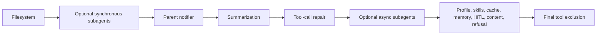
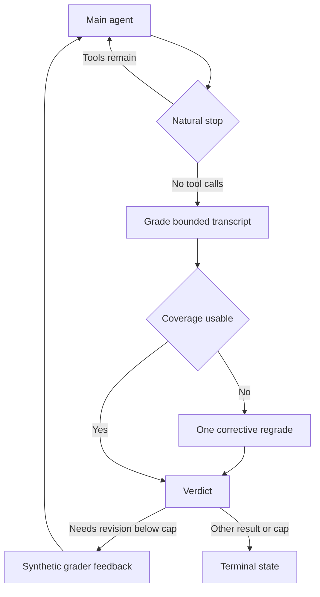

# Middleware Catalog

`deepagents.middleware` contains the request hooks, tool wrappers, and typed cross-turn state that turn a base LangChain agent into a Deep Agent. The top-level `deepagents` package re-exports the principal delegation, filesystem, memory, and rubric entry points; the middleware package additionally exposes skills, summarization, and unsupported-content support. Use middleware for behavior that must run around model calls or retain state; use a `tools=[]` callable for a self-contained operation that only runs when the model selects it.

| Concern | Primary middleware | Operational effect |
| --- | --- | --- |
| Files and execution | `FilesystemMiddleware` | Supplies backend-dependent file and execution tools and applies configured permissions. |
| Durable file instructions | `MemoryMiddleware` | Loads private memory once and formats it into model requests. |
| Context control | `SummarizationMiddleware` | Builds a compact *effective* history while retaining raw messages and an archive pointer. |
| Local delegation | `SubAgentMiddleware` | Provides blocking `task` delegation to compiled or declarative workers. |
| Remote delegation | `AsyncSubAgentMiddleware` | Manages persisted remote tasks and injects labelled updates. |
| Progressive capability disclosure | `SkillsMiddleware` | Loads skill metadata, pins bodies on request, and gates associated deferred tools. |
| Completion review | `RubricMiddleware` | Grades a natural final answer and can route revision feedback back to the agent. |
| Provider/content adaptation | prompt caching, `UnsupportedContentMiddleware`, `ModelRefusalMiddleware` | Applies provider-specific request handling, adapts unsupported content, and turns a model refusal into an error. |

## Assembled stack and safe customization

`create_deep_agent()` assembles the main core in this order: `FilesystemMiddleware`; optional `SubAgentMiddleware`; parent notification; automatic summarization; and `PatchToolCallsMiddleware`; optional `AsyncSubAgentMiddleware` follows. It then adds profile middleware, optional skills, provider prompt caching, optional memory, optional HITL, `UnsupportedContentMiddleware`, and `ModelRefusalMiddleware`. The refusal layer is deliberately in the tail: caller middleware such as `ModelFallbackMiddleware` is merged ahead of it and can recover a refusal first. Tool exclusion, when configured by the profile, is appended only after all custom middleware so an excluded tool cannot be restored by a later request wrapper.

The diagram is assembly order; optional entries are omitted when not configured.

Profile exclusions run before and after caller middleware is merged. A custom middleware with an existing `.name` replaces that slot; a novel name is spliced after the core and before the tail. A replacement filesystem middleware must preserve the graph's permissions (or use identical rules). Exclusions use exact effective class or exact name matching. Ambiguous name collisions, removal of required scaffolding, and an exclusion that matched no main or general-purpose stack fail construction rather than silently altering safety behavior. The lazy Anthropic caching proxy preserves the real middleware name, only imports and constructs its delegate for an Anthropic request, and reports the real class after it is loaded for class-form exclusion.

Tool exclusion and skill disclosure govern what the model was shown and what reaches tool dispatch; neither is an authorization boundary. Use filesystem permission rules and HITL for authorization.

## Delegation and refusals

`SubAgentMiddleware` exposes the blocking `task` tool. Declarative subagents are isolated by default and receive the delegated description; experimental `mode="fork"` continues the parent's effective conversation and prompt-producing context. A fork deliberately drops parent-only state such as the parent's rubric, pinned-but-unconsumed skills, prior disclosed skill-tool record, structured response, and summarization session/event, so it does not resume parent control state. Fork-specific middleware that rewrites the inherited prompt prefix or tool definitions can reduce prompt-cache reuse.

A refusal is not presented to the parent as a successful worker answer. If a subagent returns a refusal content block, raises `ModelRefusalError`, or fails structured output because its AI message contains a refusal, synchronous and asynchronous task execution convert it to a task result explaining that the subagent stopped, including category or explanation when present and a retry warning. This lets the parent decide to rephrase or proceed without the task. In contrast, the main Deep Agent raises `ModelRefusalError` by default; a caller-installed fallback can handle it because `ModelRefusalMiddleware` is tail-positioned, and a harness profile may explicitly exclude that middleware.

`AsyncSubAgentMiddleware` launches remote Agent Protocol work without waiting. Its `async_tasks` state persists task/thread/run identifiers and status through compaction. In the async lifecycle it polls unfinished tasks before model calls and after a natural final answer; a newly observed update is injected as a notification and the latter case resumes the model. Failed polling is logged and deferred. Notifications are explicitly marked `async_subagent`, state that they are not user input, and preserve only safe escaped/capped text or media result blocks. Synchronous `invoke` still supports task tools but does not perform lifecycle polling.

## Memory and skills

`MemoryMiddleware` loads configured sources only when private `memory_contents` is absent. Missing files are skipped, other download errors raise, and loaded content is formatted into each request unless `system_prompt=None`. HTML comments are removed before injection; the default prompt explicitly treats the resulting file content as untrusted reference material. With cache control enabled, only the final system block is marked, and only for the runtime Anthropic model—even if injection is suppressed.

`SkillsMiddleware` caches source metadata per thread; later sources override duplicate names and setting `skills_metadata` to `None` requests a reload. Source-load errors are logged and retained privately. `pinned_skills` is consumed before the next model call: known readable names are deduplicated in order, appended as tagged `HumanMessage` snapshots without frontmatter, then cleared. A snapshot does not change if the file later changes.

Skill-associated tools are disclosed only for skills that were read or pinned in effective context. The middleware records the exact disclosure per model call and re-resolves and enforces it at dispatch. Therefore a resolver must be stable and inexpensive: it can run once per model request and again for a tool call.

## Rubric-driven review

`RubricMiddleware` is public from both `deepagents` and `deepagents.middleware`. It is inactive until invocation state supplies a non-empty `rubric`, and only then lazily creates its nested structured-output grader. Its `GraderResponse` requires a result, explanation, and discriminated per-criterion pass/fail entries; failures need gaps, and validation rejects contradictions between the top-level result and criteria.

The grader receives a bounded, role-labelled transcript: up to the newest 30 messages plus the original non-synthetic user request when necessary, each rendering capped at 4,000 characters. Nonce-delimited rubric, criteria, and transcript blocks are sanitized against closing-tag breakout. The first non-failed evaluation freezes criterion names; later calls replay that checklist. One corrective regrade handles empty or under-counted accounting. A twice-underreported `satisfied` verdict becomes unverified `needs_revision`, while failed verdicts are exempt and over-coverage is usable.

The diagram shows the rubric control loop; feedback is middleware-authored, not a user turn.

Only `needs_revision` below the iteration cap resumes the model. The feedback `HumanMessage` is attributed with name and `lc_source` `rubric_grader`, preventing it from being selected as the original user prompt. Terminal outcomes distinguish `satisfied`, rubric-level `failed`, middleware-created `max_iterations_reached`, and `grader_error`; except for revision feedback, all retain the last main-agent answer. Consumers that need acceptance must inspect private state, checkpoint state, stream events, or the observational callback—not final prose alone. Callback exceptions are normally suppressed, while graph-control interrupts propagate; ordinary grader failures become `grader_error` diagnostics.

For customization, the nested grader supports tools, middleware, schemas, copy-transformed messages, and additional nested state. `build_grader_state` cannot replace SDK-owned messages. Override `_invoke_grader` or `_ainvoke_grader` for per-call changes so coverage retry remains active; preserve the bounded and sanitized payload path when customizing inputs.

## Compaction and overflow recovery

`SummarizationMiddleware` reconstructs effective history from its private summary event, rather than deleting raw state. When thresholds require compaction, it can truncate old large tool-call arguments, offloads selected history before summarizing, and stores a per-invocation session ID so later events append to the same history archive. Previous summaries are not offloaded again. If archival or inline-media persistence fails, compaction continues with a warning and unrecoverable placeholders or history.

Before model dispatch, it counts the full request—including tools where supported—and reserves configured output tokens plus headroom. It recognizes context-overflow errors, summarizes when possible, and permits only one strictly smaller tail-clipping recovery. A request that cannot be reduced enough raises `ContextOverflowError`; it is never retried unchanged. `SummarizationToolMiddleware` exposes manual `compact_conversation` but does not compact by itself: eligibility begins at about half of an automatic trigger clause. `create_summarization_tool_middleware` builds that manual layer around the same engine; pair it with automatic summarization when automatic compaction is also desired.

## Focused tests

- `tests/unit_tests/test_subagent_refusal.py` covers direct, raised, and structured-output subagent refusals; main-agent refusal, fallback ordering, and profile exclusion; and async final-content reporting.
- `tests/unit_tests/test_graph.py` covers assembled-stack ordering, replacement, permissions, and exclusion failures.
- `tests/unit_tests/middleware/test_rubric_middleware.py` and `test_end_to_end.py` cover schema, transcript bounds, coverage retry, lifecycle outcomes, callbacks, extensions, and revision loops.
- `tests/unit_tests/middleware/test_pinned_skills.py` covers pin snapshots and skill-tool disclosure lifetime.
- `tests/unit_tests/middleware/test_summarization_middleware.py` covers offload, effective history, overflow recovery, and manual compaction.
