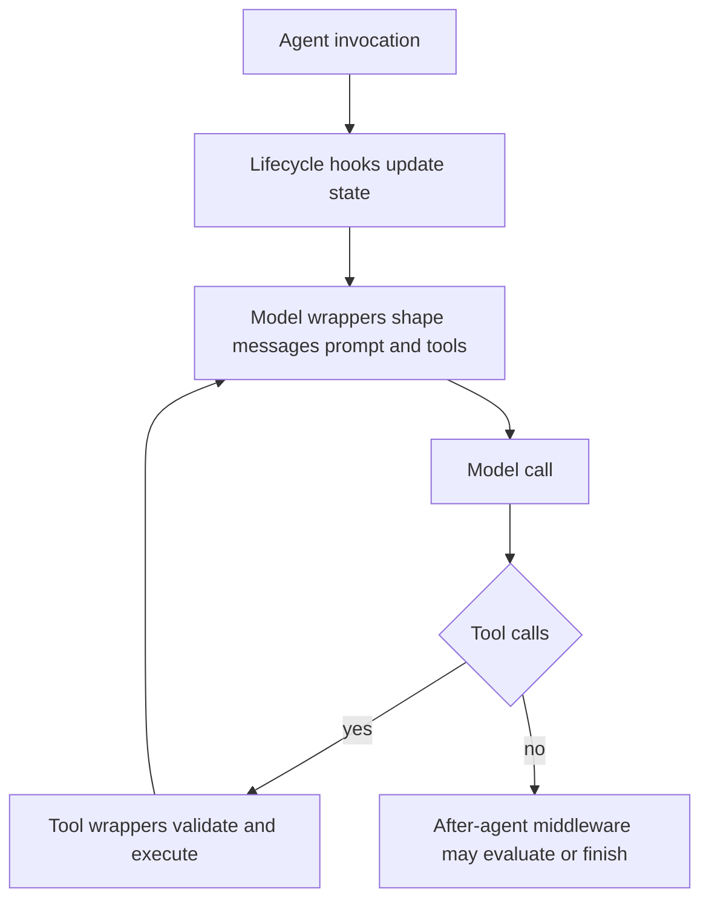
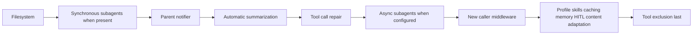
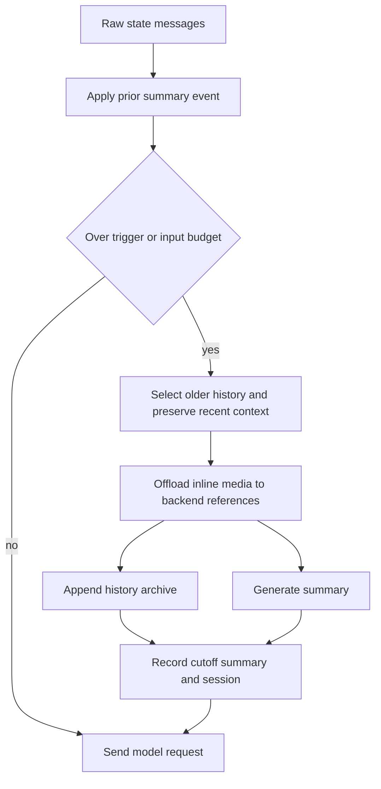

# Middleware Catalog

`deepagents.middleware` is the public import surface for middleware that changes an agent request, tool execution, or cross-turn state. The package exports filesystem, memory, skills, summarization, synchronous and asynchronous subagent, rubric, and unsupported-content middleware, along with the public configuration and result types needed to use them. Internal helpers—such as `_ToolExclusionMiddleware`, message eviction, prompt caching, tool-call repair, and parent notification—are assembled by the graph but are not extension APIs.

## Middleware versus an ordinary tool

A normal tool is available for the model to select. Middleware participates in the agent lifecycle: it can initialize state, rewrite a model request on every call, intercept a pending tool call, or run after the agent would otherwise finish. Use middleware for context-sensitive tools, prompt or tool-list changes, policy, and persistent state; use a plain `tools=[...]` callable for a self-contained capability.

This is the control boundary middleware adds around model and tool activity; ordinary tools execute only on the selected-tool branch.

## Public catalog

| Concern | Public entrypoints | Operational role |
| --- | --- | --- |
| Filesystem | `FilesystemMiddleware`, `FilesystemPermission` | Provides backend-aware file and execution tools and applies filesystem permission policy. |
| Context management | `SummarizationMiddleware`, `SummarizationToolMiddleware`, `create_summarization_tool_middleware`, `DEEPAGENTS_DEFAULT_SUMMARY_PROMPT` | Keeps model input within budget through automatic or explicitly requested compaction, retaining recoverable history in the backend. |
| Memory | `MemoryMiddleware` | Loads configured instruction files into state and, unless disabled, appends their content to the system prompt. |
| Skills | `SkillsMiddleware`, `SkillMetadata`, `SkillsState`, `SkillToolResolver` | Loads skill metadata and supports progressive disclosure of skill instructions and associated tools. |
| Synchronous delegation | `SubAgentMiddleware`, `SubAgent`, `CompiledSubAgent` | Exposes the blocking `task` tool for declarative or already-compiled workers. |
| Background delegation | `AsyncSubAgentMiddleware`, `AsyncSubAgent`, `TaskEvent` | Launches and manages remote Agent Protocol work while the parent continues. |
| Completion review | `RubricMiddleware` and rubric/grader types | Optionally grades a completed run against caller-provided rubric state and can request a revision turn. |
| Provider compatibility | `UnsupportedContentMiddleware` | Replaces unsupported human or tool multimodal blocks in an outbound request while retaining original thread content. |

Import these names from `deepagents.middleware`. The automatic summarization factory, `create_summarization_middleware`, is intentionally used by graph assembly but is not re-exported from that package; import it from `deepagents.middleware.summarization` when direct construction is needed.

## Default assembly and ordering

`create_deep_agent()` builds the main stack in deliberate layers. It starts with filesystem support and, where configured, synchronous subagents; it then adds the internal parent notifier, automatic summarization, and tool-call repair. Configured async subagents complete this core. Profile middleware, automatic skills, prompt caching, optional memory, optional HITL, and unsupported-content adaptation make up the tail. Caller middleware that replaces a surviving middleware name stays in that layer's slot; otherwise it is inserted after the core and before the tail. A profile tool-exclusion middleware is appended last.

This is the main-agent assembly order. Optional entries are skipped, while same-name replacements preserve a surviving layer's position.

The final internal `_ToolExclusionMiddleware` removes excluded names from the request and returns an error for a matching call at the tool boundary. It prevents later wrappers from re-advertising a profile-excluded tool, but explicitly provides advertised-tool consistency rather than authorization. Filesystem permissions and HITL policy remain the relevant protection mechanisms.

## Context compaction and eviction

The graph installs `create_summarization_middleware(model, backend)`. It requires an already resolved `BaseChatModel`: if the model profile has integer `max_input_tokens`, defaults use a 0.85 trigger and 0.10 retention fraction; otherwise the defaults trigger at 170,000 tokens, retain six messages, and enable older tool-argument truncation at 20 messages. The factory rejects a model string, which makes model resolution an explicit caller responsibility outside graph assembly.

The automatic engine leaves raw `state["messages"]` intact. Instead, private `_summarization_event` records an absolute cutoff, a summary `HumanMessage`, and an optional history path, while `_summarization_session_id` identifies the history file for this invocation. Later requests construct an effective transcript from the summary and messages after that cutoff. Evicted messages are appended in a session-specific backend history file, so history-offload failure is non-fatal but makes the event's path `None`.

This automatic path projects effective context for the request without replacing the raw message log.

`DEEPAGENTS_DEFAULT_SUMMARY_PROMPT` directs the summarizer to preserve offloaded-media references without inventing visual detail, so a later agent can inspect the referenced path. The internal message-eviction helper is shared by filesystem handling and overflow recovery: when a tool result is successfully written to the backend, it replaces text with a line-numbered head-and-tail preview and a path the agent can read; if the write fails, the original message remains. It preserves non-text tool-message blocks when replacing text.

### The explicit compact tool

`SummarizationToolMiddleware` registers `compact_conversation` but never compacts autonomously. It delegates to a supplied automatic-engine instance and shares the same private event and session keys, so manual and automatic compaction compose. `create_summarization_tool_middleware(model, backend, *, system_prompt=None)` accepts a string or model object, builds the engine, and registers only this tool layer; pair it with automatic summarization when that behavior is also wanted.

The tool will not compact until reported usage reaches about half the automatic trigger. If there is no eligible cutoff it returns a “Nothing to compact” tool result. On success it returns a `Command` that adds the confirmation message and summary event; a summarization or archive exception becomes an error tool result without changing that event.

## Delegation boundaries

The synchronous `task` tool invokes the selected declarative or compiled worker and adapts its output to one parent `ToolMessage`: `structured_response` is serialized when present; otherwise it selects the last non-empty `AIMessage` text. An isolated worker starts from its task description. A declarative fork instead receives the parent's effective compacted history and is marked to reject recursive `task` delegation, preventing unbounded nested delegation.

`AsyncSubAgentMiddleware` is a separate remote path. It supplies `start_async_task`, `check_async_task`, `update_async_task`, `cancel_async_task`, and `list_async_tasks`; task records are persisted under `async_tasks`, including their task and remote thread IDs, current run ID, status, and timestamps. The constructor rejects an empty list, duplicate names, and modes other than `isolated` and beta `fork`.

An isolated remote start sends only the delegated description. A fork snapshots the parent's effective summarized conversation plus task, drops local artifacts and eviction tags, and rehydrates offloaded tool media before serialization. The remote graph owns its own prompt, tools, and runtime. Omitting `url` chooses local ASGI transport and therefore requires an asynchronous parent invocation such as `ainvoke`; a synchronous parent needs a reachable server URL. Platform credentials are discovered by the SDK, while self-hosted credentials belong in `headers`.

## Completion review and content compatibility

`RubricMiddleware` is dormant unless invocation state supplies `rubric`. At natural completion it runs a nested grader and may add revision feedback and jump back to the model. A satisfied, failed, grader-error, or iteration-limit outcome is tracked in private rubric state; failed, errored, or max-iteration outcomes do not rewrite the model's last response, so callers that need to branch must inspect state, a callback, or stream events. The grader is constructed lazily, avoiding model-client initialization when the middleware is merely imported or configured.

`UnsupportedContentMiddleware` belongs near the end because it evaluates the actual `ModelRequest.model` after routing or fallback middleware. It copies and filters only human and tool messages for that outbound request, replacing blocks the active model cannot accept with text notices. The original thread is preserved so a later model that supports the content can receive it.

## Focused change coverage

When changing this catalog, test stack order and replacement by middleware name, especially the final exclusion boundary. Summarization coverage should cover profile and fallback defaults, event-cutoff reconstruction, history/media offload failure, provider overflow fallback, and the distinction between automatic compaction and the tool-only factory. For delegation, test isolated versus fork payload construction, output adaptation, recursion refusal, private-state boundaries, async task persistence, terminal-status refresh, update and cancellation. Rubric tests should cover no-rubric pass-through, revision looping, iteration limits, and grader failure observability; compatibility tests should verify that unsupported blocks are filtered only on the outbound copy.
