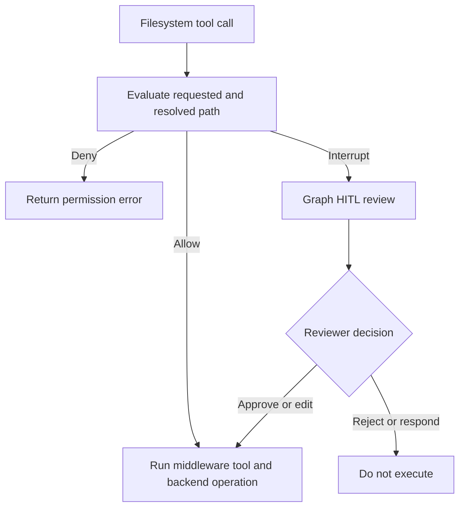
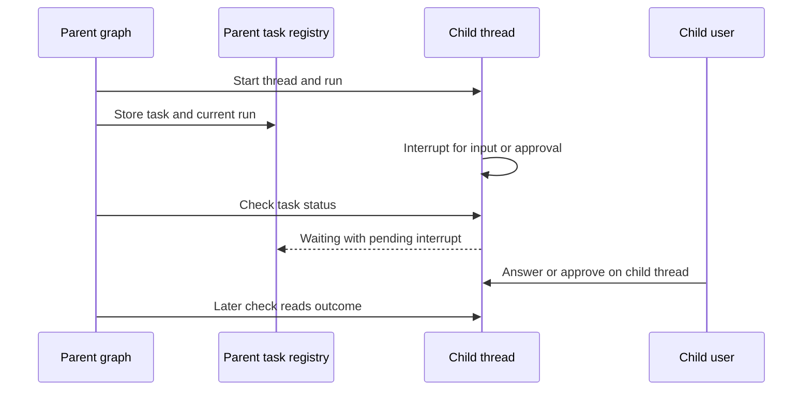

# Permissions and Human Approval

Deep Agents separates three controls that are easy to conflate: filesystem policy enforced by built-in filesystem tools, graph-level human review, and configuration of each graph that can execute tools. A filesystem `interrupt` is a request to route a call through human review, not a denial. In particular, a remote `AsyncSubAgent` is another Agent Protocol graph and thread, not a privileged continuation of its parent: it owns its tools, permissions, and approval exchange.

See [Tool Surface and Filesystem Policy](/openwiki/concepts/tools-filesystem.md), [dcode Configuration Layering](/openwiki/concepts/config-layering.md), [Middleware Stack](/openwiki/architecture/middleware-stack.md), and [Security](/openwiki/operations/security.md).

## Filesystem permissions are middleware enforcement

`FilesystemPermission` contains absolute glob `paths`, `read` and/or `write` `operations`, and an `allow`, `deny`, or `interrupt` mode. Rules are evaluated in declaration order, so the first matching rule wins; a path with no matching rule is allowed. Patterns must start with `/`, and patterns containing `..` or `~` are rejected.

`FilesystemMiddleware` enforces a `deny` in its own built-in filesystem tools before the backend operation. It is not a general backend ACL: another direct backend caller does not acquire this check. On a `FilesystemBackend`, including one reached through a `CompositeBackend` route, it evaluates both the requested virtual path and its symlink-resolved target; denial of either blocks the operation. Listings and search results filter paths denied by the rule set.

A recursive or potentially recursive `delete` fails closed more broadly than an ordinary first-match lookup. If the target subtree could overlap any write-deny pattern, the delete is refused; an allowed parent must not remove a denied descendant. Filesystem permissions do not implement an `execute` policy. Accordingly, an execution-capable backend rejects permission configuration unless every pattern is scoped to composite routes, rather than suggesting that shell execution is protected.

*`deny` is enforced by the filesystem tool; `interrupt` selects a review path before that tool executes.*

## Interrupt rules generate path-sensitive HITL

`FilesystemMiddleware` does not pause a graph itself. During `create_deep_agent` assembly, interrupt-mode permissions are converted into per-tool `HumanInTheLoopMiddleware` `interrupt_on` entries. The generated entries cover `ls`, `read_file`, `write_file`, `edit_file`, `delete`, `glob`, and `grep`, and allow `approve`, `edit`, `reject`, or `respond`.

For exact-path tools, the generated predicate reviews only a matching requested path, and also the resolved target when a backend is available. A deny on either candidate wins over interrupt, so the call returns a permission error rather than presenting an approvable request. For bulk tools—listing, search, glob, and delete—the predicate intentionally over-approximates: it pauses if the reachable subtree can overlap an interrupt-rule anchor. A missing bulk path or `.` is treated as the accessible root. `glob` also checks an absolute `pattern`, which can redirect its search independently of `path`; a relative pattern containing `..` is conservatively reviewed. Prefer literal leading anchors such as `/secrets/**`; a leading-wildcard pattern such as `/**/secrets` has root anchor `/` and can review every bulk operation.

Caller-provided `interrupt_on` takes precedence over a generated entry with the same tool name. That is an application extension point, not a bypass of filesystem denial. Approval is neither a sandbox nor a durable authorization grant: an approved or edited call still reaches the filesystem middleware's pre-execution enforcement.

## Inheritance stops at graph boundaries

For declarative local `SubAgent` specifications, omitting `permissions` inherits the parent rules, while any explicit list—including `[]`—replaces them. The same omitted-versus-explicit behavior applies to top-level `interrupt_on`. Graph assembly installs `FilesystemMiddleware` with the effective rules and merges derived filesystem routing with the effective interrupt map; an explicit routing entry wins on a name collision. The auto-added `general-purpose` local subagent also receives the parent permissions and top-level routing.

This is a construction-time inheritance rule, not an ambient authorization capability. A `CompiledSubAgent` has already been assembled and must be configured by its owner. An `AsyncSubAgent` names another graph and must also be configured independently. `mode="fork"` can copy conversational state and rebuild prompt middleware, but it does not make a remote graph inherit filesystem policy or approval authority. Apply sensitive-tool controls to every executable graph.

## Remote async children retain human-request ownership

`AsyncSubAgentMiddleware` starts an independent remote Agent Protocol thread and run, returns immediately, and records task/thread state under parent `async_tasks`. When a child run interrupts, its run can report success while the child thread reports `interrupted` with pending interrupts. `check_async_task` maps that condition to `waiting` and exposes the pending request for observation.

The parent cannot answer, resume, or approve that request. The child user must respond on the child thread. Parent notification is therefore not an approval bridge: `notify_parent` defaults to true for eligible same-deployment children, while `notify_parent=False` removes the parent assistant reference and remote-url children omit it. A paused child does not wake its parent, since only the child's user can resolve the pause.

*Task records give the parent lifecycle visibility; the child thread retains authority to resolve its interrupt.*

`update_async_task` starts a new run on the same child thread. With its default `interrupt` strategy, and with beta `enqueue` once the queued work starts, a pending human request can be dropped rather than answered. Cancelling a waiting task marks it cancelled without cancelling a paused run. Treat update and cancellation as lifecycle operations, never as mechanisms for approval.

## dcode approval routing is live and fail-closed

dcode sends a resolved `ServerConfig` across its client/server process boundary using `DEEPAGENTS_CODE_SERVER_*` environment variables, then `server_graph` supplies its approval settings to `create_cli_agent`. By default `auto_approve` is false, so the CLI's interrupt map gates shell execution, file write/edit/delete, web search, URL fetch, local and async subagent dispatch, and MCP tools that are not coherently read-only. The map allows only approve or reject. Setting `auto_approve=True` disables those HITL routes for all tools; it is an explicit unrestricted mode, not a filesystem permission setting.

An interactive, non-sandboxed server can enable classifier-backed `auto`; otherwise dcode uses ordinary approval routing. Approval mode is thread-scoped and has `manual`, `auto`, and `yolo` values. The mode is read from a Store record whose key is validated against the active thread. A malformed context or key, unavailable Store, missing or invalid record, unsupported synchronous access, or an `auto` mode in an ineligible graph all fail closed to `manual`, so gated calls interrupt. `yolo` bypasses stock HITL; `auto` only bypasses it where classifier-backed Auto is eligible.

The async-aware HITL middleware resolves that live mode after model completion and passes a process-local routing marker to stock routing rather than storing an autonomous decision in checkpoint state. Local dcode subagents receive this middleware themselves and explicitly set `interrupt_on={}` to suppress the SDK's otherwise inherited, second synchronous HITL layer. Thus one CLI graph has one owner of its approval routing, while a separately deployed async child still has its own policy.

`interrupt_shell_only` is only a valid alternative when a restrictive shell allow-list is available. In that case dcode disables HITL and installs `ShellAllowListMiddleware`; if the requested mode has no restrictive list, it falls back to standard HITL rather than running without either control. The JavaScript interpreter is a separate boundary: PTC host-tool calls bypass `interrupt_on`, so its PTC allowlist is the actual control. The `safe` preset is read-only (`read_file`, `glob`, `grep`); exposure of other tools requires an explicit list, or `interpreter_ptc="all"` with an unsafe acknowledgement when not auto-approved.

## Talon has a separate persisted tool policy

Talon's `ToolApprovalStore` is distinct from dcode's live approval modes and from filesystem path rules. It stores an exact-name boolean mapping in a bounded regular JSON file opened without following symlinks. Enabled names become approve-or-reject HITL entries; names not in the mapping are not prompted. Its default policy enables review for `update_tool_approvals`, `delete_conversations`, `update_mcp_server`, `start_async_task`, and `send_message`.

A read yields an immutable `ApprovalSnapshot` whose revision is a hash of the policy bytes. Updates validate a complete boolean batch, use a lock and expected-revision compare-and-swap, and report conflict or error instead of silently replacing another writer's policy. The runtime binds its loaded snapshot for an invocation and rebuilds its graph only when the persisted snapshot changes, so a saved change applies on a later invocation rather than loosening the current one. The update tool further requires both an active snapshot and an operator context; cron and background-delivery turns are not operator contexts.

## Operating guidance and focused tests

- Use `deny` for operations that must never run; use `interrupt` when a human should decide an individual graph call. Keep permission paths absolute and use anchored interrupt globs.
- Install filesystem policy and HITL routing in every graph that can execute sensitive tools. Local declarative children inherit only omitted values; compiled and remote children require independent configuration.
- Do not use `update_async_task` or cancellation as an answer to a waiting child. Direct the user to the child thread.
- Treat `--yolo` or `auto_approve=True` as a deliberate global removal of dcode HITL, and do not assume it is constrained by filesystem rules. Keep interpreter PTC on `safe` unless a broader allowlist is intentionally reviewed.
- `test_permissions.py` covers order-sensitive outcomes, path validation, recursive-delete protection, generated bulk and exact predicates, symlink-target enforcement, middleware conflicts, and general-purpose subagent inheritance. dcode's approval implementation separately protects malformed or unavailable live approval state by falling back to Manual. Talon tests cover malformed and symlink policy files, revision conflicts, snapshot timing, and operator gating.
