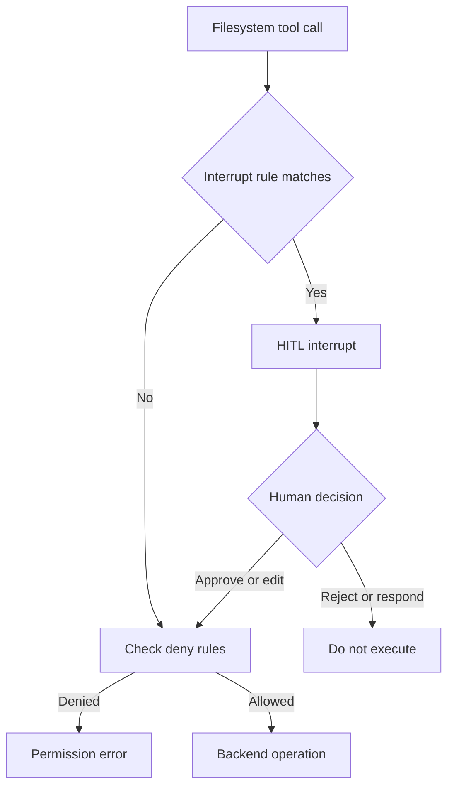
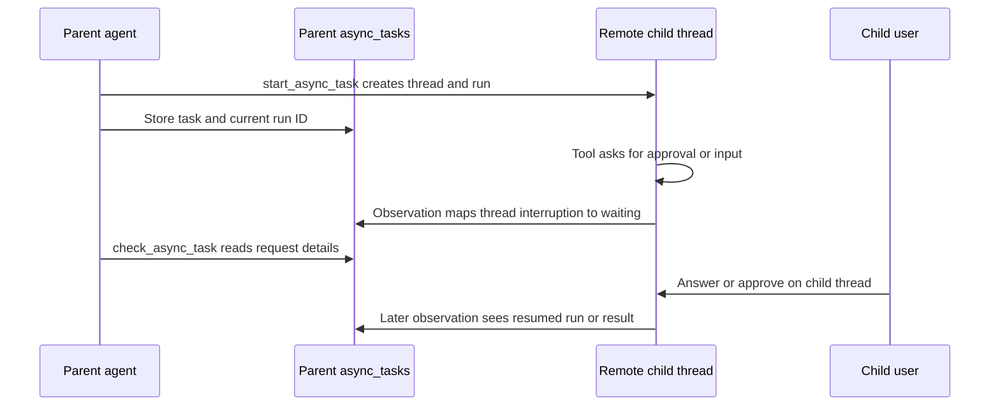

# Permissions and Human-in-the-Loop

Deep Agents deliberately separates three concerns: filesystem policy, a graph-level human review interruption, and the remote child agent's own configuration. A filesystem rule governs the built-in filesystem tools in the graph where it is installed. An `interrupt` rule routes a matching call to `HumanInTheLoopMiddleware`; it is not a denial. A remote `AsyncSubAgent` is a separate Agent Protocol run, so its tools, permissions, and approval workflow are its own. See [Tool Surface and Filesystem Policy](/openwiki/concepts/tools-filesystem.md), [Subagents, Skills, and Delegation](/openwiki/concepts/subagents-skills.md), and [Security](/openwiki/operations/security.md).

## Filesystem policy is enforced by filesystem middleware

`FilesystemPermission` describes one or more absolute glob paths, the `read` and/or `write` operations it covers, and an `allow`, `deny`, or `interrupt` mode. Paths must begin with `/`; patterns containing `..` are rejected and `~` is unsupported. Rules are evaluated in declaration order: the first matching rule wins, and a path with no matching rule is allowed.

`FilesystemMiddleware` enforces `deny` before its built-in filesystem tool implementation reaches the backend. With `FilesystemBackend`, including a routed `CompositeBackend` filesystem backend, it evaluates both the requested path and its symlink-resolved target. A denial of either form blocks the operation; a result that resolves to a denied target is also filtered from listings and searches. This is tool middleware, not a universal backend ACL: code that calls a backend directly does not acquire these checks.

A recursive or potentially recursive `delete` is intentionally stricter than the ordinary first-match result. If its subtree could overlap any deny-write pattern, deletion is refused, protecting a denied descendant from being removed through an allowed parent directory. Permissions cannot presently represent policy for `execute`: configuring non-route-scoped permissions with an execution-capable backend raises `NotImplementedError` rather than implying shell execution is constrained.

*An interrupt chooses review before the call; an executed call still passes the filesystem deny check.*

## `interrupt` turns a matching filesystem call into HITL routing

`FilesystemMiddleware` itself enforces denials and filters denied results. During `create_deep_agent` assembly, `interrupt` permissions are converted into an `interrupt_on` configuration for `HumanInTheLoopMiddleware`. The generated entries cover `ls`, `read_file`, `write_file`, `edit_file`, `delete`, `glob`, and `grep`, and allow the human decisions `approve`, `edit`, `reject`, and `respond`.

For exact-path tools, the predicate interrupts only when the validated requested path—or its resolved target when a backend is available—matches an interrupt rule. A matching deny takes precedence, so it returns a permission error instead of requesting approval. For bulk tools, the predicate conservatively interrupts when the search or deletion subtree can overlap an interrupt rule. A pathless bulk operation is treated as potentially reaching any protected path; `glob` also checks an absolute pattern because it can redirect the search away from `path`. A relative glob containing `..` is likewise treated as unlocalizable and routed to review. Literal leading anchors such as `/secrets/**` make this scope more precise than an unanchored pattern such as `/**/secrets`.

A caller-supplied `interrupt_on` entry overrides a generated entry with the same tool name. This lets an application choose its own review routing, but it does not disable `FilesystemMiddleware` denial enforcement. Conversely, approval is not a sandbox or a durable authorization grant: it controls only the interrupted graph call.

## Child configuration: inherit local rules deliberately, configure remote rules independently

A declarative local `SubAgent` that omits `permissions` inherits the parent list. A supplied list—including `[]`—replaces it. The factory creates a `FilesystemMiddleware` for that child and merges filesystem-derived interruption entries with its effective `interrupt_on`; the relevant user-provided `interrupt_on` wins on a name collision. The auto-added `general-purpose` local subagent also receives the parent's permissions and top-level review map.

A `CompiledSubAgent` is already built by the caller, and an `AsyncSubAgent` targets another graph. Neither inherits the parent filesystem permissions or top-level `interrupt_on`. Configure their filesystem middleware and HITL policy in their own graph or deployment. `mode="fork"` on an async specification copies a snapshot of the parent conversation at launch, but the child still uses its own system prompt and tools; sharing context is not sharing authorization.

## Remote async children own their interruptions

`AsyncSubAgentMiddleware` exposes `start_async_task`, `check_async_task`, `update_async_task`, `cancel_async_task`, and `list_async_tasks`. Starting a task creates a remote Agent Protocol thread and run, returns immediately, and stores an `AsyncTask` record in the parent state under `async_tasks`. The record uses the child thread ID as its task ID and tracks the current run ID, status, and observation timestamps.

A remote run that reaches `interrupt()` normally has a successful run status; the child thread's `interrupted` status and pending interrupts reveal that it is actually waiting. The middleware reports this as task status `waiting` and includes the pending interrupt IDs and values in `check_async_task` output. This state means the child is waiting for **its user**—for an answer or an approval—on the child's own thread. The parent can inspect the request and continue working, but cannot resume, answer, or approve it.

*The task record gives the parent observability and lifecycle controls; the child thread retains approval authority.*

`update_async_task` starts another run on the same child thread. Its default `update_strategy="interrupt"` replaces active work; when the task is waiting, this drops the outstanding human request rather than answering it. The beta `update_strategy="enqueue"` queues behind an active run, but a queued follow-up still starts if that run pauses for a person, also dropping the request. `cancel_async_task` marks a waiting task cancelled without trying to cancel a non-active paused run. Use updates and cancellation as lifecycle actions, not as a way to supply an approval decision.

## Parent notification is optional and never replaces child approval

`notify_parent` defaults to `True` for an async subagent. For a child on the same deployment, the launch metadata can include the parent's assistant and thread so `_ParentNotifierMiddleware` can wake an idle parent with a success or error notification. A busy parent instead discovers status during its async pull cycle; a parent thread waiting for human input is not awakened because a new run could cancel that approval. A child pause does not wake the parent—the parent observes `waiting` on a later check or pull—and a resumed child may later report its outcome.

Set `notify_parent=False` when an application, for example through a `webhook`, delivers outcomes itself. The launch retains the parent thread as provenance but omits the parent assistant reference, preventing both the launched child and later runs on that child thread from waking the parent. A child with a remote `url` similarly receives no parent assistant reference because it cannot wake a parent in another deployment. Notification is therefore convenience and observability, not delegation of the child's approval authority.

## Operational guidance and focused tests

- Put enforcement in each graph that can execute a sensitive tool. Treat an async child as an independently configured approval domain, even when it receives forked conversation history.
- Use `deny` for actions that must not run; use `interrupt` only when a person should decide a matching call. Keep permission paths absolute and make interrupt patterns anchored where possible.
- Do not use `update_async_task` to answer a waiting child. Direct the user to the child thread; an update can discard the pending request.
- If application delivery owns task completion, set `notify_parent=False` and test that no parent assistant reference is sent. Do not assume `webhook` alone suppresses built-in parent wake-up behavior.
- Regression coverage in `test_permissions.py` exercises first-match rules, recursive deletion protection, symlink-target enforcement, generated interrupt predicates, and local subagent inheritance. `test_async_subagents.py` covers task creation and observation, waiting questions and approvals, updates that drop a waiting request, notification suppression, and the rule that a paused child does not wake its parent.
