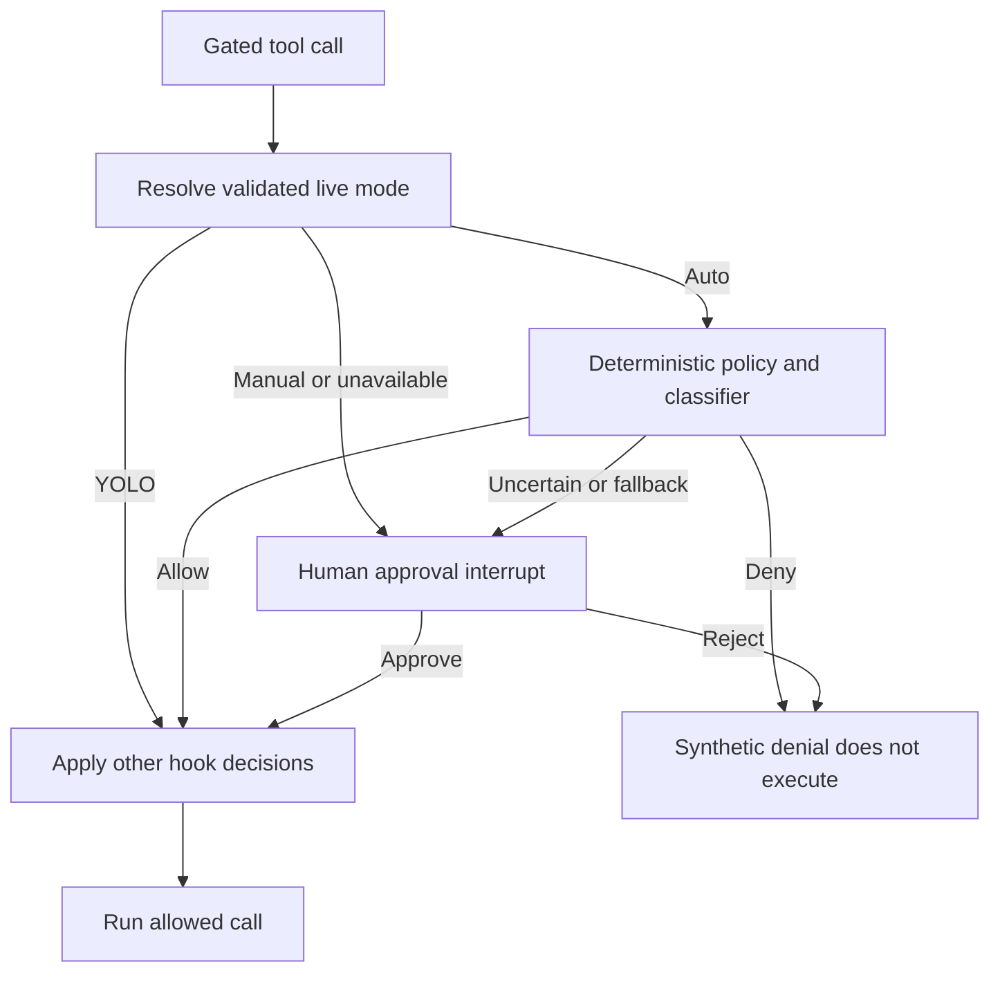
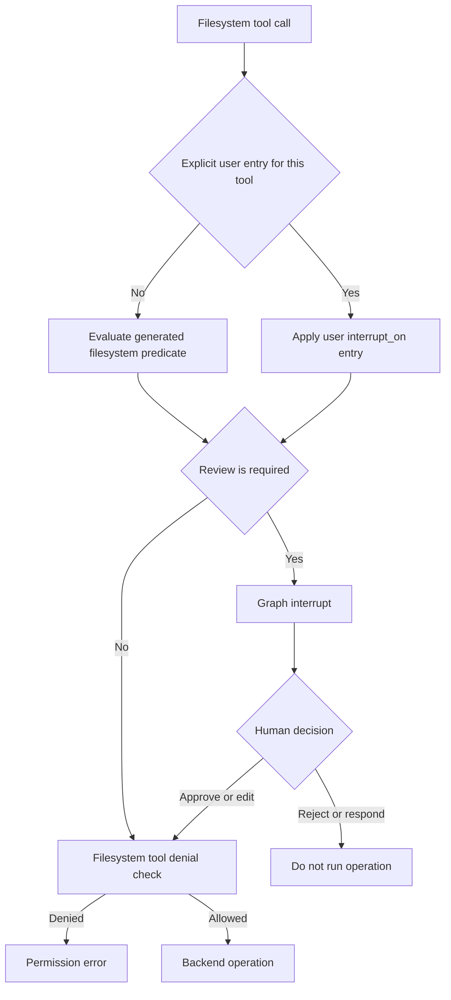
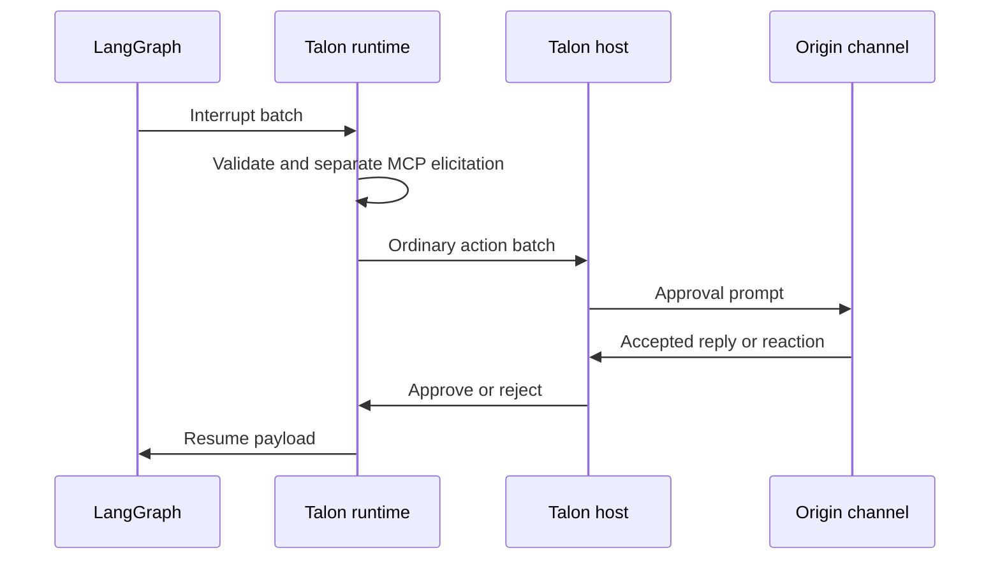

# Permissions and Human-in-the-Loop

Tool visibility, tool-level permission enforcement, a graph interrupt, a human decision, and backend containment answer different questions. A visible tool can deny one call; an allowed call can pause; and a human approval is neither an operating-system sandbox nor a durable authorization grant. See [filesystem tools](/openwiki/concepts/tools-filesystem.md), [middleware stack](/openwiki/architecture/middleware-stack.md), [subagents and skills](/openwiki/concepts/subagents-skills.md), and [security](/openwiki/operations/security.md).

> **Talon is experimental.** Talon is an alpha runtime, not a production or enterprise security boundary. It lacks complete production-grade HITL policy, channel-administrator controls, and multi-tenant isolation. Its opt-in sandbox does not cover MCP tools. Channel prompts and channel exposure are therefore not complete security boundaries; treat channel access as access to the agent, its credentials, MCP tools, and host resources.

## Choose the control that matches the need

| Need | Mechanism | It does not provide |
| --- | --- | --- |
| Hide a tool from the model and reject calls by that name | Harness profile `excluded_tools` | A sandbox or policy for direct backend use |
| Deny selected built-in filesystem operations | `FilesystemPermission(mode="deny")` | A human prompt or OS isolation |
| Pause selected SDK tool calls | `HumanInTheLoopMiddleware` / `interrupt_on` | A deny rule or durable authorization |
| Require a Talon decision for an exact tool name | `ToolApprovalStore` policy and Talon runtime | Tool availability, wildcard matching, or sandboxing |
| Select dcode interactive review behavior | Manual, classifier-backed Auto, or YOLO mode | A sandbox or an OS permission boundary |
| Restrict what code can do after a tool runs | A constrained tool/backend or sandbox | Protection supplied by a prompt or approval dialog |

Deep Agents follows a **trust-the-LLM** model: containment belongs in installed tools, backends, or sandboxes. HITL is opt-in and protects only calls routed through it. `StateBackend` has no shell execution; using `LocalShellBackend` is an explicit higher-power choice.

## dcode approval modes: session policy, not containment

The interactive dcode client has three approval modes. **Manual** pauses gated actions for a person. **Auto** applies deterministic checks and then a classifier to eligible gated actions, using human review when the policy requires it or falls back. **YOLO** bypasses dcode's approval review for calls not denied by another hook; it is deliberately unrestricted, not an assertion that filesystem, shell, network, MCP, or host effects are sandboxed.

The server, rather than an untrusted client mode value alone, resolves a live per-thread mode. The client writes a `mode` record under the `("deepagents_code", "approval_mode")` namespace keyed by the SHA-256 of the thread ID. Typed Auto and YOLO need a valid, thread-bound Store key and record. A malformed context, invalid key/value, missing Store, or failed read resolves to Manual; legacy `auto_approve=True` remains a compatibility route to YOLO. This makes loss of control state conservative rather than silently autonomous.

Caption: dcode selects review routing after a gated call is proposed; neither Auto nor YOLO replaces containment or an independent hook denial.

`AutoModeHITLMiddleware` replaces the stock HITL middleware by name and uses the same interrupt map as Manual, augmented with protected temporary-artifact operations. It validates positive finite classifier budgets, can use a separate lazily constructed classifier model, and keeps its decision plan and bounded classifier conversation in private state. The classifier must return exactly one indexed, schema-valid decision for every reviewed call before dcode binds results to tool-call IDs. Failures are not converted to allow: unavailable classifier batches receive error tool messages without execution, while invalid control/decision state routes to Manual approval. A broken configured classifier is latched so later batches escalate to human review rather than repeating silent denials; a successful review clears the latch.

### Auto and YOLO acknowledgement lifecycle

Auto is only selectable when eligible; for example, the interactive switcher omits it for a remote sandbox. Its first enablement shows an educational confirmation. Confirming records a versioned install-local notice, while Escape leaves the mode unchanged and leaves the notice unsaved for a later prompt. The notice explicitly says Auto can approve routine gated actions and is not a sandbox.

Entering YOLO from the switcher requires an explicit acknowledgement of the current warning policy version. The modal's Enter enables and records acknowledgement; `m` selects Manual and Escape preserves the previous mode, neither persisting it. The acknowledgement is stored in private `approval.json` state with a process lock and cross-process file lock, atomic replacement, and restrictive directory/file permissions where supported. Corrupt or unreadable state is treated as absent, so it re-prompts rather than authorizing YOLO. Muting the recurring YOLO toast is cosmetic: it does not bypass acknowledgement, the `startup.yolo_switcher` setting, or the active status indicator.

## Filesystem permissions: enforce at the tool boundary

A `FilesystemPermission` has read and/or write operations, absolute glob paths, and `allow`, `deny`, or `interrupt` mode. Paths must start with `/`; `..` is rejected and `~` is unsupported. Rules use declaration-order, first-match semantics, with `allow` when no rule matches.

`FilesystemMiddleware` enforces `deny` for its built-in filesystem tools before backend execution. With `FilesystemBackend`, including one behind a `CompositeBackend` route, it evaluates both the requested path and its symlink-resolved target; a denial on either blocks the call, and an unresolvable target produces an error rather than an access decision. Listing, globbing, and grep results remove entries denied by either form rather than exposing them. Permissions are tool middleware, **not** a backend-wide access-control layer: direct backend calls do not acquire these rules.

`delete` distinguishes a confirmed leaf from a directory or a target that may have descendants. A leaf uses ordinary first-match resolution. For a recursive or potentially recursive deletion, however, every deny-write pattern is considered: a pattern that could overlap the removed subtree blocks the operation even where a preceding broad allow would otherwise win. This preserves all-or-nothing deletion while still allowing a nonmatching sibling file glob.

There is an intentional execution boundary: a nonempty permission set is rejected when the backend supports command execution, because tool-level policy for `execute` is not implemented. The narrow exception is a `CompositeBackend` whose permission patterns are all scoped to configured route prefixes; that permits policy on those routed filesystem operations without representing it as a policy for the execution-capable default. Do not combine filesystem permissions with a shell-capable backend and assume that `execute` is constrained.

### Interrupt is routing, not enforcement

An `interrupt` rule does not deny access. During `create_deep_agent` assembly, filesystem interrupt rules are transformed into `HumanInTheLoopMiddleware` `interrupt_on` entries with per-call `when` predicates. A caller's explicit `interrupt_on` entry wins for the same tool name, so it can deliberately replace the generated filesystem routing; deny enforcement remains in `FilesystemMiddleware` either way.

Exact tools (`read_file`, `write_file`, and `edit_file`) resolve the requested path and, when available, its symlink target. They route only when an `interrupt` decision is present and neither candidate is denied, so a deny wins over review. Bulk tools (`ls`, `glob`, `grep`, and `delete`) compare their potential search or deletion subtree with the literal anchor of each applicable interrupt pattern; this intentionally errs toward review rather than attempting to enumerate all glob matches. A missing bulk path or current-directory alias is treated as the root. For `glob`, an absolute pattern is independently checked because it can ignore `path`, and a relative pattern containing `..` is treated as unlocalizable and routed to review. Invalid paths and malformed non-string arguments do not create a synthetic interrupt.

The graph passes the configured backend to these predicates, so symlink aliases can also route to review. Generated filesystem interrupts allow `approve`, `edit`, `reject`, and `respond`; approved and edited calls still re-enter the tool, where deny rules are checked. `reject` and `respond` do not execute the operation.

Caption: A user entry overrides generated routing by tool name; whether routed or not, an executed filesystem call reaches tool-level denial enforcement.

## Subagents: inheritance is explicit and type-dependent

For declarative `SubAgent` specifications, including experimental `mode="fork"`, omitted `permissions` inherits the parent list; a supplied list, including `[]`, replaces it completely. The graph constructs each declarative subagent with its own `FilesystemMiddleware` and builds filesystem-derived interrupt routing from that subagent's effective rules. The auto-added general-purpose subagent also uses the parent permissions.

Top-level `interrupt_on` is inherited by declarative subagents unless their specification supplies its own map. The effective map merges generated filesystem interrupts first and then user configuration, so the relevant user map takes precedence on name conflicts. `CompiledSubAgent` and remote `AsyncSubAgent` specifications instead pass through as already-built or separately deployed agents: they inherit neither the parent's filesystem permissions nor its top-level `interrupt_on`. Configure filesystem enforcement and approval behavior in the compiled or remote graph itself. Do not infer a common enforcement boundary merely because the parent delegates work.

A default declarative subagent is isolated and receives the delegated task rather than the parent conversation. Experimental `mode="fork"` continues the parent conversation and state, rebuilds prompt-producing middleware, appends the fork's prompt, and cannot define separate skills. It follows the same declarative permission and interrupt defaults above; fork mode is a context and composition decision, not a privilege reduction. Choose tools, permissions, and HITL for each subagent deliberately.

### Remote async children are autonomous approval domains

An `AsyncSubAgent` is different from a local declarative child: the parent launches a run on an Agent Protocol server, receives a task ID immediately, and tracks the remote thread/run in `async_tasks`. That child uses its own graph, system prompt, tools, runtime, permissions, and HITL configuration. `mode="fork"` only snapshots portable parent conversation content at launch; it does not synchronize settings or turn the remote runtime into an extension of the parent's policy boundary.

A remote task whose run finishes at `interrupt()` is reported as `waiting` by inspecting the remote thread. The parent can see the interrupt details through task status, but the task protocol explicitly requires that the user answer or approve the child directly; the parent agent cannot approve it. Updating a waiting task starts a new remote run with `multitask_strategy="interrupt"`, which drops its pending human request. Treat this as remote lifecycle control, not authority to resume a child approval.

## Profile exclusion is separate from permissions

A harness profile's `excluded_tools` appends `_ToolExclusionMiddleware` after tool-injecting middleware. It removes matching names from the model request and returns an unavailable-tool error if a tool call still names one. This is useful for controlling the model-facing capability set, but it is expressly not a security surface or a substitute for backend containment.

Profile `excluded_middleware` is a different mechanism again: it removes selected middleware instances by exact class or name. Core `FilesystemMiddleware` and `SubAgentMiddleware` are protected scaffolding and cannot be excluded; attempting to do so raises instead of producing a silently degraded graph. Consequently, do not use visibility exclusion as a claim that a path is denied, or use a filesystem rule as a claim that an arbitrary custom tool is unavailable.

## Talon approvals: persisted exact-name interrupt policy

Talon maintains an assistant-local `tools.json` map of exact tool names to booleans. Enabled entries generate approve/reject `interrupt_on` configuration; absent or false entries generate no prompt. Names are not patterns. When the file is first missing, the defaults enable `update_tool_approvals`, `delete_conversations`, `update_mcp_server`, `start_async_task`, and `send_message`; an existing valid file is retained.

This policy selects graph routing, not an ACL. Disabling a prompt neither exposes a tool nor authorizes it, and it does not contain the tool's effects. Policy self-edit remains separately protected: `update_tool_approvals` requires both active invocation policy context and operator context.

`ToolApprovalStore` validates a bounded regular, non-symlink JSON file and freezes its exact-name boolean policy in an `ApprovalSnapshot`; its revision hashes persisted bytes. Updates lock the file, validate the complete update, compare the expected revision, and atomically replace only on a match. The active snapshot is fixed for an invocation: runtime graph rebuilding and policy-management closures use the snapshot read at invocation start. Saved changes therefore take effect on a later invocation, while invalid saved policy prevents that invocation rather than silently retaining an old graph.

## From interruption to a channel decision

Talon validates unique nonempty resumable IDs before seeking approval. It cancels valid MCP elicitation separately, aggregates ordinary interrupted action requests into one `ToolApprovalRequest`, obtains one approve/reject decision, expands that decision into explicit resume payloads, and resumes the graph. Malformed batches and the 50-round ceiling fail rather than being implicitly resumed.

Caption: Talon makes one channel decision for ordinary actions while cancelling valid MCP elicitation separately.

The host holds one pending approval future per agent conversation and removes it after resolution. A known initiating sender is required for text reply approval; reaction approval additionally matches provider, conversation, prompt message, and sender. That binds a response to a pending prompt, not to general tool authorization.

Operator authority for policy changes is also separate from the approval handler. The host derives it from trusted channel exposure rather than inbound request metadata, and the runtime requires active invocation context. It clears this authority for cron and background delivery.

## Invocation context is scoped and cleaned up

At the start of each `DeepAgentRuntime.invoke`, Talon selects the invocation graph and immutable approval snapshot, derives the approval-operator flag from trusted request metadata, and installs request-scoped context for pending background results, cron origin, scheduled-turn status, OAuth authorization, and progress messages. The invocation's `finally` block resets every one of those context variables, including the graph and snapshot. A later request therefore cannot inherit an earlier request's approval policy, operator authority, authorization callback, scheduled status, or delivery state—even if the earlier graph call raises or is cancelled.

This scoping is important but narrow: it prevents accidental cross-turn context leakage inside the runtime; it does not turn metadata supplied outside the host into trusted authority. The host is responsible for deriving `tool_approval_operator` from trusted channel exposure and for clearing authorization records after a turn.

## Unattended and delegated work fails closed

For cron, background-result delivery, or requests without an approval handler, Talon rejects protected ordinary actions rather than waiting for an unavailable person; this holds even if a handler is injected for an unattended request. The host withholds interactive approval and OAuth paths for scheduled and background-result work. The runtime independently clears operator authority when metadata identifies cron or background delivery.

Detached background subagents clear operator and authorization context and report an interrupted protected action as not run. Cron-only inline delegation instead runs in its already unattended caller, disallows nested delegation, and cannot inherit an interactive approval or authorization handler. This fail-closed behavior applies to calls that the active policy routes through approval; it is not a blanket claim that every tool or integration is protected.

### Scheduled turns have explicit bounds

A scheduled job runs under a per-job conversation lock, so two fires of the same job do not overlap. Each fire receives a fresh cron thread ID and is bounded to 1,800 seconds. On timeout, the host asks the runtime to repair the interrupted thread and re-raises the timeout; the next fire uses a new thread rather than resuming the timed-out one. This limit protects the sequential scheduler from one indefinitely running job, but it is a liveness bound rather than a permission control.

Within a scheduled turn, delegation is inline rather than detached: it waits for the result, marks the subagent context to prevent nested delegation, and has its own bounded concurrency slots and per-delegation deadline. Parallel delegations from one assistant message can run concurrently up to that slot limit; additional work queues rather than escaping into the background job table. Do not expect a later background-delivery turn to provide an approval or OAuth interaction for this work.

## Operating and testing safely

- Treat tool visibility, permission denial, interrupt routing, dcode mode selection, channel approval, operator authority, and sandbox/backend containment as independent layers.
- For dcode, regard failure to persist or resolve a typed Auto/YOLO mode as a safety event: it should leave the session in Manual rather than be worked around by client-side state. Test mode-key binding, corrupt Store records, classifier schema coverage, unavailable-classifier denial, and Manual escalation.
- Require deliberate local configuration for every declarative child, and deploy filesystem/HITL policy independently on every remote async child. A parent task ID is observability and lifecycle control, not approval authority.
- Give interrupt rules literal leading anchors where possible. Broad patterns such as `/**/secrets` intentionally over-interrupt bulk tools.
- Review every declarative subagent's replacement `permissions` and `interrupt_on`; configure compiled and remote agents independently.
- Use exact names and the revision from `get_tool_approvals` when changing Talon policy. Expect a new invocation before saved changes apply.
- Keep Talon approval UIs batch-oriented and validate interrupt IDs and actions before calling an external handler. Do not treat a channel decision as an identity or authorization system.
- Focus regression coverage on `test_permissions.py` for first-match decisions, confirmed-leaf versus recursive deletion, symlink target enforcement, bulk/glob routing bypasses, and inheritance behavior. Use `test_filesystem_backend.py` to cover the backend's virtual-root and symlink-containment behavior separately; permission middleware does not turn backend path handling into a sandbox.
- Cover Talon policy validation, snapshots, batch fan-out, unattended rejection, trusted sender handling, reaction matching, and request-context reset in its tool-approval and host authorization tests.
- In `test_host.py`, exercise scheduled timeout repair and same-job serialization. In `test_background.py`, cover inline scheduled delegation, its nested-delegation guard, fan-out, slot queueing, and deadline behavior.
